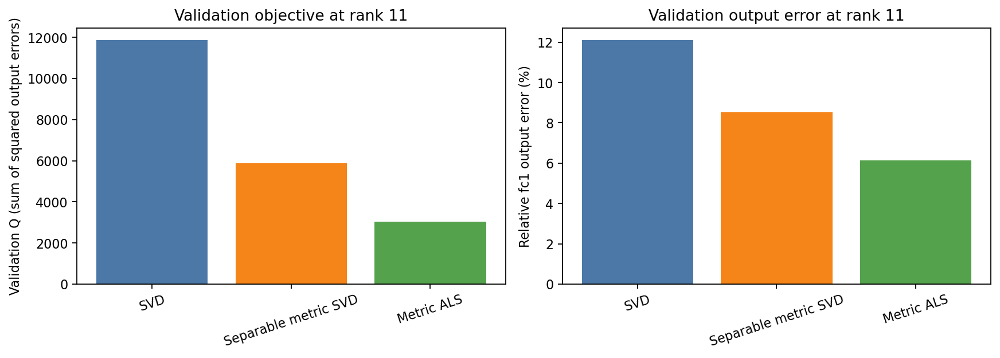
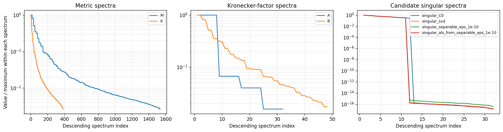
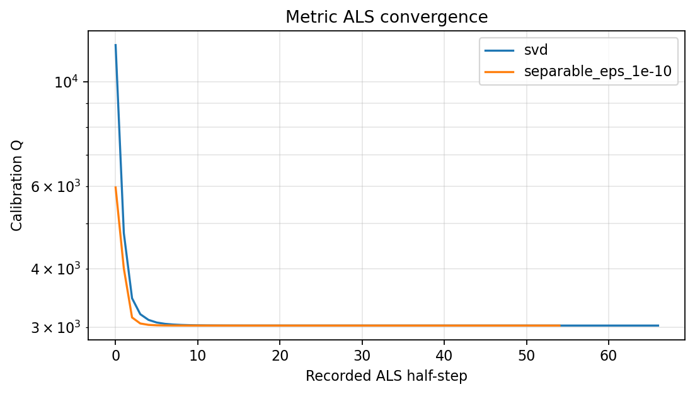

# データ計量付きTT bond切り詰めとALS

## このノートの目的

TT・MPSの隣接2コアを結合して更新した後、通常SVDでbond rankを切ると、結合テンソルのFrobenius誤差は最小になる。しかし、ニューラルネットワークで重要なのは、重みそのものの誤差ではなく、実入力に対する層出力やlossの変化である。

本ノートでは、次を一般論として整理する。

1. 2-coreの変更が出力誤差の二次形式になる理由
2. 通常SVDが最適になる計量
3. 分離計量を白色化してSVDする方法
4. 一般計量をクロネッカー積へ近似する方法
5. 固定rank ALSで本来の計量を直接最小化する方法
6. 正準形のノルム計量とデータ計量の違い
7. DMRG-like 2-core更新へ接続するときの注意
8. 半正定値・非分離計量の扱いと、分離度の解釈限界
9. activation・Fisher・MALS・Tensor Ring切り詰めとの先行研究上の関係

Fashion-MNISTでの実測値は[[40_TT_MPS_NN圧縮/10_FashionMNIST_MLP/22_計量を考慮したbond切り詰め診断]]へ分ける。

---

## 1. 2-core結合テンソル

隣接するTT coresを結合し、適切に行列化したものを、

$$
C_0\in\mathbb{R}^{p\times q}
$$

とする。切り詰め後の行列を$C$、目標bond rankを$r$とすると、

$$
\operatorname{rank}(C)\le r
$$

を満たす$C$を探す問題になる。

通常のTT-roundingでは、

$$
\min_{\operatorname{rank}(C)\le r}
\left\|C-C_0\right\|_F^2
$$

を解く。Eckart–Young–Mirskyの定理により、$C_0$のSVDをrank $r$で切ったものが大域最適解である。

これは、各要素方向を同じ重さで測るユークリッド計量に対する最適性である。

---

## 2. 実データ上の出力誤差

他のTT coresを固定すると、結合2-core $C$から層出力への写像は線形になる。sample $s$に対する線形写像を$H_s$とすれば、

$$
z_s(C)-z_s(C_0)
=
H_s\operatorname{vec}(C-C_0)
$$

である。

$\Delta c=\operatorname{vec}(C-C_0)$と置くと、出力二乗誤差は、

$$
\begin{aligned}
Q(C)
&=
\sum_s
\left\|z_s(C)-z_s(C_0)\right\|_2^2\\
&=
\sum_s
\left\|H_s\Delta c\right\|_2^2\\
&=
\Delta c^\top
\left(\sum_sH_s^\top H_s\right)
\Delta c.
\end{aligned}
$$

したがって、

$$
M=\sum_sH_s^\top H_s
$$

と定義すれば、

$$
Q(C)=\Delta c^\top M\Delta c
$$

となる。$M$は、入力データと固定coreが決める局所計量である。

平均二乗誤差にしたい場合は$M$をsample数で割ればよい。最適解は定数倍で変わらないが、$Q$の絶対値は変わる。

---

## 3. 正準形の計量とデータ計量は違う

MPS・TTの正準形では、左右環境が等長写像になり、全テンソルのFrobeniusノルム変化を局所テンソルのFrobeniusノルムで測れる場合がある。

しかし、ニューラルネットワークで見る出力誤差は、入力$x_s$を通した、

$$
\Delta z_s=\Delta W x_s
$$

である。入力共分散、

$$
S_x=\sum_s x_s x_s^\top
$$

が入るため、core鎖が正準化されていても、データ計量$M$が単位行列になるとは限らない。

区別すべきものは次である。

| 評価対象 | 局所計量 |
|---|---|
| TT・MPS全体のFrobeniusノルム | 正準形により$I$となり得る |
| 実入力に対する層出力誤差 | 入力分布を含み、一般には$M\ne I$ |

正準化はデータのwhiteningではない。

---

## 4. 通常SVDが最適になる条件

$M=I$なら、

$$
Q(C)=\left\|C-C_0\right\|_F^2
$$

であり、通常SVDのrank $r$切り詰めが$Q$についても大域最適になる。

$M\ne I$では、通常SVDは重み誤差には最適でも、データ上の出力誤差には最適とは限らない。

特に、入力が頻繁に励起する方向の誤差は大きく、ほとんど使わない方向の誤差は小さく評価される。通常SVDはこの違いを見ない。

### 4.1 Frobenius誤差と計量付き誤差が比例する条件

すべての変化方向$\Delta c$について、

$$
\Delta c^\top M\Delta c
=
\alpha\|\Delta c\|_2^2
$$

が成り立つなら、対称行列の二次形式の一意性から、

$$
M=\alpha I
$$

である。逆も明らかに成り立つ。

したがって、「どの方向の誤差もFrobenius誤差と同じ比率で測られる」という意味で二つの計量が一致する必要十分条件は$M=\alpha I$である。$\alpha>0$は目的値全体の定数倍なので、最小解を変えない。

ただし、ある特定の$C_0$とrank $r$について、通常SVD解と計量付き最適解が偶然一致するために$M=\alpha I$である必要はない。計量が異なっても、その問題の支配方向が一致すれば同じ解を選ぶことがある。

次はFashion-MNISTの一つのbondで、同じrank 11に切った保存済み実測例である。通常SVDよりもデータ計量を使う方式のほうが、実入力上の出力誤差を小さくした。ただし、これは一つのbond・rank条件の結果である。

---

## 5. 小さい数値例

rank 1へ切る例を考える。

$$
C_0=
\begin{pmatrix}
2&0\\
0&1
\end{pmatrix}
$$

### 5.1 通常SVD

特異値は2と1なので、通常SVDは大きい成分2を残す。

$$
C_{\mathrm{SVD}}=
\begin{pmatrix}
2&0\\
0&0
\end{pmatrix}
$$

捨てたFrobenius誤差は、

$$
\left\|C_{\mathrm{SVD}}-C_0\right\|_F^2=1
$$

である。

### 5.2 第2行を9倍重くする

行側の計量を、

$$
A=
\begin{pmatrix}
1&0\\
0&9
\end{pmatrix},
\qquad
B=I
$$

とする。通常SVD解の計量付き誤差は、

$$
Q(C_{\mathrm{SVD}})
=
\left\|A^{1/2}(C_{\mathrm{SVD}}-C_0)B^{1/2}\right\|_F^2
=9
$$

である。

一方、小さい特異値側を残す、

$$
C_{\mathrm{metric}}=
\begin{pmatrix}
0&0\\
0&1
\end{pmatrix}
$$

では、

$$
Q(C_{\mathrm{metric}})=4
$$

となる。

通常SVDは重みとして大きい成分を残したが、データ計量では小さい成分の方が重要だった。この例が、重みSVDとデータ上の出力誤差最小化が異なる最も単純な場合である。

---

## 6. 分離計量SVD

### 6.1 分離できる計量

行列$C$の行側計量を$A$、列側計量を$B$とし、row-majorの`vec`規約で、

$$
M=A\otimes B
$$

と書けるとする。このとき、

$$
Q(C)
=
\left\|A^{1/2}(C-C_0)B^{1/2}\right\|_F^2
$$

となる。

標準的なcolumn-majorの`vec`規約ではクロネッカー積の順番が$B\otimes A$になる。式を実装するときは、`reshape`・`vec`規約と小さい既知例で必ず照合する。

### 6.2 白色化

変数を、

$$
\widetilde C=A^{1/2}CB^{1/2}
$$

へ変換すると、

$$
Q(C)
=
\left\|\widetilde C-\widetilde C_0\right\|_F^2
$$

になる。

$A$と$B$が可逆なら、左右からの可逆変換はrankを保存する。

$$
\operatorname{rank}(\widetilde C)
=
\operatorname{rank}(C)
$$

したがって、

$$
\min_{\operatorname{rank}(C)\le r}Q(C)
$$

は、

$$
\min_{\operatorname{rank}(\widetilde C)\le r}
\left\|\widetilde C-\widetilde C_0\right\|_F^2
$$

へ変わる。後者を通常SVDで解き、

$$
C_*=A^{-1/2}\widetilde C_*B^{-1/2}
$$

と戻せば、元の分離計量付き問題の大域最適解になる。

「元の倍率へ戻す」操作は、SVDで捨てた成分を復元する操作ではない。rankは$r$以下のままである。

---

## 7. 一般計量のクロネッカー近似

一般の$M$は$A\otimes B$へ分離できない。そこで、

$$
\min_{A,B}
\left\|M-A\otimes B\right\|_F
$$

を解き、近似した分離計量で前節のSVDを行う。

### 7.1 並べ替え

$M$をブロックごとに並べ替える演算を$R$とすると、

$$
R(A\otimes B)
=
\operatorname{vec}(A)
\operatorname{vec}(B)^\top
$$

となる。右辺はrank 1行列である。

並べ替えは全要素のFrobeniusノルムを保つため、

$$
\left\|M-A\otimes B\right\|_F
=
\left\|
R(M)-
\operatorname{vec}(A)
\operatorname{vec}(B)^\top
\right\|_F
$$

である。

したがって、$R(M)$のrank 1 SVD近似から$A$と$B$を求められる。

ここでrank 1なのは並べ替えた計量の近似rankであり、圧縮対象$C$のbond rankとは別である。

### 7.2 近似誤差の意味

相対誤差を、

$$
\epsilon_{\mathrm{kron}}
=
\frac{\left\|M-A\otimes B\right\|_F}{\left\|M\right\|_F}
$$

とする。

$\epsilon_{\mathrm{kron}}$は計量全体に対する平均的なFrobenius残差である。ある特定の$\Delta C$に対する$Q$の誤差率を直接決めない。重要方向で近似がずれていれば$Q$は大きく変わり、そうでなければ影響は小さい。

残差の二乗エネルギー比は$\epsilon_{\mathrm{kron}}^2$であり、ノルム比と区別する。

### 7.3 分離度と圧縮しやすさは別である

$R(M)$の特異値を、

$$
s_1\ge s_2\ge\cdots\ge0
$$

とする。最近接rank 1 Kronecker近似が説明できない二乗エネルギー比を、

$$
\eta
=
1-
\frac{s_1^2}{\sum_j s_j^2}
$$

と定義できる。$\eta=0$なら$M$は一つのKronecker積で厳密に表せる。

しかし、$\eta$が小さいことは、低rankで圧縮しやすいことを意味しない。反例として、

$$
M=I_L\otimes I_R
$$

では$\eta=0$だが、計量は元のユークリッド計量であり、$C_0$の特異値減衰を速くしない。

区別する仮説は、

1. 計量を分離形式で近似しやすい。
2. その計量を使うと、小さいbond rankでtask上重要な方向を保ちやすい。

である。1から2は自動では導けない。

近似計量を$M_\otimes=A\otimes B$とすると、特定の誤差方向$\Delta c$について、

$$
\left|
\Delta c^\top(M-M_\otimes)\Delta c
\right|
\le
\|M-M_\otimes\|_2
\|\Delta c\|_2^2
$$

である。Frobenius近似誤差や$\eta$だけでなく、実際の$\Delta c$が近似残差のどの方向を向くかも必要になる。

### 7.4 一つのcutとTT全体を区別する

$M=A\otimes B$として白色化SVDを使えるという議論は、指定した一つのcutでのrank制約付き行列近似に対するものである。

一つのcutで分離できても、$A$や$B$が左・右block内部の別cutをまたいでmodeを混ぜる場合がある。したがって、

- そのcutのrankが保存される。
- TTの全bond rankが保存される。
- 複数cutを順に切っても誤差二乗和が成り立つ。

は別の主張である。

また、非分離計量で言えるのは、通常の白色化・SVD・逆変換で所望cut rankを保存する一般保証がない、ということまでである。特定の$C_0$や特定の解でrankが偶然保存される可能性は残る。「非分離なら必ずrankが増える」とは言わない。

Fashion-MNISTの実測例で保存された計量・係数行列のspectrumは次である。各spectrumをそれぞれの最大値で1へ正規化しているため、絶対スケールではなく形の比較である。

---

## 8. 固有値floorと逆平方根

$A^{-1/2}$と$B^{-1/2}$を計算するには、小さい固有値が問題になる。最大固有値を$\lambda_{\max}$とし、

$$
\lambda_i^{\mathrm{floor}}
=
\max\left(\lambda_i,\varepsilon\lambda_{\max}\right)
$$

とすれば、逆平方根の発散を防げる。

$\varepsilon$は計量$A,B$を求めるためではなく、求めた$A,B$で白色化・逆白色化するための数値保護である。

異なる$\varepsilon$で同じ結果になっても、floor対象の固有値が0個なら、悪条件での頑健性を試したことにはならない。

### 8.1 半正定値・特異な計量

$M$、$A$、$B$はデータから作るGram行列なので、正定値ではなく半正定値になる場合がある。固有値0の方向は、calibrationデータ上では出力誤差へ寄与しない方向である。

この場合、通常の逆平方根は存在しない。選択肢は、

1. 非零固有値が張る観測部分空間へ制限する。
2. Moore–Penrose疑似逆を使う。
3. $A+\varepsilon I$、$B+\varepsilon I$として正則化する。

である。

ただし、正則化は数値計算だけでなく目的関数も変える。

$$
Q_\varepsilon(C)
\ne
Q(C)
$$

が一般に成り立つため、最終比較は正則化前の元の$Q$でも行う。観測部分空間へ制限しても、rank制約と部分空間射影が可換とは限らず、元問題の大域最適性が自動で得られるわけではない。

---

## 9. 固定rank ALS

一般の$M$に対する、

$$
\min_{\operatorname{rank}(C)\le r}
(\operatorname{vec}(C-C_0))^\top
M
\operatorname{vec}(C-C_0)
$$

には、通常SVDのような一般的な閉形式解がない。

そこで、

$$
C=UV^\top,
\qquad
U\in\mathbb{R}^{p\times r},
\quad
V\in\mathbb{R}^{q\times r}
$$

と置く。これによりrank制約は常に満たされる。

### 9.1 片側更新

$U$を固定すれば、$C=UV^\top$は$V$について線形であり、$Q$は$V$について二次関数になる。$V$を固定した$U$更新も同様である。

ALSは、

1. $U$を固定して$V$を最小二乗更新する。
2. $V$を固定して$U$を最小二乗更新する。
3. 目的値の減少が小さくなるまで繰り返す。

という方法である。

### 9.2 保証と限界

各片側更新は、その片側について最適である。そのため、正確に解ければ目的値は非増加になる。

しかし、$U$と$V$を同時に見ると非凸である。したがって、

- 初期値に依存し得る。
- 異なる停留点や鞍点へ到達し得る。
- 大域最適性を保証しない。
- 複数初期値が同じ目的値へ到達しても証明にはならない。

という限界がある。

通常SVD解や分離計量SVD解は、ALSの初期値として利用できる。

Fashion-MNISTの実測例では、通常SVD解と分離計量SVD解のどちらから始めても目的値は単調非増加に低下し、数値的に同等の目的値へ到達した。ただし、これは大域最適性の証明ではない。

---

## 10. rank制約付き目的値の下界

$M$が正定値で、最小固有値を$\lambda_{\min}>0$とする。任意の$\Delta c$について、

$$
\Delta c^\top M\Delta c
\ge
\lambda_{\min}\left\|\Delta c\right\|_2^2
$$

である。

また、Eckart–Young–Mirskyの定理から、rank $r$以下の行列による最小Frobenius誤差は、

$$
\min_{\operatorname{rank}(C)\le r}
\left\|C-C_0\right\|_F^2
=
\sum_{j>r}\sigma_j(C_0)^2
$$

である。

したがって、

$$
Q(C)
\ge
\lambda_{\min}
\sum_{j>r}\sigma_j(C_0)^2
$$

が、全rank $r$候補に対する下界になる。

ただし、これは一般に緩い。下界へ到達できるとは限らず、ALSの大域最適性を確認する値でもない。

---

## 11. $K\otimes I_{\mathrm{output}}$の構造

多出力線形写像では、出力成分ごとに同じ入力側Gram行列が現れるため、座標順序を整理すると、

$$
M=K\otimes I_{\mathrm{output}}
$$

の形になる場合がある。

$I_{\mathrm{output}}$は行側出力modeと列側出力modeへ分けられるので、分離を妨げる本体は$K$である。$K$が2-core行列の行側自由度と列側自由度へ、

$$
K=K_L\otimes K_R
$$

と分離できれば、$M$も分離できる。

物理の言葉では、行側と列側を二分割したときの演算子Schmidt rankが1であることに対応する。rankが1より大きければ、左側の変化の重要度が右側の変化と相互作用する。

このSchmidt spectrumから作る$\eta$は、データ二次モーメントまたは局所計量を演算子と見たときの、cutをまたぐ演算子エンタングルメントの一指標と解釈できる。ただし、前節のとおり、演算子エンタングルメントが小さいことと、圧縮対象$C_0$の特異値が速く減衰することは別である。

この構造は、出力脚が単位行列だから$M=I$になるという意味ではない。入力側の$K$は一般に非自明である。

task lossの局所二次近似では、FisherやGauss–Newton行列をK-FAC型に、

$$
F\approx A\otimes G
$$

と分けることがある。$A$は入力activation側、$G$は出力gradient側の因子である。行列層全体では分離的でも、TTの指定cutで使うには、$A$と$G$がさらにそのcutの左右modeへ適合して分離できる必要がある。行列rankを保存する白色化が、そのままTTの全bond rankを保存するわけではない。

---

## 12. DMRG-like 2-core更新への接続

2-site DMRG・MALS型の更新では、

1. 隣接2コアを結合する。
2. 局所目的関数を下げる。
3. SVDで2コアへ再分割する。
4. bond rankを制限する。

という処理を行う。

ここで局所更新が最小化する目的と、通常SVDが最小化するFrobenius誤差は異なる可能性がある。SVD再分割により、更新で得た改善の一部を失うことがある。

計量付き切り詰めは、再分割でも局所目的に近い方向を残そうとする方法である。

ただし、次を分ける必要がある。

- 学習済み固定モデルを事後的に切る診断
- 2-core局所更新直後のsupercoreを切る実学習

前者で有効でも、後者の改善率を直接保証しない。更新直後のsupercore、局所勾配、他parameterの共同更新によって計量と重要方向が変わるためである。

---

## 13. 近接研究との位置づけ

データや環境に基づく重み付きTT圧縮には複数の近接研究がある。次の三つを混同しない。

1. データ・Fisherで重み付けしてから学習済みweightをTT分解する。
2. データを使って2-site更新し、その後に通常SVDで切る。
3. 2-site切り詰めの損失を局所計量で測り、分離計量SVDや全計量ALSで改善する。

### 13.1 AWT

Beatini、Maronese、Rodolàによる“Activation-Aware Weight Tensorization: A Calibration-Time Preconditioner for Tensor-Network LLM Compression”（2026、[arXiv:2610.10085](https://arxiv.org/abs/2610.10085)）は、入力活性化のMeanAbsまたは標準偏差から対角スケール$D_\alpha$を作り、

$$
W'=WD_\alpha
$$

へ既存のTT・TTN分解を適用する事後圧縮である。これは活性化統計に基づく対角前処理であり、full input covarianceによる厳密白色化ではない。

層全体の目的は、

$$
\|(W-\widehat W)D_\alpha\|_F^2
$$

と書けるが、局所2-core計量が行側と列側へ分離することを保証しない。2-site更新直後の切り詰め損失や全計量ALSを扱う方法ではない。

### 13.2 FWTTM

Pletenevらの“A Computational Study of Matrix Decomposition Methods for Compression of Pre-trained Transformers”（PACLIC 2023、[ACL Anthology](https://aclanthology.org/2023.paclic-1.73/)）に含まれるFWTTMは、各weightの勾配二乗からFisher重要度を近似し、行方向へ集約した対角スケールを使ってから通常TTM分解を行う。

要素ごとの理想目的、

$$
\|\sqrt F\odot(W-\widehat W)\|_F^2
$$

と、実装で使う行集約後の前処理は同一ではない。また、式に$\sqrt F$が現れることを理由に、実際の前処理を勝手に平方根Fisher白色化へ読み替えない。

FWTTMも学習済みweightの事後分解であり、DMRG・MALS反復内の2-core切り詰めではない。

### 13.3 Stoudenmire–Schwab

StoudenmireとSchwabの“Supervised Learning with Tensor Networks”（NeurIPS 2016、[原典PDF](https://proceedings.neurips.cc/paper_files/paper/2016/file/5314b9674c86e3f9d1ba25ef9bb32895-Paper.pdf)）は、隣接coreを結合してデータ損失の勾配で更新し、直後に通常SVDで2コアへ戻す。

データは局所更新に使うが、切り詰め自体は更新後bond tensorのユークリッドSVDである。canonical gaugeで全体Tensorのノルム近似が最適になることと、学習データ上のlossに対して最適になることは別である。

### 13.4 BatselierらのMALS

Batselier、Chen、Wongの“Tensor Network alternating linear scheme for MIMO Volterra system identification”（Automatica 2017、[arXiv:1607.00127](https://arxiv.org/abs/1607.00127)）は、局所設計行列による2-core最小二乗を解いた後、supercoreへ通常SVDを行ってrankを選ぶ。

局所設計行列を$D_k$とすれば、そのデータ計量は、

$$
M_{\mathrm{eff}}=D_k^\top D_k
$$

である。しかし、Algorithm中の切り詰めで$M_{\mathrm{eff}}$を使った白色化や全計量ALSを行うわけではない。

### 13.5 KhoshnanらのTruncation Loss

Khoshnan、Petritsch、Bagleyの“Efficient Approximation of Volterra Series for High-Dimensional Systems”（2025、[arXiv:2511.06527](https://arxiv.org/abs/2511.06527)）は、最小二乗更新後のSVD切り詰めによる悪化を、局所設計行列を通した`Truncation Loss`として明示する。

局所更新量と切り詰め後更新量の差を$e$、局所設計行列を$A_{0,(i)}$とすれば、

$$
\operatorname{TruncationLoss}
=
e^\top A_{0,(i)}^\top A_{0,(i)}e
$$

である。単なる係数Frobeniusノルムではなく、データ出力空間で切り詰め損失を測る点が本ノートの問いと直接重なる。一方、NN圧縮、$K\otimes I_{\mathrm{output}}$の構造、分離計量SVD対全計量ALSは別である。

### 13.6 Jeanninらの分離計量SVDと全計量ALS

Jeannin、Chessari、von Delftの“Efficient Optimization of Tensor Rings with Low-Rank Environments”（2026、[arXiv:2610.10027](https://arxiv.org/abs/2610.10027)）は、Tensor Ringの非自明な局所環境計量について、分離計量による変換後SVDと、全計量を保持するALS切り詰めを扱う。

計量の由来は入力データやFisherではなく物理Tensor Ringの環境だが、

$$
\text{非分離な局所計量}
\rightarrow
\text{分離近似によるSVD}
\rightarrow
\text{全計量ALS}
$$

というアルゴリズム構造は本ノートと近い。したがって、一般の局所計量付き切り詰めやALS自体を新規な発想とは扱えない。

### 13.7 文献ごとの比較範囲

| 文献 | 計量・重み | rankを切る時点と方法 | 実験・評価 | 本ノートと重ならない点 |
|---|---|---|---|---|
| AWT | 入力活性化のMeanAbsまたは標準偏差による対角$D_\alpha$ | 学習済み層の事後圧縮。$WD_\alpha$へ既存TT・TTN分解。予算に合うrank構成を走査 | Llama 3.1 8B、Ministral 8B、Qwen2.5 7B。相対出力誤差、重み誤差、perplexity、下流accuracy | 2-site更新直後の損失、局所計量の非分離性、全計量ALSは扱わない |
| FWTTM | 勾配二乗による要素Fisherを行方向へ集約した対角スケール | 学習済みweightの事後TTM。目標圧縮率からrankを指定 | BERT、BART。GLUE、XSUM、ParaDetox、推論時間・電力・memory | full Fisherを保持せず、DMRG・MALS内の局所切り詰めではない |
| Stoudenmire–Schwab | データ二乗損失を2-site勾配更新に使用 | 更新直後に通常SVD。最大bond dimensionと特異値閾値を使用 | 14×14 MNIST。bond dimensionと分類誤差。最大$m=120$でtest error 0.97% | データ計量による切り詰めや、切り詰め単独のloss増分は扱わない |
| Batselierら | 局所設計行列$D_k$による最小二乗 | supercore最小二乗後に通常SVD。機械精度ベースの閾値でrank選択 | 人工Volterra系、double balanced mixer。残差と計算時間 | $D_k^\top D_k$による白色化・全計量ALSは行わない |
| Khoshnanら | 局所設計行列を通した出力空間のTruncation Loss | MVMALS更新後のSVD切り詰め損失を定量化 | Volterra series。理論中心で実証は今後の課題と記載 | NN圧縮、出力脚構造、分離計量SVD対ALSは扱わない |
| Jeanninら | Tensor Ringの局所環境計量 | 分離計量で変換後SVD、非分離な全計量ではALS | 物理Tensor Ring・XXZ。ungauged SVD等との切り詰め比較 | 計量の由来が入力データ・Fisherではない |

原典上の主な確認箇所は、AWT §§3–4・Algorithm 1、FWTTM §§3.3–3.4、Stoudenmire–Schwab §4、Batselierら §4.2・Algorithm 2、Khoshnanら Appendix A.2、Jeanninら §IIIである。Jeanninらについては、元の調査時点で§III.3以降の詳細式と対応図番号を完全には確認できていないため、未確認部分を補って断定しない。

### 13.8 研究上の差分を述べるときの限界

既存研究との比較から残る問いは、単なる「activation-aware TT」や「SVD後にALS」ではない。より限定した問いは、

> 学習済みNN層またはNNの2-core局所更新について、局所計量の出力脚の単位行列構造を導出し、残る入力・bond側計量$K$の左右非分離性と、切り詰めによるtask目的悪化・切り詰め方式の差を結び付けられるか。

である。

これは差分候補であり、網羅的な新規性の保証ではない。Tensor Ring、weighted low-rank approximation、Fisher・activation-aware圧縮、MALSの文献を追加確認する必要がある。

### 13.9 補足調査で挙がったが、確認範囲が限定された文献候補

補足会話では、次の関連研究も候補に挙がった。

- MarkovskyとVan Huffelの2007年のweighted low-rank approximation：Kronecker分離した左右計量なら、平方根変換とSVDで解ける行列版の既存結果として参照された。
- PRGDと呼ばれたmode分離計量の研究：補足会話ではTT側の近接研究として挙がったが、対象論文の書誌と定理の範囲を固定できていないため、確認済み根拠には使わない。
- GFWSVD（Chekalinaら、2025）：FisherをKronecker因子で近似して行列SVDへ使う研究として参照された。
- “Mind the Approximation”（Thomaら、2026）：FisherのKronecker近似構造と圧縮性能の関係、および計量近似の忠実度とtask性能が一致しない警告として参照された。
- “Rethinking the Role of Tensor Decompositions…”（Zagitovら、2026）：限定されたLLM・圧縮条件でTT・Tuckerと行列法を比較した実験研究として参照された。
- TTによるstructured covariance estimation：非分離な入力二次モーメントをKronecker積の和・低bond TTとして近似する道具の候補として挙がった。

これらは元の補足調査で、abstract、検索本文、または本文の一部までしか確認できていないものを含む。したがって、本ノートでは確定した新規性や定理の根拠には使わない。

特に、“Rethinking the Role…”の実験結果を「TTが行列法に勝てない定理」と読み替えない。誤差比の上界が大きいことも、実際の誤差比が必ず大きいことを意味しない。また、計量近似が正確でもtask性能が高いとは限らないという警告は、$\eta$の解釈にも適用する。

---

## 14. 出力誤差と分類性能

$Q$は対象層の出力誤差を測る。後段にReLUや複数層がある場合、

$$
Q\text{が小さい}
\quad\not\Rightarrow\quad
\text{accuracy低下が一定割合で小さい}
$$

である。

出力誤差の方向、ReLUの符号反転、後段weight、classification marginが影響する。分類性能を主張するには、少なくとも同一sample上で、

- cross-entropy
- accuracy
- logits差
- prediction変更数
- margin変化

を別に測る必要がある。

一方、切り詰め機構そのものを調べる診断では、分類評価を必須とせず、$Q$を直接比較する設計にも意味がある。

---

## 15. 実装・解釈上のチェックリスト

### 計量の実装

- `vec`のrow-major・column-major規約を固定する。
- 小さい$A\otimes B$の既知例で二次形式を照合する。
- $M$の二次形式と実際のforward差分を照合する。
- calibrationとvalidationを分離する。
- $Q$が総和か平均かを明記する。

### 分離計量SVD

- $A$と$B$が対称か確認する。
- 固有値、条件数、floor適用数を保存する。
- クロネッカー近似誤差を保存する。
- 近似計量での最適性と本来の計量での最適性を区別する。

### ALS

- 複数初期値を使う。
- 各half-stepの目的値を保存する。
- 目的値増加を検出する。
- 正規方程式の固有値と`rcond`による切り捨て数を保存する。
- 同じ目的値を同一行列・大域最適とみなさない。

### 比較

- 全候補を同じtarget rankで比較する。
- 計量構築時間とsolver時間を分ける。
- 下界を最適値とみなさない。
- 出力誤差と分類性能を分ける。
- 事後切り詰めと学習中切り詰めを分ける。
- 先行研究が使う計量の由来、rankを切る時点、切り詰め方法を分ける。
- 層全体の計量が分離的でも、局所2-core計量が分離的とは限らない。
- 既存手法の式を平方根白色化などへ読み替えない。

---

## 16. まとめ

通常SVDは、2-core結合行列のFrobenius誤差を最小化する。しかし、実入力に対する出力誤差は、

$$
Q(C)=\operatorname{vec}(C-C_0)^\top M\operatorname{vec}(C-C_0)
$$

というデータ依存計量で測られるため、$M\ne I$では最適な切り方が変わる。

$M=A\otimes B$へ分離できれば、白色化、通常SVD、逆白色化により大域最適解を閉形式で求められる。分離できない場合はクロネッカー近似が安価な近似法になり、本来の$M$を直接使う固定rank ALSはより柔軟だが、大域最適保証を持たない。

DMRG-like 2-core学習へ応用するときの中心問題は、局所更新で下げた目的関数と、SVD再分割が最小化するユークリッド誤差の不一致である。計量付き切り詰めは、この不一致を診断し、同じbond rankのまま更新効果をより多く残すための枠組みである。
