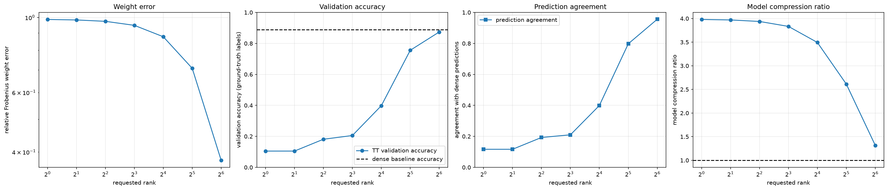
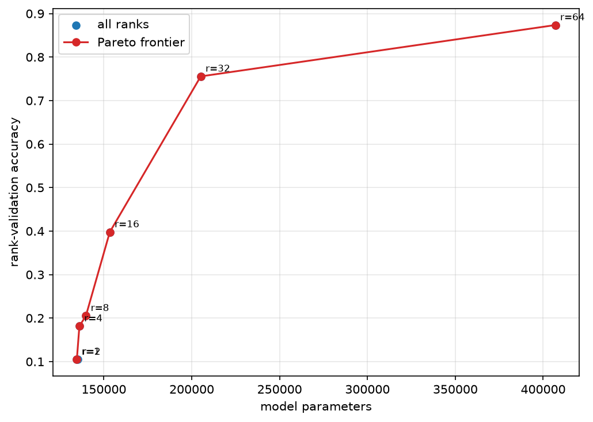

# Fashion-MNIST MLPのfc1 TT-rank sweep

## このノートの位置づけ

このノートは、Notebook 08に保存された実装・結果と、その結果について行った考察を整理する。

- [08_pretrained_mlp_fc1_tt_rank_sweep.ipynb](../../../notebooks/30_tt_mps/10_fashion_mnist_mlp/08_pretrained_mlp_fc1_tt_rank_sweep.ipynb)

ここではtensorizationを固定してTT-rankを変え、圧縮率・重み近似誤差・分類性能の関係を調べる。Notebook 08で得た3段階のparameter予算を使うtensorization比較は、[[40_TT_MPS_NN圧縮/10_FashionMNIST_MLP/02_fc1_tensorization比較]]へ分ける。

理論は次のノートへ分ける。

- [[00_基礎理論/03_モデル圧縮理論/30_TTLinear圧縮/62_TT-matrixのmode分解とrank設計]]
- [[00_基礎理論/03_モデル圧縮理論/30_TTLinear圧縮/70_TT-matrixのrank_sweepと圧縮率_再構成誤差]]
- [[00_基礎理論/03_モデル圧縮理論/30_TTLinear圧縮/72_TT圧縮の重み近似指標と分類性能指標の読み分け]]
- [[00_基礎理論/01_数学基礎/02_テンソル代数/20_TT_MPS基礎/31_TT-rankとunfolding]]
- [[00_基礎理論/01_数学基礎/02_テンソル代数/20_TT_MPS基礎/33_TT-SVDの打ち切りと誤差]]

## 1. 証拠レベル

このノートの数値は、Notebookの保存済み出力と次のCSVを照合した結果である。

- [rank_sweep_results.csv](../../../results/30_tt_mps/10_fashion_mnist_mlp/08_pretrained_mlp_fc1_tt_rank_sweep/rank_sweep_results.csv)
- [selected_rank_candidates.csv](../../../results/30_tt_mps/10_fashion_mnist_mlp/08_pretrained_mlp_fc1_tt_rank_sweep/selected_rank_candidates.csv)

今回、Notebookを新しいkernelからFresh Restart Kernel、Run Allしたわけではない。従って、保存済み出力とCSVから確認した結果、コードを静的に読んで確認した処理、Fresh Run Allによる再実行確認を区別する。最後の再実行確認は、このノート作成時には実施していない。

## 2. 共通の実験条件

対象は、学習済みFashion-MNIST MLPである。

$$
784 \rightarrow 512 \rightarrow 256 \rightarrow 10
$$

第1 Linear層だけを圧縮する。

$$
W_1=\mathrm{fc1.weight}\in\mathbb{R}^{512\times784}
$$

共通条件は次のとおりである。

- `fc1`だけを3-core TTLinearへ置換する
- `fc2`と`fc3`はdenseのまま保持する
- 学習済みdense weightをTT-SVDで近似し、fine-tuningは行わない
- rank・tensorization選択用validation 5,000件で評価する
- test setは候補選択に使わない
- dense baselineのvalidation accuracyは`0.8884`
- denseモデル全体は535,818 parameter
- dense `fc1`はbias込みで401,920 parameter

現在の範囲はfine-tuningとfinal testの前までである。DMRG-like optimization、1-site update、2-site updateにも進んでいない。

baselineの正解数は、

$$
5000\times0.8884=4442
$$

である。

## 3. 一般論：評価指標の読み分け

各指標の一般的な定義、数値例、数学的に保証できる関係と実験依存の関係は、[[00_基礎理論/03_モデル圧縮理論/30_TTLinear圧縮/72_TT圧縮の重み近似指標と分類性能指標の読み分け]]へ分ける。ここではNotebook 08の保存結果を読むために必要な定義だけを再掲する。

### 3.1 重み近似誤差

相対Frobenius誤差は、dense重み$W$とTT近似重み$\widehat W$の数値的な差を測る。

$$
\frac{\lVert W-\widehat W\rVert_F}{\lVert W\rVert_F}
$$

これは重み全体を同じ基準で測る指標であり、各方向が分類にどれだけ重要かは考慮しない。

### 3.2 logits RMSE

logits RMSEは、全sample・全classのlogitの平均的な数値差を測る。

$$
\mathrm{RMSE}
=
\sqrt{
\frac{1}{BC}
\sum_{i=1}^{B}
\sum_{c=1}^{C}
\left(
\widehat L_{i,c}-L_{i,c}
\right)^2
}
$$

RMSEが小さくても、1位と2位のlogitが接近したsampleでは、小さな変化で`argmax`が入れ替わることがある。反対に、RMSEが大きくても最大logitのclassが変わらない場合がある。

### 3.3 prediction agreement

prediction agreementは、TTモデルとdenseモデルの予測classが一致した割合である。

$$
\frac{1}{B}
\sum_{i=1}^{B}
\mathbf{1}
\left[
\arg\max_c \widehat L_{i,c}
=
\arg\max_c L_{i,c}
\right]
$$

これはdenseモデルの挙動への忠実度であり、正解率ではない。denseモデルが誤分類したsampleについて、TTモデルが同じ誤分類をした場合もagreementには数えられる。

### 3.4 validation accuracy

accuracyは、TTモデルの予測classと正解labelが一致した割合である。

$$
\frac{1}{B}
\sum_{i=1}^{B}
\mathbf{1}
\left[
\arg\max_c \widehat L_{i,c}=y_i
\right]
$$

agreementはdense予測と比較し、accuracyは正解labelと比較する。この2つを混同しない。

## 4. Notebook 08：実験設定と保存結果

### 4.1 目的と実装の流れ

固定したmode分解は、

$$
\boldsymbol m=(2,8,32),
\qquad
\boldsymbol n=(49,8,2)
$$

であり、combined physical modeは、

$$
\boldsymbol q=(98,64,64)
$$

である。

Notebookでは次を実装した。

1. `MNISTMLP()`でモデル構造を生成する。
2. `torch.load(..., weights_only=True)`で`state_dict`を読み込む。
3. `load_state_dict()`で学習済みparameterを設定し、`eval()`へ切り替える。
4. validation batchごとのlogitsとlabelを集め、sample軸`dim=0`で結合する。
5. baselineを`deepcopy`し、copy側の`fc1`だけをTTLinearへ置換する。
6. weight誤差、parameter数、logits誤差、agreement、accuracyを測る。
7. model parameter数とvalidation errorに基づくPareto frontierを求める。

### 4.2 実装中に確認したPyTorch操作

学習済みモデルの読み込みは、次の3段階に分かれる。

~~~text
MNISTMLP()                  -> モデル構造を生成する
torch.load(...)             -> checkpointからstate_dictを読む
model.load_state_dict(...)  -> state_dictをモデルへ設定する
~~~

`torch.load(..., weights_only=True)`の`weights_only`は、biasを除外する意味ではない。安全に読み込める型を重み保存で一般的な範囲へ制限する設定である。

validation全体のlogitsを集めるとき、`model(images)`はshape`(batch_size, 10)`のTensorを返す。各batchのTensorをlistへ`append`し、最後に、

~~~python
# batchごとのsampleを第0軸へ連結する。reshapeではない。
logits = torch.cat(logits_batches, dim=0)
labels = torch.cat(label_batches, dim=0)
~~~

とする。`.cpu()`を呼んだ後も値はTensorであり、deviceだけがCPUへ移る。

cross-entropyでは、logits$z_{i,c}$からsoftmaxによって概念上、

$$
p_{i,c}
=
\frac{\exp(z_{i,c})}
{\sum_k\exp(z_{i,k})}
$$

を作り、正解class$y_i$に対して、

$$
\mathcal{L}
=
-\frac{1}{B}
\sum_{i=1}^{B}
\log p_{i,y_i}
$$

を求める。実装では`F.cross_entropy(logits, labels)`へlogitsを直接渡す。accuracyとagreementでは`argmax(dim=1)`を使い、class軸からsampleごとの予測classを取り出す。

当初、agreementでlogitsの要素を直接比較すると、スコアが少し違うだけで不一致になる問題があった。最終実装では、denseとTTの両方で`argmax(dim=1)`を計算し、そのclass index同士を比較するよう修正した。

内部rankを$r_1=r_2=r$としたとき、bias込み`fc1` parameter数は、

$$
P_{\mathrm{fc1}}
=
98r+64r^2+64r+512
$$

である。中央coreに$r^2$項があるため、高rank側ではparameter数が急速に増える。

### 4.3 保存結果

| requested rank | fc1 parameter | model圧縮率 | 相対weight誤差 | accuracy | agreement | logits RMSE |
| ---: | ---: | ---: | ---: | ---: | ---: | ---: |
| 1 | 738 | 3.980倍 | 0.9868 | 0.1050 | 0.1166 | 9.7290 |
| 2 | 1,092 | 3.969倍 | 0.9835 | 0.1050 | 0.1166 | 9.7325 |
| 4 | 2,184 | 3.937倍 | 0.9743 | 0.1814 | 0.1928 | 9.6999 |
| 8 | 5,904 | 3.833倍 | 0.9480 | 0.2054 | 0.2100 | 9.6410 |
| 16 | 19,488 | 3.493倍 | 0.8772 | 0.3978 | 0.3990 | 8.4658 |
| 32 | 71,232 | 2.612倍 | 0.7076 | 0.7556 | 0.7976 | 5.9787 |
| 64 | 273,024 | 1.317倍 | 0.3781 | 0.8736 | 0.9558 | 1.5868 |

CSVには、この表以外にもabsolute Frobenius error、spectral error、validation loss、accuracy drop、logits maximum absolute errorが保存されている。このノートでは、08と09を同じ軸で考察するため、相対Frobenius誤差、parameter数、accuracy、agreement、logits RMSEを中心に整理した。

図の左から、相対weight誤差、validation accuracy、dense予測とのagreement、モデル全体の圧縮率を示す。accuracyパネルの黒い破線はdense baselineの`0.8884`、圧縮率パネルの黒い破線は1倍である。

## 5. Notebook 08の実験結果からの考察

この節は、一般論を説明する節ではなく、4.3節の保存結果から何を読み取ったかを整理する。各項目では、観測した数値、その数値と整合する解釈、数値だけからは断定できないことを分ける。

### 5.1 rankとaccuracyの関係は線形ではない

#### 保存結果で観測したこと

accuracyの変化は一様ではなかった。

- rank 1から2では`0.1050`のまま変化しなかった
- rank 4から8では2.40ポイント改善した
- rank 16から32では35.78ポイント改善した
- rank 32から64では11.80ポイント改善した

#### この結果からの考察

rank増加によって保持できる成分数は増えるが、accuracyは連続量ではなく、各sampleの正解classが`argmax`になったかを数える離散的な指標である。そのため、重みやlogitsが少しずつ改善してもclass順位が変わらない区間ではaccuracyが増えず、複数sampleで順位が入れ替わる区間では大きく増え得る。今回、rank 16から32で大きな回復が起きたのは、このrank範囲で多数のsampleのclass順位が正解側へ変化した可能性と整合する。

ただし、試したrankは16と32の間が空いているため、rank 32を性能回復の厳密な閾値とはみなせない。rank 20、24、28などを追加し、sampleごとの予測遷移を調べなければ、回復がどこで生じたかは特定できない。

### 5.2 rank 1から2では、重み誤差の改善が分類指標へ現れなかった

#### 保存結果で観測したこと

rank 1から2では相対weight誤差が`0.9868`から`0.9835`へわずかに減ったが、accuracyとagreementは変化せず、logits RMSEはわずかに増えた。

#### この結果からの考察

Frobenius誤差はweight全体の差を測るが、logitsはその誤差がvalidation入力へ作用した結果である。rank 2で新たに保持された方向が、今回の入力分布や最終的なclass順位にほとんど影響しなかった可能性がある。また、Frobenius誤差の改善量自体が小さいため、logits RMSEの微増を意味のある悪化と断定することもできない。

この結果は、weight誤差が小さくなれば、同じ順序でlogits RMSE、agreement、accuracyも必ず改善する、という単純な因果列が成立しない具体例である。

また、rank 1・2のaccuracyが約10%だからといって、保存された集計値だけから「10 classを一様ランダムに予測した」「1つのclassだけを予測する状態へ崩壊した」とは言えない。どちらもaccuracyだけでは区別できず、予測classの度数、confusion matrix、sample別予測を確認する必要がある。

### 5.3 一層だけの圧縮にはモデル全体の圧縮率の上限がある

#### 保存結果で観測したこと

rank 1では`fc1`単体を約544.6倍に圧縮しているが、モデル全体の圧縮率は約3.98倍である。圧縮しない部分は、

$$
134{,}636-738=133{,}898
$$

parameter残る。`fc1`をさらに小さくしても、`fc2`、`fc3`などの未圧縮部分は減らない。

#### この結果からの考察

今回のモデルでは、`fc1`をほぼゼロparameterへ近づけても、未圧縮部分が下限として残る。従って、対象層の圧縮率とモデル全体の圧縮率を分けて評価する必要がある。より大きなモデル全体の圧縮を目指すなら、`fc2`など他層も候補に含める必要があるが、このNotebookは`fc1`だけを比較しているため、他層をTT化した場合のaccuracyや計算量までは扱っていない。

### 5.4 rank 32から64では、精度回復と引き換えにparameter数が大きく増えた

#### 保存結果で観測したこと

rank 32から64では、

- `fc1` parameter：71,232から273,024
- model圧縮率：2.612倍から1.317倍
- accuracy：`0.7556`から`0.8736`

へ変化した。rank 64はaccuracyを重視した候補、rank 32はより強い圧縮を残す候補と解釈できる。

#### この結果からの考察

`fc1` parameter数は約3.83倍になった一方、accuracyの改善は11.80ポイントだった。3-core TTLinearでは中央coreに$r^2$項があるため、高rank側の容量増加には大きなparameter費用がかかる。従って、rank 64を選ぶかrank 32を選ぶかはaccuracyだけでなく、保存容量、推論計算量、さらにfine-tuningで回復できる余地を含む目的次第である。このNotebookはfine-tuning前なので、rank 32が学習後にどこまで回復するかはまだ比較していない。

rank 64でも相対weight誤差は`0.3781`残るが、accuracyは`0.8736`、agreementは`0.9558`まで回復した。重みの完全再現は、分類性能をbaseline付近まで回復させるための必要条件ではなかった。

この結果は、残ったweight誤差のすべてがvalidation画像のclass順位へ同じ強さで作用していない可能性を示す。ただし、どの誤差方向が影響しなかったかは、weight誤差だけからは特定できない。

### 5.5 Pareto frontierと次の3候補

#### 保存結果で観測したこと

parameter数とvalidation accuracyに基づくPareto frontierにはrank 1、4、8、16、32、64が残った。rank 2はrank 1よりparameter数が多い一方でaccuracyが同じなので除外された。

Notebook 09へ渡した候補は次の3つである。

| role | rank | fc1 parameter予算 | accuracy | agreement |
| :-- | ---: | ---: | ---: | ---: |
| aggressive | 16 | 19,488 | 0.3978 | 0.3990 |
| balanced | 32 | 71,232 | 0.7556 | 0.7976 |
| conservative | 64 | 273,024 | 0.8736 | 0.9558 |

赤線がPareto frontierである。rank 2はrank 1よりparameter数が多い一方でaccuracyが同じため、frontierには残らない。

#### この結果からの考察

rank 2は、今回用いた「model parameter数を小さく、validation accuracyを高く」という2目的ではrank 1に支配されるため、次のtensorization比較へ渡す必要がない。一方、Pareto frontierに残ることは、そのrankがすべての用途で最良という意味ではない。logits RMSE、agreement、実測速度、fine-tuning後の回復量を目的へ加えれば、候補の順位や選び方は変わり得る。

aggressive、balanced、conservativeの3候補は、圧縮の強さを変えたときにtensorizationの影響がどう変わるかをNotebook 09で比較するために選んだ。この選択はfine-tuning後の回復しやすさを比較した結論ではない。

## 6. この実験だけでは確定できないことと追加分析

Notebook 08の保存結果は、1つのcheckpoint、1つのvalidation split、固定tensorization、`fc1`のみ、fine-tuningなしという条件に限られる。従って、次は未確認である。

- rank 16から32のどのrankで予測が大きく回復するか
- rankを増やしたときのsample別の`不正解→正解`、`正解→不正解`、`誤分類classの変更`の件数
- weight誤差のどの方向が、実入力に対する層出力誤差へ強く寄与したか
- 別checkpointや別seedでも同じrank帯で大きな回復が起こるか
- fine-tuning後にもrank 32と64の優劣が維持されるか
- `fc2`など別の層でも同じ傾向が見られるか

特にaccuracyの段差を直接調べるには、rankごとにdense予測・TT予測・正解labelの3者をsample単位で保存し、予測遷移表とclass marginの変化を確認する必要がある。

## 7. 現時点の結論

Notebook 08では、固定tensorizationにおけるTT-rankと、重み近似・parameter数・分類性能のトレードオフを確認した。rankを増やすと重み近似は改善したが、accuracyの改善は一様ではなく、高rank側ではparameter数が急増した。

rankや重み誤差だけからaccuracyを決めることはできない。また、対象層の大きな圧縮率が、そのままモデル全体の圧縮率になるわけではない。Notebook 09では、このrank sweepから選んだ3つのparameter予算を固定し、tensorizationの違いを比較する。
