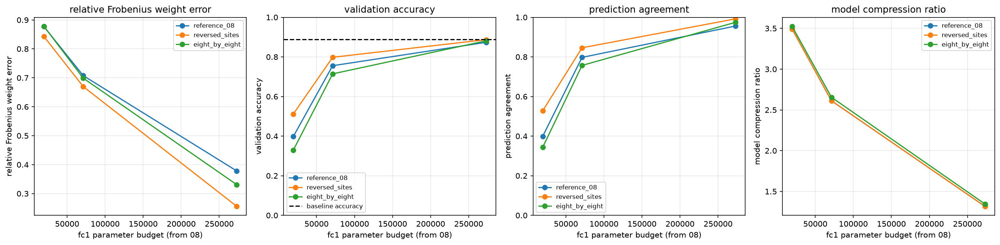
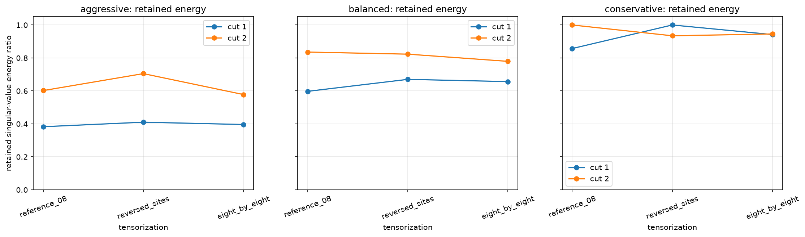
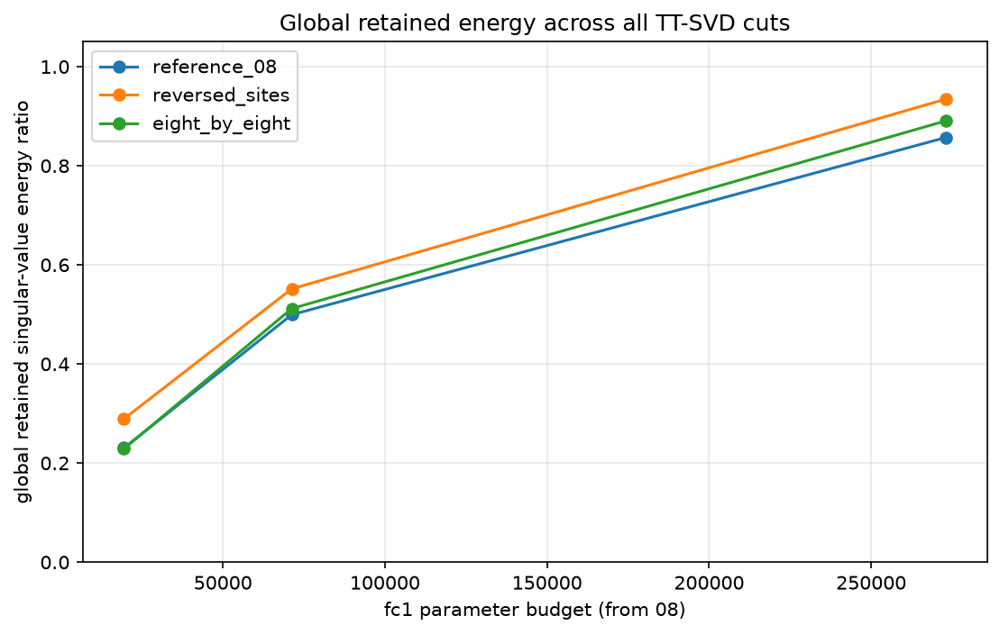

# Fashion-MNIST MLPのfc1 tensorization比較

## このノートの位置づけ

このノートは、Notebook 09に保存された実装・結果と、その結果について行った考察を整理する。

- [09_pretrained_mlp_fc1_tt_tensorization_comparison.ipynb](../../../notebooks/30_tt_mps/10_fashion_mnist_mlp/09_pretrained_mlp_fc1_tt_tensorization_comparison.ipynb)

Notebook 08のrank sweepから選んだ3段階のparameter予算を引き継ぎ、同じ予算上限の下で3種類のtensorizationを比較する。予算の選択過程は、[[40_TT_MPS_NN圧縮/10_FashionMNIST_MLP/01_fc1_TT-rank_sweep]]に分けている。

理論は次のノートへ分ける。

- [[00_基礎理論/03_モデル圧縮理論/30_TTLinear圧縮/62_TT-matrixのmode分解とrank設計]]
- [[00_基礎理論/03_モデル圧縮理論/30_TTLinear圧縮/71_TT-matrixのtensorization比較とcut別特異値エネルギー]]
- [[00_基礎理論/03_モデル圧縮理論/30_TTLinear圧縮/72_TT圧縮の重み近似指標と分類性能指標の読み分け]]
- [[00_基礎理論/01_数学基礎/02_テンソル代数/20_TT_MPS基礎/31_TT-rankとunfolding]]
- [[00_基礎理論/01_数学基礎/02_テンソル代数/20_TT_MPS基礎/33_TT-SVDの打ち切りと誤差]]

## 1. 証拠レベル

このノートの数値は、Notebookの保存済み出力と次のCSVを照合した結果である。

- [tensorization_comparison.csv](../../../results/30_tt_mps/10_fashion_mnist_mlp/09_pretrained_mlp_fc1_tt_tensorization_comparison/tensorization_comparison.csv)
- [selected_tensorizations.csv](../../../results/30_tt_mps/10_fashion_mnist_mlp/09_pretrained_mlp_fc1_tt_tensorization_comparison/selected_tensorizations.csv)
- [tt_svd_cut_energy.csv](../../../results/30_tt_mps/10_fashion_mnist_mlp/09_pretrained_mlp_fc1_tt_tensorization_comparison/tt_svd_cut_energy.csv)

今回、Notebookを新しいkernelからFresh Restart Kernel、Run Allしたわけではない。従って、保存済み出力とCSVから確認した結果、コードを静的に読んで確認した処理、Fresh Run Allによる再実行確認を区別する。最後の再実行確認は、このノート作成時には実施していない。

## 2. 実験条件とNotebook 08からの接続

対象は学習済みFashion-MNIST MLPで、第1 Linear層だけを3-core TTLinearへ置換する。

$$
784 \rightarrow 512 \rightarrow 256 \rightarrow 10
$$

$$
W_1=\mathrm{fc1.weight}\in\mathbb{R}^{512\times784}
$$

- `fc2`と`fc3`はdenseのまま保持する
- 学習済みdense weightをTT-SVDで近似し、fine-tuningは行わない
- rank・tensorization選択用validation 5,000件で評価する
- test setは候補選択に使わない
- dense baselineのvalidation accuracyは`0.8884`
- denseモデル全体は535,818 parameter
- dense `fc1`はbias込みで401,920 parameter

Notebook 08から引き継ぐ予算は、aggressive 19,488、balanced 71,232、conservative 273,024 parameterである。現在の範囲はfine-tuningとfinal testの前までであり、DMRG-like optimization、1-site update、2-site updateにも進んでいない。

baselineの正解数は、

$$
5000\times0.8884=4442
$$

である。

## 3. 一般論：評価指標の読み分け

tensorization、cut別保持率、global保持率の一般論は、[[00_基礎理論/03_モデル圧縮理論/30_TTLinear圧縮/71_TT-matrixのtensorization比較とcut別特異値エネルギー]]へ分ける。weight誤差、logits RMSE、agreement、accuracyの関係は、[[00_基礎理論/03_モデル圧縮理論/30_TTLinear圧縮/72_TT圧縮の重み近似指標と分類性能指標の読み分け]]へ分ける。ここではNotebook 09の保存結果を読むために必要な定義だけを再掲する。

### 3.1 重み近似誤差

相対Frobenius誤差は、dense重み$W$とTT近似重み$\widehat W$の数値的な差を測る。

$$
\frac{\lVert W-\widehat W\rVert_F}{\lVert W\rVert_F}
$$

これは重み全体を同じ基準で測る指標であり、各方向が分類にどれだけ重要かは考慮しない。

### 3.2 global保持率

Notebook 09では、TT-SVDの各cutにおける特異値エネルギー保持率を求め、次を診断指標としている。

$$
\mathrm{global\ retained\ energy\ ratio}
=
1-
\left(
\mathrm{TT\mbox{-}SVD\ relative\ error\ bound}
\right)^2
$$

3-core TT-SVDでは、実装上、次の積とも許容誤差内で一致する。

$$
\mathrm{global保持率}
=
\mathrm{cut\ 1保持率}
\times
\mathrm{cut\ 2保持率}
$$

保存結果における積との差の最大値は約$1.26\times10^{-7}$だった。global保持率は候補の説明・診断用であり、Notebook 09の自動選択条件には使っていない。

### 3.3 logits RMSE

logits RMSEは、全sample・全classのlogitの平均的な数値差を測る。

$$
\mathrm{RMSE}
=
\sqrt{
\frac{1}{BC}
\sum_{i=1}^{B}
\sum_{c=1}^{C}
\left(
\widehat L_{i,c}-L_{i,c}
\right)^2
}
$$

RMSEが小さくても、1位と2位のlogitが接近したsampleでは、小さな変化で`argmax`が入れ替わることがある。反対に、RMSEが大きくても最大logitのclassが変わらない場合がある。

### 3.4 prediction agreement

prediction agreementは、TTモデルとdenseモデルの予測classが一致した割合である。

$$
\frac{1}{B}
\sum_{i=1}^{B}
\mathbf{1}
\left[
\arg\max_c \widehat L_{i,c}
=
\arg\max_c L_{i,c}
\right]
$$

これはdenseモデルの挙動への忠実度であり、正解率ではない。denseモデルが誤分類したsampleについて、TTモデルが同じ誤分類をした場合もagreementには数えられる。

### 3.5 validation accuracy

accuracyは、TTモデルの予測classと正解labelが一致した割合である。

$$
\frac{1}{B}
\sum_{i=1}^{B}
\mathbf{1}
\left[
\arg\max_c \widehat L_{i,c}=y_i
\right]
$$

agreementはdense予測と比較し、accuracyは正解labelと比較する。この2つを混同しない。

## 4. Notebook 09：実験設定と保存結果

### 4.1 比較の目的

tensorizationが変わると、各coreの物理次元$q_k=m_kn_k$が変わる。そのため、同じTT-rankでもparameter数は一般に一致しない。

3-core TT-matrixのcore parameter数は、

$$
P_{\mathrm{core}}
=
q_1r_1+r_1q_2r_2+r_2q_3
$$

である。Notebook 09ではrankを機械的に揃えず、Notebook 08の3つの`fc1` parameter数を予算上限として、各tensorizationで予算以下のrankを選んだ。

### 4.2 比較したtensorization

| tensorization | out modes | in modes | physical sizes |
| :-- | :-- | :-- | :-- |
| `reference_08` | `(2, 8, 32)` | `(49, 8, 2)` | `(98, 64, 64)` |
| `reversed_sites` | `(32, 8, 2)` | `(2, 8, 49)` | `(64, 64, 98)` |
| `eight_by_eight` | `(8, 8, 8)` | `(7, 14, 8)` | `(56, 112, 64)` |

rank探索には、

~~~text
[1, 2, 4, 8, 12, 16, 24, 32, 36, 48, 50, 64, 96, 128]
~~~

を使った。

各role・tensorizationで、予算以下の候補を`fc1_parameters`降順、同数なら`relative_error`昇順で選び、その後validation指標を評価した。最終的なtensorizationの選択は、validation accuracy降順、model parameter数昇順、relative error昇順で行った。

実装上は、各tensorizationのweight sweepを1つのDataFrameへまとめ、`itertuples(index=False, name=None)`またはnamed tupleで行を走査した。選択行を辞書へ変換し、parameter予算、role、validation指標を追加することで、weight-level指標とmodel-level指標を1行へ結合した。

### 4.3 9構成の保存結果

| role         | tensorization    | rank | fc1 parameter | 予算使用率 | 相対weight誤差 | global保持率 | accuracy | agreement | logits RMSE |
| :----------- | :--------------- | ---: | ------------: | ----: | ---------: | --------: | -------: | --------: | ----------: |
| aggressive   | `reference_08`   |   16 |        19,488 | 1.000 |     0.8772 |    0.2305 |   0.3978 |    0.3990 |      8.4658 |
| aggressive   | `reversed_sites` |   16 |        19,488 | 1.000 |     0.8430 |    0.2893 |   0.5116 |    0.5276 |      7.9337 |
| aggressive   | `eight_by_eight` |   12 |        18,080 | 0.928 |     0.8781 |    0.2290 |   0.3290 |    0.3434 |      7.9423 |
| balanced     | `reference_08`   |   32 |        71,232 | 1.000 |     0.7076 |    0.4994 |   0.7556 |    0.7976 |      5.9787 |
| balanced     | `reversed_sites` |   32 |        71,232 | 1.000 |     0.6697 |    0.5515 |   0.7980 |    0.8460 |      4.4518 |
| balanced     | `eight_by_eight` |   24 |        67,904 | 0.953 |     0.6988 |    0.5117 |   0.7144 |    0.7570 |      4.4831 |
| conservative | `reference_08`   |   64 |       273,024 | 1.000 |     0.3781 |    0.8570 |   0.8736 |    0.9558 |      1.5868 |
| conservative | `reversed_sites` |   64 |       273,024 | 1.000 |     0.2559 |    0.9345 |   0.8872 |    0.9922 |      0.1795 |
| conservative | `eight_by_eight` |   48 |       264,320 | 0.968 |     0.3308 |    0.8906 |   0.8812 |    0.9746 |      0.8190 |

同じ予算上限でも、`eight_by_eight`はrank gridの離散性により予算を完全には使っていない。従って、これは厳密な同一parameter数比較ではなく、同じ予算上限の下で選んだ構成の比較である。

左から、相対weight誤差、validation accuracy、prediction agreement、モデル全体の圧縮率を示す。横軸はNotebook 08から引き継いだ`fc1` parameter予算であり、実際の使用parameter数が全候補で完全に同じという意味ではない。

### 4.4 tensorizationで特異値分布が変わる理由

#### 一般論

tensorizationを変えると、元の重み要素をどのsiteへ割り当てるかが変わる。その結果、各cutで作られるunfoldingが変わり、特異値分布も変わる。

同じparameter数は、保存できる数値の個数が同程度であることを意味する。しかし、異なるtensorizationが同じ部分空間や同じ相関構造を表現することは意味しない。

#### 今回の保存結果

今回の`reversed_sites`は、このcheckpointの`fc1.weight`を指定したmodeでtensorizeしたとき、指定rank内により多くの特異値二乗和を保持できた。その結果、3つのroleすべてで`reference_08`より相対weight誤差が小さかった。

これは「siteをreverseすれば一般に良くなる」という意味ではない。

### 4.5 conservativeは完全なフルランクではない

#### 一般論

TT-rankが大きいかどうかではなく、各cutの最大rankと実rankを比較して、全cutで切り捨てがない場合にだけフルランクと判断する。

#### 今回の保存結果

`reversed_sites`のphysical sizeは、

$$
(q_1,q_2,q_3)=(64,64,98)
$$

である。3-core TTの各cutで取り得る最大rankは、

$$
r_1^{\max}=\min(64,64\times98)=64
$$

$$
r_2^{\max}=\min(64\times64,98)=98
$$

である。conservativeの実rankは、

$$
(1,64,64,1)
$$

なので、cut 1はフルランクだが、cut 2は最大98に対して64で打ち切っている。従って、conservativeでも重みを完全再現していない。

### 4.6 conservativeでボトルネックとなるcutが入れ替わった

#### 今回の保存結果

| role | tensorization | cut 1保持率 | cut 2保持率 | global保持率 |
| :-- | :-- | ---: | ---: | ---: |
| aggressive | `reference_08` | 0.3828 | 0.6021 | 0.2305 |
| aggressive | `reversed_sites` | 0.4104 | 0.7049 | 0.2893 |
| aggressive | `eight_by_eight` | 0.3961 | 0.5780 | 0.2290 |
| balanced | `reference_08` | 0.5976 | 0.8357 | 0.4994 |
| balanced | `reversed_sites` | 0.6701 | 0.8231 | 0.5515 |
| balanced | `eight_by_eight` | 0.6566 | 0.7794 | 0.5117 |
| conservative | `reference_08` | 0.8570 | 1.0000 | 0.8570 |
| conservative | `reversed_sites` | 1.0000 | 0.9345 | 0.9345 |
| conservative | `eight_by_eight` | 0.9419 | 0.9455 | 0.8906 |

`reference_08`ではcut 1で約14.30%を捨て、cut 2では追加の切り捨てがない。`reversed_sites`ではcut 1をすべて保持し、cut 2で約6.55%を捨てる。

#### この結果からの考察

tensorizationを変えたことで、rank制約が厳しく作用する境界が移動したと読める。物性物理の表現に寄せると、site順序を変えたことで、cutをまたぐ構造を表現するために必要なbond dimensionが変わったことに対応する。

後段のcutが100%でも、前段で失ったエネルギーは回復しない。cut単体だけでなく、全cutの累積的な損失を表すglobal保持率を見る必要がある。

3つのパネルは左からaggressive、balanced、conservativeである。青がcut 1、橙がcut 2の保持率を表す。

global保持率は各cutの保持率の積である。3つの予算すべてで`reversed_sites`が最も高いが、後で示すとおり、この順位だけからaccuracyの順位は保証できない。

### 4.7 `reversed_sites`の選択結果

Notebook 09の選択結果は次のとおりである。

| role | selected tensorization | rank | accuracy | agreement |
| :-- | :-- | ---: | ---: | ---: |
| aggressive | `reversed_sites` | 16 | 0.5116 | 0.5276 |
| balanced | `reversed_sites` | 32 | 0.7980 | 0.8460 |
| conservative | `reversed_sites` | 64 | 0.8872 | 0.9922 |

このcheckpointでは、比較した3候補の中で`reversed_sites`が3つの予算すべてで最も高いvalidation accuracyを示した。

これは今回比較した3種類、3予算、1つのcheckpointにおける選択結果であり、`reversed_sites`が一般に最良であることを示す結果ではない。また、「最良」はここでは主選択指標であるvalidation accuracyについての表現であり、parameter数、速度、別データ上の性能を含めた総合的な優越を意味しない。

## 5. Notebook 09の実験結果からの考察：指標間の関係

以下では、9構成の保存値に現れた具体的な反例を中心に考察する。一般的な指標定義は3節と基礎理論72へ分け、ここでは「今回のどの数値が、どの単純な説明を崩したか」を明確にする。

### 5.1 global保持率が高くてもaccuracyが高いとは限らない

#### 保存結果で観測したこと

conservativeでは、global保持率とaccuracyの順位がともに、

$$
\mathrm{reversed\_sites}
>
\mathrm{eight\_by\_eight}
>
\mathrm{reference\_08}
$$

となった。しかし、balancedには反例がある。

| tensorization | global保持率 | accuracy |
| :-- | ---: | ---: |
| `reference_08` | 0.4994 | 0.7556 |
| `eight_by_eight` | 0.5117 | 0.7144 |

`eight_by_eight`はglobal保持率が高いが、accuracyは低い。global保持率は重みの特異値エネルギーを測り、accuracyは入力画像に対する正解率を測るためである。

#### この結果からの考察

balancedの順位逆転は、global保持率をaccuracyの代理指標として単独利用できないことを、この9構成の内部だけでも示している。保持したFrobeniusエネルギーが大きくても、それがvalidation入力でclass marginを維持する方向と一致するとは限らない。従って、global保持率は重み近似の診断には有用だが、accuracyの順位を保証しない。

### 5.2 logits RMSEが小さくても予測classを維持するとは限らない

#### 保存結果で観測したこと

balancedでは、`eight_by_eight`のlogits RMSE `4.4831`は、`reference_08`の`5.9787`より小さい。一方、agreementは`0.7570`対`0.7976`、accuracyは`0.7144`対`0.7556`で、どちらも`eight_by_eight`のほうが低い。

#### この結果からの考察

RMSEはlogits全体の平均的な差を測る。agreementとaccuracyは`argmax`で決まる。従って、全体の数値差が小さくても、1位と2位のclass順位が入れ替わるsampleが多ければ、agreementやaccuracyは低くなり得る。

今回の保存値だけでは、どのsampleでclass順位が入れ替わったかは分からない。しかし、「logits全体がdenseに近いほど、必ずdenseと同じclassを予測する」という説明は、このbalancedの反例とは整合しない。

### 5.3 agreementが高くても、その値がaccuracyになるわけではない

#### 保存結果で観測したこと

conservativeの`reversed_sites`では、agreementは`0.9922`、accuracyは`0.8872`である。

$$
5000\times0.9922=4961
$$

なので、4,961件でdenseモデルと同じclassを予測した。しかし、その中にはdenseモデルと同じ誤分類も含まれる。

一方、TTモデルの正解数は、

$$
5000\times0.8872=4436
$$

である。dense baselineは4,442件正解なので、正解数の差は6件だった。

#### この結果からの考察

agreementはdenseモデルの挙動をどれだけ再現したかを表し、accuracyは正解labelに対する分類性能を表す。

4,961件の一致には、両モデルが同じ正解classを出したsampleと、同じ誤分類classを出したsampleの両方が含まれる。また、予測が異なる39件にも、denseのみ正解、TTのみ正解、両方不正解という複数の場合がある。従って、agreement `0.9922`とaccuracy `0.8872`から、sample単位の正誤遷移は復元できない。

### 5.4 非フルランクならaccuracy低下は不思議ではないが、必然でもない

#### 保存結果で観測したこと

conservativeの`reversed_sites`はcut 2で特異値成分を打ち切るため、dense weightと完全には一致しない。従って、logitsや予測が変化し、accuracyが`0.8884`から`0.8872`へ低下しても不思議ではない。

ただし、非フルランクから直接言えるのは重み近似誤差が残ることまでであり、accuracyが必ず低下することまでは保証されない。圧縮によってdenseモデルの誤分類が正解へ変わる場合も論理的にはあり得る。

4.3節に示した`tensorization_tradeoffs.png`では、左から2番目の`validation accuracy`パネルに、この比較が表示されている。

- 黒い破線：dense baseline `0.8884`
- `reversed_sites`のconservative点：`0.8872`

#### この結果からの考察

cut 2で成分を捨てているためdense weightと同一ではなく、logitsや予測classが変化する余地がある。その意味で6件の正解数低下は不思議ではない。しかしdenseモデル自体も558件を誤分類しており、圧縮による予測変化には、正解を失う変化だけでなくdenseの誤りを修正する変化もあり得る。非フルランクであることだけから、accuracy低下の符号や大きさは決まらない。

### 5.5 rank増加から直接説明できる部分と、実験で観測した部分

rankを増やすと、各cutで残せる特異値成分が増える。

$$
\mathrm{rank増加}
\rightarrow
\mathrm{保持する特異値二乗和の増加}
\rightarrow
\mathrm{重み近似誤差の減少}
$$

ここまではTT-SVDから直接説明できる。

一方、

$$
\mathrm{重み近似の改善}
\rightarrow
\mathrm{logits、agreement、accuracyの改善}
$$

は一般には保証されない。今回の`reversed_sites`では、rank 16、32、64と増やすにつれてglobal保持率、agreement、accuracyがすべて改善した、という実験結果である。

この同方向の変化は今回の観測として重要だが、因果を確定するものではない。rankとparameter数を同時に増やしているため、どの特異値成分の追加がどのsampleを正解へ変えたかは分離できていない。

### 5.6 aggressiveで捨てた成分がすべて分類に重要だったとは言えない

#### 保存結果で観測したこと

aggressiveでは重み近似誤差とaccuracy低下が同時に観測された。従って、低rank近似が元モデルの分類性能を維持するための情報を十分に残せなかった、とは言える。

#### この結果からの考察と限界

しかし、次は確認していない。

- どのcutのどの特異値成分が、どのsampleの分類に寄与したか
- 捨てた成分がすべて分類に重要だったか
- 特異値の大きさと分類への重要度が一致するか

特異値の大きさは重み近似の観点での大きさであり、分類への影響は入力activation、後続層、class marginにも依存する。

## 6. 08と09の実験結果を通した主要な考察

### 6.1 強い圧縮条件ほどtensorization差が大きかった

`reference_08`と`reversed_sites`のaccuracy差は、

- aggressive：11.38ポイント
- balanced：4.24ポイント
- conservative：1.36ポイント

だった。この2候補は各roleで同じrank・同じ`fc1` parameter数なので、今回の低予算条件ではtensorizationの違いが分類性能へ大きく表れた。

低rankでは保持できる成分が少なく、unfoldingの特異値がどの程度上位成分へ集中しているかの違いが近似へ強く表れやすい。高rankでは両tensorizationともより多くの成分を保持してdense weightへ近づくため、差が縮小した可能性がある。今回の11.38、4.24、1.36ポイントという順序は、この説明と整合する。

ただし、これは今回観測した傾向を説明する仮説であり、「強く圧縮すれば常にtensorization差が大きくなる」という一般則ではない。また、`reversed_sites`がタスク上重要な成分を残したことを直接測定したわけではない。

### 6.2 parameter数だけではaccuracyの順位を説明できない

conservativeでは、`eight_by_eight`が264,320 parameterでaccuracy `0.8812`、`reference_08`が273,024 parameterでaccuracy `0.8736`だった。

より多くのparameterを使った構成が必ず高いaccuracyになるわけではない。parameter数は容量の大きさを表すが、tensorizationがどの構造を表現しやすいかまでは表さない。

特にこの比較は、`eight_by_eight`のほうが8,704 parameter少ないにもかかわらず、accuracyが0.76ポイント高い。容量の総量よりも、指定された容量をどのunfolding構造へ割り当てたかが結果へ影響した可能性がある。ただし、「分類に適した構造」を直接同定したわけではなく、accuracyから逆向きに推測している段階である。

### 6.3 高予算側では追加parameterに対するaccuracy改善が小さくなった

`reversed_sites`では、

- aggressiveからbalanced：19,488から71,232 parameter、accuracyは28.64ポイント改善
- balancedからconservative：71,232から273,024 parameter、accuracyは8.92ポイント改善

だった。高予算側ではdense baselineに近づいているため、追加parameterが新たな正解増加へ結びつく余地が小さくなった可能性がある。

accuracyはargmaxだけを見るため、weightやlogitsが改善しても、すでに正解しているsampleのclass順位が変わらなければ増加しない。高予算側では多くのsampleがすでに正解またはdenseと同じ予測になっており、追加の近似改善が新たな正解数へ反映されにくかった可能性がある。

ただし、dense baselineのaccuracyは圧縮モデルの数学的な上限ではない。圧縮によってdenseの誤分類が修正される場合もあるため、改善余地を正確に知るにはsample別の正誤遷移が必要である。

### 6.4 重みの完全再現はaccuracy維持の必要条件ではなかった

conservativeの`reversed_sites`は相対weight誤差が約`0.2559`残る一方、accuracyはdense baselineと0.12ポイント差だった。

重み全体に誤差があっても、実入力$x$に対する、

$$
(\widehat W-W)x
$$

が予測classを変えるほど大きくなければ、accuracyは維持される。この結果だけから、どの誤差方向が分類に影響しなかったかを特定することはできない。

相対weight誤差`0.2559`を「小さいからaccuracyが維持された」とだけ説明するのも不十分である。重要なのは、誤差がvalidation入力へ作用した層出力差と、その差が最終logitsのclass marginを越えたかどうかである。今回のlogits RMSE `0.1795`とagreement `0.9922`は、多くのsampleでargmaxが維持されたことと整合するが、個々のsampleのmarginまでは保存集計値から分からない。

## 7. 言えること、言い過ぎになること

### 7.1 保存結果から言えること

- 固定tensorizationでは、rank増加に伴いweight誤差が減り、accuracyは概ね改善した
- rankとaccuracyの関係は線形ではなく、rank 16から32で大きな回復があった
- `fc1`単体の大きな圧縮率が、そのままモデル全体の圧縮率にはならなかった
- 同じparameter予算上限でも、tensorizationによって重み近似と分類性能が変わった
- このcheckpointでは、`reversed_sites`が3つの予算すべてで最も高いvalidation accuracyを示した
- conservativeの`reversed_sites`は、非フルランクでもdense baselineに近いaccuracyを維持した
- global保持率、logits RMSE、agreement、accuracyは、互いに関連するが同じ対象を測っていない

### 7.2 現時点では言い過ぎになること

- `reversed_sites`は一般に最適である
- global保持率が高ければ必ずaccuracyも高い
- logits RMSEが小さければ必ず予測classを維持できる
- 捨てた特異値成分はすべて分類に重要である
- validation accuracyが近ければ、同じsampleに正解している
- fine-tuning後やtest setでも同じ順位になる

### 7.3 一般化に必要な追加検証

一般化には、少なくとも次を分けて確認する必要がある。

- 異なる学習seedで得た複数checkpoint
- 異なるデータ分割
- `fc1`以外の層
- 別のtensorization候補とrank grid
- fine-tuning前後
- validationで選択した後の独立したtest評価

### 7.4 Perplexity・ChatGPTとの考察で挙がった追加分析

次は考察を直接検証するための案であり、このNotebookの実施済み結果ではない。

- 各rank・tensorizationについて、denseとTTの正誤を組み合わせた`正解→正解`、`正解→不正解`、`不正解→正解`、`不正解→不正解`の件数を集計する
- 予測classが変わったsampleについて、denseとTTの1位・2位logit、class margin、logits差を比較する
- `fc1`の層出力差$(\widehat W-W)x$をsampleごとに測り、weight誤差とlogits誤差の間を接続する
- cutごと、または追加した特異値成分ごとに近似を段階的に戻し、どの追加成分で予測が変化するかを調べる
- 複数checkpointとseedで、tensorization間のaccuracy差が圧縮を弱めるほど縮む傾向を再現できるか確認する
- validationで構成を選んだ後、独立したtest setでは一度だけ最終評価する

これらを行えば、「保持率が高かったからaccuracyが高かった」「タスク上重要な方向を保持したから回復した」という仮説を、集計指標の相関だけでなくsample・層出力・成分の単位で検証できる。

## 8. 現時点の結論

Notebook 08では、固定tensorizationにおけるTT-rankと、重み近似・parameter数・分類性能のトレードオフを確認した。rankを増やすと重み近似は改善したが、accuracyの改善は一様ではなく、高rank側ではparameter数が急増した。

Notebook 09では、同じparameter予算上限でもtensorizationによって各cutの特異値分布と近似品質が変わり、分類性能にも差が生じることを確認した。このcheckpointでは`reversed_sites`が3つの予算すべてで選択されたが、その優位性は今回のmode配置、checkpoint、validation条件に限定された観測である。

以上から、TT圧縮の構成選択には、rankやparameter数だけでなく、tensorization、重み近似誤差、実データ上のlogits、agreement、accuracyを分けて確認する必要がある。
