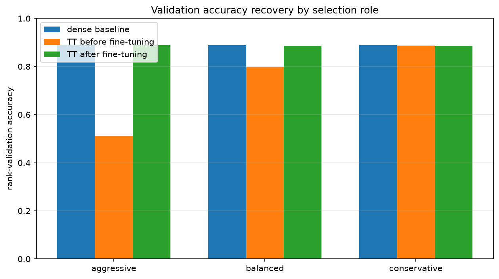
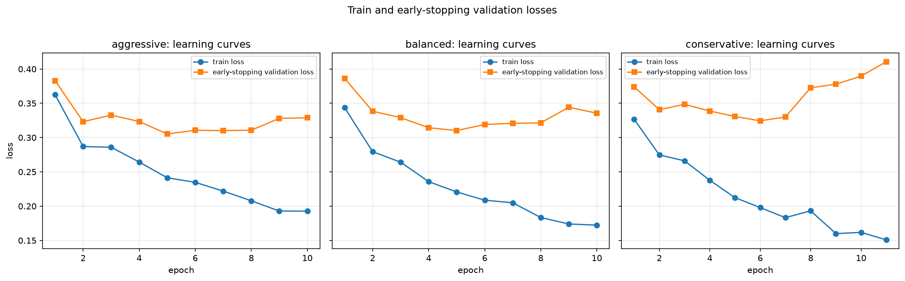

# Fashion-MNIST MLPのfc1 TT圧縮後fine-tuning

## このノートの位置づけ

このノートは、Notebook 10に保存された実装・結果と、その結果についてChatGPTおよびPerplexityとの対話で行った考察を統合する。

- [10_pretrained_mlp_fc1_tt_finetuning.ipynb](../../../notebooks/30_tt_mps/10_fashion_mnist_mlp/10_pretrained_mlp_fc1_tt_finetuning.ipynb)

Notebook 08のrank sweepとNotebook 09のtensorization比較は、次の別ノートで扱う。

- [[40_TT_MPS_NN圧縮/10_FashionMNIST_MLP/01_fc1_TT-rank_sweep]]
- [[40_TT_MPS_NN圧縮/10_FashionMNIST_MLP/02_fc1_tensorization比較]]

fine-tuningの目的、logits RMSEとaccuracy、early stopping、比較の公平性、モデル選択、testの独立性に関する一般論は、[[00_基礎理論/03_モデル圧縮理論/30_TTLinear圧縮/73_TT圧縮後fine-tuningの評価とモデル選択]]へ分ける。このノートでは、Notebook 10の保存値から何を観測し、どう考察できるかを中心にする。

Notebook 11で行ったfine-tuning前後のPareto frontier比較と追加rank判断は、[[40_TT_MPS_NN圧縮/10_FashionMNIST_MLP/04_fine-tuning後のTT-rank_trade-off]]で扱う。

## 1. 証拠レベル

数値は、Notebook 10の保存済み出力と次のCSVを照合した結果である。

- [finetuning_comparison.csv](../../../results/30_tt_mps/10_fashion_mnist_mlp/10_pretrained_mlp_fc1_tt_finetuning/finetuning_comparison.csv)
- [finetuning_history.csv](../../../results/30_tt_mps/10_fashion_mnist_mlp/10_pretrained_mlp_fc1_tt_finetuning/finetuning_history.csv)

Notebookの保存済み出力には`verification checklist: OK`がある。ただし、このノート作成時に新しいkernelからFresh Restart Kernel、Run Allしたわけではない。従って、保存済み出力・CSVから確認した結果と、今回の新規再実行確認を区別する。

## 2. 実験条件

対象は学習済みFashion-MNIST MLPである。

$$
784 \rightarrow 512 \rightarrow 256 \rightarrow 10
$$

Notebook 09で選んだ`reversed_sites`の3候補を、同じdense checkpointから独立に再生成してfine-tuningした。

| role | requested rank | actual TT-ranks | model parameter数 | model圧縮率 |
| :-- | ---: | :-- | ---: | ---: |
| aggressive | 16 | `(1, 16, 16, 1)` | 153,386 | 3.493倍 |
| balanced | 32 | `(1, 32, 32, 1)` | 205,130 | 2.612倍 |
| conservative | 64 | `(1, 64, 64, 1)` | 406,922 | 1.317倍 |

共通条件は次のとおりである。

- train 50,000件でweightを更新する
- early-stopping validation 5,000件でbest epochを選ぶ
- 別のrank-selection validation 5,000件でfine-tuning前後を比較する
- test 10,000件はこのNotebookでは評価しない
- optimizerは各候補で新しく作成する
- Adam、学習率`1e-3`、最大50 epoch、patience 5、`min_delta=1e-4`
- 3候補で同じseedとmini-batch順を使う
- TT coresだけでなく、`fc1` bias、`fc2`、`fc3`を含む全model parameterを更新する
- early stopping後は、最良validation loss時のweightへ復元する

従って、これはTT coresだけのfine-tuning実験ではない。また、圧縮モデルだけが追加学習され、dense baselineには同等の追加学習を行っていない。

## 3. 保存結果

### 3.1 fine-tuning前後の比較

| role | rank | accuracy before | accuracy after | recovery | loss before | loss after | agreement before | agreement after | logits RMSE before | logits RMSE after |
| :-- | ---: | ---: | ---: | ---: | ---: | ---: | ---: | ---: | ---: | ---: |
| aggressive | 16 | 0.5116 | 0.8890 | +0.3774 | 1.3025 | 0.3082 | 0.5276 | 0.9314 | 7.9337 | 3.6664 |
| balanced | 32 | 0.7980 | 0.8850 | +0.0870 | 0.5142 | 0.3255 | 0.8460 | 0.9298 | 4.4518 | 7.1050 |
| conservative | 64 | 0.8872 | 0.8850 | -0.0022 | 0.3107 | 0.3246 | 0.9922 | 0.9208 | 0.1795 | 11.7009 |

dense baselineのrank-selection validation accuracyは`0.8884`である。従ってfine-tuning後は、3候補とも`0.8850`から`0.8890`の狭い範囲に入った。

### 3.2 early stoppingと学習時間

| role | best epoch | best early-stopping validation loss | 実行epoch数 | 総学習時間 | 平均時間／epoch |
| :-- | ---: | ---: | ---: | ---: | ---: |
| aggressive | 5 | 0.3053 | 10 | 64.9秒 | 6.49秒 |
| balanced | 5 | 0.3103 | 10 | 94.7秒 | 9.47秒 |
| conservative | 6 | 0.3245 | 11 | 188.5秒 | 17.14秒 |

conservativeでは、train lossがepoch 1の`0.3267`からepoch 11の`0.1509`へ低下した一方、early-stopping validation lossはepoch 6の`0.3245`を底として、epoch 11には`0.4107`へ上昇した。最終評価に使われたのはepoch 11のweightではなく、epoch 6へ復元したbest modelである。

## 4. 実験結果からの考察

### 4.1 fine-tuning後にrank順位が逆転した

#### 保存結果で観測したこと

fine-tuning前のaccuracyは、

$$
\mathrm{rank\ 64}
>
\mathrm{rank\ 32}
>
\mathrm{rank\ 16}
$$

だった。一方、fine-tuning後はrank 16が`0.8890`、rank 32と64が`0.8850`となり、rank 16が候補中で最も高かった。

#### この結果からの考察

TT-SVD直後のaccuracyは、dense weightをそのrankで近似した直後の忠実度を測る。fine-tuning後のaccuracyは、そのrank制約の中で分類タスクへ再最適化した後の性能を測る。今回の順位逆転は、この2つが別の評価軸であることを示している。

fine-tuningを前提とするなら、圧縮直後のaccuracyだけでrankを選ぶと、初期性能は低いが再学習で回復できるrank 16を除外し、必要以上に高rankを選ぶ可能性があった。今回の条件では、高rankが持つ追加parameterは、fine-tuning後のaccuracy改善へ結びつかなかった。

ただし、「高rankには一般に意味がない」「低rankほど優れる」とは言えない。直接確認できたのは、今回のcheckpoint、3候補、共通fine-tuning条件、validation splitでは、rank 16の構造から`0.8890`のaccuracyを持つ解が得られたことまでである。rank 16がdenseと同じ関数を表せることを示した結果でもない。

### 4.2 aggressiveの大きなrecoveryは、反応性だけでなく改善余地を含む

#### 保存結果で観測したこと

accuracy recoveryはrank 16で`+0.3774`、rank 32で`+0.0870`、rank 64で`-0.0022`だった。

#### この結果からの考察

rank 16はfine-tuning前のaccuracyが`0.5116`であり、rank 64の`0.8872`より改善余地が大きかった。従って、recoveryが大きいことだけから、rank 16のほうがfine-tuningへ本質的に反応しやすいとは言えない。

一方、rank 16は単に大きく回復しただけでなく、fine-tuning後の最終accuracyも候補中で最も高かった。この2点は分けて報告する必要がある。

- 大きなrecovery：低い出発点からどれだけ改善したか
- 最終accuracy：fine-tuning後にどの水準へ到達したか

conservativeについては、圧縮直後からdenseに近く、改善余地が小さかったため、「fine-tuningの意味が小さかった」という読み方は今回の結果と整合する。ただし、高い初期accuracyそのものが性能低下の原因ではない。

### 4.3 dense logitsへの忠実度とclassification accuracyは別に動いた

#### 保存結果で観測したこと

aggressiveのlogits RMSEは`7.9337`から`3.6664`へ減少した。一方、balancedは`4.4518`から`7.1050`、conservativeは`0.1795`から`11.7009`へ増加した。それでもfine-tuning後のaccuracyは3候補とも約`0.885`から`0.889`だった。

#### この結果からの考察

今回の目的関数は正解labelに対するcross-entropyであり、dense logitsとのRMSEではない。全層を更新した結果、圧縮モデルはdenseの出力値を再現する方向ではなく、各rank制約の下で分類lossを小さくする別のparameter解へ移動したと考えられる。

logitsの共通オフセットやスケール変化は、生のRMSEを大きくしてもargmaxを維持し得る。ただし、conservativeのRMSE増加が単なるオフセットやスケールだけで起きたとは断定できない。クラス間の相対score、一部sampleの大きなずれ、確信度の変化も含み得る。

従って、この結果から言えるのは、dense logitsの数値的再現が高いaccuracyの必要条件ではなかったことまでである。どの変化が支配的だったかを確かめるには、centered logits、logits norm、class margin、softmax確率をsample単位で調べる必要がある。

### 4.4 同程度のaccuracyでも、同じ画像に正解しているとは限らない

#### 保存結果で観測したこと

fine-tuning後のprediction agreementは、aggressive `0.9314`、balanced `0.9298`、conservative `0.9208`だった。特にconservativeはfine-tuning前の`0.9922`から低下した一方、accuracyは`0.8872`から`0.8850`への小さな変化に留まった。

#### この結果からの考察

conservativeはdenseとほぼ同じ予測をする状態から、より異なる予測をする状態へ移ったが、正解数の合計は大きく変わらなかった。これは、denseと異なる解へ移動し、改善したsampleと悪化したsampleが入れ替わった可能性と整合する。

ただし、agreementとaccuracyの集計値だけでは、正誤の入れ替わり数は分からない。denseのみ正解、TTのみ正解、両方正解、両方不正解の4区分を直接集計する必要がある。

### 4.5 conservativeでは学習後半に過学習と整合する乖離が強く現れた

#### 保存結果で観測したこと

conservativeではtrain lossが`0.3267`から`0.1509`へ下がり続けた一方、early-stopping validation lossはepoch 6の`0.3245`からepoch 11の`0.4107`へ上昇した。aggressiveとbalancedにもbest epoch後の悪化はあるが、conservativeで乖離が最も大きかった。

#### この結果からの考察

学習後半では訓練データへの適合が進む一方、その更新がvalidationへ一般化しなくなった可能性が高い。accuracyが大きく変わらなくても、誤分類への確信が強まればcross-entropyは悪化するため、lossとaccuracyが同じ方向へ動く必要はない。

conservativeで傾向が強かった理由として、次の組合せが考えられる。

- rank 64は3候補中でparameter数が最も多く、低rankより表現上の制約が弱かった
- 圧縮直後からaccuracyが高く、追加学習による改善余地が小さかった
- 共通学習率`1e-3`が、初期状態の良いconservativeには大きすぎた可能性がある

ただし、parameter数だけを過学習の原因として確定できない。初期値、更新軌跡、正則化、学習率も異なる影響を持つ。また、best modelはepoch 6へ復元されているため、epoch 11の悪化を、そのまま復元後accuracy `0.8850`の原因とはできない。

### 4.6 共通学習条件という意味では公平だが、各rankの最良性能比較ではない

#### 実験設計として確認できること

3候補は同じdense checkpoint、同じseed、同じmini-batch順、同じ学習率とearly-stopping規則から開始し、optimizerも候補ごとに新しく作成した。従って、「同じfine-tuning手順へ各rankがどう反応したか」を比較する設計としては公平である。

#### この結果からは言えないこと

同じ学習率が各rankに最適とは限らない。rank 16には`1e-3`が適していても、rank 64にはより小さな更新や早い停止が適していた可能性がある。従って、今回の順位を「各rankを最適に調整した後の最良性能順位」と解釈することはできない。

各rankの最良性能を比較するなら、全rankに同じ学習率候補、同じ試行数または計算予算を与え、複数seedで比較する必要がある。

### 4.7 rank 16は今回の採用候補として合理的だが、一般的な最適rankではない

rank 16は、

- fine-tuning後accuracyが候補中で最大の`0.8890`
- parameter数が最小の153,386
- dense 535,818 parameterに対して約71.37%削減
- model圧縮率3.493倍
- 学習総時間も候補中で最短

だった。従って、計算量・保存量とのトレードオフを重視する今回の候補選択では、rank 16を優先する判断は合理的である。

ただし、試したrankは16、32、64だけである。rank 24はrank 16近傍の精度・parameterトレードオフを調べる候補、rank 48は高rank側の傾向を調べる候補になる。さらに圧縮限界を探すならrank 8や12も必要である。

仮にrank 24がrank 16をaccuracyで`0.0002`だけ上回っても、5,000件では正解数の差し引き1件である。圧縮を目的とするなら、最高accuracyから事前に決めた許容差以内の候補から最小parameterのものを選ぶ、という規則が考えられる。最高値を記録したモデルと、実際に採用するモデルは同一でなくてもよい。

### 4.8 denseを3件上回ったことは、一般的な性能向上の証拠ではない

denseは`0.8884`で4,442件、aggressiveは`0.8890`で4,445件正解した。観測差は`+0.0006`、3件である。

この差から分かるのは正解数の差し引きだけである。denseの誤りを10件修正し、denseが正しかった7件を失った場合も差は3件になる。対応のある正誤差を調べるには、

- $b$：denseは不正解、aggressiveは正解
- $c$：denseは正解、aggressiveは不正解

を集計する必要がある。現在分かるのは、

$$
b-c=3
$$

だけであり、McNemar検定に必要な$b$と$c$は保存集計値から得られない。

従って、「rank 16がdenseより高性能」と結論づけるのではなく、「parameter数を約71%削減しながら、今回のvalidationではdenseに近いaccuracyを維持した」と述べるのが適切である。同等性を統計的に証明した結果でもない。

### 4.9 圧縮モデルとdenseの比較には、追加学習の有無も混ざっている

今回、TTモデルはfine-tuningしたが、dense baselineは元checkpointのままである。従って、fine-tuned TTとdenseの差には、

1. dense構造とTT低rank構造の違い
2. 追加学習なしと追加学習ありの違い

が同時に含まれる。aggressiveがdenseをわずかに上回ったとしても、それを低rank化そのものの効果とは分離できない。

低rank化の正則化効果と追加学習の効果を切り分けるには、denseにも同等のfine-tuningを行う対照条件が必要である。一方、「既存の学習済みdenseをどこまで小さく置換できるか」が目的なら、元checkpointを基準にする現在の比較にも意味がある。

### 4.10 実測学習時間と一般的な計算量を区別する

rank 64の総学習時間188.5秒はrank 16の64.9秒の約2.90倍だった。しかし実行epoch数は11対10である。平均時間／epochの比は約2.64倍である。

従って言えるのは、今回の環境とearly-stopping手順ではrank 64の総時間が約2.9倍だった、という実測結果である。これを理論FLOPsの比、一般的な学習速度比、または推論時間の比へ置き換えることはできない。

固定step数、warm-up、反復測定を用いたlatency測定、MACs・FLOPs、peak memoryを別々に評価する必要がある。

### 4.11 accuracyとvalidation lossでは候補の見え方が異なる

rank-selection validationにおけるfine-tuning後の値は、次のとおりである。

| role | accuracy | validation loss |
| :-- | ---: | ---: |
| aggressive | 0.8890 | 0.3082 |
| balanced | 0.8850 | 0.3255 |
| conservative | 0.8850 | 0.3246 |

aggressiveはaccuracyが最も高くlossも最も低いため、今回の3候補ではどちらを主指標にしても有力である。一方、balancedとconservativeはaccuracyが同じ`0.8850`だが、lossではconservativeがわずかに低い。accuracyは正解数だけを、cross-entropyは正解classへ割り当てた確率も評価するためである。

従って、「最高accuracy」「最低validation loss」「最小parameter数」は別の選択目的として定義する必要がある。今回はaggressiveが最小parameter数でもあるため結論は変わらないが、一般にはどの指標を優先するかを結果を見る前に決める。

## 5. 言えること、言い過ぎになること

### 5.1 保存結果から言えること

- 共通fine-tuning条件の下で、rank 16は`0.5116`から`0.8890`へ回復した
- fine-tuning前後で3候補のaccuracy順位が変わった
- fine-tuning後はrank 16が最小parameter数と候補中最高accuracyを両立した
- balancedとconservativeではdense logitsとのRMSEが増えても、accuracyは約`0.885`を維持した
- conservativeではbest epoch後にtrain lossとvalidation lossの乖離が強くなった
- 今回の実測では、高rankほど総学習時間と平均時間／epochが長かった
- test setはモデル選択にも評価にも使っていない

### 5.2 現時点では言い過ぎになること

- rank 16が一般に最適である
- 低rankほどfine-tuningしやすい
- rank 16がdenseより一般的に高性能である
- rank 64は本質的に過学習しやすい
- logits RMSE増加は単純なスケール変化だけで説明できる
- fine-tuning後のaccuracyが近いので、同じ画像に正解している
- 高rankの追加parameterには常に意味がない
- 学習時間の比から推論速度や理論計算量の比が分かる
- 圧縮モデルの改善が低rank化そのものの効果である

## 6. 追加検証

考察を直接検証するには、次を追加する。

### 6.1 予測内容とlogits

- denseのみ正解、TTのみ正解、両方正解、両方不正解の件数
- McNemar検定に必要な不一致対$b,c$
- class別accuracyとconfusion matrix
- predictionが変わったsampleの1位・2位logitとclass margin
- centered logits RMSE、logits norm、softmax確率、sample別loss

### 6.2 rankと学習条件

- rank 24によるrank 16近傍の探索
- 必要に応じてrank 48による高rank側の傾向確認
- 圧縮限界を見るrank 8、12
- 各rankへ同じlearning-rate gridと同じ探索予算を与える比較
- weight decayなど正則化条件を揃えた比較

### 6.3 再現性と対照条件

- 同じcheckpointでfine-tuning seedを変える
- dense学習seedを変えた別checkpointで再実験する
- 必要ならsplitを変え、dense学習から選択までやり直す
- denseにも同等の追加学習を行う対照実験
- TT coresだけを更新するfine-tuningとのablation

### 6.4 効率

- 固定step数での学習latency
- 推論latency
- MACsまたはFLOPs
- peak memory
- 複数回測定した中央値とばらつき

## 7. test setをまだ使わない理由

rank、学習率、early stopping、許容accuracy差を決める段階でtest結果を見ると、勾配を計算しなくても意思決定がtestへ適合する。従って、rank 24や48を追加するか、rank 16を採用するかはvalidationで決める。

最終候補と評価手順を固定した後に、dense baselineと最終圧縮モデルをtestで評価する。test結果が期待より低くても、その結果を理由にrankやhyperparameterを選び直さない。

## 8. Notebook 10時点の結論

Notebook 10では、圧縮直後に最も高いaccuracyを示したrank 64が、fine-tuning後にも最良になるとは限らなかった。共通条件で全層をfine-tuningした結果、rank 16はmodel parameter数を約71.37%削減したまま、validation accuracy `0.8890`へ回復し、今回の3候補中で最も高かった。

この結果は、圧縮直後のdense weight再現能力と、低rank制約下で再学習した後の分類能力を分けて評価する必要があることを示す。また、dense logitsとのRMSE、prediction agreement、accuracy、cross-entropyは異なる対象を測るため、1つの指標だけでfine-tuningの成否を判断できない。

一方、rank 16の優位性は単一checkpoint、seed、split、共通学習条件、`fc1`だけをTT化した範囲の観測である。test setを保持したまま、追加rank、複数seed、hyperparameter探索、dense対照、sample別予測、実測効率をvalidation上で確認してから最終候補を固定する。

## 9. Notebook 12による後続確認

Notebook 10のtrained bestはepoch 1以降だけから選ばれていた。後続のNotebook 12でepoch 0と保存済みtrained bestを同じvalidation loss基準で比較したところ、rank 16・32ではtrained best、rank 64ではepoch 0が採用された。

従って、このノートのfine-tuning後の数値は「実際に学習すると何が起きたか」を示す結果として残るが、rank 64の最終採用checkpointを意味しない。圧縮直後を含む採用判断と、保存checkpointの再現確認は[[40_TT_MPS_NN圧縮/10_FashionMNIST_MLP/05_epoch0を含むcheckpoint再選択と再現確認]]を参照する。
