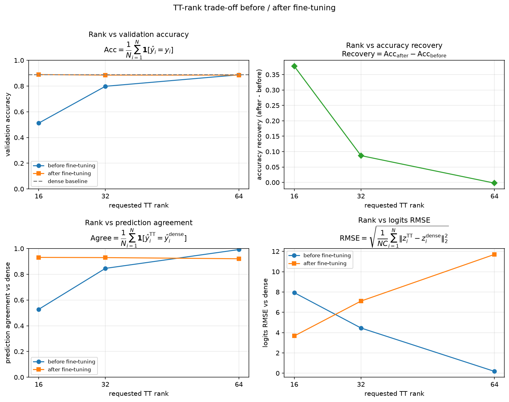
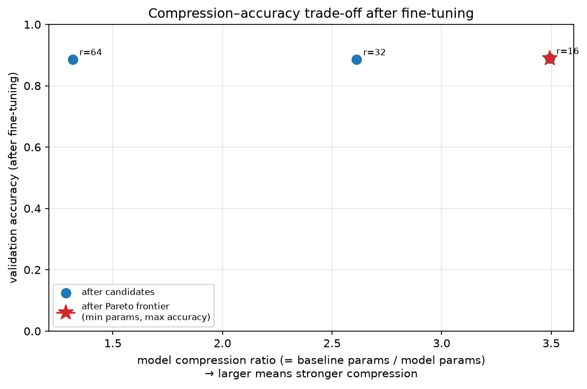

# Fashion-MNIST MLPのfine-tuning後TT-rank trade-off

## このノートの位置づけ

このノートは、Notebook 11の保存結果と、同じ結果についてChatGPTおよびPerplexityとの対話で行った考察を統合する。

- [11_tt_rank_tradeoff_after_finetuning.ipynb](../../../notebooks/30_tt_mps/10_fashion_mnist_mlp/11_tt_rank_tradeoff_after_finetuning.ipynb)

Notebook 11は新しくfine-tuningするNotebookではない。Notebook 09と10の結果を読み込み、実験条件の接続を検証したうえで、fine-tuning前後のPareto frontierを別々に求め、次に調べるrankを判断する分析Notebookである。

前段は次のノートで扱う。

- [[40_TT_MPS_NN圧縮/10_FashionMNIST_MLP/02_fc1_tensorization比較]]
- [[40_TT_MPS_NN圧縮/10_FashionMNIST_MLP/03_fc1_TT-fine-tuning]]

Pareto dominance、探索範囲の端に最良点が来た場合の扱い、許容accuracy差、対応のある予測比較などの一般論は、[[00_基礎理論/03_モデル圧縮理論/30_TTLinear圧縮/74_fine-tuning後のPareto_frontierと追加rank探索]]へ分ける。このノートでは、Notebook 11の保存値から直接言えることを中心にする。

## 1. 証拠レベル

数値は、Notebook 11の保存済み出力と次のCSVを照合した結果である。

- [rank_tradeoff_after_finetuning.csv](../../../results/30_tt_mps/10_fashion_mnist_mlp/11_tt_rank_tradeoff_after_finetuning/rank_tradeoff_after_finetuning.csv)
- [pareto_before_finetuning.csv](../../../results/30_tt_mps/10_fashion_mnist_mlp/11_tt_rank_tradeoff_after_finetuning/pareto_before_finetuning.csv)
- [pareto_after_finetuning.csv](../../../results/30_tt_mps/10_fashion_mnist_mlp/11_tt_rank_tradeoff_after_finetuning/pareto_after_finetuning.csv)
- [additional_rank_requests.csv](../../../results/30_tt_mps/10_fashion_mnist_mlp/11_tt_rank_tradeoff_after_finetuning/additional_rank_requests.csv)

保存済みNotebookでは、コードセルの実行番号が34から41まで連続し、エラー出力はない。ただし、このノート作成時にFresh Restart Kernel、Run Allを新たに行ったわけではない。従って、保存済み出力・CSV・Figureの確認と、新規の全セル再実行確認は区別する。

## 2. Notebook 11で比較したもの

対象は学習済みFashion-MNIST MLPの`fc1`だけを3-core TTLinearへ置換した3候補である。

$$
784 \rightarrow 512 \rightarrow 256 \rightarrow 10
$$

3候補はNotebook 09で選んだ`reversed_sites`を使う。変えているrankはcore数ではなく、隣接core間のbond dimensionの上限である。fine-tuning中もTT coreのshapeとrankは固定されている。

| role | requested rank | actual TT-ranks | model parameter数 | denseに対するmodel圧縮率 |
| :-- | ---: | :-- | ---: | ---: |
| aggressive | 16 | `(1, 16, 16, 1)` | 153,386 | 3.493倍 |
| balanced | 32 | `(1, 32, 32, 1)` | 205,130 | 2.612倍 |
| conservative | 64 | `(1, 64, 64, 1)` | 406,922 | 1.317倍 |

注意点は次のとおりである。

- Notebook 10ではTT coresだけでなく、`fc1` bias、`fc2`、`fc3`を含む全parameterを更新した
- Notebook 11はその保存結果を分析するだけで、新しいweight更新は行わない
- 比較に使うのはrank-selection validation 5,000件であり、test 10,000件はまだ評価しない
- dense baselineの同じvalidationにおけるaccuracyは`0.8884`である

従って、以下の「rank 16の回復」はTT cores単独の効果ではなく、低rankの`fc1`へネットワーク全体を再調整した結果である。

## 3. 保存結果

### 3.1 fine-tuning前後の全指標

| rank | stage | parameter数 | 圧縮率 | validation accuracy | prediction agreement | logits RMSE |
| ---: | :-- | ---: | ---: | ---: | ---: | ---: |
| 16 | before | 153,386 | 3.493倍 | 0.5116 | 0.5276 | 7.9337 |
| 16 | after | 153,386 | 3.493倍 | 0.8890 | 0.9314 | 3.6664 |
| 32 | before | 205,130 | 2.612倍 | 0.7980 | 0.8460 | 4.4518 |
| 32 | after | 205,130 | 2.612倍 | 0.8850 | 0.9298 | 7.1050 |
| 64 | before | 406,922 | 1.317倍 | 0.8872 | 0.9922 | 0.1795 |
| 64 | after | 406,922 | 1.317倍 | 0.8850 | 0.9208 | 11.7009 |

### 3.2 Pareto frontier

Notebook 11では、parameter数を最小化し、validation errorを最小化する2目的でPareto frontierを求めた。

$$
E_{\mathrm{val}}
=
1-A_{\mathrm{val}}
$$

fine-tuning前と後を同じ候補集合へ混ぜず、stageごとに別々に判定している。

| stage | frontierに残ったrank | 読み方 |
| :-- | :-- | :-- |
| before | 16、32、64 | parameterを増やすほどaccuracyが上がり、3候補間にtrade-offがあった |
| after | 16のみ | rank 16が最小parameterかつ最高accuracyとなり、32・64を支配した |

ここでのPareto判定軸はparameter数とvalidation accuracyであり、validation lossではない。

### 3.3 追加rankの判定結果

保存された追加候補はrank 12だけである。

| requested rank | 下側rank | 上側rank | 目的 |
| ---: | :-- | ---: | :-- |
| 12 | なし | 16 | rank 16より強い圧縮でもaccuracyを維持できるか確認する |

判定コードでは、rank 16のaccuracyが、

$$
A_{16}
\ge
A_{\mathrm{dense}}-0.001
$$

を満たすとrank 12を要求する。実際には、

$$
0.8890
\ge
0.8884-0.001
$$

なのでrank 12が登録された。

rank 24と48は登録されなかった。fine-tuning後の2目的Pareto frontierがrank 16だけとなり、現在の実用上の選択が明確だったため、高rank側の中間点探索を行わない設計だからである。これはrank 24・48に価値がないことの証明ではなく、今回の逐次探索では優先しなかったという意味である。

`ACCURACY_TOLERANCE = 0.001`はNotebookで用いた選択規則であり、統計的同等性から導いた普遍的閾値ではない。また、Notebook内に固定値として書かれていることは確認できるが、実験結果を見る前に事前登録されたことまでは保存物から証明できない。

## 4. 実験結果からの考察

### 4.1 fine-tuningによってPareto frontierの構造が変わった

fine-tuning前には、rankを上げるほどparameter数が増える代わりにaccuracyも上がった。そのため、rank 16、32、64はどれも他候補に一方的には負けず、frontierに残った。

fine-tuning後にはrank 16が、

- 最小parameter数の153,386
- 候補中最高accuracyの`0.8890`

を同時に達成した。rank 32・64はparameter数が多いうえにaccuracyも`0.8850`だったため、2目的ではrank 16に支配された。

これは、「高rankほどfine-tuning後も高accuracyになる」という単調関係が今回成立しなかったことを示す。高rankは表現可能な重みの集合を広げるが、共通のoptimizer、学習率、early stoppingから得られるvalidation性能の順位までは保証しない。

### 4.2 表現能力、最適化、汎化を分けて読む

高rankほど広い関数集合を表せることと、Adamがvalidationに良いparameterへ到達することは別である。また、train lossにとって良い更新と、validationへ一般化する更新も同じではない。

今回の結果から、rankごとに異なる局所最小点へ到達したとは断定できない。early stoppingでbest epochを採用しており、数学的な意味での収束点や局所最小点を確認した実験ではないからである。安全な表現は、

> rankによってparameterization、初期値、勾配、更新軌跡が異なり、共通条件で採用されたbest modelも異なった。

である。

### 4.3 rank 16の回復は、切り捨てた特異値成分の復元ではない

rank 16のaccuracyは`0.5116`から`0.8890`へ`+0.3774`回復した。この結果は、圧縮直後のrank 16が悪かったことを示す一方、rank 16という構造そのものに高accuracyを実現する能力がなかったことを意味しない。

TT-SVD直後のparameterはdense weightのFrobenius近似を出発点にする。fine-tuningは、捨てた成分を同じ形で復元する処理ではなく、固定されたrank 16の表現範囲内で、分類lossに有利な別のweightへネットワーク全体を再適応させる処理である。

従って今回の結果は、

> rank 16では、圧縮直後の性能低下の少なくとも一部が、容量の絶対的不足ではなく、低rank構造に対するparameterの未適応に由来していた可能性がある。

ことを示唆する。ただし、全parameterを更新しているため、「TT coresだけで十分だった」とは言えない。

### 4.4 大きいrecoveryと高い最終性能を分ける

rank 16は出発点が`0.5116`と低いため、rank 64より改善余地が大きかった。従って`+0.3774`というrecoveryだけから、低rankほどfine-tuningに反応しやすいとは言えない。

一方、rank 16は改善幅が大きいだけでなく、最終accuracyも候補中で最高だった。報告では次を分ける。

- recovery：低い出発点からどれだけ変化したか
- after accuracy：最終的にどの水準へ到達したか
- parameter数：その性能をどのmodel sizeで得たか

### 4.5 rank 64では、今回のfine-tuningの有効性を確認できない

rank 64はfine-tuning前後で、

- accuracy：`0.8872 → 0.8850`
- agreement：`0.9922 → 0.9208`
- logits RMSE：`0.1795 → 11.7009`

となった。分類accuracyは改善せず、dense出力の再現性はagreementとRMSEの両方で悪化した。従って、今回の設定と評価に限れば、rank 64へのfine-tuningが有効だったとは言いにくい。

後続のNotebook 12でepoch 0をcheckpoint候補へ加えると、rank 64では実際にepoch 0が採用された。これはNotebook 11のtrained bestの測定値を否定するものではなく、「fine-tuning後の候補を比較した結果」と「fine-tuningしない候補も含めた採用判断」を分ける必要があることを示す。詳細は[[40_TT_MPS_NN圧縮/10_FashionMNIST_MLP/05_epoch0を含むcheckpoint再選択と再現確認]]を参照する。

正解labelに対するcross-entropy最適化は、dense logitsの保持を目的にしていない。denseをほぼ再現していた初期状態でも、その性質を保存する損失がなければ別の解へ移動できる。ただし、今回の悪化原因を、過学習、学習率、更新回数、初期値のいずれか1つへ特定することはできない。

また、logits RMSEは全classへの共通offsetやscale変化でも増える。しかしagreementも`0.0714`低下しているため、共通offsetだけでは説明できず、denseと異なるclassを選ぶsampleも増えた。

### 4.6 fine-tuning後のlogits RMSEについての訂正

対話中には「rankを16から32、64へ上げるほど、fine-tuning後のdenseとのlogits RMSEが小さくなる」という説明が一度出た。しかし、保存CSVとFigureは逆である。

$$
3.6664
<
7.1050
<
11.7009
$$

従って、fine-tuning後の実測値では、rank 16がaccuracyとparameter数だけでなく、agreementとlogits RMSEでも3候補中最良だった。評価軸をafterの4指標へ増やしても、今回の保存値からrank 32・64がfrontierへ戻るとは言えない。

一方、fine-tuning前は高rankほどdense再現性が高く、rank 64はagreement `0.9922`、RMSE `0.1795`だった。従ってrank 64に確認できた価値は、今回のafter指標での優位性ではなく、**追加学習なしでdenseを忠実に近似できたこと**である。

一般論としてaccuracyとlogits RMSEは異なる対象を測るが、その一般論を今回の数値へ適用するときは、beforeとafterを混同しない。

### 4.7 同程度のaccuracyは、同じsampleに正解したことを意味しない

fine-tuning後のaccuracyは`0.8850`から`0.8890`へ集中した一方、denseとのagreementは`0.9208`から`0.9314`だった。これはaccuracyが近くても、denseと同じ判断をしているわけではないことを示す。

集計値だけでは、

- denseだけ正解
- TTだけ正解
- 両方正解
- 両方不正解

の内訳は分からない。fine-tuning後のモデルがdenseの誤りを直したsampleと、denseが正しかったのに誤ったsampleが入れ替わり、正解数の合計だけが近くなった可能性がある。

### 4.8 rank 16とdenseの`0.0006`差は優位性を示さない

validation 5,000件において、

| model | accuracy | 正解数 |
| :-- | ---: | ---: |
| dense | 0.8884 | 4,442 |
| rank 16 after | 0.8890 | 4,445 |

なので、差は3件である。この差から「rank 16のほうが高性能」とは結論づけない。

同じsampleに対する2モデルを比較する場合、

- $b$：denseのみ不正解、rank 16のみ正解
- $c$：denseのみ正解、rank 16のみ不正解

とすると、accuracyから分かるのは、

$$
b-c=3
$$

だけである。最もrank 16に有利な$b=3,c=0$でも、両側の正確なMcNemar検定は$p=0.25$となる。さらに、固定された2モデル間の有意差と、別seedや別checkpointでもrank 16が勝つことは別の主張である。

従って成果は、

> model parameter数を535,818から153,386へ約71.37%削減しながら、今回のvalidationではdenseに近いaccuracyを得た。

と表現する。「同等性を統計的に証明した」とも言わない。

### 4.9 rank 16は評価済み候補中の最良点であり、最適rankとは限らない

rank 16だけがafter frontierに残ったことは、16、32、64の中での結果である。しかもrank 16は探索範囲の下端なので、より低いrankに未探索の候補が残る。

rank 12を試した場合の読み方は次のとおりである。

- rank 16と同程度以上：rank 16も過剰だった可能性が生じる
- accuracyが少し低いがparameter数や実測コストが大きく減る：rank 12と16の両方がtrade-off候補になる
- accuracyが大きく低下：rank 16付近に性能低下の境界があるという情報が増える

例えばrank 12のaccuracyがrank 16より`0.001`低くても、計算資源が大きく減り、その低下を用途が許容するならrank 12を採用する判断は合理的である。ただしNotebook 11はrank 12を**要求しただけ**で、学習・評価はまだ行っていない。

### 4.10 rank 24・48・128は今回の結論に必須ではない

rank 24と48は、既存区間の曲線を細かくする候補である。しかしafterの2目的frontierではrank 16が32・64を支配したため、圧縮モデルの採用を目的とする現在の逐次探索では、低rank側の12を優先する方が自然である。

rank 128を追加すれば高rank側の傾向は増えるが、それだけでは表現能力とfine-tuning条件の相性を切り分けられない。同じ学習条件を適用したrankが1つ増えるだけだからである。rank 64や128の潜在性能を調べる目的なら、rank追加より先に、学習率や停止時点を同じ探索予算で比較する必要がある。

### 4.11 共通条件での公平性と、各rankの最良性能比較は異なる

同じcheckpoint、seed、mini-batch順、optimizer種別、学習率、early-stopping規則を使うことは、「共通protocolへ各rankがどう反応したか」を比べる意味で公平である。

しかし、rank 16の回復に適した更新量が、fine-tuning前から良好だったrank 64には強すぎた可能性がある。今回の順位は、各rankへ最適なhyperparameterを与えた後の順位ではない。

従って言えるのは、

> 共通のfine-tuning条件ではrank 16が最も良い圧縮・accuracy trade-offを示した。

までである。rank 64自体が本質的に劣る、または高rankほど過学習しやすいとは断定しない。

### 4.12 選ぶのはrank単独ではなく、モデル作成手順である

今回の候補には異なる利点があった。

- rank 16：fine-tuningが必要だったが、afterでは小さいmodel sizeと高いaccuracyを両立した
- rank 64 before：追加学習なしでdenseのaccuracy・prediction・logitsをよく保った

一度fine-tuningして大量に推論するならrank 16が有力である。一方、再学習データを使えない、または圧縮後に学習せずdenseを再現したい場合は、fine-tuning前のrank 64にも意味がある。

従って、モデル選択ではrankだけでなく、

- fine-tuningの有無
- 学習条件と条件探索の費用
- 分類accuracyとdense再現性のどちらを重視するか
- 推論回数とモデル更新頻度

まで含めて比較する。

### 4.13 parameter数と実際の計算資源を同一視しない

Notebook 11で直接Pareto判定した効率指標はmodel parameter数である。parameter数が少ないほど、保存容量は小さくなる。しかし、次はまだNotebook 11の結果ではない。

- 推論latency
- throughput
- MACsまたはFLOPs
- peak memory
- 消費電力

従ってrank 12の仮想例について「計算量も大きく減るなら12を選ぶ」と考えるのは妥当だが、その前提は実測または理論計算で別途確認する必要がある。

### 4.14 層別rank探索は一般的な拡張だが、今回の直接の論点ではない

Perplexityとの対話には「層ごとにrankを変える」という一般的な追加案もあった。しかし今回TT圧縮したのは`fc1`だけであり、複数のTT層へ一律rankを割り当てた実験ではない。

従って、層別rank配分は複数層をTT化する将来実験には有効だが、Notebook 11のrank 16・32・64の差を直接説明する論点には含めない。

## 5. 一般論との境界

### 5.1 Notebook 11の保存結果から言えること

- beforeではrank 16、32、64がすべてPareto frontierに残った
- afterではrank 16だけがparameter数・accuracyの2目的Pareto frontierに残った
- 共通条件ではrank 16が`0.8890`まで回復し、候補中で最小parameterかつ最高accuracyだった
- afterのagreementとlogits RMSEも、保存された3候補中ではrank 16が最良だった
- rank 64ではfine-tuning後にaccuracy、agreement、logits RMSEの改善が確認できなかった
- rank 12だけが次の追加候補として登録された
- test setはまだモデル選択にも評価にも使っていない

### 5.2 一般論として成り立つが、今回まだ実測していないこと

- Pareto frontierは評価軸を変えると変わり得る
- parameter数が少なくても、実機で高速とは限らない
- accuracyが同じでも、calibrationやclass別性能は異なり得る
- 小さい学習率や別の停止時点ならrank 64が改善する可能性がある
- TT coresだけのfine-tuningでは結果が変わる可能性がある
- 複数seed、別checkpoint、別splitでは順位が変わる可能性がある

これらは追加評価の理由にはなるが、Notebook 11で確認済みの結果としては書かない。

## 6. 言えることと言い過ぎになること

| 言えること | 言い過ぎになること |
| :-- | :-- |
| 評価した16・32・64ではrank 16がafter frontierに残った | rank 16が一般に最適である |
| rank 16は今回のvalidationでdenseに近いaccuracyを得た | rank 16はdenseより高性能である |
| rank 16の構造でも高accuracyの解が得られた | rank 16がdenseと同じ関数を表現できる |
| rank 64には今回のfine-tuning効果が見られなかった | rank 64にはfine-tuningが常に不要である |
| 共通条件ではrank 16が有力だった | 各rankを最適調整してもrank 16が最良である |
| afterの保存指標ではrank 16が32・64を上回った | rank 32・64にはあらゆる用途で価値がない |
| rank 12を次の候補として要求した | rank 12がrank 16より良い |
| parameter数が約71.37%減った | 推論時間や消費電力も同率で減る |

## 7. 追加検証の優先順位

すべてを同時に行う必要はない。目的に応じて段階を分ける。

### 7.1 現在の圧縮限界を探す

1. rank 12を同じtensorizationで生成する
2. 圧縮直後を評価する
3. 既存候補と比較可能な条件でfine-tuningする
4. accuracy、parameter数、MACs、latency、memoryを分けて比較する

rank 12がaccuracy最大でなくても、許容低下内で大きく軽量化できれば候補に残す。

### 7.2 rank 64の悪化原因を調べる

1. epoch 0、つまりfine-tuning前も採用候補に含める
2. 学習率を元条件、1/3、1/10など同じgridで比較する
3. 各epochのaccuracy、agreement、logits RMSEを保存する
4. rank間の最良性能を比較するなら、全rankへ同じ探索予算を与える

このうち1はNotebook 12のpost-hocな二者比較で実施され、rank 64ではepoch 0が採用された。ただし、epoch 0を最初から含めたpatience trajectoryの再計算は未実施である。2〜4は原因を切り分ける今後の実験として残る。

### 7.3 回復を担ったparameterを調べる

次のablationを比較する。

| 条件 | 更新対象 | 分かること |
| :-- | :-- | :-- |
| `all_parameters` | 現在と同じ全parameter | ネットワーク全体での回復 |
| `tt_cores_only` | TT coresのみ | 後段を固定しても回復するか |

凍結対象が変化していないことも確認する。

### 7.4 予測差とlogits RMSEを分解する

- sampleごとの正誤4区分とMcNemar検定用の$b,c$
- class別accuracyとconfusion matrix
- centered logits RMSE
- logits norm、平均、標準偏差
- 1位と2位のclass margin
- softmax確率、Brier score、calibration curve

### 7.5 再現性と最終評価

1. 同じcheckpointでfine-tuning seedを変える
2. 別のdense学習seedのcheckpointでも比較する
3. 選択手順をvalidationで固定する
4. 最終候補を未使用testで一度評価する

test結果を見てrankや学習条件を選び直さない。

## 8. 中心的な結論

> 共通のfine-tuning条件では、rank 16がaccuracyをdenseと同程度まで回復し、比較したrankの中で最も良い圧縮・性能trade-offを示した。ただし、最適rankであるとはまだ断定できない。

この結論の中心は、rank 16がdenseを3件上回ったことではない。model parameter数を約71.37%削減しながら、今回のvalidationでdenseに近いaccuracyを得たことと、fine-tuning後の探索を高rank側ではなくrank 12側へ進める根拠が得られたことである。
