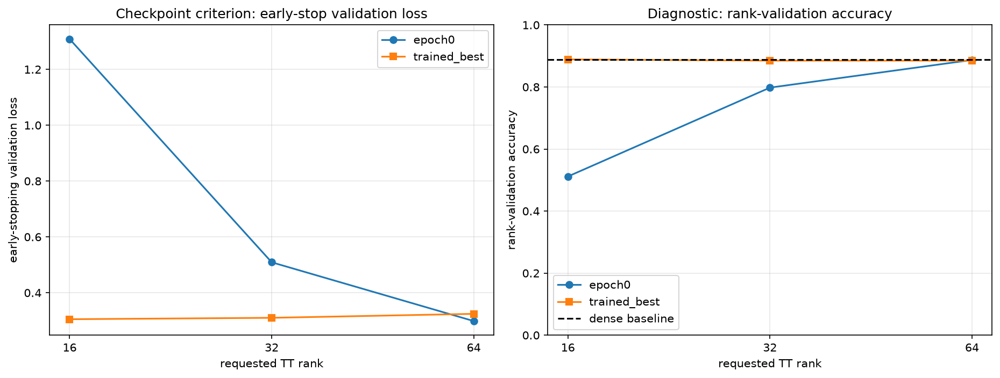

# Fashion-MNIST MLPのepoch 0を含むcheckpoint再選択と再現確認

## このノートの位置づけ

このノートは、Notebook 12の保存結果と、同じ結果についてChatGPTおよびPerplexityとの対話で行った考察を統合する。

- [12_epoch0_checkpoint_selection_and_reproducibility.ipynb](../../../notebooks/30_tt_mps/10_fashion_mnist_mlp/12_epoch0_checkpoint_selection_and_reproducibility.ipynb)

Notebook 10では、fine-tuning開始後のepochだけをbest checkpointの候補にしていた。Notebook 12では新たな学習をせず、圧縮直後のepoch 0と、Notebook 10で保存したtrained bestを同じvalidation loss基準で比較し直した。また、保存checkpointを読み直した評価値がNotebook 10の保存値と一致するか確認した。

checkpoint候補へepoch 0を含める一般的な理由、lossとaccuracyの違い、再評価の再現性と再学習の再現性の区別は、[[00_基礎理論/03_モデル圧縮理論/30_TTLinear圧縮/75_epoch0を含むcheckpoint選択と保存モデルの再現確認]]へ分ける。このノートではNotebook 12の保存値から直接言えることを中心にする。

## 1. 証拠レベル

数値は、Notebook 12の保存済み出力と次のCSVを照合した結果である。

- [implementation_audit.csv](../../../results/30_tt_mps/10_fashion_mnist_mlp/12_epoch0_checkpoint_selection_and_reproducibility/implementation_audit.csv)
- [checkpoint_reproduction.csv](../../../results/30_tt_mps/10_fashion_mnist_mlp/12_epoch0_checkpoint_selection_and_reproducibility/checkpoint_reproduction.csv)
- [epoch0_checkpoint_comparison.csv](../../../results/30_tt_mps/10_fashion_mnist_mlp/12_epoch0_checkpoint_selection_and_reproducibility/epoch0_checkpoint_comparison.csv)
- [selected_checkpoint_metrics.csv](../../../results/30_tt_mps/10_fashion_mnist_mlp/12_epoch0_checkpoint_selection_and_reproducibility/selected_checkpoint_metrics.csv)

保存済みNotebookではコードセルの実行番号が1から9まで連続し、エラー出力はない。最後のguardは`no-training / no-test / output verification: OK`である。ただし、このノート作成時にFresh Restart Kernel、Run Allを新たに行ったわけではない。従って、保存済み出力・CSV・Figureの確認と、新規の全セル再実行確認は区別する。

## 2. Notebook 12が行ったこと

対象はNotebook 09で選び、Notebook 10でfine-tuningした3候補である。

| role | requested rank | actual TT-ranks | model parameter数 | denseに対するmodel圧縮率 |
| :-- | ---: | :-- | ---: | ---: |
| aggressive | 16 | `(1, 16, 16, 1)` | 153,386 | 3.493倍 |
| balanced | 32 | `(1, 32, 32, 1)` | 205,130 | 2.612倍 |
| conservative | 64 | `(1, 64, 64, 1)` | 406,922 | 1.317倍 |

Notebook 12の処理は次の3段階である。

1. Notebook 10のloss、optimizer、seed、評価関数、更新対象などを静的に監査する。
2. 保存済みtrained bestを再構築して再評価し、Notebook 10の保存値を再現する。
3. 各rankでepoch 0とtrained bestのearly-stopping validation lossを比較し、checkpointを選び直す。

新しいfine-tuning、test setでの評価、全epochの再探索、patience trajectoryの再計算は行っていない。

### 2.1 実装監査の結果

Notebook 12では、Notebook 10の実装条件を12項目に分け、すべて`PASS`であることを確認した。

| 監査対象 | 確認された内容 |
| :-- | :-- |
| loss | `CrossEntropyLoss`のみ。蒸留lossは使わない |
| optimizer | roleごとに独立したAdamを作る |
| 学習率・weight decay | `lr=1e-3`、`weight_decay=0` |
| scheduler | なし |
| seed | 各roleでseed 0とtrain用Generatorをリセット |
| 初期dense checkpoint | 全roleで同じ`baseline_state`から開始 |
| optimizer state | role間で共有しない |
| best判定 | early-stopping validation lossの`min_delta`を超える改善 |
| 元のepoch 0の扱い | best候補に含まれていなかった |
| 評価mode | `eval()`と`no_grad()`を使う |
| logits RMSE | 全sample・全classのlogit要素に対するglobal RMSE |

表では学習率とweight decayを1行にまとめたため11行だが、CSVでは別項目として数え、全12項目である。この監査は保存された実装が意図した共通条件になっているかを確認するものであり、学習率や更新範囲が各rankに最適だったことを示さない。

## 3. checkpoint選択規則

epoch 0のlossを$L_0$、保存済みtrained bestのlossを$L_{\mathrm{best}}$、`min_delta = 0.0001`を$\delta$とする。trained bestを選ぶ条件は、

$$
L_0 - \delta > L_{\mathrm{best}}
$$

である。改善が$\delta$以下の場合は、より早いepoch 0を残す。

選択基準は最初からearly-stopping validation lossに固定されている。rank-selection validationのaccuracy、prediction agreement、logits RMSEは採用後の診断指標であり、選択には使わない。

## 4. 保存結果

### 4.1 保存checkpointの再現確認

| rank | validation loss差 | accuracy差 | agreement差 | logits RMSE差 | 判定 |
| ---: | ---: | ---: | ---: | ---: | :-- |
| 16 | 0 | 0 | 0 | 0 | PASS |
| 32 | $5.55\times10^{-17}$ | 0 | 0 | 0 | PASS |
| 64 | 0 | 0 | 0 | $1.78\times10^{-15}$ | PASS |

差は0または浮動小数点の丸め誤差水準であり、全候補が許容差内で一致した。

### 4.2 epoch 0とtrained bestの比較

| rank | checkpoint | epoch | early-stop loss | early-stop accuracy | rank-validation loss | rank-validation accuracy | agreement | logits RMSE |
| ---: | :-- | ---: | ---: | ---: | ---: | ---: | ---: | ---: |
| 16 | epoch 0 | 0 | 1.308600 | 0.5110 | 1.302496 | 0.5116 | 0.5276 | 7.933703 |
| 16 | trained best | 5 | 0.305269 | 0.8868 | 0.308215 | 0.8890 | 0.9314 | 3.666437 |
| 32 | epoch 0 | 0 | 0.509134 | 0.7946 | 0.514218 | 0.7980 | 0.8460 | 4.451787 |
| 32 | trained best | 5 | 0.310279 | 0.8912 | 0.325543 | 0.8850 | 0.9298 | 7.104990 |
| 64 | epoch 0 | 0 | 0.298593 | 0.8830 | 0.310711 | 0.8872 | 0.9922 | 0.179470 |
| 64 | trained best | 6 | 0.324507 | 0.8888 | 0.324577 | 0.8850 | 0.9208 | 11.700915 |

### 4.3 再選択結果

| rank | 採用checkpoint | 採用epoch | early-stop loss | rank-validation accuracy |
| ---: | :-- | ---: | ---: | ---: |
| 16 | trained best | 5 | 0.305269 | 0.8890 |
| 32 | trained best | 5 | 0.310279 | 0.8850 |
| 64 | epoch 0 | 0 | 0.298593 | 0.8872 |

rank 16・32ではfine-tuning後が選ばれ、rank 64だけが圧縮直後へ戻った。

## 5. 実験結果からの考察

### 5.1 fine-tuningの必要性はrankによって異なった

rank 16は圧縮直後のaccuracyが`0.5116`、rank 32は`0.7980`であり、denseモデルのタスク性能を十分に保てていなかった。fine-tuning後にはそれぞれ`0.8890`、`0.8850`まで回復し、固定したloss基準でもtrained bestが選ばれた。従って、今回のrank 16・32ではfine-tuningが有効だった。

一方、rank 64は圧縮直後からaccuracy `0.8872`、agreement `0.9922`、logits RMSE `0.179470`であり、denseモデルをすでによく近似していた。fine-tuning後は選択基準のlossが`0.298593`から`0.324507`へ悪化したため、epoch 0が採用された。

従って、今回の条件では、rank 64に対するfine-tuningは固定したcheckpoint選択基準の改善に寄与せず、採用モデルを得るためには不要だった。ただし、これは「rank 64ではfine-tuningが常に不要」という一般論ではない。学習率、更新対象、seed、checkpoint候補の扱いを変えれば結果が変わる可能性がある。

### 5.2 rank 64ではlossとaccuracyが逆方向へ動いた

rank 64のearly-stopping validationでは、fine-tuningによりaccuracyが`0.8830`から`0.8888`へ0.58 percentage point上昇した一方、Cross Entropy lossは`0.298593`から`0.324507`へ悪化した。

これは矛盾ではない。accuracyはargmaxが正解した件数だけを見るが、Cross Entropyは全sampleについて正解ラベルへ割り当てた確率を見る。少し多く正解するようになっても、残った誤分類で正解確率が大きく下がったり、正解のまま確信度が下がったりすれば、平均lossは増え得る。

ただし、集計値だけから「過信した誤分類が増えた」「calibrationが悪化した」とは断定できない。これを確かめるには、sampleごとのloss変化、正誤の遷移、信頼度、calibration指標が必要である。

### 5.3 loss基準を途中でaccuracy基準へ変えない

rank 64のtrained bestはaccuracyだけならepoch 0より高い。しかし、今回のcheckpoint選択基準は事前にvalidation lossへ固定されている。そのためepoch 0を選ぶ判断でよい。

結果を見た後でrank 64だけaccuracy基準へ変更すると、epoch 0を候補に加えた効果と選択指標を変更した効果が混ざる。Notebook 12ではloss基準を維持し、accuracy上昇は別の観測として報告することで、比較の一貫性を保っている。

また、trained bestはlossで選ばれたcheckpointであり、全epoch中でaccuracyが最大のcheckpointとは限らない。

### 5.4 fine-tuningが有効でなかった原因候補

今回の集計値と監査結果から、rank 64では「圧縮で壊れた状態を修復する利益」より、良好だった初期状態を更新で変える影響が大きかった可能性がある。具体的な候補は次である。

1. 圧縮直後からdenseに近く、rank 16・32より修復の余地が小さかった。
2. accuracyは上昇したが、残った誤分類や正解sampleの確率が悪化し、平均Cross Entropyが増えた可能性がある。
3. `lr=1e-3`でTT cores、`fc1` bias、`fc2`、`fc3`を同時更新する条件が、良好な初期状態には強すぎた可能性がある。
4. train lossへの適合が進んでも、validation lossの改善へ一般化しなかった可能性がある。
5. lossは正解labelへのCross Entropyだけであり、dense logitsやprediction agreementを保存する目的がなかった。

5はdense再現性が悪化し得る理由を説明するが、validation lossまで悪化した原因を単独では説明しない。また、1〜4のどれが支配的だったかは、sample別確率、学習曲線、学習率、更新対象のablationなしには確定できない。

### 5.5 Notebook 10・11の結果は誤りではない

Notebook 10・11と12は、答えている問いが異なる。

| Notebook | 答えている問い |
| :-- | :-- |
| 10 | epoch 1以降で、validation lossにより選んだtrained checkpointはどうなったか |
| 11 | Notebook 10で選んだfine-tuning後の候補をparameter数とaccuracyで比較するとどうなるか |
| 12 | epoch 0と保存済みtrained bestを同じloss基準で比較すると、どちらを採用するか |

Notebook 12はNotebook 10の保存値を再現している。従って、以前の数値を訂正したのではなく、候補集合へepoch 0を追加したことでrank 64の採用判断を更新したと整理する。

Notebook 10・11を残すことで、fine-tuning後の比較からrank 64の悪化に気づき、保存値を検証し、epoch 0を含む選択へ改善した経緯も追跡できる。

### 5.6 Notebook 11の中心的なPareto結論は変わらない

Notebook 12で選び直したモデルをparameter数とrank-validation accuracyで比較すると、rank 16は153,386 parameters・accuracy `0.8890`、rank 64は406,922 parameters・accuracy `0.8872`である。rank 16はrank 32・64より小さく、accuracyも高い。そのため、この2軸によるPareto frontierには引き続きrank 16だけが残る。

ただし、「高rankに意味がなかった」という表現は広すぎる。epoch 0のrank 64はagreement `0.9922`、logits RMSE `0.179470`であり、dense出力の再現性では採用後のrank 16より優れている。正確には、今回の候補とvalidationにおいて「parameter数とclassification accuracyの2軸では、高rankを選ぶ利点がなかった」である。

また、accuracy差は小さく、1 seed・1 checkpointの結果である。rank 16の一般的な最適性や、差の統計的確実性は示していない。

### 5.7 再現確認により除外しやすくなった原因

保存checkpointの再評価が一致したため、rank 64の悪化は次の単純な説明では考えにくい。

- Notebook 10のCSVや表示への転記ミス
- rank 16・32・64のcheckpointの取り違え
- 再構築時のtensorizationまたはTT-rankの不一致
- checkpointの保存・読み込みによる、今回の指標を変えるほどの復元不良
- 元の実行時にだけ生じた一時的な評価値の乱れ
- 許容差を超える非決定的な再評価

これにより、調査対象を「保存値が本物か」から「なぜ保存されたモデルがこの振る舞いになったか」へ進められる。

### 5.8 再現確認だけでは除外できない原因

一方、再評価の一致は次を保証しない。

- 学習率や更新対象がrank 64に適していたこと
- 元の学習処理と評価関数に共通の不具合がないこと
- 別seedで学習しても同じ結果になること
- test setへ一般化すること
- epoch 0を最初から候補にしたearly stoppingでも、同じ停止過程になること

「保存モデルを同じ手順で再評価できたこと」と「学習実験そのものを独立に再現できたこと」は別である。

### 5.9 post-hocな二者比較という範囲

Notebook 12が選んだのは、epoch 0と保存済みtrained bestの2候補のうち良い方である。epoch 1から最終epochまでの全checkpointを再探索したわけではない。また、epoch 0を最初からbestへ登録した場合にはpatienceの数え方や停止epochが変わる可能性があるが、そのtrajectoryも再計算していない。

従って、Notebook 12の結論は「epoch 0を含む完全なearly stoppingを再実行した結果」ではなく、「保存済み結果にepoch 0を追加したpost-hocな再選択」である。

## 6. 言えること・言えないこと

| 言えること | この実験だけでは言えないこと |
| :-- | :-- |
| rank 16・32では固定loss基準でtrained bestが選ばれた | rank 16・32ではどの条件でもfine-tuningが必要である |
| rank 64では固定loss基準でepoch 0が選ばれた | rank 64ではfine-tuningが一般に無効である |
| rank 64のaccuracy上昇とloss悪化が同時に起きた | その原因が過信、calibration、過学習のどれかである |
| 保存checkpointの評価値は許容差内で再現した | 独立な再学習でも同じ結果になる |
| parameter数とaccuracyではrank 16が32・64を支配した | latency、memory、全rank、全seedでもrank 16が最良である |
| dense再現性ではepoch 0のrank 64が優れていた | denseに近いほどtask accuracyが高い |

## 7. 結論

> epoch 0をcheckpoint候補に含めて再選択した結果、rank 16・32ではfine-tuning後のcheckpointが選ばれたが、rank 64ではfine-tuning前のepoch 0が選ばれた。従って、今回の固定validation loss基準では、fine-tuningの必要性はrankと圧縮直後の状態によって異なり、圧縮後のモデルを常に再学習すればよいわけではなかった。rank 64ではaccuracyがわずかに上昇してもlossとdense再現性が悪化しており、指標ごとに結果を分けて読む必要がある。

Notebook 11のparameter数とaccuracyに関するPareto結論は維持される。一方、rank 64のepoch 0はdense再現性に優れるため、モデルの目的をaccuracyとsizeだけに限定しない場合には別の価値を持つ。

## 8. 今後の確認

- epoch 0を最初から候補に含め、patience trajectoryも含めてfine-tuningを再実行する
- 更新対象や学習率を変え、rank 64の悪化が学習条件に依存するか調べる
- sampleごとのloss変化、正誤遷移、信頼度を調べ、lossとaccuracyの乖離を分解する
- 複数seedで傾向とaccuracy差の不確実性を確認する
- validationで条件を固定した後にtest setを一度だけ評価する

次のNotebookで行う更新対象のablationは今後の検証であり、このNotebook 12の実験結果には含めない。
