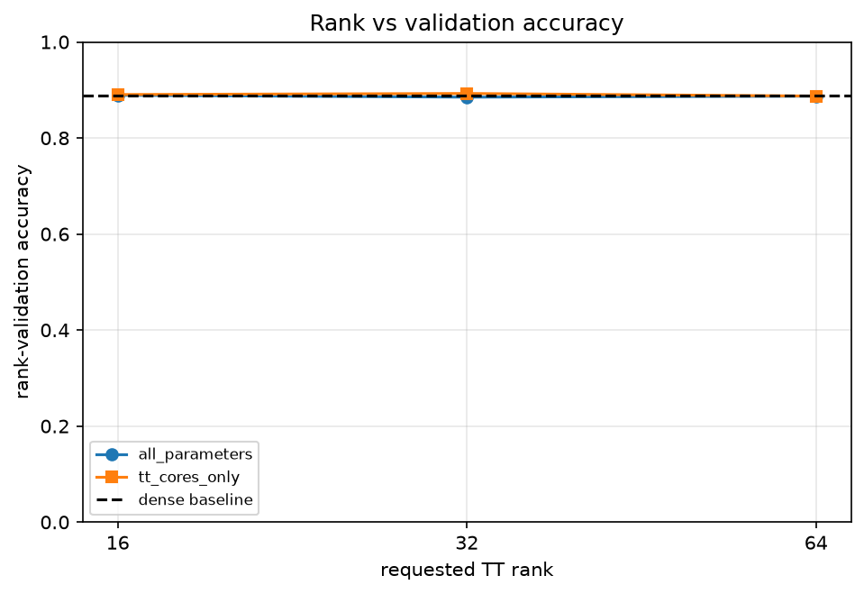
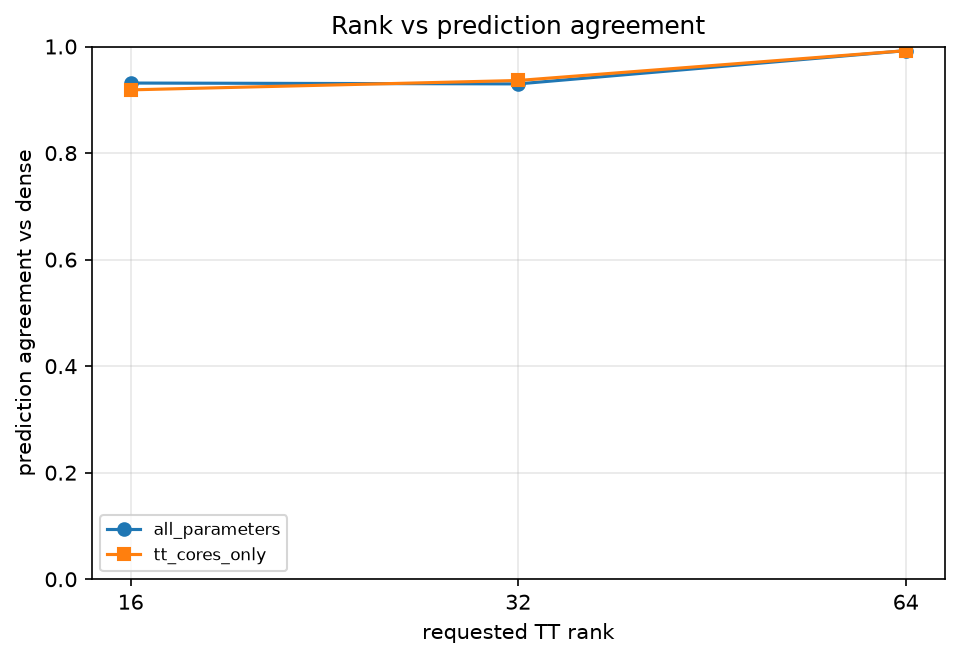
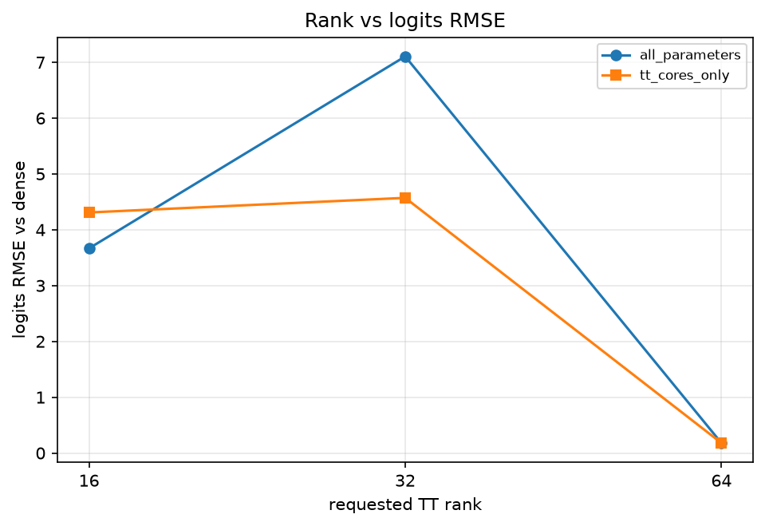
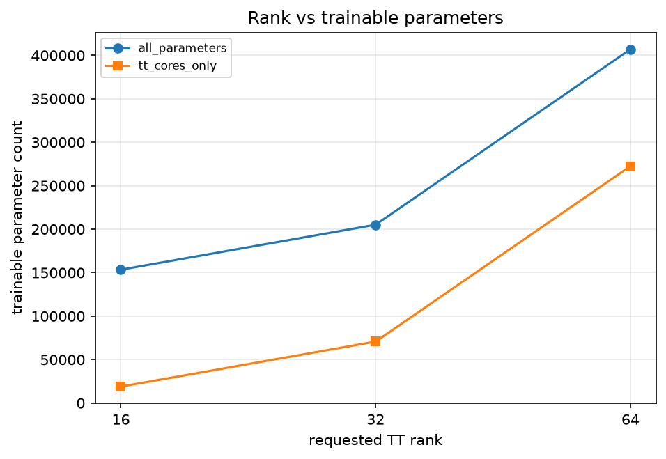
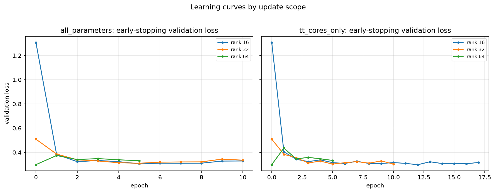

# Fashion-MNIST MLPのTTコアのみ更新ablation

## このノートの位置づけ

このノートは、Notebook 13の保存結果と、同じ結果についてChatGPTおよびPerplexityとの対話で行った考察を統合する。

- [13_tt_cores_only_ablation.ipynb](../../../notebooks/30_tt_mps/10_fashion_mnist_mlp/13_tt_cores_only_ablation.ipynb)

Notebook 12では、rank 64についてfine-tuning前のepoch 0が選ばれ、全parameter更新後にはdenseモデルからのlogitsの乖離が大きくなっていた。Notebook 13では、同じepoch 0から開始して、次の2方式だけを変えるcontrolled ablationを行った。

- `all_parameters`：TT cores、`fc1.bias`、`fc2`、`fc3`をすべて更新する。
- `tt_cores_only`：`fc1.cores.0`、`fc1.cores.1`、`fc1.cores.2`だけを更新する。

層を固定する一般的な意味、更新部分空間、同じ学習率を使う比較の範囲、early stoppingと局所最小点の違いは、[[00_基礎理論/03_モデル圧縮理論/30_TTLinear圧縮/76_fine-tuning更新範囲のcontrolled_ablation]]へ分ける。このノートでは、Notebook 13の保存値から直接言えることを中心にする。

## 1. 証拠レベル

数値はNotebook 13の保存済み出力と、次のCSVを照合した結果である。

- [update_scope_comparison.csv](../../../results/30_tt_mps/10_fashion_mnist_mlp/13_tt_cores_only_ablation/update_scope_comparison.csv)
- [update_scope_history.csv](../../../results/30_tt_mps/10_fashion_mnist_mlp/13_tt_cores_only_ablation/update_scope_history.csv)
- [trainable_parameters.csv](../../../results/30_tt_mps/10_fashion_mnist_mlp/13_tt_cores_only_ablation/trainable_parameters.csv)
- [frozen_parameter_verification.csv](../../../results/30_tt_mps/10_fashion_mnist_mlp/13_tt_cores_only_ablation/frozen_parameter_verification.csv)

保存済みNotebookではコードセルの実行番号が45から57まで連続し、エラー出力はない。最後のguardは`verification checklist: OK`である。6 checkpoint、4 CSV、5 Figureが保存されていることも確認した。ただし、このノート作成時にFresh Restart Kernel、Run Allを新たに実行したわけではない。保存済み成果物の確認と、新規の全セル再実行確認は区別する。

## 2. 実験設計

### 2.1 比較対象

Notebook 09で選択した`reversed_sites`のtensorizationを使い、同じdense checkpointからrank 16・32・64のepoch 0モデルを作り直した。各rankでepoch 0をdeep copyし、完全に同じparameter値から2つの更新方式を開始した。

| role | requested rank | 総parameter数 | denseに対する圧縮率 |
| :-- | ---: | ---: | ---: |
| aggressive | 16 | 153,386 | 3.493倍 |
| balanced | 32 | 205,130 | 2.612倍 |
| conservative | 64 | 406,922 | 1.317倍 |

新規学習は3 ranksと2 update scopesの組合せで6 trialである。

### 2.2 固定した条件

- optimizer：Adam
- 学習率：`1e-3`
- weight decay：0
- loss：正解labelに対するCross Entropy
- seed、データ分割、trialごとに作り直すtrain loaderのGenerator
- epoch 0を初期bestとするearly stopping
- checkpoint選択：early-stopping validation lossのみ
- rank-selection validation：accuracy、agreement、logits RMSEの診断のみ
- test set：予約のみで未評価

`tt_cores_only`では、選択モデルについて`fc1.bias`、`fc2`、`fc3`が学習前後で`torch.equal=True`、最大絶対変化0であることを確認した。TT-rank、core shape、総parameter数も不変だった。rank 64では両方式ともepoch 0が選ばれたため、学習可能parameterを含め、採用モデルの全parameterが初期値と一致する。

## 3. 保存結果

### 3.1 fine-tuning前のepoch 0

同じrankの2方式は同一モデルから開始するため、epoch 0の値も同じである。

| rank | early-stop loss | rank-validation accuracy | agreement | logits RMSE |
| ---: | ---: | ---: | ---: | ---: |
| 16 | 1.308600 | 0.5116 | 0.5276 | 7.933703 |
| 32 | 0.509134 | 0.7980 | 0.8460 | 4.451787 |
| 64 | 0.298593 | 0.8872 | 0.9922 | 0.179470 |

### 3.2 選択モデル

| rank | 更新方式 | 選択epoch | early-stop loss | rank-validation accuracy | agreement | logits RMSE |
| ---: | :-- | ---: | ---: | ---: | ---: | ---: |
| 16 | 全parameter | 5 | 0.305269 | 0.8890 | 0.9314 | 3.666437 |
| 16 | TT coresのみ | 12 | 0.297878 | 0.8904 | 0.9186 | 4.309767 |
| 32 | 全parameter | 5 | 0.310279 | 0.8850 | 0.9298 | 7.104990 |
| 32 | TT coresのみ | 5 | 0.303450 | 0.8926 | 0.9362 | 4.571566 |
| 64 | 全parameter | 0 | 0.298593 | 0.8872 | 0.9922 | 0.179470 |
| 64 | TT coresのみ | 0 | 0.298593 | 0.8872 | 0.9922 | 0.179470 |

### 3.3 学習可能parameter数

| rank | 総parameter数 | 全parameter更新 | TT coresのみ | TT coresのみで固定した割合 |
| ---: | ---: | ---: | ---: | ---: |
| 16 | 153,386 | 153,386 | 18,976 | 87.6% |
| 32 | 205,130 | 205,130 | 70,720 | 65.5% |
| 64 | 406,922 | 406,922 | 272,512 | 33.0% |

更新対象を減らしても、同じrankの総parameter数、保存サイズ、推論時のモデル構造は変わらない。これは学習対象の削減であり、追加のモデル圧縮ではない。

### 3.4 rank 64の学習trajectory

| 更新方式 | epoch | train accuracy | early-stop loss | rank-validation accuracy | agreement | logits RMSE |
| :-- | ---: | ---: | ---: | ---: | ---: | ---: |
| 全parameter | 0 | - | 0.298593 | 0.8872 | 0.9922 | 0.179470 |
| 全parameter | 1 | 0.85972 | 0.374058 | 0.8596 | 0.8962 | 4.879357 |
| 全parameter | 5 | 0.90748 | 0.330742 | 0.8822 | 0.9212 | 12.217580 |
| TT coresのみ | 0 | - | 0.298593 | 0.8872 | 0.9922 | 0.179470 |
| TT coresのみ | 1 | 0.86296 | 0.435695 | 0.8370 | 0.8710 | 5.538511 |
| TT coresのみ | 5 | 0.90766 | 0.333562 | 0.8812 | 0.9284 | 9.401554 |

### 3.5 停止epochと累積train時間

| rank | 更新方式 | 選択epoch | 停止epoch | 累積train時間 |
| ---: | :-- | ---: | ---: | ---: |
| 16 | 全parameter | 5 | 10 | 37.30秒 |
| 16 | TT coresのみ | 12 | 17 | 60.87秒 |
| 32 | 全parameter | 5 | 10 | 55.63秒 |
| 32 | TT coresのみ | 5 | 10 | 55.03秒 |
| 64 | 全parameter | 0 | 5 | 55.46秒 |
| 64 | TT coresのみ | 0 | 5 | 55.63秒 |

累積時間は`train_one_epoch`の合計であり、評価時間を含まない。また、選択epochまでではなくearly stoppingで停止するまでの時間である。

## 4. 実験結果からの考察

### 4.1 TT coresだけでもrank 16・32の分類性能は回復した

rank 16はaccuracy `0.5116`から`0.8904`、rank 32は`0.7980`から`0.8926`へ回復した。`fc1.bias`、`fc2`、`fc3`を固定しても、圧縮した`fc1`のTT coresを正解labelへ最適化するだけで、今回の分類性能は回復できた。

従って、今回のrank 16・32には「accuracyを回復するために全parameter更新が必須だった」という証拠はない。ただし、Fashion-MNIST MLPの`fc1`だけ、単一checkpoint・seed、学習率`1e-3`での結果である。TT圧縮一般でTT coresだけの更新が十分だとは言えない。

### 4.2 更新方式の優劣はrankと指標で揃わなかった

rank 32ではTT coresのみが、accuracy、agreement、logits RMSEの3指標で全parameter更新より良かった。一方、rank 16ではTT coresのみのaccuracyが`0.0014`高いが、agreementは`0.0128`低く、RMSEも`0.643329`大きい。

rank-validationは5,000件なので、rank 16のaccuracy差は7件、rank 32のaccuracy差は38件である。これらは今回の点推定値であり、単一試行だけから明確な優位性を主張しない。特に同じsampleへの予測を比較しているため、正解数の差だけでなく、一方だけが正解したsample数の組も必要である。予測labelを保存すれば、McNemar検定による対応のある比較ができる。

現時点では、rank 12でも一方へ決め打ちせず、同じepoch 0から両方式を比較するのが妥当である。

### 4.3 accuracyとdenseへの近さは別の目的である

rank 16では、TT coresのみが7件多く正解した一方、全parameter更新の方がdenseのargmaxとlogitsに近かった。この違いは矛盾ではない。

- accuracy：正解labelと一致したか。
- agreement：denseモデルのargmaxと一致したか。
- logits RMSE：denseモデルの全logit値に近いか。

denseモデルも誤るため、denseと異なる予測が新たな正解になる場合も、逆に不正解になる場合もある。従って「accuracyが高い」と「denseを忠実に再現する」は単調な関係ではない。用途が分類性能ならaccuracy・lossを主要指標にし、teacherへの忠実さが必要ならagreement・RMSEも選択条件として事前に位置づける必要がある。

### 4.4 fine-tuningはdense logitsの復元ではなく、別のtask解を探索した

rank 32のTT coresのみでは、accuracyが`0.7980`から`0.8926`へ大きく改善した一方、logits RMSEは`4.451787`から`4.571566`へわずかに悪化した。学習目的は正解labelに対するCross Entropyであり、dense logitsの模倣ではない。従って、accuracyの回復をdense logitsへの接近で説明できない。

この結果は、TTモデルがdenseモデルを数値的に復元したのではなく、同じ分類タスクを解ける別のparameter解へ移ったことと整合する。ただし、出力指標だけから「denseが使った特徴を失い、新しい意味的特徴を獲得した」とは言えない。既存特徴の強さや組合せ、後段での使われ方が変わっただけでも説明できる。内部表現を主張するには、sample別の正誤遷移、層活性、CKAなどの追加確認が必要である。

### 4.5 rank 64では、選択モデルから更新方式の優劣を判断できない

rank 64は両方式とも同じepoch 0が選ばれた。採用モデルのaccuracy `0.8872`、agreement `0.9922`、RMSE `0.179470`が同じなのは、2方式が同程度に学習できたからではなく、どちらも更新後のcheckpointを採用できなかったからである。

従ってrank 64の選択結果から言えるのは、「今回の学習率・停止規則では、両方式ともepoch 0より良いvalidation lossを得られなかった」であり、2つの更新方式が一般に同等ということではない。

### 4.6 rank 64のRMSE増大は後段層の更新だけでは説明できない

epoch 5のRMSEは、全parameter更新で`12.217580`、TT coresのみで`9.401554`だった。更新範囲を限定した方が今回の乖離は小さく、`fc1.bias`、`fc2`、`fc3`の更新が追加の乖離へ寄与した可能性はある。

しかし、TT coresのみでもRMSEは`0.179470`から`9.401554`へ増えた。従って、後段層まで更新したことだけを原因にはできない。両方式に共通するTT coresの更新によって、`fc1`から後段へ渡す値が変化し、最終logitsがdenseから離れたと考えられる。

また、agreementも全parameter更新で`0.9922`から`0.9212`、TT coresのみで`0.9922`から`0.9284`へ低下した。5,000件に換算すると、denseとの不一致は約39件から、それぞれ394件と358件へ増えた。従って、RMSE増大をlogitsの共通shiftやscale変化だけで説明することもできず、argmaxの入替えも実際に起きている。

一方、accuracy低下は25件と30件程度である。denseと異なる予測のすべてが誤りになったわけではなく、正解・不正解sampleの入替えを伴いながら、近い集計accuracyを維持したと読める。

### 4.7 今回のrank 64ではfine-tuningに採用上の利益がなかった

rank 64では、両方式ともepoch 1からearly-stopping validation lossがepoch 0より悪く、epoch 0が最後までbestだった。epoch 5ではtrain accuracyが約`0.9075`まで上がった一方、rank-validation accuracyは`0.8812`〜`0.8822`で、epoch 0の`0.8872`を下回った。trainへの適合が未学習データの改善につながらなかった点は、過学習という解釈と整合する。

従って今回の`lr=1e-3`では、rank 64を採用するためのfine-tuningは不要だった。ただし「rank 64にはfine-tuningが常に不要」とは言えない。より小さい学習率でepoch 0近傍を微調整すれば改善する可能性と、どの学習率でも改善余地がない可能性は、まだ区別できていない。

early stoppingがepoch 0を選んだことは、観測したepoch checkpointの中でepoch 0が最良だったことを示す。Adamがtrain lossの勾配を使って探索したことや、validation lossが一定期間改善しなかったことは、epoch 0がparameter空間の局所最小点であることを証明しない。

### 4.8 同じ学習率を使った比較が答える範囲

同じoptimizer、学習率`1e-3`、seed、データ順、停止規則で更新範囲だけを変えたため、「共通の学習条件で更新範囲を変えるとどうなったか」というcontrolled ablationとして有効である。

一方、「各方式に適した学習率を個別に調整した場合、どちらが最高性能を出すか」は比較していない。学習可能parameter数が違うから学習率を必ず変えるべき、という意味ではない。更新する層と最適化geometryが違うため、最適な学習率も異なる可能性が残る、という範囲である。

### 4.9 選択epochだけで回復速度を断定しない

rank 16では、全parameter更新はepoch 5、TT coresのみはepoch 12が選ばれた。更新方向をTT coresへ制限し、固定した後段が利用できる特徴を`fc1`だけで作り直す必要があるため、良い状態の選択が遅れた可能性はある。

ただし、選択epochは「同じaccuracyへ初めて到達したepoch」ではなく、early-stopping validation lossが最良だったepochである。この2点だけから、TT coresのみのaccuracy回復速度が遅かったとは断定しない。途中のaccuracy・loss曲線を同じ閾値で比較する必要がある。

### 4.10 学習対象削減と時間短縮は一致しなかった

停止までの累積train時間は、rank 16で全parameter更新`37.30`秒、TT coresのみ`60.87`秒、rank 32で`55.63`秒と`55.03`秒、rank 64で`55.46`秒と`55.63`秒だった。

この時間は評価時間を含まず、実行epoch数も異なる。固定層を含むforwardと、TT coresへ勾配を返すための後段を通したbackwardも必要である。従って、学習可能parameterの削減率から試行全体の時間短縮率を直接推定できない。1 epochあたりの速度を比較するなら、同じepoch数・同じ計測範囲で別に測る必要がある。

### 4.11 rankとaccuracyは単調ではなかった

TT coresのみの選択モデルは、rank 16が`0.8904`、rank 32が`0.8926`、rank 64が`0.8872`だった。高rankほど選択後accuracyが高いわけではない。ただし、rank 64だけepoch 0、rank 16・32は学習後を比較しているため、rankの表現能力だけの比較ではない。

rank 64のepoch 0はdense忠実度で大きく優れている。圧縮率・classification accuracy・dense忠実度のどれを重視するかで評価は変わるため、「高rankに意味がなかった」と一般化しない。

### 4.12 選択モデルは全診断指標が最良のepochではない

rank 16の全parameter更新では、epoch 5から10にかけてtrain lossは`0.267224`から`0.204991`へ低下し、rank-validation accuracyは`0.8890`から`0.8922`へ上がった。一方、early-stopping validation lossは`0.305269`から`0.328877`へ悪化し、RMSEも`3.666437`から`7.165574`へ増えた。

選択基準は別の5,000件に対するvalidation lossへ事前に固定されているため、epoch 5を採用する。この例は、train loss、別splitのaccuracy、dense忠実度が同じ方向へ動くとは限らず、選択モデルがすべての記録指標で最大・最小になるわけではないことを示す。

### 4.13 Notebook 12の全parameter更新を再現した

Notebook 13の`all_parameters`は、Notebook 12の選択epochとaccuracy、agreement、logits RMSEに一致した。TT coresのみの条件を追加しても、比較基準となる全parameter更新を同じ実験条件で再現できたことを支持する。

ただし、表示指標の一致はstate dict全要素の完全一致を直接示すものではない。また、単一seedの学習再現と、複数seedにまたがる統計的頑健性は別である。

## 5. 言えること・言えないこと

| 言えること | この実験だけでは言えないこと |
| :-- | :-- |
| rank 16・32ではTT coresのみでもaccuracyが回復した | TT圧縮では一般にTT coresだけ更新すれば十分である |
| rank 32の点推定ではTT coresのみが3指標で良かった | rank 32でTT coresのみが統計的に優位である |
| rank 16ではaccuracyとdense忠実度の優劣が分かれた | accuracyが高いほどdenseに近い、またはその逆である |
| rank 64では両方式ともepoch 0が選ばれた | 2つの更新方式が一般に同等である |
| rank 64の後段更新は追加の乖離へ寄与した可能性がある | RMSE増大の原因が後段更新だけである |
| `lr=1e-3`ではrank 64に採用上のfine-tuning利益がなかった | 学習率を変えてもrank 64のfine-tuningは無効である |
| 同一学習率で更新範囲を比較した | 各方式を個別調整した最高性能を比較した |
| frozen parameterは選択モデルで完全一致した | 別モデル・別層・別seedでも同じ結果になる |

## 6. 結論

> 同一のepoch 0から更新範囲だけを変えた結果、rank 16・32ではTT coresのみの更新でも分類性能を回復でき、全parameter更新が必須だという証拠は得られなかった。一方、rank 16では分類accuracyとdense忠実度の優劣が分かれ、rank 32の差も単一試行の点推定であるため、どちらの更新方式が一般に優れるかは決められない。rank 64では両方式ともepoch 0が選ばれ、TT coresのみでも学習中のRMSEが大きく増えたため、後段層の更新だけを乖離の原因にはできない。今回の`lr=1e-3`ではfine-tuningに採用上の利益がなかったが、fine-tuning自体が不要なのか、学習条件が強すぎたのかは未確定である。

## 7. 今後の確認

優先順位を分ける。

1. rank 12では同じepoch 0から両更新方式を比較し、一方へ決め打ちしない。
2. 更新方式の差を主張するなら複数seedで繰り返し、sample別予測を保存して対応のある比較を行う。
3. rank 64の原因まで特定したい場合は、同じepoch 0・seed・データ順から学習率を下げ、必要ならpatienceも分けて検討する。
4. rank 64でtrain lossとvalidation loss、sample別の正誤遷移・Cross Entropy・confidenceを確認する。
5. 内部特徴の変化を主張する場合だけ、同じsampleに対する`fc1`・`fc2`活性やCKAを追加する。
6. validationでrank、更新方式、学習率を固定した後、test setを一度だけ最終評価する。
