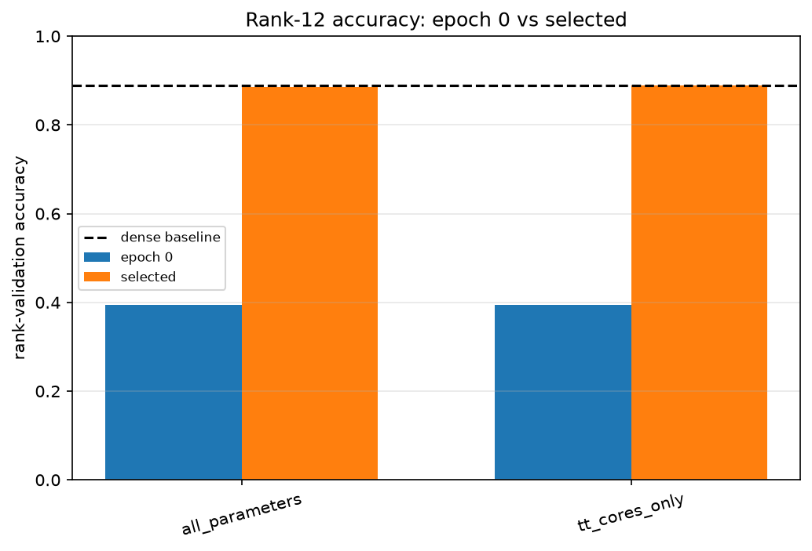
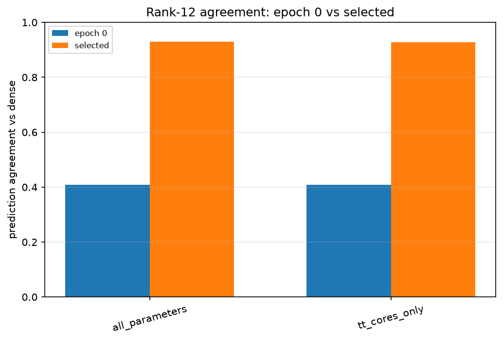
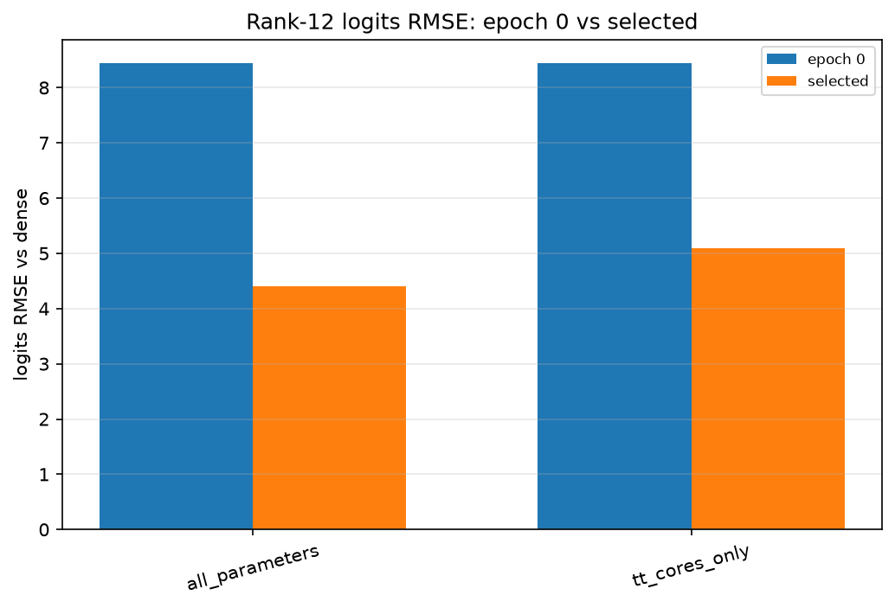
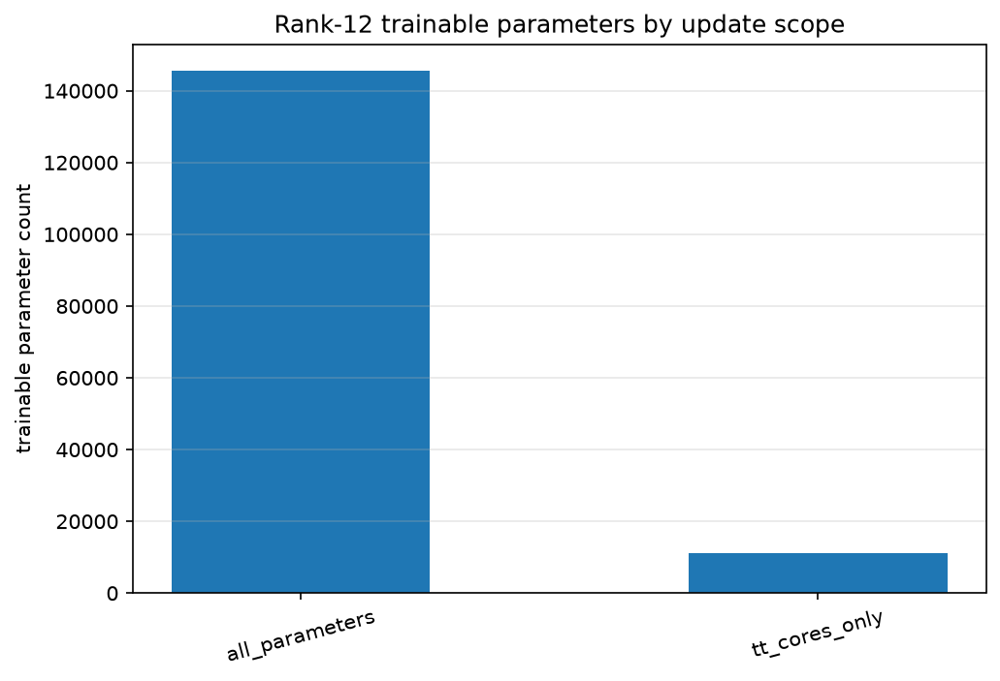
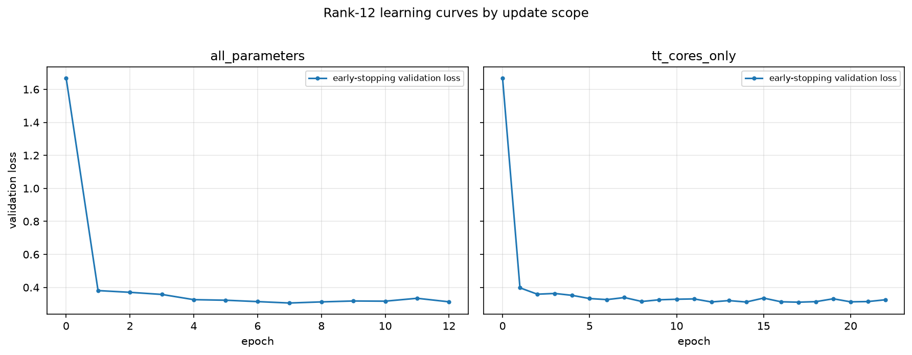

# Fashion-MNIST MLPのrank 12追加と更新範囲比較

## このノートの位置づけ

このノートは、Notebook 14の保存結果と、同じ結果についてChatGPTおよびPerplexityとの対話で行った考察を統合する。

- [14_rank12_update_scope_ablation.ipynb](../../../notebooks/30_tt_mps/10_fashion_mnist_mlp/14_rank12_update_scope_ablation.ipynb)

Notebook 11では、fine-tuning後の候補のうちrank 16が最小parameterかつ最高accuracyとなり、探索範囲の下端だったため、追加候補としてrank 12を登録した。Notebook 13ではrank 16・32・64について、全parameter更新とTT coresのみ更新を比較した。Notebook 14は、その更新範囲ablationをrank 12へ拡張し、Notebook 11の候補整理を更新する実験である。

更新範囲を制限する一般的な意味は、[[00_基礎理論/03_モデル圧縮理論/30_TTLinear圧縮/76_fine-tuning更新範囲のcontrolled_ablation]]で扱う。総parameter数、学習対象parameter数、学習時間、推論コストの区別は、[[00_基礎理論/03_モデル圧縮理論/30_TTLinear圧縮/77_TT-rankと学習計算量_推論コストの切り分け]]へ分ける。このノートでは、Notebook 14の保存値とNotebook 11・13との比較から直接言えることを中心にする。

## 1. 証拠レベル

数値はNotebook 14の保存済み出力と、次の成果物を照合した結果である。

- [rank12_epoch0.csv](../../../results/30_tt_mps/10_fashion_mnist_mlp/14_rank12_update_scope_ablation/rank12_epoch0.csv)
- [rank12_comparison.csv](../../../results/30_tt_mps/10_fashion_mnist_mlp/14_rank12_update_scope_ablation/rank12_comparison.csv)
- [rank12_history.csv](../../../results/30_tt_mps/10_fashion_mnist_mlp/14_rank12_update_scope_ablation/rank12_history.csv)
- [rank12_trainable_parameters.csv](../../../results/30_tt_mps/10_fashion_mnist_mlp/14_rank12_update_scope_ablation/rank12_trainable_parameters.csv)
- [rank12_parameter_verification.csv](../../../results/30_tt_mps/10_fashion_mnist_mlp/14_rank12_update_scope_ablation/rank12_parameter_verification.csv)

保存済みNotebookでは全10コードセルに実行番号があり、保存されたerror出力はない。5 CSV、5 Figure、2 checkpointが保存され、CSV間の選択epoch・選択指標・学習履歴の対応、PNGのファイル完全性、checkpointのarchive構造を確認した。ただし、このノート作成時にFresh Restart Kernel、Run Allを新たに実行したわけではない。保存済み成果物の確認と、新規の全セル再実行確認は区別する。

## 2. 実験設計

### 2.1 Notebook 14が追加した比較

Notebook 09で選択した`reversed_sites`を使い、Notebook 11が登録したrequested rank 12を追加した。dense checkpointの`fc1`だけを3-core TTLinearへ置換し、共通のepoch 0をdeep copyして次の2方式を作った。

- `all_parameters`：TT cores、`fc1.bias`、`fc2`、`fc3`を更新する。
- `tt_cores_only`：`fc1.cores.0`、`fc1.cores.1`、`fc1.cores.2`だけを更新する。

両方式のepoch 0 parameter値は全要素で一致する。actual TT-rankとcore shapeは、

```text
actual ranks: (1, 12, 12, 1)
core 0: (1, 32, 2, 12)
core 1: (12, 8, 8, 12)
core 2: (12, 2, 49, 1)
```

である。

### 2.2 データと選択規則

Fashion-MNISTの元train 60,000件を、seed 0で次へ分割した。

- 学習：50,000件
- early-stopping validation：5,000件
- rank-validation：5,000件
- test：元test 10,000件を予約し、未評価

early-stopping validation lossだけをbest checkpointの更新と停止判定に使う。rank-validationのaccuracy、prediction agreement、logits RMSEは診断として記録するが、checkpoint選択には使わない。両trialは同じseedとmini-batch順、Adam、学習率`1e-3`、`PATIENCE=5`、`MIN_DELTA=1e-4`で実行した。

### 2.3 固定parameterの検証

`tt_cores_only`では、次の5 parameter tensorが学習前後で`torch.equal=True`、最大絶対変化0だった。

- `fc1.bias`
- `fc2.weight`
- `fc2.bias`
- `fc3.weight`
- `fc3.bias`

TT coresは変化したが、actual TT-rank、core shape、モデル総parameter数は不変だった。従って、`tt_cores_only`の性能変化は、今回実際に更新したTT coresへ結びつけられる。

## 3. Notebook 14の保存結果

### 3.1 epoch 0と選択モデル

| 状態・方式 | 選択epoch | 停止epoch | early-stop loss | rank-validation accuracy | agreement | logits RMSE |
| :-- | ---: | ---: | ---: | ---: | ---: | ---: |
| 共通epoch 0 | 0 | - | 1.669115 | 0.3950 | 0.4092 | 8.442084 |
| 全parameter | 7 | 12 | 0.305487 | 0.8848 | 0.9304 | 4.400143 |
| TT coresのみ | 17 | 22 | 0.310498 | 0.8884 | 0.9280 | 5.097318 |

denseモデルのrank-validation accuracyは`0.8884`である。rank 12のTT coresのみ更新は、同じ5,000件上でdenseと同じaccuracyへ到達した。ただし、agreementとlogits RMSEはdenseとの予測・出力が一致していないことを示す。







### 3.2 parameter数と圧縮率

| 更新方式 | モデル総parameter数 | 学習対象parameter数 | denseに対する圧縮率 |
| :-- | ---: | ---: | ---: |
| 全parameter | 145,570 | 145,570 | 3.680827倍 |
| TT coresのみ | 145,570 | 11,160 | 3.680827倍 |



更新範囲を限定しても、固定parameterは推論時に残る。従って、同じrank 12の2方式で変わるのは学習対象であり、モデル総parameter数や推論時の構造ではない。

### 3.3 学習trajectory

全parameter更新はepoch 7をbestとし、epoch 8から12まで5回非改善で停止した。TT coresのみ更新はepoch 17をbestとし、epoch 18から22まで5回非改善で停止した。どちらもepoch 0を候補に含め、停止後にbest stateへ復元している。



全parameter更新のrank-validation accuracyはepoch 10の`0.8944`が最大だったが、選択されたのはearly-stopping validation lossが最小だったepoch 7である。TT coresのみ更新もrank-validation accuracy最大のepoch 21ではなく、選択用lossが最小だったepoch 17を採用した。比較しているのは「各trialでaccuracyが最大だった状態」ではなく、「同じloss規則で選択した状態」である。

## 4. Notebook 13と統合した結果

### 4.1 更新方式別accuracy

| rank | 全parameter | TT coresのみ | cores-only - all |
| ---: | ---: | ---: | ---: |
| 12 | 0.8848 | 0.8884 | +0.0036 |
| 16 | 0.8890 | 0.8904 | +0.0014 |
| 32 | 0.8850 | 0.8926 | +0.0076 |
| 64 | 0.8872 | 0.8872 | 0.0000 |

今回の固定条件では、Notebook 13で見られた「TT coresのみの選択済みaccuracyが全parameter更新を下回らない」という観察がrank 12でも続いた。rank 64は両方式ともepoch 0を選んだため、fine-tuning後の方式差ではなく、共通初期状態が採用された結果として区別する。

### 4.2 rankごとのepoch 0 accuracy

| rank | epoch 0のrank-validation accuracy |
| ---: | ---: |
| 12 | 0.3950 |
| 16 | 0.5116 |
| 32 | 0.7980 |
| 64 | 0.8872 |

rank 64はepoch 0のまま選択され、rank 12・16・32は追加学習後のcheckpointが選択された。高rankではTT-SVD直後から機能がよく保持され、低rankでは圧縮直後に低下した分類性能を、rankを増やさずタスク向けに再最適化して回復した、という説明と整合する。

### 4.3 学習対象数、停止epoch、時間

| rank | 更新方式 | 学習対象数 | 選択epoch | 停止epoch | 累積train時間 | 秒/epoch |
| ---: | :-- | ---: | ---: | ---: | ---: | ---: |
| 12 | 全parameter | 145,570 | 7 | 12 | 43.25秒 | 3.60 |
| 12 | TT coresのみ | 11,160 | 17 | 22 | 72.29秒 | 3.29 |
| 16 | 全parameter | 153,386 | 5 | 10 | 37.30秒 | 3.73 |
| 16 | TT coresのみ | 18,976 | 12 | 17 | 60.87秒 | 3.58 |
| 32 | 全parameter | 205,130 | 5 | 10 | 55.63秒 | 5.56 |
| 32 | TT coresのみ | 70,720 | 5 | 10 | 55.03秒 | 5.50 |
| 64 | 全parameter | 406,922 | 0 | 5 | 55.46秒 | 11.09 |
| 64 | TT coresのみ | 272,512 | 0 | 5 | 55.63秒 | 11.13 |

累積時間は`train_one_epoch`部分の合計で、validation評価や保存時間を含まない。秒/epochは単純に累積時間を実行epoch数で割った参考値であり、独立したtiming benchmarkではない。

## 5. 実験結果からの考察

### 5.1 Notebook 13の傾向をrank 12へ拡張できた

rank 12でも、TT coresのみ更新のaccuracy `0.8884`は全parameter更新の`0.8848`を下回らず、denseと同じ値になった。この結果により、Notebook 13のrank 16・32で得た観察を、より強い圧縮側へ1点拡張できた。

ただし、続いたのは今回の固定条件におけるaccuracyの観察である。すべての指標でTT coresのみが優れたわけではなく、更新方式の一般的な優劣も示していない。

### 5.2 epoch 0の低精度はrank 12の到達可能性能ではなかった

rank 12のepoch 0はaccuracy `0.3950`だったが、bond dimension、core shape、固定後段を変えず、TT coresだけを更新して`0.8884`へ回復した。従って、「rank 12では容量が足りないため、どのcore値でも高いaccuracyへ到達できない」という説明は今回の結果と合わない。

今回確認したのは、rank 12のモデル構造の中に、固定された後段層との組合せでrank-validation accuracy `0.8884`を達成するcore値が実際に存在したことである。epoch 0の低精度は、TT-SVD直後のcore値が分類タスクへ十分適応していなかったことを示唆する。

一方、rank 12がdense重みやdense logitsを忠実に表現できるとは言っていない。agreement `0.9280`なので、denseとは5,000件中約360件でargmaxが異なる。logits RMSEも`5.097318`であり、testも未評価である。分類accuracyを回復できる容量と、denseを再現する容量は分けて扱う。

### 5.3 更新範囲を広げるaccuracy上の利点は観測されなかった

rank 12・16・32ではTT coresのみ更新の点推定accuracyが全parameter更新より高く、rank 64では共通epoch 0が選択された。従って今回の固定条件では、更新対象をTT coresから`fc1.bias`・`fc2`・`fc3`を含む全parameterへ広げるaccuracy上の利点は確認できなかった。

rank 12の差`0.0036`は、5,000件中の正解数では18件である。sample別の正誤対応や複数seedを確認していないため、この差だけでTT coresのみ更新の統計的優位性は主張しない。

これは「後段層の更新は無意味」「後段更新がaccuracyを下げた」という因果主張ではない。同じ学習率`1e-3`でのcontrolled ablationにおいて、利点が観測されなかったという結論である。各方式を個別に調整した最高性能は比較していない。

### 5.4 固定後段が利用できるfc1出力へTT coresだけで調整できた

`tt_cores_only`では`fc1.bias`、`fc2`、`fc3`が完全に固定されている。それでもaccuracyが回復したため、後段の分類処理を変更せず、そこへ渡す`fc1`側の出力をTT coresの再最適化だけで改善できたと読める。

ただし、denseの中間表現を復元したことや、どの意味的特徴を獲得・喪失したかは確認していない。出力側の集計指標だけから内部特徴を命名しない。

### 5.5 低rankでfine-tuning後のcheckpointが選ばれた

rank 64は両方式ともepoch 0、rank 32は両方式ともepoch 5、rank 16はepoch 5と12、rank 12はepoch 7と17が選ばれた。今回の条件では、高rankのrank 64はTT-SVD直後からdenseに近く、低rank側ではtask lossによる再最適化後のcheckpointが採用された。

ここで再学習が補ったのは、切り捨てた特異成分を元どおり復元することではない。限られたrankのparameter空間で、正解labelに対するCross Entropyを改善する別のtask解へ移動したと解釈する。

### 5.6 選択epochの遅さをparameter数だけへ帰属しない

rank 12ではTT coresのみがepoch 17、全parameter更新がepoch 7で選択された。しかし、選択epochは同じaccuracyへ到達した時点でも、勾配が0になった時点でもない。事前に決めたearly-stopping validation lossが最良だったepochである。

また、変えたのはparameterの個数だけでなく、更新できる場所である。rank 32では両方式ともepoch 5が選択されており、「学習対象が少ないほど常に選択が遅い」という一貫した結果でもない。今回のrank 12では選択・停止が遅かったという観察と、その原因の仮説を分ける。

### 5.7 accuracyとdense忠実度の食い違いがrank 12でも続いた

rank 12ではTT coresのみのaccuracyが高い一方、全parameter更新のagreementとlogits RMSEの方がdenseに近い。rank 16でも同じ関係が観察され、rank 32では3指標ともTT coresのみが良かった。

従って、更新方式をaccuracy、agreement、RMSEの合成スコアで安易に一列へ順位付けしない。分類性能を重視するのか、denseモデルの予測やlogitsへの忠実度も必要なのかを、利用目的に応じて分ける。

### 5.8 学習対象数の削減は時間短縮と一致しなかった

TT coresのみ更新では学習対象parameter数が大きく減ったが、総train時間はrank 12・16で長く、rank 32・64では全parameter更新とほぼ同じだった。低rankでは1 epoch当たりの時間が少し短かったものの、停止までのepoch数が増えて総時間で逆転した。

この結果から、「cores-onlyは一般に遅い」とも「学習対象削減率に比例して速い」とも言えない。測定したのは1回の`train_one_epoch`累積時間であり、同じ精度へ到達する時間、実メモリ、推論latencyは未測定である。

### 5.9 Notebook 11の候補整理を更新する

Notebook 11では、当時比較したrank 16・32・64のfine-tuning後結果でrank 16だけがPareto frontierに残った。Notebook 14でrank 12を追加すると、候補は次のように更新される。

| rank | 採用する更新方式 | rank-validation accuracy | モデル総parameter数 |
| ---: | :-- | ---: | ---: |
| 12 | TT coresのみ | 0.8884 | 145,570 |
| 16 | TT coresのみ | 0.8904 | 153,386 |
| 32 | TT coresのみ | 0.8926 | 205,130 |
| 64 | epoch 0 | 0.8872 | 406,922 |

rank 12・16・32は、小ささとaccuracyのトレードオフになった。rank 64はこの2指標だけでは他候補より大きくaccuracyも低いが、dense忠実度を重視する場合には別の役割が残る。

Notebook 11の`ACCURACY_TOLERANCE`は、追加rank候補を提案するための許容差である。統計的同等性の証明でも、Notebook 14を含めた最終採用基準でもない。候補生成時の規則と、追加実験後のモデル選択を区別する。

今回の目的では、次の理由からrank 12・TT coresのみ更新を暫定候補とした。

> 今回の固定条件では、denseと同じrank-validation accuracyを得られ、検証した候補中でモデル総parameter数が最小だったrank 12・tt_cores_onlyを、圧縮を優先する暫定候補として選ぶ。最高accuracyや最短学習時間を達成した候補という意味ではない。

### 5.10 `fc1`だけの低rank化にはモデル全体の削減下限がある

rank 12のTT coresは11,160 parameterだが、モデル全体は145,570 parameterである。TT cores以外の固定部分は134,410 parameterで、全体の約92.3%を占める。

rank 16から12へ下げると、TT coresは18,976から11,160へ約41.2%減る一方、モデル全体は153,386から145,570へ約5.1%しか減らない。`fc1`のrankを下げ続けても、未圧縮の`fc2`などが全体の下限になる。この観察は将来のlayer-wise圧縮を検討する動機になるが、次の実験を直ちに`fc2`圧縮へ決めるものではない。

### 5.11 更新範囲を狭めても推論モデルは追加で小さくならない

同じrank 12なら、全parameter更新とTT coresのみ更新のモデル総parameter数、core shape、forward構造は同じである。`requires_grad=False`はparameterを削除しない。

従って、TT coresのみ更新を選ぶ理由は、今回のaccuracyと学習対象の限定にある。「全parameter更新より小さい推論モデルになる」「推論演算量が減る」という説明はしない。実測の推論時間も比較していない。

## 6. 言えること・言えないこと

| 言えること | この実験だけでは言えないこと |
| :-- | :-- |
| rank 12でもTT coresのみでaccuracyを回復できた | rank 12なら別モデル・別seedでも同じaccuracyになる |
| Notebook 13のaccuracy傾向がrank 12でも続いた | TT coresのみ更新が一般に全parameter更新より優れる |
| 更新範囲を全parameterへ広げるaccuracy上の利点は観測されなかった | 後段層の更新が無意味、またはaccuracy低下の原因である |
| rank 12・cores-onlyはdenseと同じrank-validation accuracyだった | denseと同じ予測・logits・内部表現を得た |
| rank 12は比較候補中で最小モデルだった | rank 12が最高accuracy・最短学習時間の候補である |
| 学習対象数を減らしても総train時間は短くならなかった | cores-onlyは一般に計算効率が悪い |
| 同じrankなら2方式のモデル総parameter数とforward構造は同じ | 実測推論latencyが完全に同じである |
| test setを選択に使用しなかった | 未使用testでもdenseと同じaccuracyを維持する |

## 7. 結論

> Notebook 14は、Notebook 13の更新範囲ablationをrank 12へ拡張した。rank 12のepoch 0 accuracyは0.3950だったが、TT coresだけを更新すると0.8884まで回復し、今回のrank-validationではdenseと同じaccuracyになった。この結果は、rank 12の構造内に今回の分類性能を達成できる解があり、圧縮直後の低精度を容量不足だけで説明できないことを示す。rank 12・16・32ではTT coresのみの選択済みaccuracyが全parameter更新を下回らず、今回の共通学習条件では更新範囲を広げるaccuracy上の利点は確認できなかった。一方、accuracyとdense忠実度、学習対象数と総学習時間、学習時の更新範囲と推論モデルサイズは一致しない。圧縮を優先する暫定候補としてrank 12・tt_cores_onlyを選ぶが、最高accuracy・最短時間・一般的優位性を意味しない。

## 8. 今後の確認候補

これらは一般化したい範囲に応じた候補であり、Notebook 14の完了条件や次の実験順序を自動的に決めるものではない。

1. fine-tuning seedだけを変え、rank 12・cores-onlyのaccuracy、選択epoch、時間のばらつきを確認する。
2. 更新方式ごとの最高性能を比較する場合は、両方式へ同程度の学習率探索機会を与える。
3. rank・更新方式・学習率の選択をvalidationで固定した後、予約したtest setを一度だけ最終評価する。
4. 時間効率を主張する場合は、同じ計測範囲で繰り返しtimingし、実メモリも別に測る。
5. さらに低いrankや別層・別tensorizationへ結論を広げる場合は、それぞれを新しい実験として検証する。
