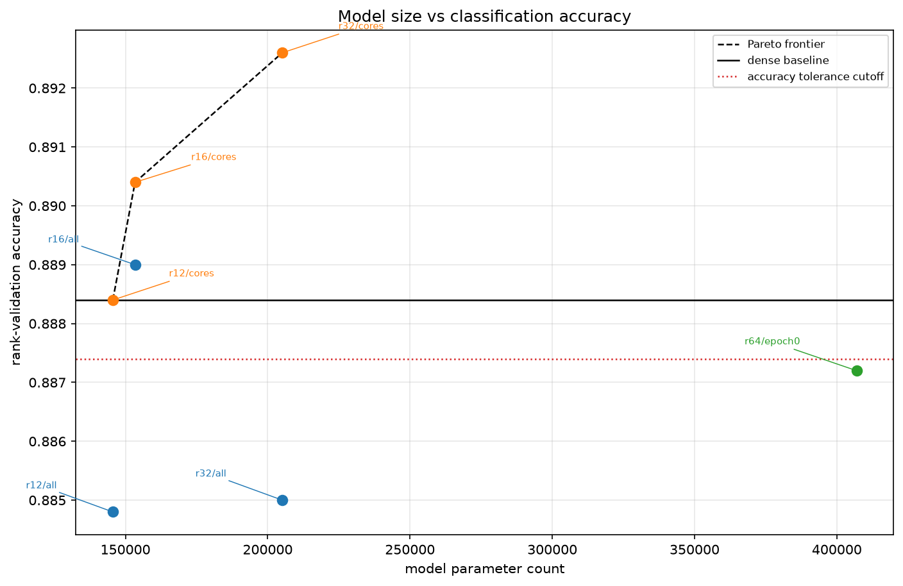
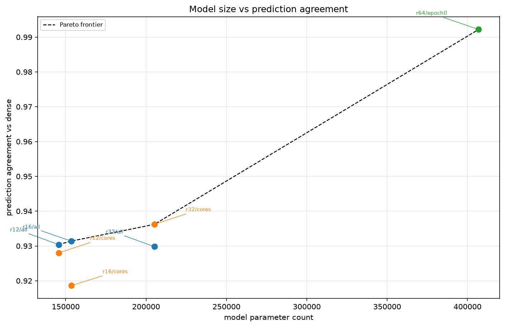
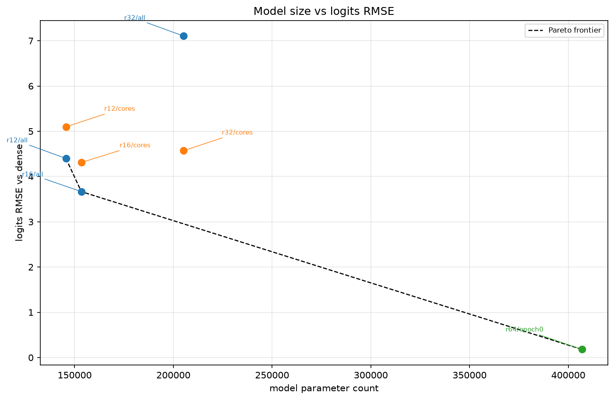
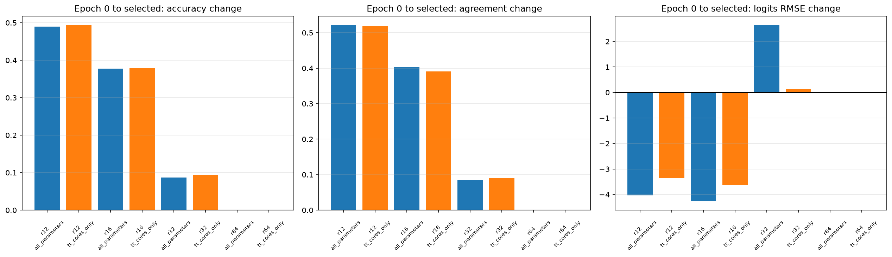
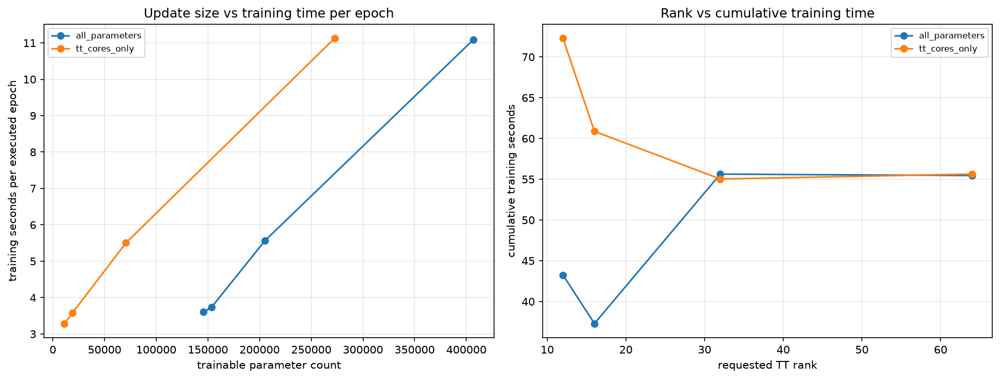

# Fashion-MNIST MLPのTT-rankと更新範囲の統合trade-off

## このノートの位置づけ

このノートは、Notebook 15の保存結果と、同じ結果についてChatGPTおよびPerplexityとの対話で行った考察を統合する。

- [15_integrated_tt_rank_update_scope_tradeoff.ipynb](../../../notebooks/30_tt_mps/10_fashion_mnist_mlp/15_integrated_tt_rank_update_scope_tradeoff.ipynb)

Notebook 13はrank 16・32・64、Notebook 14はrank 12について、全parameter更新とTT coresのみ更新を比較した。Notebook 15は新しい学習を行うNotebookではない。13・14の保存済み結果を共通schemaへ統合し、次の問いを分けて扱う。

1. モデル総parameter数とaccuracyの交換関係はどうなったか。
2. accuracy以外に、denseとのagreementやlogits RMSEを重視すると候補は変わるか。
3. TT-rankと更新範囲は、モデルサイズと学習コストへそれぞれどう効くか。
4. rank 12よりさらにrankを下げる検証へ進む根拠があるか。

許容差、Pareto frontier、kneeを使う一般的な候補選択は、[[00_基礎理論/03_モデル圧縮理論/30_TTLinear圧縮/78_accuracy許容差とParetoによる圧縮候補選択]]で扱う。このノートでは、Notebook 15の実測値から直接言えることを中心にする。

## 1. 証拠レベルと入力

数値はNotebook 15の保存済み出力と、次の成果物を照合した結果である。

- [integrated_model_candidates.csv](../../../results/30_tt_mps/10_fashion_mnist_mlp/15_integrated_tt_rank_update_scope_tradeoff/integrated_model_candidates.csv)
- [integrated_trial_comparison.csv](../../../results/30_tt_mps/10_fashion_mnist_mlp/15_integrated_tt_rank_update_scope_tradeoff/integrated_trial_comparison.csv)
- [pareto_accuracy.csv](../../../results/30_tt_mps/10_fashion_mnist_mlp/15_integrated_tt_rank_update_scope_tradeoff/pareto_accuracy.csv)
- [pareto_agreement.csv](../../../results/30_tt_mps/10_fashion_mnist_mlp/15_integrated_tt_rank_update_scope_tradeoff/pareto_agreement.csv)
- [pareto_logits_rmse.csv](../../../results/30_tt_mps/10_fashion_mnist_mlp/15_integrated_tt_rank_update_scope_tradeoff/pareto_logits_rmse.csv)
- [accuracy_tolerance_candidates.csv](../../../results/30_tt_mps/10_fashion_mnist_mlp/15_integrated_tt_rank_update_scope_tradeoff/accuracy_tolerance_candidates.csv)
- [accuracy_knee_auxiliary.csv](../../../results/30_tt_mps/10_fashion_mnist_mlp/15_integrated_tt_rank_update_scope_tradeoff/accuracy_knee_auxiliary.csv)
- [integration_provenance.csv](../../../results/30_tt_mps/10_fashion_mnist_mlp/15_integrated_tt_rank_update_scope_tradeoff/integration_provenance.csv)

Notebook 15の保存状態では、11個のコードセルに実行番号があり、保存されたerror出力はない。成果物は14 CSVと5 Figureの計19ファイルである。ただし、このノート作成時にFresh Restart KernelからRun Allを新たに実行したわけではない。ここで確認したのは、保存済みNotebook、CSV、PNGの静的な整合性である。

統合前の条件について、Notebook 13・14はseed 0、対象層`fc1`、50,000／5,000／5,000の分割、batch size 64、Adam、学習率`1e-3`、Cross Entropy、最大50 epoch、patience 5、`min_delta=1e-4`、dense checkpoint、tensorization、dtypeが一致している。test setは使用していない。

## 2. 統合方法

### 2.1 「trial」と「モデル候補」を分けた

学習コストの比較では、rank 64も更新方式ごとに2 trialとして残す。一方、rank 64では両方式ともepoch 0が選択され、保存checkpointの`state_dict`もkey、shape、dtype、値が完全一致した。そのため、モデル候補のPareto計算では`common_epoch0`という1候補へまとめた。

したがって、Notebook 15には次の2つの母集団がある。

- 学習trial：rank 12・16・32・64 × 2方式の8行
- 選択済みモデル候補：rank 12・16・32 × 2方式にrank 64の共通epoch 0を加えた7行

### 2.2 同rankのepoch 0を検証した

各rankで、2方式のepoch 0について次が完全一致した。

- モデル総parameter数
- 圧縮率
- rank-validation accuracy
- prediction agreement
- logits RMSE

`trainable_parameters`は更新方式によって変わるため、一致条件に含めない。これにより、同rank内のfine-tuning後の差は、少なくとも異なるepoch 0評価値を混ぜた結果ではないと確認した。

## 3. 統合結果

### 3.1 選択済みモデル候補

| rank | 更新方式 | 選択epoch | accuracy | agreement | logits RMSE | モデル総parameter数 | dense比圧縮率 |
| ---: | :-- | ---: | ---: | ---: | ---: | ---: | ---: |
| 12 | 全parameter | 7 | 0.8848 | 0.9304 | 4.400143 | 145,570 | 3.6808倍 |
| 12 | TT coresのみ | 17 | 0.8884 | 0.9280 | 5.097318 | 145,570 | 3.6808倍 |
| 16 | 全parameter | 5 | 0.8890 | 0.9314 | 3.666437 | 153,386 | 3.4933倍 |
| 16 | TT coresのみ | 12 | 0.8904 | 0.9186 | 4.309767 | 153,386 | 3.4933倍 |
| 32 | 全parameter | 5 | 0.8850 | 0.9298 | 7.104990 | 205,130 | 2.6121倍 |
| 32 | TT coresのみ | 5 | 0.8926 | 0.9362 | 4.571566 | 205,130 | 2.6121倍 |
| 64 | 共通epoch 0 | 0 | 0.8872 | 0.9922 | 0.179470 | 406,922 | 1.3168倍 |

この表では、モデル総parameter数はTT-rankで変わるが、同じrankの更新方式では変わらない。`requires_grad=False`はparameterを削除せず、推論モデルの構造も変えないためである。

### 3.2 指標別Pareto frontier

モデル総parameter数を小さくする目的と、各性能指標を良くする目的でPareto frontierを求めると、残る候補は異なる。

| 目的指標 | Pareto候補 |
| :-- | :-- |
| accuracyを高くする | rank 12 cores-only、rank 16 cores-only、rank 32 cores-only |
| agreementを高くする | rank 12 all、rank 16 all、rank 32 cores-only、rank 64 epoch 0 |
| logits RMSEを小さくする | rank 12 all、rank 16 all、rank 64 epoch 0 |

accuracy Paretoは3行であり、rank 16の全parameter更新は含まれない。同じ153,386 parameterでaccuracyが高いrank 16 cores-onlyに支配されるためである。一方、accuracy許容差表は別の規則で作るため4行になる。2つの表を混同しない。

### 3.3 accuracy許容差による暫定候補

denseのrank-validation accuracyは`0.8884`である。Notebook 15では、

$$
0.8884 - 0.001 = 0.8874
$$

をcutoffとし、accuracyが`0.8874`以上の候補からモデル総parameter数が最小のものを選んだ。

| rank | 更新方式 | accuracy | モデル総parameter数 |
| ---: | :-- | ---: | ---: |
| 12 | TT coresのみ | 0.8884 | 145,570 |
| 16 | 全parameter | 0.8890 | 153,386 |
| 16 | TT coresのみ | 0.8904 | 153,386 |
| 32 | TT coresのみ | 0.8926 | 205,130 |

この機械的規則では、rank 12 cores-onlyが唯一の最小parameter候補になる。結論は次のように限定する。

> 今回の固定条件では、dense accuracyから0.001以内という事後的な許容差を満たし、その中でモデル総parameter数が最小だったrank 12・TT coresのみ更新を、圧縮優先時の暫定候補とする。最高accuracy、最短学習時間、統計的同等性、test性能を意味しない。

この許容差は実験前に登録した合格基準ではなく、結果整理のために事後的に再利用した運用規則である。信頼区間でも理論誤差上界でもない。

### 3.4 kneeによる補助候補

accuracy Paretoの3点を0から1へ正規化し、端点を結ぶ直線からの距離が最大の点を補助的なkneeとすると、rank 16 cores-onlyが選ばれた。

ただし、frontierが3点しかないため、中間点がkneeになりやすい。正規化や距離定義にも依存する。従って、rank 16を採用すべきという独立した強い証拠ではなく、rank 12とrank 32の間の折衷点を示す補助情報として扱う。

## 4. fine-tuning前後と学習コスト

### 4.1 epoch 0から選択checkpointへの変化

| rank | 更新方式 | epoch 0 accuracy | 選択後accuracy | 変化 |
| ---: | :-- | ---: | ---: | ---: |
| 12 | 全parameter | 0.3950 | 0.8848 | +0.4898 |
| 12 | TT coresのみ | 0.3950 | 0.8884 | +0.4934 |
| 16 | 全parameter | 0.5116 | 0.8890 | +0.3774 |
| 16 | TT coresのみ | 0.5116 | 0.8904 | +0.3788 |
| 32 | 全parameter | 0.7980 | 0.8850 | +0.0870 |
| 32 | TT coresのみ | 0.7980 | 0.8926 | +0.0946 |
| 64 | 両方式 | 0.8872 | 0.8872 | 0.0000 |

rank 12・16ではTT-SVD直後のaccuracyが低いが、rankを増やさずfine-tuningで大きく回復した。これは低いepoch 0 accuracyを、そのrankの到達可能性能や容量不足と同一視できないことを示す。一方、rank 64ではepoch 0が選ばれ、今回の条件でfine-tuningの利益は確認されなかった。

### 4.2 学習対象parameter数と時間

| rank | 更新方式 | 学習対象parameter数 | 実行epoch数 | 累積train時間 | 秒/epoch |
| ---: | :-- | ---: | ---: | ---: | ---: |
| 12 | 全parameter | 145,570 | 12 | 43.25秒 | 3.60秒 |
| 12 | TT coresのみ | 11,160 | 22 | 72.29秒 | 3.29秒 |
| 16 | 全parameter | 153,386 | 10 | 37.30秒 | 3.73秒 |
| 16 | TT coresのみ | 18,976 | 17 | 60.87秒 | 3.58秒 |
| 32 | 全parameter | 205,130 | 10 | 55.63秒 | 5.56秒 |
| 32 | TT coresのみ | 70,720 | 10 | 55.03秒 | 5.50秒 |
| 64 | 全parameter | 406,922 | 5 | 55.46秒 | 11.09秒 |
| 64 | TT coresのみ | 272,512 | 5 | 55.63秒 | 11.13秒 |

rank 12では、cores-onlyにすると学習対象parameter数は約92.3%減ったが、1 epochは約8.8%しか短くならなかった。TT coresを更新するためにもforwardは全層を通り、後段の固定層を通る入力勾配の計算も必要である。省略できるのは主に固定parameter自身の勾配保持・更新と、それらに対するoptimizer処理であり、計算全体ではない。

さらに、rank 12 cores-onlyは停止まで22 epoch、全parameter更新は12 epochだったため、累積train時間は逆に長い。ここから分かるのは、「計算効率」を何で測るかを明示する必要があることである。

- 1 epoch当たりの時間
- early stoppingまでの累積train時間
- 学習対象parameter数やoptimizer state
- 推論時のモデルサイズ・演算量・latency
- 再学習を含むモデルのライフサイクル全体

同じrankの2方式では推論モデルのparameter数とforward構造が同じである。モデルを一度学習して長く利用する場合、学習時間差は運用全体で小さな比重になる。一方、頻繁に再学習する場合は、停止までの総時間やoptimizer memoryを候補選択へ含める意味が大きくなる。

## 5. 実験結果からの考察

### 5.1 Notebook 15の目的に対する中心的な結論

Notebook 15の目的は、rank 12を最終決定することではなく、既存候補を統合し、さらにrankを下げる余地があるかを判断できる状態にすることだった。

rank 12 cores-onlyはaccuracy `0.8884`を保ちながら、今回比較した候補で最小の145,570 parameterだった。しかもrank 12は探索範囲の下端である。従って、圧縮を優先するなら、rank 12未満を追加検証する根拠はある。

ただし、rank 12が実用上十分か、rank 8やrank 10でも同等のaccuracyを保てるかはまだ分からない。Notebook 15は「さらに下げられる可能性」を示したのであって、下限を確定していない。

### 5.2 rank 12とrank 16の差は目的によって評価が変わる

rank 12 cores-onlyとrank 16 allを比べると、モデル総parameter数は145,570対153,386で、rank 12は7,816少ない。これはrank 12を基準に約5.37%、rank 16を基準に約5.10%の差である。

一方、accuracyは`0.8884`対`0.8890`で差は`0.0006`、5,000件では正解数3件分である。agreementは`0.9280`対`0.9314`、logits RMSEは`5.0973`対`3.6664`で、dense忠実度ではrank 16 allが高い。

圧縮を優先し、accuracy差`0.0006`を実質的に小さいと扱うならrank 12が候補になる。denseの予測やlogitsへの近さも重視するならrank 16 allに利点がある。どちらが正しいかではなく、何を保存したいかで選択が変わる。

### 5.3 rank 12とrank 32の交換関係

rank 12 cores-onlyからrank 32 cores-onlyへ増やすと、モデル総parameter数は59,560増え、rank 12比で約40.9%増える。accuracyは`0.8884`から`0.8926`へ`0.0042`上がり、5,000件では21件分である。

最高accuracyを優先するならrank 32が有利だが、圧縮を優先するなら、約41%のparameter増加に対するaccuracy差`0.0042`を許容し、rank 12を選ぶ判断は成り立つ。Notebook 15はこの価値判断を自動化せず、交換関係を数値で見えるようにした。

### 5.4 accuracy、agreement、logits RMSEは同じものを測っていない

rank 64 epoch 0はagreement `0.9922`、logits RMSE `0.1795`でdenseに非常に近いが、accuracyは`0.8872`でdenseの`0.8884`よりわずかに低い。rank 32 cores-onlyはaccuracyが最高の`0.8926`だが、dense忠実度はrank 64より低い。

accuracyは正解labelとの一致、agreementはdenseのargmaxとの一致、logits RMSEはdense logits全体との数値的な近さを測る。denseモデル自体も誤るため、denseへ近いことと高accuracyは同じ目的ではない。fine-tuning後の圧縮モデルがdenseから離れながら、labelに対してはより良い別のtask解へ移動することもある。

従って、logits RMSEをaccuracyと同列の採用指標として機械的に合成しない。モデル蒸留やdense挙動の再現が目的なら重要だが、分類性能と圧縮率を優先する候補選択では診断指標として扱う。

### 5.5 厳密な許容差選択と実験上の候補集合は分ける

cutoff `0.8874`を機械的に適用すると、rank 12ではcores-onlyだけが残る。しかし、rank 12 allのaccuracy `0.8848`との差がどれほど再現可能かは、単一seedだけでは分からない。許容差`0.001`も事後的であり、統計的な境界ではない。

そのため、Notebook 15の規則上の暫定選択はrank 12 cores-onlyとしつつ、次の比較対象としてrank 12 allを排除しきらない。これは規則を曖昧にするのではなく、機械的選択結果と科学的な不確実性を分ける扱いである。

### 5.6 更新範囲の優劣はrankによって一定しない

accuracyだけを見るとrank 12・16・32でcores-onlyがallを上回った。しかし、agreementとRMSEではrank 12・16のallがcores-onlyよりdenseに近く、rank 32ではcores-onlyが3指標すべてでallを上回った。rank 64は同じepoch 0が選ばれた。

従って、「cores-onlyが常に優れる」「allがdense忠実度を常に保つ」という一般化はできない。更新範囲の効果はrank、指標、最適化trajectoryの組合せで変わる。今回の固定学習率`1e-3`における点推定結果であり、方式ごとに学習率を最適化した比較でもない。

### 5.7 小さいaccuracy差へ強い意味を与えない

rank-validationは5,000件なのでaccuracyの刻みは`0.0002`である。rank 12 cores-onlyとrank 16 allの差`0.0006`は3件、rank 12 cores-onlyとdenseは表示値上同じである。

ただし、同じsampleを各モデルが評価しているため、単一モデルの二項標準誤差だけでモデル間差を判定するのは不十分である。sampleごとの正誤対応を使うMcNemar検定やbootstrap、複数seed、予約したtest setをまだ確認していない。従って、この程度の差から順位の再現性や統計的優位性を主張しない。

### 5.8 学習時間は候補選択の目的関数にまだ入っていない

現在のaccuracy Paretoは、モデル総parameter数とaccuracyだけで作られている。rank 12 cores-onlyは小さいが、累積train時間`72.29`秒はrank 16 allの`37.30`秒より長い。

モデルを配布して長期間推論に使うなら、モデルサイズと推論性能を優先する判断が自然である。頻繁に再学習するなら、累積学習時間やoptimizer memoryも含む別のPareto問題になる。現在のPareto frontierから「rank 12が計算効率でも最良」とは言えない。

また、累積train時間はearly stoppingが停止するまでの時間であり、選択checkpointのepochまでの実測時間ではない。`cumulative_training_seconds × selected_epoch / num_epochs_run`のような値は近似にすぎず、実測値として扱わない。

### 5.9 rankを下げ続けたときのモデル全体の削減余地は小さくなる

今回圧縮したのは`fc1`だけである。rank 12のモデル総parameter数145,570のうち、TT coresは11,160で、残る134,410 parameterはrankをさらに下げても減らない。

したがって、rank 12未満の探索には意味があるが、`fc1`のrank低下だけによるモデル全体の追加削減には下限がある。低rank追加実験では、accuracy低下に対してモデル全体が何parameter減るかを確認し、削減量が小さくなった時点で別層の圧縮との比較へ進むべきである。

## 6. 言えること・言えないこと

| 言えること | この実験だけでは言えないこと |
| :-- | :-- |
| rank 12 cores-onlyは事後的許容差を満たす最小モデルだった | rank 12が真の最適rankである |
| rank 12は探索下端なので、さらに低rankを試す根拠がある | rank 12未満でもaccuracyを維持できる |
| accuracy Paretoにはrank 12・16・32 cores-onlyが残った | cores-onlyが一般にallより優れる |
| 指標を変えるとPareto候補が変わった | logits RMSEが分類モデル選択の主目的になる |
| rank 12では学習対象数を約92.3%減らしても秒/epochは約8.8%しか短くならなかった | trainable parameter削減が計算資源を節約しない |
| rank 12 cores-onlyは秒/epochが短いが累積時間は長かった | cores-onlyは一般に学習が遅い |
| 同じrankなら更新方式で推論モデルサイズは変わらない | 実測推論latencyが完全に同じである |
| rank 64はdense忠実度が高い | rank 64が分類accuracy上の最良候補である |
| test setを選択へ使用していない | test setでも候補順位が維持される |

## 7. 結論

> Notebook 15は、Notebook 13・14の8 trialを統合し、7つの選択済みモデル候補として比較した。accuracy Paretoにはrank 12・16・32のTT coresのみ更新が残り、dense accuracy `0.8884`から0.001以内という事後的許容差では、145,570 parameterのrank 12 cores-onlyが最小候補になった。rank 12は探索範囲の下端なので、圧縮を優先するならさらに低rankを検証する根拠がある。ただし、agreementやlogits RMSEを重視すれば候補は変わり、学習時間まで含めても選択は変わり得る。rank 12は最高accuracy、最短学習時間、統計的同等性、test性能を保証する最終解ではなく、次のrank探索を始めるための暫定候補である。

## 8. 次の検証で固定すべき点

1. rank 12未満の少数候補を、rank 12と同じcheckpoint、tensorization、data split、選択loss、最大epoch、patienceで比較する。
2. 圧縮優先の主指標をモデル総parameter数とaccuracyに固定し、agreementとRMSEは別目的の診断として残す。
3. 許容差を再利用するなら実験前に値とtie規則を固定する。
4. 更新範囲差を主張する前に複数seedとsample別の対応を確認する。
5. 最終候補をvalidationで固定してから、未使用test setを一度だけ評価する。
