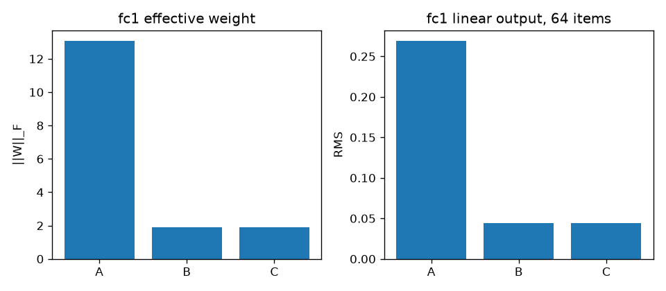

# Fashion-MNIST TT-MLPの初期化スケール診断

## このノートの役割

本ノートは、次のNotebook 01で保存した初期化診断と、ChatGPT・Perplexityとの対話で行った考察を統合する。

- `notebooks/40_dmrg/10_fashion_mnist_mlp/01_tt_initialization_scale_diagnostics.ipynb`
- 結果：`results/40_dmrg/10_fashion_mnist_mlp/01_tt_initialization_scale_diagnostics/`
- Stage C checkpoint：`models/40_dmrg/10_fashion_mnist_mlp/01_tt_initialization_scale_diagnostics/initial_stage_c.pt`

Notebook 00では、rank制限したTT-MLPを5往復・50局所更新だけ学習したが、accuracyは約9.5%にとどまった。Notebook 01の目的は、その停滞を追加学習で直すことではなく、**dense重みからStage Cを作るどの段階でスケールが変わり、その変化がforwardと最初の勾配へどう現れるかを分解すること**である。

現在のNotebook 01は、Stage CをNotebook 02の全条件で共有するbaselineとして明記する修正後、最終保存セルを未実行にしている。したがって、ここでは保存済みCSV・JSONとcheckpoint再読込で確認した数値を実験結果とし、現在のNotebookをFresh Kernel Run All済みとは扱わない。

---

## 1. 実験設計

比較した段階は次の3つである。

| 段階 | 状態 |
|---|---|
| A | 元のdense `fc1.weight` |
| B | TT-SVD・rank cap 12による打ち切り後、正準化前 |
| C | Bを中心0へ正準化した後 |

`fc1`のshapeは`(512, 784)`、TT-matrixのmodesは

$$
(m_1,\ldots,m_6)=(4,2,2,2,4,4),
$$

$$
(n_1,\ldots,n_6)=(2,2,2,2,7,7)
$$

である。rank capは12だが、第1 bondはshape上限により8なので、Stage Cのrank列は

$$
(1,8,12,12,12,12,1)
$$

となった。

activationはtraining split先頭64件、勾配はtraining split 50,000件全体に対する最初のpairだけを測定した。スケール補正は行っていない。

---

## 2. 保存済み結果

### 2.1 重みノルム

| 段階 | Frobenius norm | Aに対するnorm比 | Aに対する相対誤差 |
|---|---:|---:|---:|
| A | 13.063023 | 1.000000 | 0.000000 |
| B | 1.882493 | 0.144109 | 0.989562 |
| C | 1.882493 | 0.144109 | 0.989562 |

Bの二乗norm比は`0.0207673`である。したがって、Frobenius normの二乗という意味では、Aの約2.08%になった。

### 2.2 正準化前後の一致

| 比較 | 差 |
|---|---:|
| 実効重みBとCの最大絶対差 | `1.30385e-8` |
| 実効重みBとCのFrobenius差 | `7.27072e-7` |
| 同じ入力に対するlogits最大絶対差 | `1.49012e-8` |

通常parameterのstate key集合はA・B・Cで一致し、TT core以外のstateはexactに一致した。非有限値もなかった。

### 2.3 activationとlogits

| 指標 | A | B | C |
|---|---:|---:|---:|
| `fc1`線形出力std | 0.268556 | 0.044036 | 0.044036 |
| `fc1`線形出力RMS | 0.268828 | 0.044036 | 0.044036 |
| `fc1` ReLUゼロ率 | 47.1497% | 50.5859% | 50.5859% |
| logits RMS | 0.074217 | 0.039068 | 0.039068 |
| 64件のcross-entropy | 2.294308 | 2.296783 | 2.296783 |

Stage Cのtraining split全体では、lossは`2.303470`、accuracyは`0.09358`だった。

### 2.4 最初のpairの勾配

学習率はTT側・通常parameter側ともに$10^{-3}$である。

| 対象 | parameter norm | gradient norm | 相対更新量 |
|---|---:|---:|---:|
| 結合テンソル$T$ | 1.882493 | 0.007720 | `4.101e-6` |
| 通常parameter群 | 9.435225 | 0.043195 | `4.578e-6` |

相対更新量は

$$
\frac{\eta\lVert g\rVert}{\lVert\theta\rVert}
$$

である。どちらの勾配も有限かつ非ゼロだった。

---

## 3. 実験結果からの考察

### 3.1 ノルム低下はTT-SVD・rank制限で起きた

AからBでnormは`13.0630`から`1.88249`へ低下した。一方、BとCは同じ`1.88249`である。したがって、今回の大きなスケール低下は正準化ではなく、**rank cap 12を伴うTT-SVD打ち切り**で起きた。

これは「TT表現へ書き換えたから必ず小さくなる」という一般論ではない。打ち切りなしなら、reshapeとSVD再分解は元のweightを丸め誤差内で再現できる。今回の変化は、指定rankで表現できない成分を捨てた結果である。

### 3.2 正準化は表現を変えなかった

BとCの実効重み差・logits差はいずれも$10^{-8}$程度だった。よって、今回の正準化はTT coreの内部表現と正準中心を変えたが、モデルが表す線形写像はfloat32の丸め誤差内で保たれた。

ここから、Stage Cの小さいnormを「正準化で重みが縮んだ」と説明してはいけない。原因の段階はAからBである。

### 3.3 activationの大きさは縮んだが、ReLUが死んだわけではない

`fc1`線形出力stdは`0.26856`から`0.04404`へ低下し、Aの約16.4%になった。後段のlogits RMSも`0.07422`から`0.03907`へ下がった。したがって、rank制限後は、入力に対するhidden activationとlogitsの変動幅が小さくなった。

一方、ReLUゼロ率は`47.15%`から`50.59%`への変化であり、「ほとんどすべてがゼロ」ではない。少なくとも診断した64件では、全ユニットが不活性になるdead ReLU状態は確認されなかった。問題は二値的な生死ではなく、非ゼロactivationを含む全体スケールの縮小である。

### 3.4 勾配は流れているが、1回の相対変化は小さい

結合テンソルと通常parameter群のgradient normはともに非ゼロだった。したがって、「勾配が完全に消えて更新不能」という状態ではない。

しかし、相対更新量は両方とも約$4\times10^{-6}$であり、1回の局所更新でparameter normに対して動く割合は小さい。Notebook 00が50局所更新でほとんど改善しなかったことと整合するが、この診断だけで原因を一つに決めることはできない。

### 3.5 スケール低下を学習停滞の原因とは断定できない

Notebook 01が示したのは、次の同時発生である。

- rank制限でweight normとactivation scaleが低下した。
- Stage Cの最初の相対更新量が小さかった。
- Notebook 00の短い学習ではaccuracyがほとんど改善しなかった。

これは原因候補を絞る診断であって、因果実験ではない。スケール補正あり・なし、rank違い、学習率違いを同じ更新予算で比較していないため、「スケール低下が学習停滞を引き起こした」とは言えない。

### 3.6 Stage Cの役割は02の共通baselineである

Notebook 01で保存したStage Cは、Notebook 02の全条件が共有する新しいbaselineである。同じseed・設定で再生成したが、Notebook 00の保存checkpointと完全同一ではない。実効重みの相対差は約`1.16e-3`であり、00との厳密な継続学習比較には使わない。

Notebook 02では、全条件をこの同じStage Cから開始することで、条件間比較の公平性を確保する。

---

## 4. この実験だけでは言えないこと

- rank制限によるスケール低下が長時間学習を妨げるか。
- pair 0以外でも同じgradient scaleになるか。
- 相対更新量$10^{-6}$が最適化に十分か。
- 別seed、別rank、別tensorizationでも同じ比率になるか。
- Stage CがNotebook 00の初期stateと完全に同じであること。

---

## 5. 01の結論

> 今回の初期化では、重みとactivationの大きなスケール低下は正準化ではなく、rank cap 12を伴うTT-SVD打ち切りで生じた。正準化は実効重みとlogitsを丸め誤差内で維持した。勾配は非ゼロだったが、最初の相対更新量は約$10^{-6}$と小さかった。ただし、この診断だけでは、初期化スケール低下をNotebook 00の学習停滞の原因とは断定できない。

## 関連

- [[40_TT_MPS_NN圧縮/10_FashionMNIST_MLP/09_full-batch_2-core_sweep学習設計]]
- [[40_TT_MPS_NN圧縮/10_FashionMNIST_MLP/10_full-batch_2-core_sweep実験結果と考察]]
- [[40_TT_MPS_NN圧縮/10_FashionMNIST_MLP/12_full-batch更新予算grid]]
- [[50_DMRG/07_TT-MLPのfull-batch共同更新と更新予算]]

