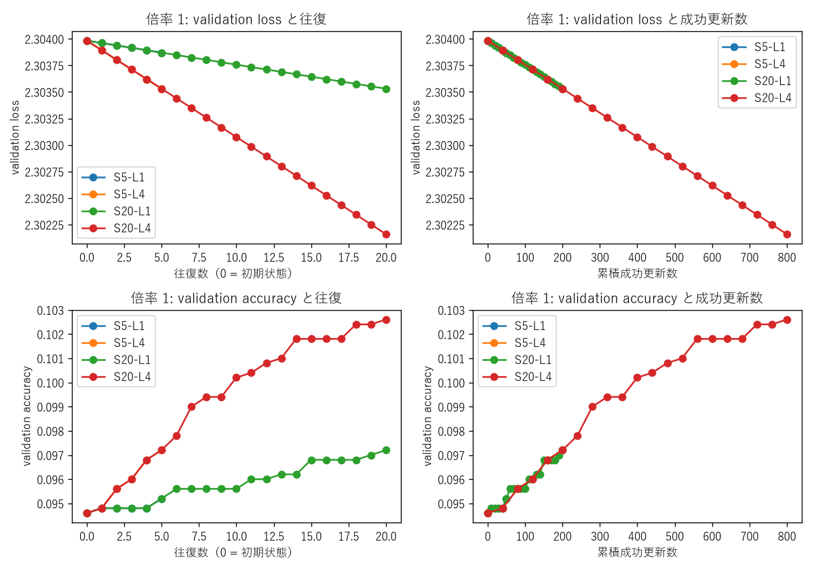
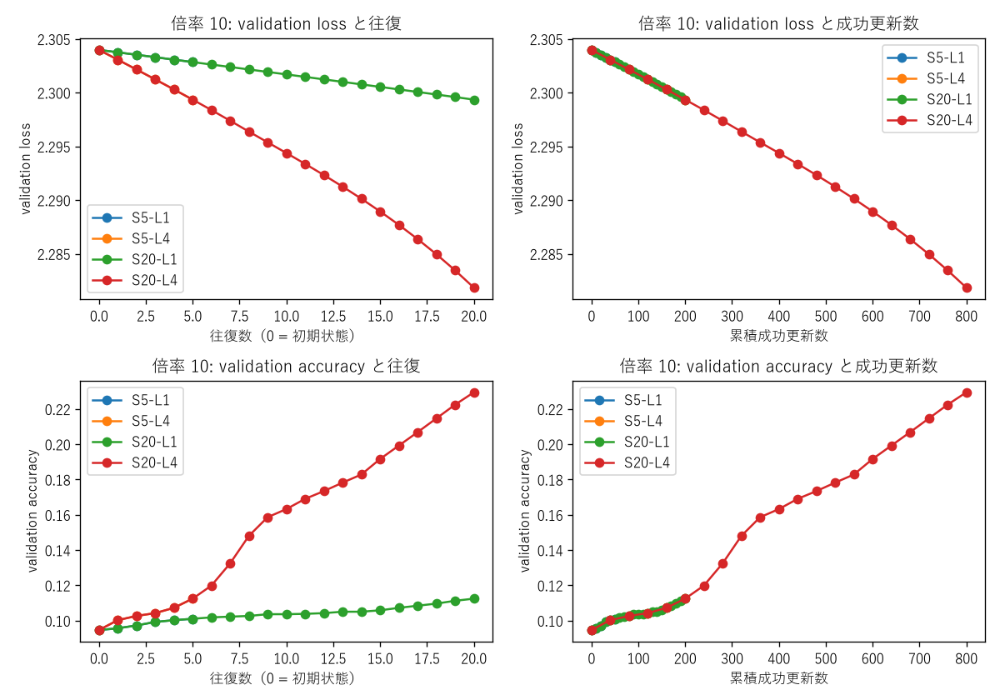
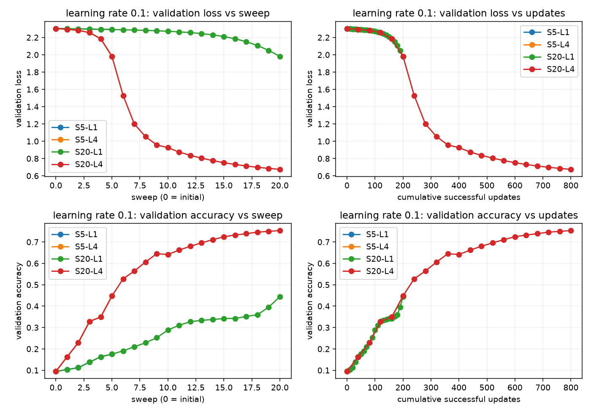
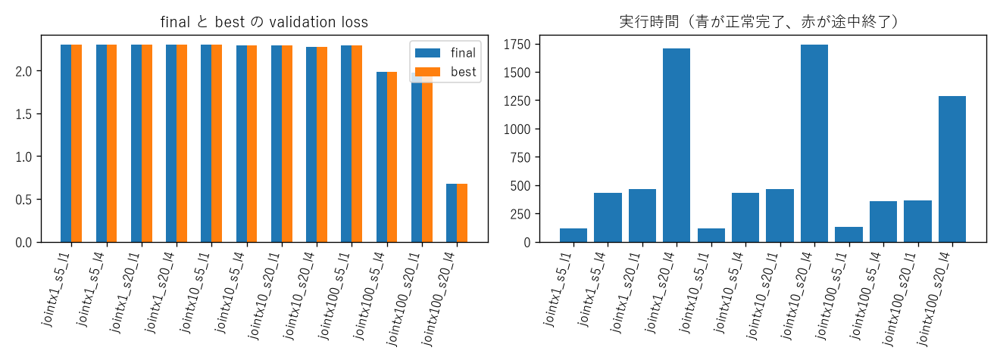

# Fashion-MNIST TT-MLP full-batch更新予算grid

## このノートの役割

本ノートは、Notebook 01で保存した共通Stage Cから独立に開始し、共同学習率、最大往復数、各pairの局所更新回数を変えたNotebook 02の保存結果と考察をまとめる。

- `notebooks/40_dmrg/10_fashion_mnist_mlp/02_full_batch_sweep_update_budget_grid.ipynb`
- 結果：`results/40_dmrg/10_fashion_mnist_mlp/02_full_batch_sweep_update_budget_grid/`
- 各条件の履歴・checkpoint：`models/40_dmrg/10_fashion_mnist_mlp/02_full_batch_sweep_update_budget_grid/`

smokeは実行経路・保存・有限性を確認する短い試運転であり、性能比較には使わない。本ノートの結果はfull grid 12条件だけを対象にする。

---

## 1. 実験で変えたもの

| 因子 | 候補 |
|---|---|
| TT側・通常parameter側の共同学習率 | `0.001`, `0.01`, `0.1` |
| 最大往復数$S$ | `5`, `20` |
| 各pairの局所更新回数$L$ | `1`, `4` |

6 coreの1往復は、right 5 pairとleft 5 pairの10 visitである。したがって、正常完了時の成功更新数は

$$
N_{\mathrm{update}}=10SL
$$

となる。4種類の更新予算は`50`、`200`、`200`、`800`である。

全条件で次を固定した。

- Notebook 01の同じStage C checkpoint。
- seed 0と同じ50,000/5,000/5,000分割。
- rank cap 12と同じTT-matrix modes。
- TT pair、`fc1.bias`、`fc2`、`fc3`の共同更新。
- 全training set平均cross-entropy。
- 方向付きSVD、pair順、候補検査、checkpoint保存規則。
- early stopping無効。

条件は独立であり、前の条件の最終stateを次へ渡していない。

---

## 2. 12条件の保存済み結果

| 学習率 | 往復$S$ | local step$L$ | 更新数 | final val loss | final val accuracy | best往復 | 時間[s] |
|---:|---:|---:|---:|---:|---:|---:|---:|
| 0.001 | 5 | 1 | 50 | 2.303870 | 0.0952 | 5 | 117.7 |
| 0.001 | 5 | 4 | 200 | 2.303530 | 0.0972 | 5 | 429.0 |
| 0.001 | 20 | 1 | 200 | 2.303530 | 0.0972 | 20 | 462.6 |
| 0.001 | 20 | 4 | 800 | 2.302160 | 0.1026 | 20 | 1707.7 |
| 0.01 | 5 | 1 | 50 | 2.302848 | 0.1010 | 5 | 117.4 |
| 0.01 | 5 | 4 | 200 | 2.299353 | 0.1124 | 5 | 429.3 |
| 0.01 | 20 | 1 | 200 | 2.299353 | 0.1124 | 20 | 462.7 |
| 0.01 | 20 | 4 | 800 | 2.281852 | 0.2294 | 20 | 1739.9 |
| 0.1 | 5 | 1 | 50 | 2.291856 | 0.1754 | 5 | 132.4 |
| 0.1 | 5 | 4 | 200 | 1.982448 | 0.4472 | 5 | 358.5 |
| 0.1 | 20 | 1 | 200 | 1.981023 | 0.4442 | 20 | 365.5 |
| 0.1 | 20 | 4 | 800 | 0.674865 | 0.7534 | 20 | 1288.9 |

全12条件でfinal lossが保存された往復終了時のbest lossと一致した。これは「最終時点が最小だった」ことを示すが、途中のaccuracyまで単調だったことは意味しない。

---

## 3. 実験結果からの考察

### 3.1 検証した範囲では学習率0.1が最良だった

同じ`S=20, L=4`、800更新で比べると、validation lossは`2.302160`、`2.281852`、`0.674865`だった。今回の3候補では、学習率`0.1`が最も学習を進めた。

ただし、この結果は「学習率は大きいほどよい」という単調則を示さない。`0.1`より大きい領域では発散や不安定化が起こり得る。言えるのは、**固定したStage Cと800更新の範囲で、候補中の`0.1`が最良だった**ことまでである。

### 3.2 往復数とpair内反復のどちらを増やしても改善した

学習率`0.1`で、`S=5, L=1`を基準にすると、

- 往復数だけを`5→20`：loss `2.291856→1.981023`。
- local stepだけを`1→4`：loss `2.291856→1.982448`。

どちらも更新数を50から200へ増やし、lossを約0.31下げた。したがって、今回の初期領域では「更新回数が少な過ぎた」というNotebook 00の仮説と整合する。

### 3.3 同じ200更新では配分の明確な優劣はない

`S=5, L=4`と`S=20, L=1`のloss差は

$$
1.982448-1.981023=0.001425
$$

だった。単一seedの1回だけで、この差をpair内反復と往復反復の本質的な優劣とは扱えない。今回の最終lossは近いと読むのが適切である。

accuracyは`0.4472`と`0.4442`で逆方向の小差になっている。この点も、lossとaccuracyの小差から一方を一般的に選べない理由になる。

### 3.4 同じ更新数でも評価回数が異なる

validationは往復終了時に行うため、`S=5, L=4`は5回、`S=20, L=1`は20回評価する。実行時間は約358.5秒と365.5秒だったが、後者はvalidationを15回多く行っている。

したがって、総更新数だけをそろえても、評価を含むwall timeは完全にはそろわない。更新配分の速度を比べるときは、更新時間と評価時間を分けて記録する必要がある。

### 3.5 finalがbestでも、毎往復単調とは限らない

全条件で最終往復がbestだった。この事実から言えるのは、記録した往復終了時点のうち最終値が最小だったことだけである。途中で一時的にlossが増えたかはhistoryを確認しなければ分からない。bestの位置と履歴の単調性は別の情報である。

### 3.6 改善をTT更新だけの効果とは言えない

各局所更新では、結合テンソル$T$だけでなく、`fc1.bias`、`fc2`、`fc3`も同じ更新前stateのlossから更新した。したがって、lossとaccuracyの改善はjoint update全体の結果であり、TT pairだけの寄与ではない。

TT更新の追加価値を調べるには、同じ初期state・予算・学習率で、TT-only、通常parameter-only、jointを分ける必要がある。

### 3.7 単一初期状態の探索結果である

全条件を同じStage Cから始めたことは条件間比較には必要だが、別初期状態への一般化を保証しない。別seed、別rank、別モデルでも`0.1`が最良かは未検証である。

---

## 4. 実装上の理解

### 4.1 同じlossから二つの勾配群を得る

各batchでweighted lossをbackwardすると、leafである結合テンソル$T$には`grad_t`、通常parameterには名前付きの`dense_grads`が蓄積される。lossが二つあるのではなく、同じスカラーlossを異なる変数で偏微分している。

### 4.2 local stepは更新・SVD・commitの一式を繰り返す

`local_steps_per_pair=4`は、同じ$T$をSVDせず4歩動かす方式ではない。各stepで、最新coreを結合し、全データ勾配を再計算し、候補更新、方向付きSVD、検査、commitまでを行う。

### 4.3 端のpairも通常のvisitとして扱う

左端・右端では片側environmentのrankが1になるが、pair更新を省略しない。正準中心はright sweepで0から5へ、left sweepで5から0へ戻る。

---

## 5. この実験だけでは言えないこと

- `0.1`より大きい学習率が悪いこと。
- pair内反復と往復反復の一般的な優劣。
- TT更新単独の寄与。
- 別seed・別rank・別モデルでの最良条件。
- test set上の性能。
- 更新予算を増やしたときの最終的な収束値。

---

## 6. 02の結論

> Notebook 00でほとんど進まなかったjoint full-batch sweepは、学習率と更新数を増やすと明確に学習した。検証した候補では学習率0.1、20往復、各pair 4更新が最良だった。同じ200更新では、5往復・各pair 4更新と20往復・各pair 1更新の最終lossは近く、更新配分の明確な優劣は確認できなかった。これはjoint updateの単一初期状態における結果であり、TT単独の効果や一般的な最良条件を示さない。

## 関連

- [[40_TT_MPS_NN圧縮/10_FashionMNIST_MLP/11_TT初期化スケール診断]]
- [[40_TT_MPS_NN圧縮/10_FashionMNIST_MLP/13_joint学習率0.2_0.3長時間比較]]
- [[50_DMRG/07_TT-MLPのfull-batch共同更新と更新予算]]

