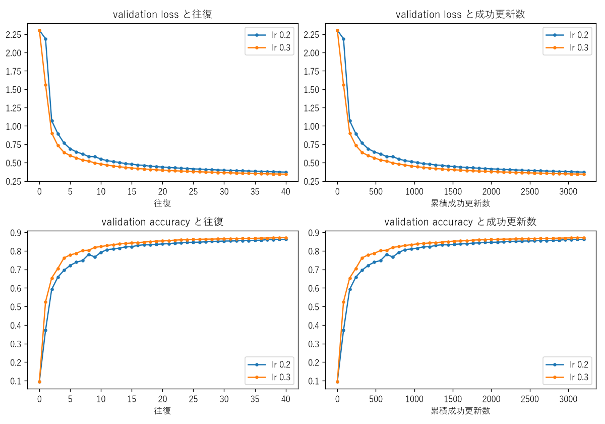
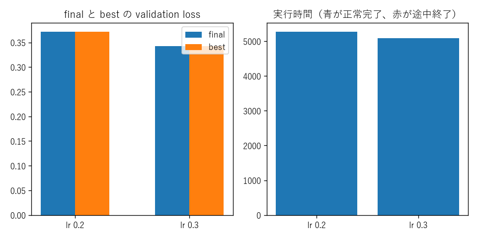

# Fashion-MNIST TT-MLP joint学習率0.2・0.3長時間比較

## このノートの役割

本ノートは、Notebook 02で最良だった探索上端`0.1`のさらに上を、長い固定更新予算で確認したNotebook 03の結果と考察をまとめる。

- `notebooks/40_dmrg/10_fashion_mnist_mlp/03_joint_learning_rate_02_03_s40_l8.ipynb`
- 結果：`results/40_dmrg/10_fashion_mnist_mlp/03_joint_learning_rate_02_03_s40_l8/`
- 履歴・checkpoint：`models/40_dmrg/10_fashion_mnist_mlp/03_joint_learning_rate_02_03_s40_l8/`

保存済みNotebookの6 code cellは実行済みでerrorはないが、execution countは`7`から`12`である。ここではNotebookの表示だけでなく、`condition_summary.csv`、各`history.csv`、3,200行の`local_updates.csv`、`run_state.json`、checkpoint再読込値を照合した結果を使う。Fresh Kernel Run Allの証拠とは分けて扱う。

---

## 1. 02から変えたもの

| 項目 | Notebook 03 |
|---|---|
| joint learning rate | `0.2`, `0.3` |
| 最大往復数$S$ | 40 |
| 各pairの局所更新回数$L$ | 8 |
| 1往復の更新数 | 80 |
| 1条件の総更新数 | 3,200 |
| early stopping | 無効 |

初期Stage C、seed、データ分割、rank cap、pair順、全データ平均loss、TT pairと通常parameterの共同更新、方向付きSVD、保存規則は02と同じである。

03は新しい学習アルゴリズムではない。02と同じ共通学習関数に、上側の学習率と長い更新予算を与えた差分実験である。

---

## 2. 保存済み結果

| 条件 | 更新数 | final train loss | final train accuracy | final val loss | final val accuracy | best往復 | 時間[s] |
|---|---:|---:|---:|---:|---:|---:|---:|
| lr 0.2 | 3,200 | 0.338109 | 0.87864 | 0.371161 | 0.8616 | 40 | 5265.3 |
| lr 0.3 | 3,200 | 0.301779 | 0.89080 | 0.342614 | 0.8710 | 40 | 5079.4 |

両条件で、次を確認した。

- 40往復・3,200局所更新を完了。
- `local_updates.csv`は3,200行すべて`status=ok`。
- history、summary、run stateの最終値が一致。
- final・best checkpoint再読込後のvalidation lossとaccuracyが保存値と一致。
- 初期validation lossは共通の`2.303983`、accuracyは`0.0946`。
- 保存された往復終了時のvalidation lossは、両条件とも40往復まで毎回低下。

### 2.1 最大相対更新量

| 条件 | TT側 | 通常parameter側 |
|---|---:|---:|
| lr 0.2 | 0.036855 | 0.029787 |
| lr 0.3 | 0.404282 | 0.112373 |

これは全3,200更新中の最大値であり、典型値や平均値ではない。

---

## 3. 実験結果からの考察

### 3.1 同じ予算では0.3が0.2よりよかった

両条件は同じStage C、40往復、local step 8、3,200更新である。validation loss差は

$$
0.371161-0.342614=0.028547
$$

で、accuracy差は

$$
0.8710-0.8616=0.0094
$$

すなわち0.94 percentage pointだった。今回の固定条件では、`0.3`を選ぶ根拠がlossとaccuracyの両方にある。

ただし、比較したのは`0.2`と`0.3`だけであり、`0.3`が一般的な最適学習率であることや、さらに大きな学習率がよいことは示していない。

### 3.2 40往復目でもlossは下がっていた

学習率`0.3`の30往復目から40往復目では、

| 指標 | 30往復 | 40往復 | 改善 |
|---|---:|---:|---:|
| validation loss | 0.364064 | 0.342614 | 0.021451低下 |
| validation accuracy | 0.8648 | 0.8710 | 0.0062上昇 |

だった。したがって、「40往復で数値改善が完全に止まった」とは言えない。

一方、この追加10往復は800回の全データ勾配を必要とする。accuracy改善は0.62 percentage pointであり、終盤ほど単位計算量あたりの改善は小さくなった。研修の次の問いを進めるという目的では、さらに更新数だけを増やす優先度は低い。

ここでの結論は、

- 追加更新で少し改善する可能性は残る。
- その小さな改善のために長時間計算する実用的価値は低い。

という二つを分けたものである。

### 3.3 最大相対更新量0.404だけで破綻とは言えない

学習率`0.3`のTT側では、ある局所更新の相対更新量が`0.4043`まで達した。しかし、3,200更新は非有限値なく完了し、validation lossは`2.303983`から`0.342614`へ低下した。

したがって、最大相対更新量が大きいという一つの診断値だけで、「学習率0.3は不安定だった」「学習が破綻した」とは判断できない。判断には、非有限値、loss spike、checkpoint再現、複数seed、更新量の分布なども必要である。

一方、`0.2`より最大値が大きく異なるため、別seedやさらに長い学習でも同じ安定性が保たれるとは仮定しない。

### 3.4 02との改善差を学習率だけに帰属できない

Notebook 02の代表条件は学習率`0.1`、20往復、local step 4、800更新で、validation lossは`0.674865`だった。Notebook 03は学習率だけでなく、40往復、local step 8、3,200更新へ変えている。

したがって、03のlossが低い理由には、

- 学習率を`0.1→0.2/0.3`へ上げた効果。
- 更新数を`800→3,200`へ増やした効果。
- 両者の相互作用。

が混在する。学習率の純粋な効果として比較できるのは、03内の`0.2`対`0.3`だけである。

### 3.5 改善はjoint update全体の結果である

03でもTT pairと通常parameterを連動した同じ学習率で更新した。したがって、accuracy `0.8710`への改善をTT更新だけの成果とは言えない。更新対象の寄与を分けるには、次のNotebookでcontrolled ablationが必要である。

---

## 4. この実験だけでは言えないこと

- 学習率`0.3`が別seed・別rank・別モデルでも最良であること。
- `0.3`より大きい学習率の優劣。
- 40往復が数学的な収束点であること。
- TT更新だけの寄与。
- 02から03への改善が学習率上昇だけによること。
- test set上の最終性能。

---

## 5. 03の結論

> 同じStage Cと3,200更新の比較では、joint learning rate 0.3が0.2より低いvalidation lossと高いaccuracyを得た。両条件とも40往復目がbestで、lossは終端まで低下していたが、終盤のaccuracy改善は計算量に対して小さくなった。追加更新の可能性は残るものの、次の研究問いへ進むうえで更新数だけを増やす優先度は低い。02との差は学習率と更新予算が同時に変わっているため、学習率だけの効果とは解釈しない。

## 関連

- [[40_TT_MPS_NN圧縮/10_FashionMNIST_MLP/12_full-batch更新予算grid]]
- [[40_TT_MPS_NN圧縮/10_FashionMNIST_MLP/14_full-batch勾配集計高速化benchmark]]
- [[50_DMRG/07_TT-MLPのfull-batch共同更新と更新予算]]

