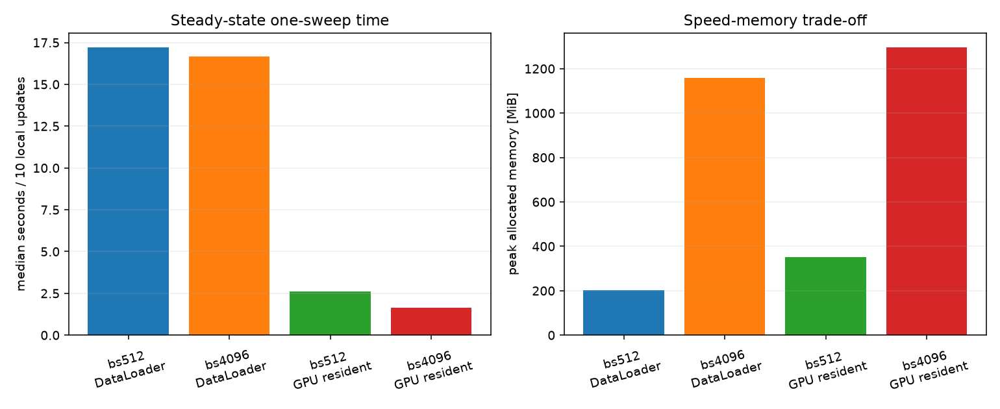

# Fashion-MNIST TT-MLP full-batch勾配集計高速化benchmark

## このノートの役割

本ノートは、Notebook 03の長時間実行で支配的だった全データ勾配計算について、データ供給方式とbatch sizeを切り分けたNotebook 04の結果と考察をまとめる。

- `notebooks/40_dmrg/10_fashion_mnist_mlp/04_full_batch_gradient_optimization_benchmark.ipynb`
- 結果：`results/40_dmrg/10_fashion_mnist_mlp/04_full_batch_gradient_optimization_benchmark/`

04は新しい学習結果を作るNotebookではない。高速化候補を共通学習実装へ移す前に、**同じ全データ勾配と同じ局所更新を維持したまま、定常処理時間を短縮できるか**を短期benchmarkで確認する。

---

## 1. 比較した4条件

| 条件ID | batch size | データ供給 |
|---|---:|---|
| `bs512_dataloader` | 512 | Dataset/DataLoaderから毎更新作成 |
| `bs4096_dataloader` | 4096 | Dataset/DataLoaderから毎更新作成 |
| `bs512_gpu_resident` | 512 | 前処理済み全データをGPU常駐 |
| `bs4096_gpu_resident` | 4096 | 前処理済み全データをGPU常駐 |

baselineは`bs512_dataloader`である。学習率は0.2、rank capは12、Stage C、sample順、全50,000件、loss重み、更新parameter、pair順、SVD、validationを固定した。

DataLoader条件は`num_workers=0`、`pin_memory=False`、`non_blocking=False`であり、Notebook 03の現行経路に合わせている。

---

## 2. 測定方法

### 2.1 単一局所更新

pair 0、right方向、local step 0の1回を測定した。時間を次へ分けた。

- DataLoaderからの取得またはGPU tensorのslice。
- CPUからGPUへの転送。
- forward/backwardと全データ勾配蓄積。
- SGD候補作成。
- 方向付きSVD。
- 書き戻し候補の診断。

### 2.2 1往復

6 coreをright 5 visit、left 5 visitする10局所更新を測定した。各pairのlocal stepは1回である。これはNotebook 03の`L=8`、1往復80更新の代替ではない。

採用時間は、ウォームアップ1回を除く3反復の`one_sweep_wall_seconds`中央値である。この区間には10局所更新と直後のCPU転送・再構成を含むが、次を含まない。

- 初回のCPU tensor作成。
- GPUへのpreload。
- 初期stateへのrestore。
- 往復後validation。
- 結果ファイル保存。

したがって、約10.49倍は学習全体のend-to-end速度比ではなく、準備後の定常的な10局所更新の速度比である。

---

## 3. 保存済み結果

### 3.1 1往復の代表時間

| 条件 | 中央値[s] | baseline/候補 | 採用候補 |
|---|---:|---:|---|
| batch 512・DataLoader | 17.208690 | 1.000 | baseline |
| batch 4096・DataLoader | 16.675541 | 1.032 | 不採用 |
| batch 512・GPU常駐 | 2.597817 | 6.624 | 合格 |
| batch 4096・GPU常駐 | 1.641190 | 10.485 | 推奨 |

事前に定めた最低改善率は1.10倍である。数値、validation、有限性、memory、更新順の全条件を通過した候補のうち、`bs4096_gpu_resident`が最短だった。

### 3.2 単一局所更新の時間内訳

| 条件 | data fetch[s] | H2D[s] | forward/backward[s] | SVD[s] | total[s] |
|---|---:|---:|---:|---:|---:|
| bs512 DataLoader | 1.279945 | 0.027577 | 0.309424 | 0.000974 | 1.624545 |
| bs4096 DataLoader | 1.344292 | 0.009564 | 0.209494 | 0.001175 | 1.570495 |
| bs512 GPU常駐 | 0.001684 | 0.000000 | 0.300246 | 0.000991 | 0.309351 |
| bs4096 GPU常駐 | 0.000242 | 0.000000 | 0.199440 | 0.001041 | 0.206378 |

baselineでは、TTのSVDではなく、DataLoaderの`next()`に含まれるDatasetアクセス・変換・batch構築が最大の測定区間だった。

### 3.3 validationと数値的同等性

1往復後のvalidation lossは全条件で表示上`2.299388`だった。単一更新では、全データ平均loss、結合テンソル勾配、通常parameter勾配、SVD前候補、再結合pair、再構成weight、特異値、更新後通常parameterをbaselineと比較した。

全候補が事前基準を通過した。

- 相対Frobenius差：$10^{-4}$未満。
- 小norm時の最大絶対差・Frobenius差：$10^{-5}$未満。
- 1往復validation loss差：$10^{-3}$未満。
- validation accuracy差：0.001未満。
- 非有限値なし。
- peak allocated memory：GPU総memoryの80%未満。

これは許容差内の数値同等性であり、bitwise identicalを意味しない。長時間反復後のtrajectory一致も保証しない。

### 3.4 memory

1往復時のpeak allocated memoryは、baselineで約213 MB、`bs4096_gpu_resident`で約1.36 GBだった。GPU常駐とlarge batchは時間を短縮する代わりにmemoryを多く使う。

---

## 4. 実験結果からの考察

### 4.1 batch size拡大だけではほとんど速くならなかった

DataLoaderのまま`512→4096`へ増やしても、1往復は`17.209→16.676`秒で、約1.03倍だった。batch数は98から13へ減るが、各局所更新で50,000件をDatasetから取得し、変換し、CPU batchへまとめる処理は残る。

したがって、今回のbaselineではbatch sizeだけを調整しても、主要な負荷を除けなかった。

### 4.2 大きな改善の主因はGPU常駐を含む供給経路の変更だった

batch 512を固定しても、DataLoaderからGPU常駐へ変えると`17.209→2.598`秒、約6.62倍になった。単一更新のdata fetchは`1.279945→0.001684`秒、H2Dは`0.027577→0`秒になった。

変更前は各局所更新で、

1. Datasetから50,000件を取得する。
2. 変換を適用する。
3. CPU上でbatchを構築する。
4. 各batchをGPUへ送る。

処理を繰り返していた。変更後は、この準備を開始時の1回にまとめ、更新中はGPU tensorのsliceを使う。

CPU処理をGPU kernelへ移植したのではない。**同じ入力を毎更新準備し直す処理を省き、最初に作った前処理済みデータを再利用した**ことが中心である。forward、backward、勾配計算、SGD候補、SVDは毎更新行っている。

### 4.3 供給負荷を除いた後にbatch拡大が効いた

GPU常駐後の`512→4096`では、`2.598→1.641`秒、約1.58倍になった。全データを処理するbatch数が98から13へ減り、Python loop、forward/backward呼出し、勾配集計、計測用CUDA同期の回数も減る。

大きい行列演算によるGPU効率、Python overhead、同期回数の寄与率は個別には分離していない。ここから言えるのは、ボトルネックを一つ除くと、それまで目立たなかったbatch拡大の効果が現れたことまでである。

### 4.4 計算を省略して速くしたわけではない

4条件とも50,000件を同じ順で使い、batch meanを$n_b/N$で重み付けした。勾配、更新後weight、validationを許容差内で照合している。

したがって、sampleを減らしたりlossを変えたりして速くしたのではない。一方、有限精度での集計順はbatch sizeにより変わるので、完全同一ではなく数値許容差内の一致である。

### 4.5 速度とmemoryの交換条件である

最速候補はpeak allocated memoryを約213 MBから約1.36 GBへ増やした。Fashion-MNIST 50,000件はGPUへ収まったが、大規模画像や長系列では全量常駐できない場合がある。

この方法は、同じ前処理済みデータを多数回再利用し、その全量がGPU memoryへ収まる場合に有効である。

### 4.6 10.49倍を一般化しない

約10.49倍は、`num_workers=0`、`pin_memory=False`、`non_blocking=False`の現行baselineに対する値である。worker、prefetch、pinned memoryを調整したDataLoaderとの比較ではない。また、batch 512と4096だけを比べたので、4096が一般的な最適batch sizeとも言えない。

ランダムaugmentationを毎回変える学習では、前処理済みtensorの固定再利用が学習条件を変える。04の方法をそのまま適用してはいけない。

### 4.7 延べsample処理数の訂正

3,200局所更新で各回50,000件を見ると、延べ処理数は

$$
50{,}000\times3{,}200=160{,}000{,}000
$$

である。添付会話中の「16億件」は一桁大きく、正しくは**1億6,000万件**である。

---

## 5. 04をここで閉じる理由

04の目的は、全データ供給方式を網羅的に最適化することではなく、次の学習で使う実装候補の速度と短期数値妥当性を確認することだった。

- baselineより速い候補を見つけた。
- batch拡大とGPU常駐の効果を分けた。
- 数値差・validation・有限性・memory・更新順を確認した。
- 測定範囲と一般化できない範囲を明記できた。

worker数、prefetch、追加batch sizeまで広げると、更新対象ablationではなくデータ供給最適化そのものが主題になる。これらは未検証事項として残し、04は`bs4096_gpu_resident`を現在の候補として完了する。

次のNotebookでは、共通学習実装へこの経路を移し、学習率0.3・local step 8の短いsmokeで更新範囲、数値、時間、memoryを確認してから、更新対象を比較する。

---

## 6. 04の結論

> 今回のbaseline実装では、単一局所更新の時間内訳でもDataLoaderによるデータ取得・変換・batch構築が最大の負荷だった。前処理済み学習データをGPU上で再利用するとこの処理がほぼ除かれ、さらにbatch size 4096で反復回数を減らした結果、定常的な10局所更新は約10.49倍高速化した。数値差、validation、有限性、memory、更新順は短期基準を通過した。ただし、この倍率は現行DataLoaderと定義した測定区間に限定され、長時間学習、最適化済みDataLoader、別データへの一般化は未検証である。

## 関連

- [[40_TT_MPS_NN圧縮/10_FashionMNIST_MLP/13_joint学習率0.2_0.3長時間比較]]
- [[50_DMRG/08_full-batch勾配のGPU常駐高速化とbenchmark設計]]

