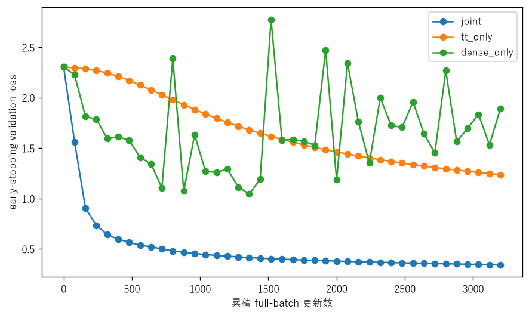
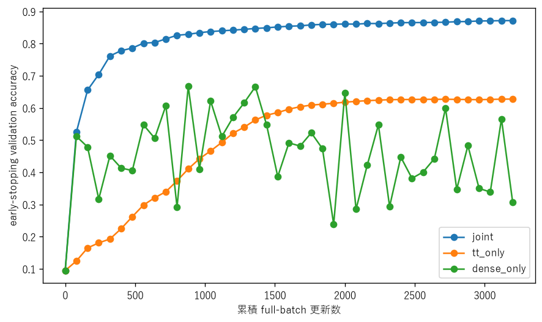
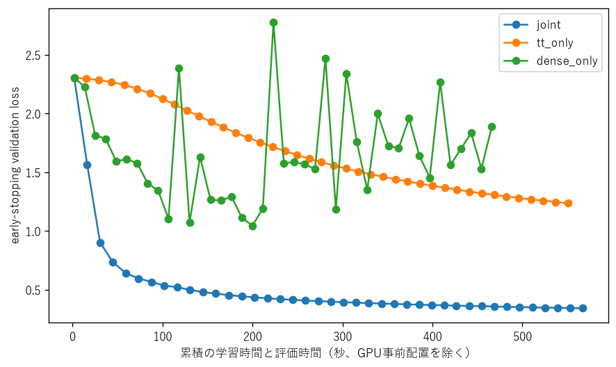
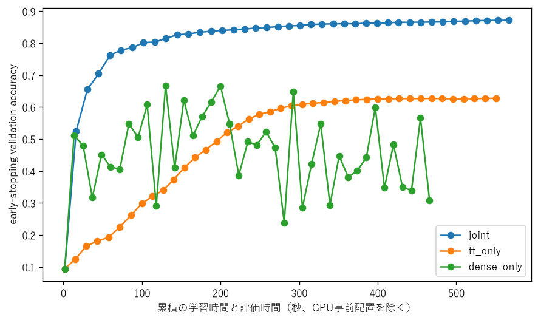

# Fashion-MNIST TT-MLPの更新対象固定予算ablation

## このノートの役割

本ノートは、Notebook 04で採用したGPU常駐・batch size 4,096の経路を使い、更新対象だけを変えたNotebook 05の保存結果と考察をまとめる。

- Notebook：`notebooks/40_dmrg/10_fashion_mnist_mlp/05_update_scope_ablation_gpu_resident.ipynb`
- 集計：`results/40_dmrg/10_fashion_mnist_mlp/05_update_scope_ablation_gpu_resident/`
- 各条件の履歴・checkpoint：`models/40_dmrg/10_fashion_mnist_mlp/05_update_scope_ablation_gpu_resident/`

Notebook 03までのjoint学習だけでは、「改善は通常parameterの更新だけで説明でき、TT更新は不要だったのではないか」という疑問が残っていた。05の目的は、同じStage Cと固定更新予算のもとで更新対象を切り分け、この疑問を検証することである。収束後の限界性能や、各方式を個別に最適化した結果を比べる実験ではない。

---

## 1. 実験設計

### 1.1 比較した更新範囲

| scope | 結合TT pair | 通常parameter |
|---|---|---|
| `joint` | 更新 | 更新 |
| `tt_only` | 更新 | 固定 |
| `dense_only` | 固定 | 更新 |

ここで通常parameterは、`fc1.bias`、`fc2.weight`、`fc2.bias`、`fc3.weight`、`fc3.bias`をまとめた群である。

`tt_only`は通常parameterのforwardを残すが、勾配保存、更新候補作成、書き戻しから外す。`dense_only`はTT学習率を0にする方式ではなく、TT pairの結合、局所勾配更新、SVD、rank制限、core書き戻し、正準中心移動、pair巡回を実行しない。

### 1.2 固定した条件

- 共通のStage C checkpoint。
- seed 0と同じデータ分割。
- training 50,000件、early-stopping validation 5,000件。
- GPU常駐、batch size 4,096。
- 更新する側の学習率は0.3。
- 全データ平均cross-entropy。
- 最大3,200 full-batch更新。
- 80更新ごとにtrainingとvalidationを評価。
- early stoppingは行わず、全条件が固定予算を使い切る。
- bestはearly-stopping validation loss最小の評価時点。初期状態も候補に含み、lossが同値なら早い時点を選ぶ。
- testとrank-selection validationは走査しない。

無更新baselineは共通初期stateの0更新評価で表す。更新しない処理を3,200回繰り返す条件は実行していない。

jointとtt-onlyでは、6 coreの左右1往復、各pair 8局所stepが80更新に対応する。dense-onlyの80更新は比較用の評価区間であり、DMRG-likeな往復ではない。

したがって、05でそろえたのはfull-batch更新回数である。各parameterの更新回数、1更新の処理内容、wall time、計算量まで等しい比較ではない。

### 1.3 比較が成立していることの確認

保存済みsmokeでは、次を確認した。

- 旧DataLoader jointと新GPU常駐jointの80更新後について、validation loss差が`1e-3`未満、accuracy差が`0.001`未満。
- `joint`ではTT coreと通常parameterが両方変化。
- `tt_only`ではTT coreが変化し、通常parameterは初期値と`torch.equal`で完全一致。
- `dense_only`ではTT coreが初期値と完全一致し、通常parameterだけが変化。
- `tt_only`の通常parameter候補作成回数は0。
- `dense_only`のSVD・core書き戻し回数は0。

主実験中も80更新ごとの評価で固定対象が初期stateと一致することを検査した。3条件とも3,200更新を正常完了し、未完了条件を比較表へ混ぜていない。

---

## 2. 保存済み結果

共通初期値はvalidation loss `2.303983`、accuracy `0.0946`だった。

| scope | best更新数 | best val loss | best時点のaccuracy | final val loss | final accuracy |
|---|---:|---:|---:|---:|---:|
| `joint` | 3,200 | 0.341941 | 0.8716 | 0.341941 | 0.8716 |
| `tt_only` | 3,200 | 1.236367 | 0.6278 | 1.236367 | 0.6278 |
| `dense_only` | 1,360 | 1.044149 | 0.6660 | 1.890252 | 0.3076 |

ここでbestはvalidation loss基準であり、accuracy最大時点とは限らない。

### 2.1 時間とmemory

| scope | 学習時間[s] | 評価時間[s] | 総時間[s] | peak allocated |
|---|---:|---:|---:|---:|
| `joint` | 496.2 | 70.6 | 566.9 | 約1.36 GB |
| `tt_only` | 479.9 | 70.5 | 550.5 | 約1.36 GB |
| `dense_only` | 397.1 | 68.9 | 466.0 | 約1.15 GB |

総時間は学習と評価のほか保存時間を含む。GPU事前配置時間は約0.015秒で、学習曲線の時間軸には加えていない。

---

## 3. 実験結果からの考察

### 3.1 固定予算ではjointが明確に優位だった

jointはvalidation loss `0.341941`、accuracy `0.8716`で、両単独更新より良かった。

- jointとdense-onlyの損失best時点を比べると、accuracy差は`0.8716-0.6660=0.2056`、20.56 percentage point。
- jointとtt-onlyを比べると、accuracy差は`0.8716-0.6278=0.2438`、24.38 percentage point。

dense-onlyの悪い最終値`0.3076`を使わず、途中のbestと比べてもjointとの差は大きい。したがって、今回のStage C、学習率0.3、3,200更新では、jointの高い到達性能を通常parameterの更新だけでは説明できない。TT側も更新できることがjointの到達性能へ寄与したと読める。

ただし、20.56ポイントを「TTの独立した寄与」とは解釈しない。TTが変わると通常parameterが受ける入力と、その後の学習経路も変わるため、jointとdense-onlyの差には相互作用が含まれる。

### 3.2 tt-onlyでもTT側が実際に学習した

tt-onlyは通常parameterを完全に固定したまま、accuracyを`0.0946`から`0.6278`へ、validation lossを`2.303983`から`1.236367`へ改善した。

したがって、2-core更新とSVD書き戻しを行うTT側の経路は、形式的に動いただけではなく、分類性能を改善できた。一方、同じ予算ではjointに届かず、通常parameter群も調整できることが有効だった。

tt-onlyで固定した通常parameterは、十分に学習済みの分類器ではなく、accuracy 9.46%のStage Cに含まれる状態である。この制約を含む結果なので、jointとの差をTT表現の容量不足とは扱わない。また、tt-onlyの最終lossはまだ低下中であり、`0.6278`はTT-onlyの限界性能ではない。

### 3.3 dense-onlyは学習不能ではなく、改善後に振動した

dense-onlyはaccuracy最大では880更新で`0.6672`、validation loss最小では1,360更新でloss `1.044149`、accuracy `0.6660`まで改善した。通常parameterだけでも学習できるため、最終accuracy `0.3076`だけを使って「通常parameterだけでは学習できない」とは言えない。

一方、loss best時点から最終時点までに、

| 指標 | 1,360更新 | 3,200更新 |
|---|---:|---:|
| train loss | 1.039920 | 1.861287 |
| validation loss | 1.044149 | 1.890252 |
| validation accuracy | 0.6660 | 0.3076 |

へ悪化した。40評価区間のうち、train lossとvalidation lossはそれぞれ15区間で上昇し、そのうち14区間では同じ区間に両方が上昇した。曲線も上下を繰り返している。

train lossが下がり続けてvalidationだけが悪化する典型的な過学習だけでは、この挙動を説明しにくい。今回の学習率0.3における最適化の振動・不安定化と整合する。ただし、学習率を変えたdense-onlyを比較していないため、原因を学習率0.3と確定することはできない。TT更新に一般的な安定化作用があるとも断定しない。

### 3.4 bestは選択指標と評価間隔に依存する

dense-onlyでは、

- validation accuracy最大：880更新、accuracy `0.6672`。
- validation loss最小：1,360更新、loss `1.044149`、accuracy `0.6660`。

となった。Notebookのbest checkpointはlossで選ぶため、accuracy最大checkpointとは異なる。「best accuracy」と書く場合は、accuracy最大値なのか、loss基準best時点のaccuracyなのかを区別する。

また、validationは0更新と80更新ごとに評価した41時点だけである。bestは全3,201 stateから選んだ値ではなく、この評価点集合の中でのbestである。振動の大きいdense-onlyでは、評価間にさらに良い一時点が存在した可能性を排除できない。

### 3.5 jointは最終性能だけでなく到達速度でも優位だった

dense-onlyの全評価点でのaccuracy最大は`0.6672`だった。jointは240更新時点でvalidation loss `0.733329`、accuracy `0.7044`に達し、すでにこの値を上回った。この時点の累積学習時間は約37.8秒、評価時間を加えて約44.8秒だった。

dense-onlyがaccuracy最大へ達したのは880更新、累積学習・評価時間は約130秒である。したがって、今回の履歴では、jointは更新数でも実時間でも、dense-onlyより早く高いaccuracyへ到達した。

これは同じ3,200更新後の最終順位だけからは見えない結果である。一方、単一seedの1回なので、一般的なtime-to-accuracy優位とは主張しない。

### 3.6 1更新の費用と目標性能への到達時間を分ける

全3,200更新の総時間は、jointが`566.9`秒、dense-onlyが`466.0`秒で、jointは約22%長かった。TT勾配、SVD、core書き戻しを行わないdense-onlyの1更新が軽いことと整合する。

一方、前節のとおり、jointは約44.8秒でdense-onlyの最高accuracyを上回った。したがって、次の二つは両立する。

- 同じ更新数を完了する費用はjointの方が大きい。
- 今回の履歴では、より良い性能への到達はjointの方が早い。

計算効率を議論するときは、1更新の費用、固定更新予算の総時間、目標性能への到達時間を分ける必要がある。

### 3.7 同じ更新数でもparameterごとの学習機会は同じではない

1回の更新で動かす対象は、

| scope | 1更新で動かすもの |
|---|---|
| `joint` | 現在のTT pairと通常parameter群 |
| `tt_only` | 現在のTT pair |
| `dense_only` | 通常parameter群 |

である。jointとtt-onlyではpairを巡回するため、1更新でTT全coreを同時に動かすわけではない。一方、通常parameter群はjointとdense-onlyの各更新で対象になる。

これは更新範囲を除外したときの挙動を見る05の目的には合っているが、「各parameterに同じ回数の学習機会を与えた比較」ではない。また、通常parameter群を一括して更新・固定したため、`fc2`、`fc3`、biasのどれが重要だったかは分からない。

### 3.8 jointとtt-onlyは3,200更新で収束したとは言えない

最後の3,120更新から3,200更新では、

| scope | 3,120更新のval loss | 3,200更新のval loss |
|---|---:|---:|
| `joint` | 0.343534 | 0.341941 |
| `tt_only` | 1.246856 | 1.236367 |

と、両条件ともまだ低下した。

保存された0更新を含む41評価点では、jointとtt-onlyのtrain loss・validation lossはいずれも前評価点から上昇しなかった。ただし、80更新の間に一時的な上昇がなかったことまでは分からない。

したがって、jointの`0.8716`とtt-onlyの`0.6278`は今回の固定予算内の到達値であり、各方式の限界性能ではない。長く学習したtt-onlyがjointへ追いつくかも、この実験では分からない。05が示したのは、同じ3,200更新ではjointが先に良い性能へ到達したことまでである。

### 3.9 Notebook 03との近さは再現性の参考である

| 条件 | validation loss | validation accuracy |
|---|---:|---:|
| Notebook 03・DataLoader batch 512・joint 0.3 | 0.342614 | 0.8710 |
| Notebook 05・GPU常駐 batch 4,096・joint 0.3 | 0.341941 | 0.8716 |

loss差は約`0.000673`、accuracy差は0.06 percentage pointである。GPU常駐化とbatch size変更後も03に近い到達値を得た参考確認になる。ただし、同一実装の反復ではなく、微小差から05の方が高性能とは主張しない。

---

## 4. この実験だけでは言えないこと

- jointが別seed、別rank、別モデルでも最良であること。
- 各scopeに適した学習率を選び直した後も順位が同じであること。
- 同じwall time・FLOPs・parameter更新回数での優劣。
- joint、tt-onlyが収束した後の限界性能。
- dense-onlyの振動原因が学習率、モデル構造、その他の要因のどれか。
- TT更新に一般的な安定化作用があること。
- jointと単独更新の差を、TT側・通常parameter側の独立した寄与へ加法分解できること。
- 通常parameter群のうち、どの層やbiasの更新が重要だったか。
- 2-core＋SVD方式が通常のTT全core同時学習や他optimizerより優れること。
- test set上の最終性能。

---

## 5. 05の結論

> 同じStage C、学習率0.3、3,200 full-batch更新という固定条件では、jointがTT-onlyとdense-onlyの両方を明確に上回った。TT-onlyでも分類性能は改善したため、TT側の2-core更新は実際に学習へ寄与している。一方、TT側だけではjointへ届かず、通常parameter群も同時に調整できることが有効だった。dense-onlyは途中で66%台まで改善した後、train・validationの両方が振動しながら悪化したため、典型的な過学習だけでは説明しにくい。jointは1更新あたりの費用は大きいが、今回の履歴ではdense-onlyの最高accuracyを更新数・実時間の両方で早く上回った。ただし、これは単一seed・固定学習率・固定更新予算での結果であり、各方式の収束後性能や一般的な優越性を示さない。

## 関連

- [[40_TT_MPS_NN圧縮/10_FashionMNIST_MLP/13_joint学習率0.2_0.3長時間比較]]
- [[40_TT_MPS_NN圧縮/10_FashionMNIST_MLP/14_full-batch勾配集計高速化benchmark]]
- [[50_DMRG/07_TT-MLPのfull-batch共同更新と更新予算]]
- [[50_DMRG/08_full-batch勾配のGPU常駐高速化とbenchmark設計]]
