# Dense・通常TT・DMRG-like TTの収束性能と計算費用の比較

## このノートの役割

本ノートは、Dense MLP、通常Adamで学習するTT-MLP、2-core局所更新を行うDMRG-like TT-MLPを比較したNotebook 06の保存結果と考察をまとめる。

- Notebook：`notebooks/40_dmrg/10_fashion_mnist_mlp/06_dense_tt_dmrg_like_convergence_comparison.ipynb`
- 主表・latency・図：`results/40_dmrg/10_fashion_mnist_mlp/06_dense_tt_dmrg_like_convergence_comparison/`
- 履歴・checkpoint：`models/40_dmrg/10_fashion_mnist_mlp/06_dense_tt_dmrg_like_convergence_comparison/`
- 保存成果物の監査：`results/40_dmrg/10_fashion_mnist_mlp/06_dense_tt_dmrg_like_convergence_comparison/rank_initial_repair/`

06の目的は、parameter容量、分類性能、学習費用、理論MACs、実測推論latencyを同時に確認し、3つの学習手順の交換関係を整理することである。通常TTとDMRG-likeではoptimizer、batch単位、更新単位、学習率、計算予算が異なるため、局所2-core更新やSVDだけを切り分ける因果実験ではない。

---

## 1. 実験設計

### 1.1 比較した3条件

| 条件 | モデル | 学習方法 |
|---|---|---|
| Dense | Dense MLP | minibatch Adam、学習率`1e-3` |
| 通常TT | rank cap 12のTT-MLP | 全parameterをminibatch Adam、学習率`1e-3` |
| DMRG-like TT | 通常TTと同じTT構造 | joint 2-core full-batch局所更新、TT側・通常parameter側とも学習率`0.3` |

TTのmodeとactual ranksは次である。

- output modes：`(4, 2, 2, 2, 4, 4)`。
- input modes：`(2, 2, 2, 2, 7, 7)`。
- actual ranks：`(1, 8, 12, 12, 12, 12, 1)`。
- TT core要素数：`5,968`。
- TT-MLP全体のparameter数：`140,378`。

通常TTとDMRG-like TTは、構造、actual ranks、parameter数、direct contractionによるforwardが同じである。したがって、この2条件の性能差をモデル容量の差では説明できない。

### 1.2 データ分割と選択規則

- training：50,000件。
- early-stopping validation：5,000件。
- rank-selection validation：5,000件。
- test：10,000件の長さだけを確認し、forward評価には使わない。
- seed：0の1設定。
- best checkpoint：early-stopping validation lossのstrict best。
- stopping referenceに対する非改善がpatience 5へ達したときearly stopping。
- 学習終了後、best checkpointだけをrank-selection validationで評価して主比較に使う。

DMRG-likeはNotebook 05の3,200更新済みjointモデルから継続した。ただし履歴、best、累積時間、局所更新番号はStage Cの0更新から接続している。06で追加したのは3,200更新以後の学習である。

---

## 2. 保存済み結果

### 2.1 分類性能

| 条件 | strict best | early-stop用loss | early-stop用accuracy | rank-selection loss | rank-selection accuracy | Denseとの差 |
|---|---:|---:|---:|---:|---:|---:|
| Dense | epoch 7 | 0.299885 | 0.8838 | 0.310588 | 0.8884 | 0.00 pp |
| 通常TT | epoch 8 | 0.303265 | 0.8926 | 0.309005 | 0.8906 | +0.22 pp |
| DMRG-like TT | sweep 106、8,480更新 | 0.290853 | 0.8950 | 0.286605 | 0.8968 | +0.84 pp |

ここで主比較に使うaccuracyは、最後の`0.8884`、`0.8906`、`0.8968`である。early-stopping用とrank-selection用は別の5,000件なので、同じcheckpointでも値が一致する必要はない。

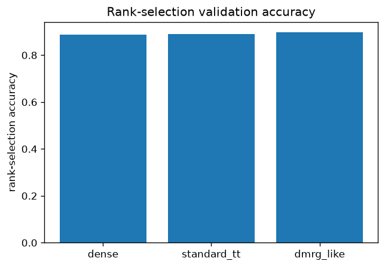

### 2.2 停止結果と学習量

| 条件 | best | 停止時点 | 全train走査 | 更新数の記録 | 停止理由 |
|---|---:|---:|---:|---:|---|
| Dense | epoch 7 | epoch 12 | 12 | Adam step 9,384 | early stopping |
| 通常TT | epoch 8 | epoch 13 | 13 | Adam step 10,166 | early stopping |
| DMRG-like TT | sweep 106 | sweep 111 | 8,880 | 局所更新8,880 | early stopping |

3条件とも安全上限で打ち切られたのではなく、保存された停止規則でearly stoppingが成立した。ただし、1 epochと1局所更新の計算内容は同じではなく、共通の停止規則を使ったことは計算予算をそろえたことを意味しない。

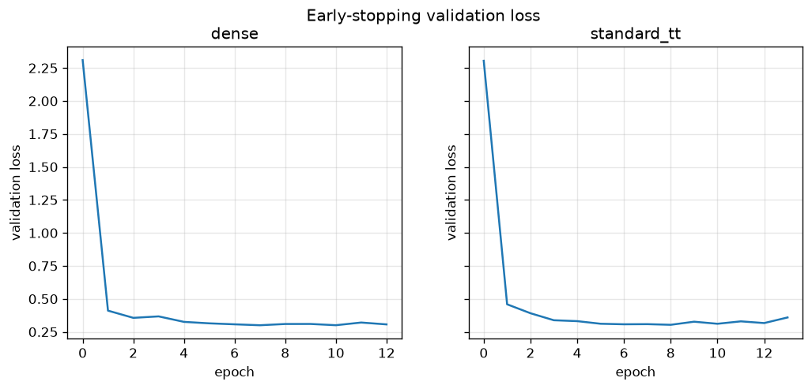

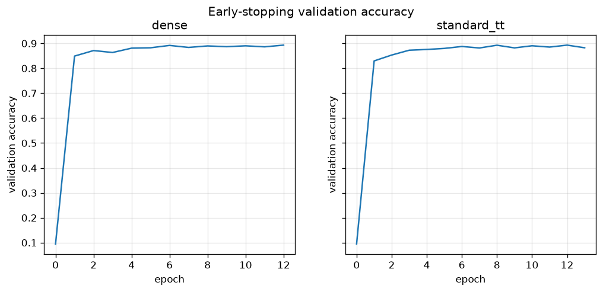

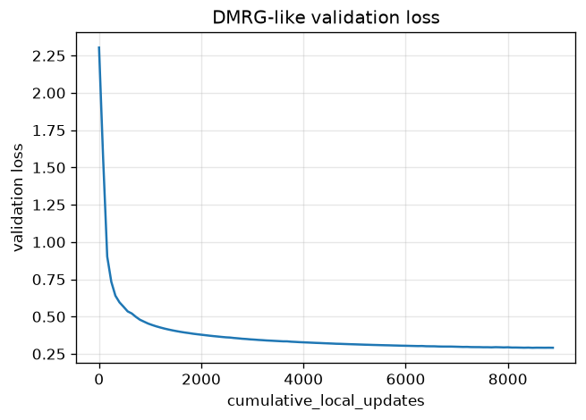

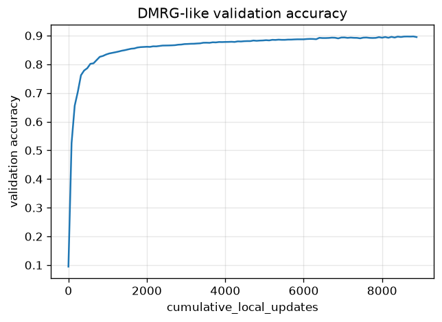

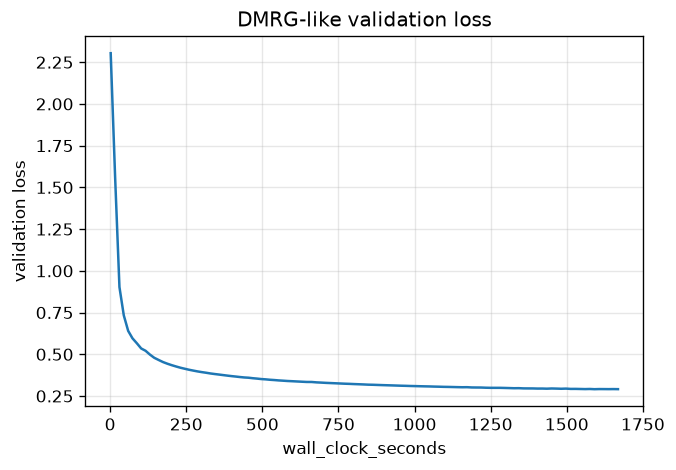

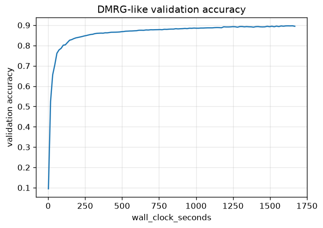

今回の固定条件では、`cumulative_local_updates = 80 × sweep`かつ`train_full_dataset_gradient_passes = cumulative_local_updates`である。この3軸は曲線の横軸を定数倍しただけなので、重複していたsweep軸とgradient pass軸の図は削除し、局所更新数と累積学習＋評価時間だけを残した。

### 2.3 parameter数と理論MACs

| 指標 | Dense | 通常TT | DMRG-like TT |
|---|---:|---:|---:|
| モデル総parameter数 | 535,818 | 140,378 | 140,378 |
| Dense比parameter削減率 | 0% | 73.80% | 73.80% |
| 圧縮比 | 1.000 | 3.817 | 3.817 |
| `fc1`理論MACs/sample | 401,408 | 2,175,488 | 2,175,488 |
| モデル全体の理論MACs/sample | 535,040 | 2,309,120 | 2,309,120 |
| Dense比MACs | 1.000倍 | 4.316倍 | 4.316倍 |

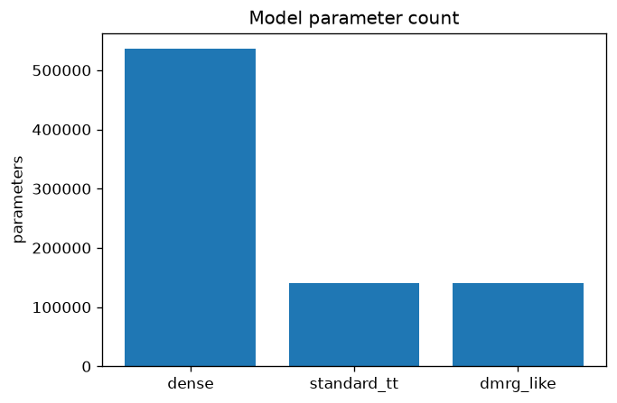

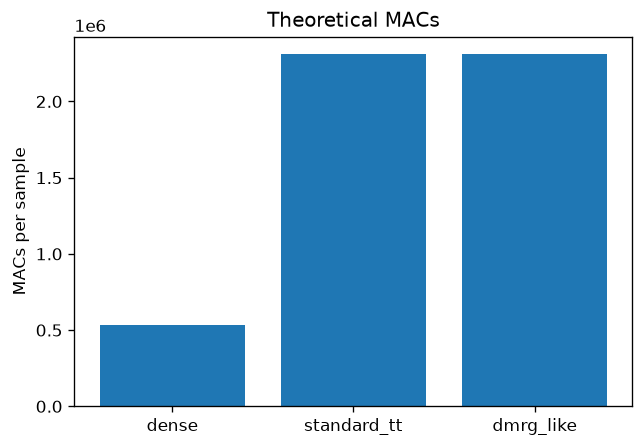

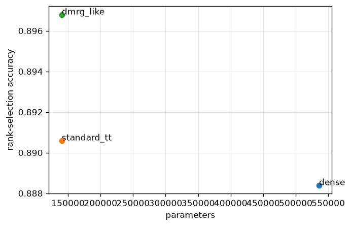

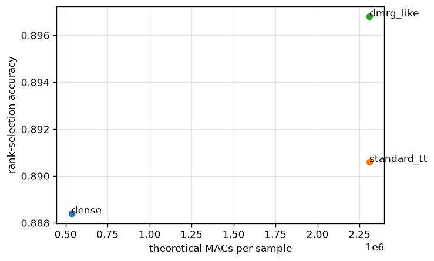

上の2図は、TTでparameter数は減った一方、現在の直接縮約実装では理論MACsが増えたことを、同じaccuracy軸で示す。parameter圧縮と演算量削減は同じ指標ではない。

### 2.4 推論latency

CUDA同期を含む100回の測定のmedianは次だった。

| batch | Dense | 通常TT | DMRG-like TT |
|---:|---:|---:|---:|
| 1 | 0.139 ms | 0.598 ms | 0.586 ms |
| 4,096 | 0.263 ms | 8.889 ms | 8.890 ms |

Dense比では、batch 1でTTが約4.2〜4.3倍、batch 4,096で約33.9倍遅かった。通常TTとDMRG-like TTの四分位範囲はほぼ同じであり、両者の小さな差を速度差とは解釈しない。

batch 4,096の推論時peak allocated memoryも、Dense約100 MBに対し、TTは約1.01 GBだった。

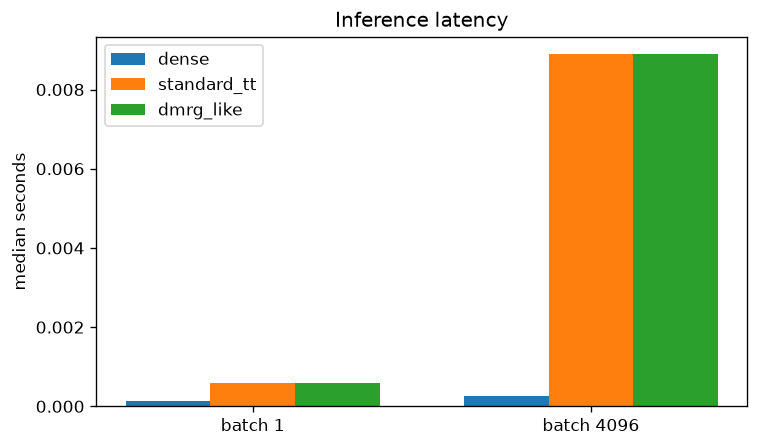

### 2.5 学習・評価費用

| 条件 | 学習時間 | 評価時間 | 学習＋評価時間 | peak training allocated |
|---|---:|---:|---:|---:|
| Dense | 34.79秒 | 24.42秒 | 59.22秒 | 約80 MB |
| 通常TT | 46.69秒 | 24.21秒 | 70.91秒 | 約188 MB |
| DMRG-like TT | 1,355.38秒 | 312.94秒 | 1,668.31秒 | 約1.36 GB |

DMRG-likeの学習時間はDenseの約38.96倍、通常TTの約29.03倍だった。学習＋評価時間では、それぞれ約28.17倍、約23.53倍である。

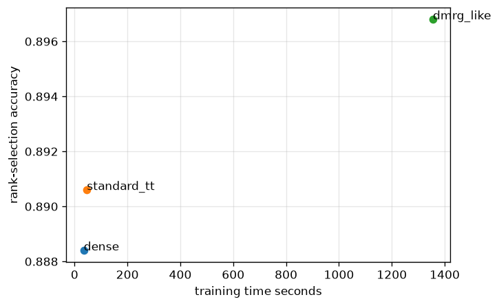

この図の学習時間は各方式の保存値であり、同じ更新予算にそろえた比較ではない。到達accuracyと、その学習手順で実際に要した学習時間の交換関係として読む。

---

## 3. 実験結果からの考察

### 3.1 同じTT容量でも学習手順によって到達値が変わった

通常TTとDMRG-like TTは、actual ranks、parameter数、理論MACs、forward実装が同じである。それでもrank-selection accuracyは`0.8906`と`0.8968`、lossは`0.309005`と`0.286605`になった。

したがって、この差はモデル容量の差ではなく、異なる学習手順によって同じ表現空間内の別の重みへ到達した結果と読める。今回の実行ではDMRG-likeの学習手順全体がより良い評価値へ到達した。

一方、通常TTとDMRG-likeでは、Adamか局所2-core更新か、minibatchかfull-batchか、学習率、更新単位、計算予算が同時に異なる。差を「局所更新」「SVD」「sweep」のどれか一つの効果へ分離することはできない。

### 3.2 DMRG-likeは高い到達性能を得たが、計算効率は良くなかった

通常TTに対するaccuracy改善は0.62 percentage point、rank-selection loss改善は約0.0224だった。一方、学習＋評価時間は約23.5倍、全train走査は13回に対して8,880回だった。

したがって、DMRG-likeを「通常TTより速く収束した」「計算効率がよい」とは評価できない。今回示されたのは、大きな計算費用を使って高い到達性能を得たという交換関係である。

また、8,880回と13回という差があるため、この結果だけからDMRG-likeの更新方法そのものが通常Adam TTより優れているとも言えない。更新方法と計算予算の差が混ざっている。

### 3.3 通常TTも重要な結果だった

通常TTはDenseより73.8%少ないparameter数で、rank-selection accuracy `0.8906`を得た。Denseの`0.8884`に近いだけでなく、今回の値では0.22ポイント上回っている。

したがって、「少ないparameter数でDense並みの分類性能を得る」という目的は、通常Adam TTでも今回の固定条件内では達成した。DMRG-likeの追加的な結果は、同じTT構造からさらに0.62ポイント高いaccuracyと低いlossへ到達したことであり、その代わりに学習費用が大幅に増えたことである。

### 3.4 parameter圧縮と演算高速化は別だった

TT化によって保存する重み要素数は減ったが、6個のcoreを中間rankを通して順番に縮約する現在のdirect contractionでは、各forwardの演算回数がDense行列積より多くなった。

このため、parameter数73.8%削減、理論MACs約4.316倍、batch 4,096のlatency約33.9倍という結果は両立する。今回達成したのはparameter容量の圧縮であり、演算量、推論時間、実行時memoryの圧縮ではない。

これはTT表現一般が必ず遅いという結論ではない。今回のtensorization、rank、direct contraction実装で得た実測結果である。

### 3.5 DMRG-likeの追加費用は主に学習方法に現れた

通常TTとDMRG-like TTは同じ推論構造なので、parameter数、理論MACs、実測latencyはほぼ同じだった。DMRG-likeへ変更したことによる大きな追加費用は、推論時ではなく学習時に現れている。

したがって、モデルを一度学習して長く利用する場合と、頻繁に再学習する場合では、学習時間増加の実用上の重みが異なる。ただし、今回のTT forward自体がDenseより遅い問題は、どちらのTT学習方法にも共通する。

### 3.6 Denseを上回ったことの解釈範囲

DMRG-like TTは、Denseより73.8%少ないparameter数で、rank-selection accuracyを`0.8884`から`0.8968`へ0.84ポイント、正解数にすると5,000件中42件上回った。lossも`0.310588`から`0.286605`へ下がった。

06については、「今回のseed、データ分割、構造、学習手順、計算予算では、圧縮されたTTモデルがDenseより高い評価値を得た」と言える。

一方、seedは1つ、各条件の学習は1回で、test評価も行っていない。したがって、「TT圧縮すればDenseより高精度になる」「DMRG-likeは一般に高精度」とは一般化できない。通常TTとの差0.62ポイントは5,000件中31件に対応するが、その確実さも複数seedやsample別の対応比較を行うまで分からない。

---

## 4. 保存成果物の監査と修復

### 4.1 固定rankの確認範囲

DMRG-likeについては、次を保存成果物から確認した。

- initial、best、finalのactual ranksがすべて`(1, 8, 12, 12, 12, 12, 1)`。
- TT core要素数`5,968`、総parameter数`140,378`。
- `local_updates.csv`の8,880行すべてで、`retained_rank`が更新pairのbond rankと一致。
- 累積更新番号は1〜8,880で重複・欠損なし。
- 先頭3,200行はNotebook 05 jointの局所更新ログと全列一致。
- 学習経路の判定とbest checkpointの判定のANDが`True`。

通常TTはinitial、best、finalと、epoch境界のhistory 14行で同じrankを確認した。stepごとのlocal updateログは存在しないため、全step確認済みとは書かない。DenseはTT rankの対象外である。

### 4.2 `initial_model.pt`の来歴修復

修復前のDMRG-like `initial_model.pt`には、Stage Cの0更新状態ではなく、Notebook 05終了時の3,200更新済み重みが入っていた。重みtensor 11個は05 jointの`final_model.pt`と一致したが、保存形式のkey順が違うためファイル全体のSHA-256は異なっていた。

保存成果物は次のように修復した。

- `initial_model.pt`：05 jointの初期checkpointと同じ内容へ置換。
- `continuation_start_after_3200_updates.pt`：修復前の06 initialを継続開始checkpointとして保存。
- 修復前ファイル：`rank_initial_repair/backup/`にも保存。
- best、final、history、local update、run state、主表、latency、Notebook 00〜05は変更していない。
- 再学習、validation、rank-selection forward、latency再測定は実行していない。

修復後の06 initialは05 joint initialとファイル全体で一致する。05 joint initialのtensorはStage Cとも一致するが、Stage C固有metadataは06 initialへ追加していない。

監査レポートの`current_06_initial_equals_05_final_tensors`は、名前に反して修復前に取得した判定である。現在の06 initialは05 initialと一致し、05 finalとは一致しない。読むときは`pre_repair_06_initial_equals_05_final_tensors`に相当する履歴値として扱う。

### 4.3 将来の再実行に対するコード修正

保存成果物の事後修復だけではFresh Run Allで同じ問題が再発するため、Notebook本体も修正した。

- DMRG-likeの`initial_model.pt`には05 joint initialを保存する。
- 3,200更新時点は`continuation_start_after_3200_updates.pt`へ別保存する。
- 固定rankは履歴側とbest checkpoint側を別キーで保存し、公開値を両者のANDにする。
- `state.update(metrics)`による履歴判定の上書きを廃止する。
- Denseの固定TT-rank表記は`N/A`にする。
- `RUN_MAIN_EXPERIMENT = False`へ戻し、保存済みNotebookをRun Allしても再学習しないようにする。

これらは将来の実行経路の修正であり、今回のaccuracy、loss、時間、memory、MACsを変更するものではない。

### 4.4 評価回数と時間軸の注意

DMRG-likeは1 sweepずつtrainerを呼び、各呼び出しで更新前後を評価している。このため、前sweep終了時点を次sweep開始時に再評価する重複がある。

train評価183回は、05由来の41回と、06で追加した71 sweepの前後評価から、

$$
41 + 2\times(111-40)=183
$$

となる。validation評価184回は継続開始前の確認をさらに1回含む。評価時間`312.94`秒にはこの実装上の重複費用が含まれるため、DMRG-likeに必須の理論的費用とは区別する。

履歴の`wall_clock_seconds`は、実際には

$$
\text{training seconds}+\text{evaluation seconds}
$$

であり、準備・保存などを含むプロセス全体のwall-clockではない。本ノートでは「累積学習＋評価時間」と呼ぶ。

---

## 5. 一般的な整理

### 5.1 モデル容量と最適化結果は別である

同じ構造・rank・parameter数でも、学習手順が異なれば別の重みへ到達し、accuracyとlossは変わり得る。ただし、異なる学習手順を比較しただけでは、その内部要素のどれが差を生んだかは分離できない。

### 5.2 parameter数、MACs、latency、memoryは別の指標である

parameter数は保存する重み要素数、MACsはforwardの積和演算数、latencyは実装とhardwareを含む実測時間である。parameter圧縮から他の削減を自動的に結論しない。

### 5.3 同じearly stopping規則は同じ計算予算を意味しない

epoch学習と局所full-batch更新では、評価単位、データ走査回数、parameter更新回数、1回の更新内容が異なる。到達性能と収束速度、1更新の費用、目標性能への到達時間を分けて読む必要がある。

---

## 6. この実験だけでは言えないこと

- DMRG-likeが別seed、別rank、別モデルでも最良であること。
- 通常TTとDMRG-likeを同じwall time、FLOPs、データ走査数で比較したときも順位が同じであること。
- 0.62ポイントの差が統計的に安定していること。
- 2-core局所更新、SVD、full-batch、学習率のどれが性能差を生んだか。
- 現在のTT direct contractionより高速な実装でもDenseより遅いこと。
- validationで選んだcheckpointのtest性能。
- DMRG-likeの評価重複を除いた場合の正確な総時間。

---

## 7. 06の結論

> seed 0の今回の実験では、通常TTとDMRG-like TTはDenseより73.80%少ないparameter数でDense並み以上のrank-selection validation accuracyを得た。同じTT構造の中ではDMRG-likeがaccuracy `0.8968`、loss `0.286605`で最良だったが、通常TTより学習＋評価時間が約23.5倍、全train走査も大幅に多く、計算効率や更新方法単独の優位性は示されていない。また、現在のdirect contractionではTTの理論MACsはDenseの約4.316倍、推論latencyも増えた。したがって、06が示したのは、parameter容量、到達性能、学習費用、推論費用の間の交換関係である。

## 関連

- [[40_TT_MPS_NN圧縮/10_FashionMNIST_MLP/15_更新対象固定予算ablation]]
- [[50_DMRG/06_TT-MLPのDMRG-like_2-core局所更新]]
- [[50_DMRG/07_TT-MLPのfull-batch共同更新と更新予算]]
- [[50_DMRG/08_full-batch勾配のGPU常駐高速化とbenchmark設計]]
