# 固定TT-rank sweepとDMRG-likeの費用対性能比較

## このノートの役割

本ノートは、Notebook 07で固定TT-rankを変えて学習した通常TTとDMRG-like TTを比較し、分類性能、保存量、理論MACs、実測latency、学習費用の交換関係を整理した結果・考察ノートである。

- Notebook：`notebooks/40_dmrg/10_fashion_mnist_mlp/07_fixed_rank_sweep_and_pareto.ipynb`
- 主結果：`results/40_dmrg/10_fashion_mnist_mlp/07_fixed_rank_sweep_and_pareto_gpu_slice/`
- 読取専用検証：`results/40_dmrg/10_fashion_mnist_mlp/07_fixed_rank_sweep_and_pareto_gpu_slice_readonly_verification/`
- checkpoint・履歴：`models/40_dmrg/10_fashion_mnist_mlp/07_fixed_rank_sweep_and_pareto_gpu_slice/`

07の主題は、固定rank候補間の性能と費用の関係を測定し、次のadaptive truncationと比較できる基準を作ることである。「rankを上げれば常に高精度になる」「DMRG-likeが通常TTより常に優れる」ことを示す実験ではない。

---

## 1. 実験設計と評価規則

### 1.1 比較対象

- rank cap：`1, 2, 3, 4, 5, 6, 8, 12`。
- 学習方式：通常TT（minibatch Adam）とDMRG-like（2-core full-batch joint更新）。
- 参照：Dense MLP。
- rank 12の2方式とDenseはNotebook 06の保存結果を再利用した。
- seedは1設定で、test setによる最終評価は行っていない。
- 16個の学習済みTT条件は、すべて設定されたearly stoppingで停止した。

全rankは同じ`shared_untrained_dense_state.pt`に由来するが、各rank capでTT-SVDを再実行してrank固有のStage C初期状態を作っている。したがって独立なrandom初期化ではないが、rank 8はrank 6の学習済みコアをzero paddingした続きでもない。

### 1.2 checkpointの選択と主評価

1. early-stopping validation lossがstrict bestになったcheckpointを選ぶ。
2. 選んだcheckpointを別のrank-selection validation 5,000件で評価する。
3. 主図のaccuracyとlossはこのrank-selection validation値である。
4. Paretoの縦軸はlossではなく、

$$
\text{validation error} = 1 - \text{accuracy}
$$

である。

checkpointはlossで選び、Paretoはそのcheckpointのaccuracyで決める。そのため、「loss最小の候補」と「accuracy最大の候補」の順位は一致するとは限らない。

---

## 2. 保存済みの主結果

### 2.1 rank別の分類性能

| rank cap | 通常TT loss | 通常TT accuracy | DMRG-like loss | DMRG-like accuracy | accuracy差（DMRG - 通常TT） |
|---:|---:|---:|---:|---:|---:|
| 1 | 0.310874 | 0.8916 | 0.343886 | 0.8772 | -1.44 pp |
| 2 | 0.313752 | 0.8862 | 0.336107 | 0.8790 | -0.72 pp |
| 3 | 0.300164 | 0.8922 | 0.325326 | 0.8810 | -1.12 pp |
| 4 | 0.314227 | 0.8872 | 0.318437 | 0.8850 | -0.22 pp |
| 5 | 0.313122 | 0.8874 | 0.304155 | 0.8928 | +0.54 pp |
| 6 | 0.315553 | 0.8852 | 0.303330 | 0.8940 | +0.88 pp |
| 8 | 0.301690 | 0.8948 | 0.304462 | 0.8892 | -0.56 pp |
| 12 | 0.309005 | 0.8906 | 0.286605 | 0.8968 | +0.62 pp |

Denseの参照値はloss `0.310588`、accuracy `0.8884`である。通常TTではrank 8のaccuracy `0.8948`、rank 3のloss `0.300164`がそれぞれ最良だった。DMRG-likeではrank 12がaccuracy `0.8968`、loss `0.286605`の両方で最良だった。

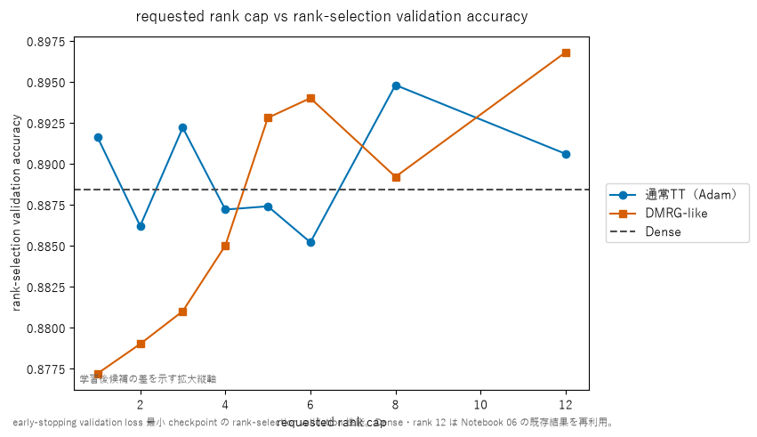

通常TTはrank 1・3でもDenseを上回った。DMRG-likeはrank 5・6・12で同rankの通常TTを上回ったが、rank 1〜4・8では下回った。学習方式の優劣はrankによって入れ替わっており、どちらかが一貫して優位とは言えない。線は独立に学習した離散的なrank候補を結んだ視覚補助であり、学習曲線ではない。

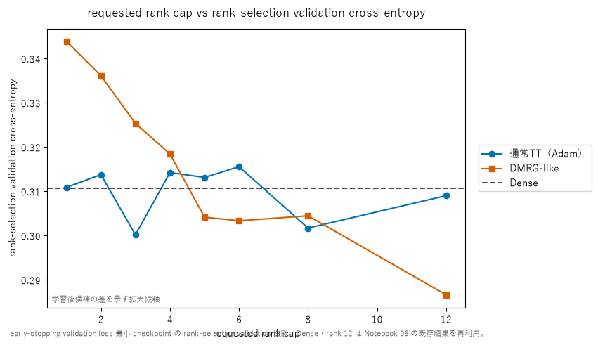

lossもrankに対して単調ではない。例えば通常TTではrank 3のlossがrank 8より低い一方、accuracyはrank 8が高い。cross-entropyは全classの予測確率と確信度を見るのに対し、accuracyはargmaxの正誤だけを見るため、順位の不一致は矛盾ではない。

### 2.2 構造的費用

| rank cap | TT core要素数 | fc1 parameter数 | モデル総parameter数 | 理論総MACs |
|---:|---:|---:|---:|---:|
| 1 | 76 | 588 | 134,486 | 156,032 |
| 4 | 784 | 1,296 | 135,194 | 411,392 |
| 5 | 1,180 | 1,692 | 135,590 | 559,232 |
| 6 | 1,656 | 2,168 | 136,066 | 738,432 |
| 8 | 2,848 | 3,360 | 137,258 | 1,190,912 |
| 12 | 5,968 | 6,480 | 140,378 | 2,309,120 |
| Dense | 対象外 | 401,920 | 535,818 | 535,040 |

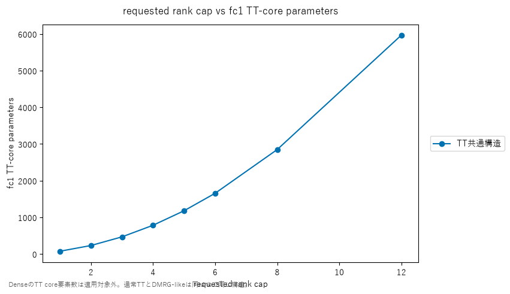

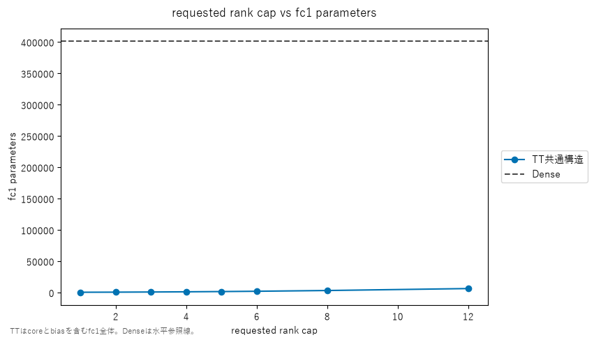

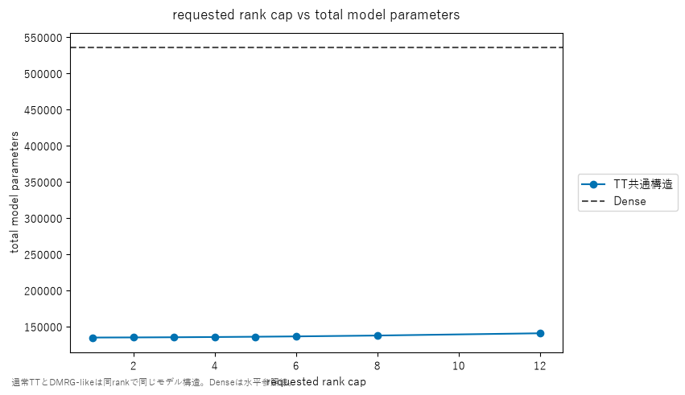

TT core要素数はrankとともに大きく増えるが、モデル総parameter数の増加は`134,486 -> 140,378`にとどまる。TT化していないfc2・fc3が共通で残るためである。rank 12でも総parameter数はDenseの約26%であり、モデルの保存量は大幅に減った。

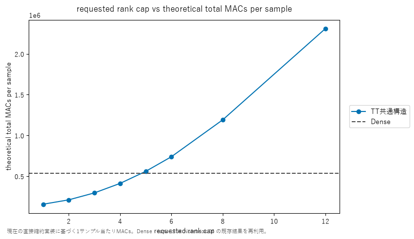

一方、現在のdirect contractionに基づく理論MACsはrank 4の`411,392`までDenseの`535,040`を下回るが、rank 5の`559,232`で上回る。rank 12はDenseの約4.32倍である。したがって、parameter数の削減と演算量の削減は別の成果である。

### 2.3 費用対accuracy

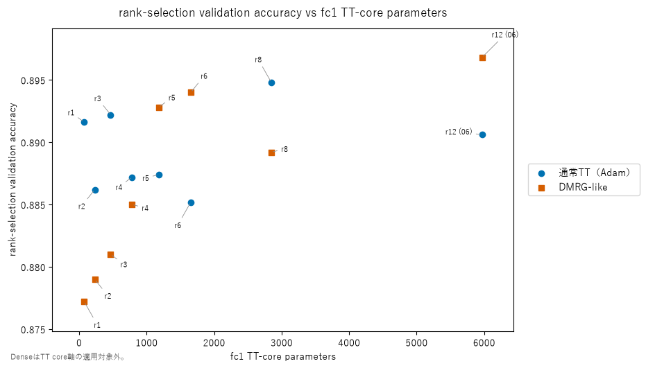

同rankの通常TTとDMRG-likeは同じ横位置にある。そのため縦方向の差は、同じモデル規模に対する学習後性能の差である。rank 6ではDMRG-like、rank 8では通常TTが上であり、「同じ規模ならDMRG-likeが常に上」ではない。

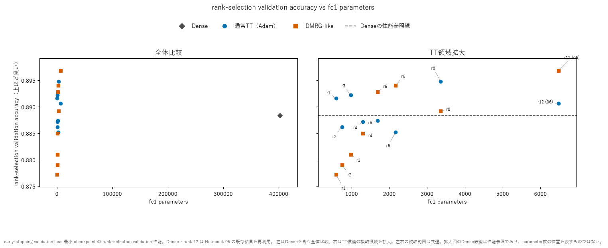

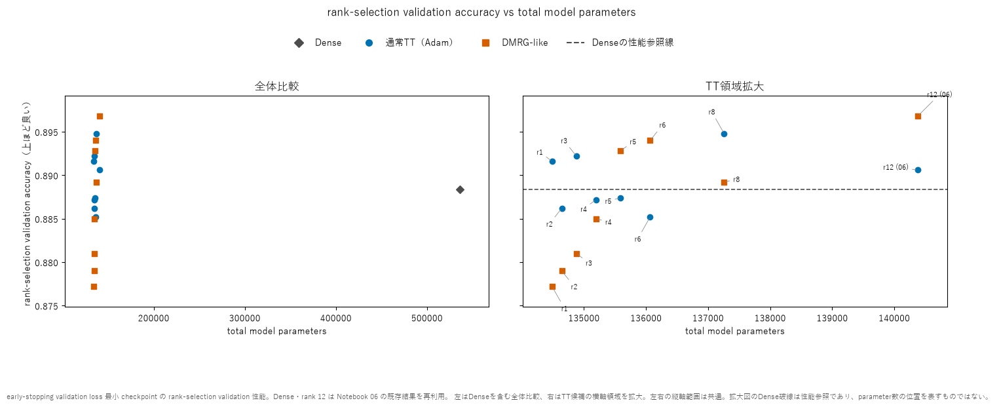

TT候補はDenseより大幅に小さいfc1・総parameter数で、今回の記録値ではDenseに近い、またはそれを上回るaccuracyを得た。ただしfc2・fc3も学習しており、fc1単体の分類能力を測った結果ではない。また、1 seedのvalidation差を未知データ上の一般的な優越とは扱わない。

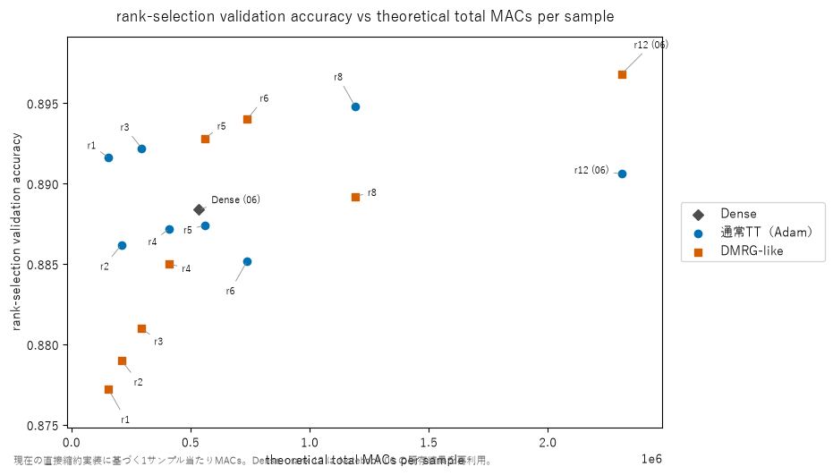

通常TT rank 1・3はDenseより少ない理論MACsでDense以上のaccuracyを記録した。DMRG-like rank 6・12はDenseより高精度だが、MACsはDenseより多い。DMRG-like rank 8は今回のrank 6より右かつ下に位置し、この2軸ではrank 6に支配された。

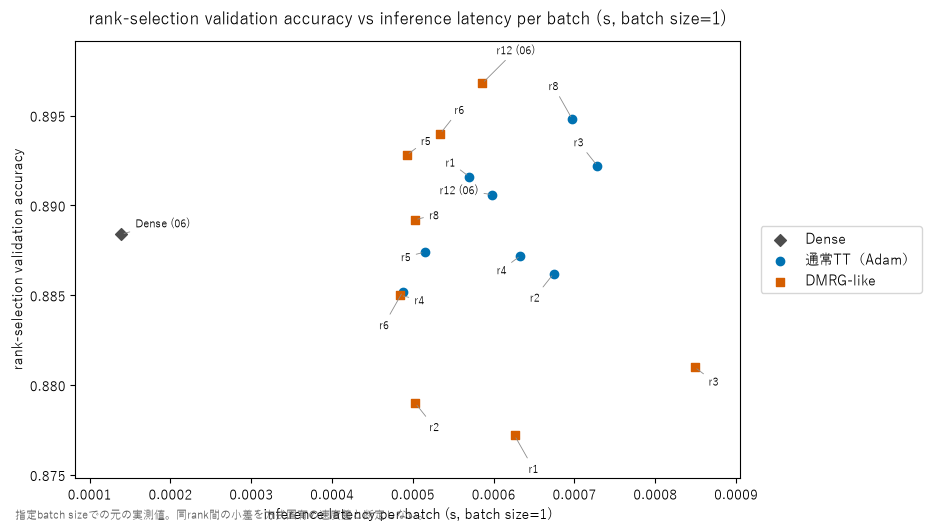

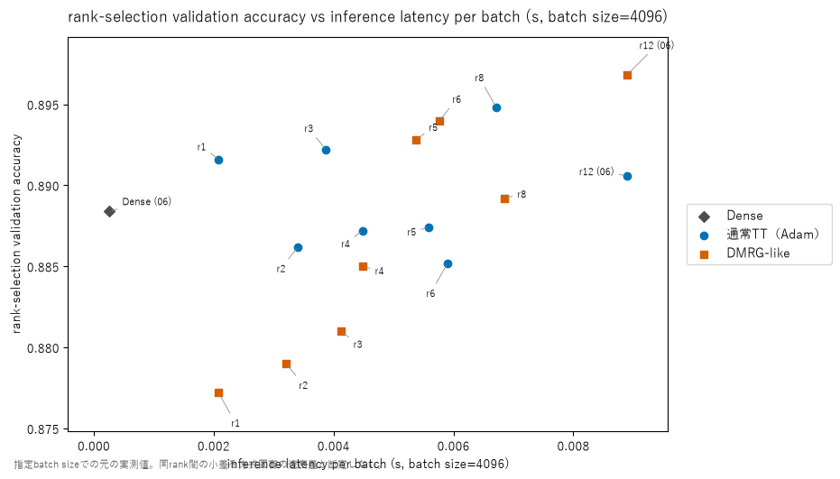

実測latencyではbatch 1・4096の両方でDenseが高速側にある。低rank TTの理論MACs削減は、現在の直接縮約実装では実測高速化に結び付いていない。また同rankの2方式はforward構造が同じなので、小さなlatency差を学習方式固有の速度差とは解釈しない。

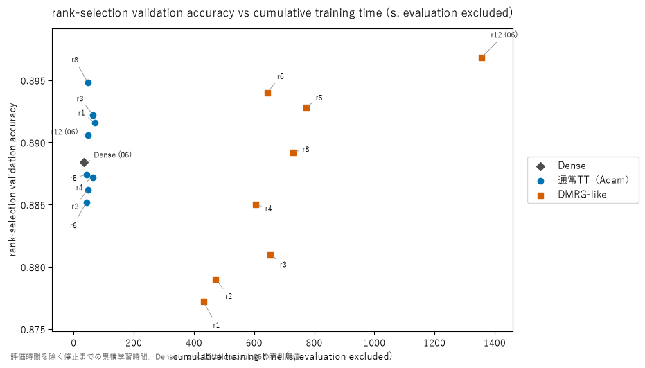

通常TT rank 8は約47秒でaccuracy `0.8948`、DMRG-like rank 12は約1,355秒で`0.8968`だった。今回のDMRG-likeの最高精度には大きな追加学習費用が伴った。一方、DMRG-like rank 5の約773秒に対しrank 6は約644秒であり、rankと停止までの時間は単調ではない。

---

## 3. Pareto frontierの結果

Pareto判定は、学習後の候補を対象に、validation errorと1つの費用指標だけで行う。fine-tuning前のinitialは主frontierに入れない。TT候補内の比較とDenseを含む比較は分け、DenseはTT core要素数の軸では対象外とする。

### 3.1 parameter数・理論MACs

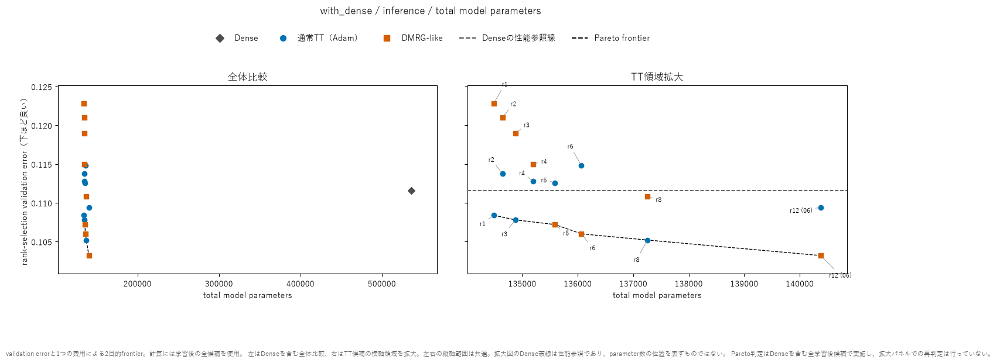

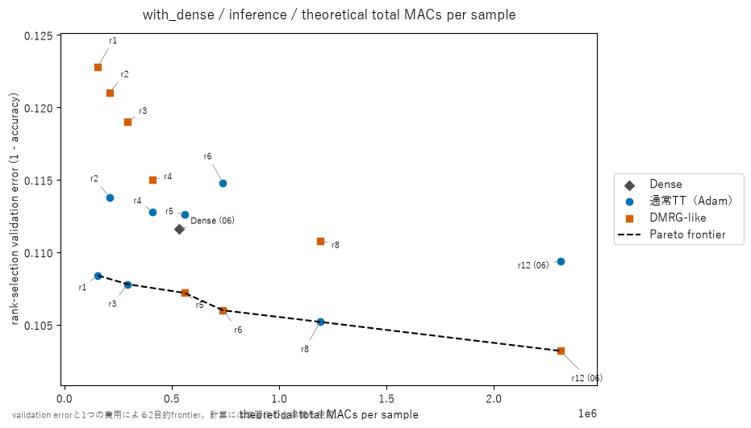

総parameter数と理論MACsのどちらでも、主に通常TT rank 1・3・8とDMRG-like rank 5・6・12が非支配候補として残った。Denseは、より小さい費用かつ低いerrorのTT候補があるため、この2軸ではfrontierから外れた。これは保存量または理論MACsとerrorに限定した結論である。

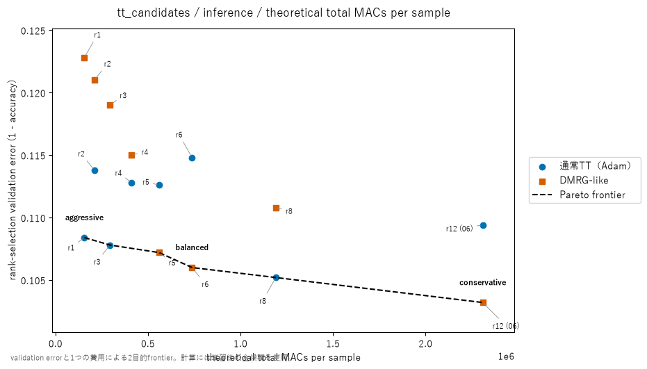

| 規則上の役割 | 候補 | accuracy | 理論MACs |
|---|---|---:|---:|
| aggressive | 通常TT rank 1 | 0.8916 | 156,032 |
| balanced | DMRG-like rank 6 | 0.8940 | 738,432 |
| conservative | DMRG-like rank 12 | 0.8968 | 2,309,120 |

`balanced = DMRG-like rank 6`は、TT候補内の理論MACs対errorに対し、事前に定めたknee抽出規則を適用した機械的な出力である。loss、latency、学習時間、memoryまで含めた「総合的な最良」ではない。

### 3.2 latency・学習時間

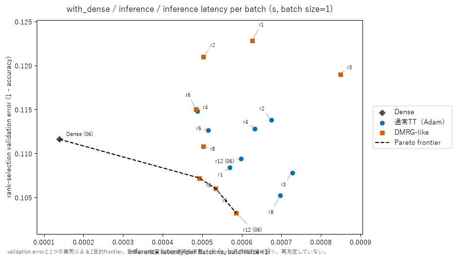

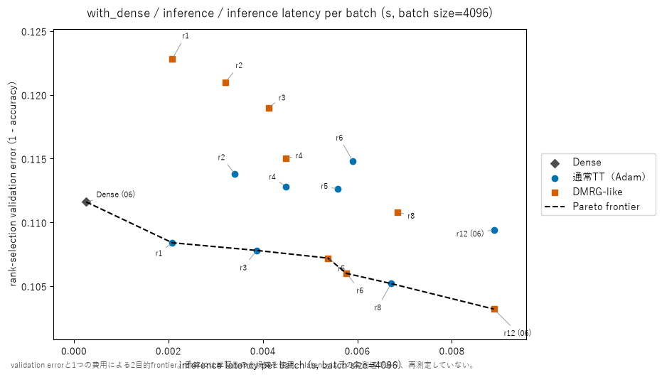

実測latencyを横軸にするとDenseがfrontierへ戻る。理論MACsではTTに支配されたDenseが、実測速度では有力な候補である。この違いから、理論MACsの削減をそのまま高速化と言い換えることはできない。

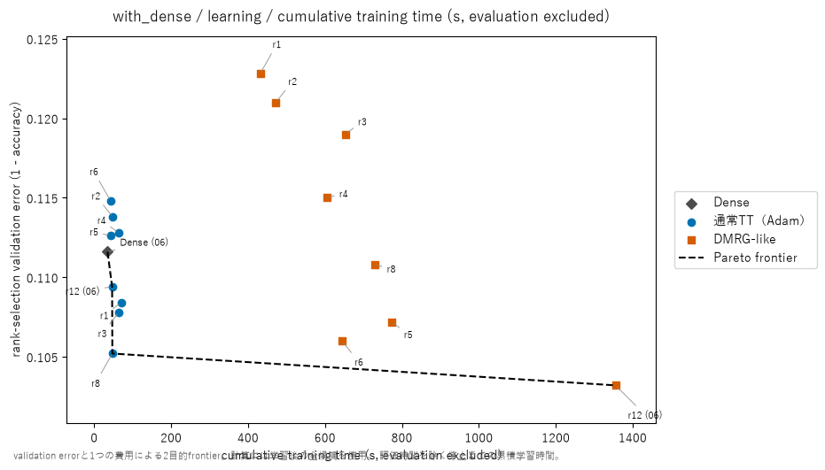

学習時間対errorでは、通常TT rank 8がDMRG-like rank 6より短時間かつ低errorである。そのためrank 6がMACs対errorで`balanced`に選ばれることと、学習時間対errorで通常TT rank 8に支配されることは矛盾しない。横軸にした費用が異なるためである。

---

## 4. 実験結果からの考察

### 4.1 高rankの表現集合は低rankを含むが、学習結果は単調にならない

理想的な表現集合を$\mathcal{F}_r$と書けば、構造上は

$$
\mathcal{F}_r \subseteq \mathcal{F}_R \qquad (r < R)
$$

と考えられる。したがって、同じ学習集合で大域的最適値を求められるなら、高rank側の最小学習lossが悪化する必要はない。

しかし07で比較したのはその理想最適値ではない。

- 各rankでTT-SVDをやり直したrank固有の初期状態から開始した。
- 非凸な神経網学習を有限回の更新と固定学習率で行った。
- DMRG-likeは局所2-core更新とSVD再分割を繰り返した。
- early stoppingとloss基準のcheckpoint選択を行った。
- 比較対象は別validation上のlossとaccuracyである。

これらにより、高rankには低rankと同じ関数を表す余地があっても、今回の最適化がその解へ到達する保証はない。実測曲線のギザギザは描画不具合ではなく、独立な学習結果の非単調性を、拡大された縦軸で表示したものである。rank-selection validationは5,000件なので、accuracyの1件分は`0.0002`（0.02 pp）であることも、小差を読むときに注意する。

この包含関係を実験的に切り分けるには、学習済み低rank解をzero paddingで高rankコアへ埋め込み、その初期checkpointも候補として保持する実験が必要である。07では行っていない。

### 4.2 DMRG-like rank 8の低下は「表現能力不足」では説明できない

DMRG-like rank 8はaccuracy `0.8892`で、rank 6の`0.8940`より低く、TT core要素数・総parameter数・理論MACsはすべて大きい。このため構造費用対errorのfrontierから外れた。

しかし同じrank 8の通常TTはaccuracy `0.8948`に達している。rank 8構造の表現能力だけを低下の原因にはできない。今回のrank固有の初期状態、固定学習率、局所更新、SVD再分割、停止・選択規則の組合せが、rank 6や12ほど良い評価性能に結び付かなかった可能性がある。どの要因が主因かはこの結果だけでは特定できない。

保存履歴では、rank 6のearly-stopping validation lossのstrict bestが`sweep 74: 0.308007`、rank 8が`sweep 71: 0.310889`であり、両条件の終盤に振動があった。rank 8では次のsweep 72のearly-stopping validation accuracy `0.8868`がbest-loss checkpointの`0.8838`より高かったが、lossは`0.313085`のため採用されなかった。これは主図のrank-selection accuracyとは別splitの履歴だが、loss選択とaccuracy最大が同じ時点とは限らないことを示す。

したがって結論は、「今回のcheckpoint選択規則の下で、DMRG-like rank 8は構造費用対errorのfrontierから外れた」までとする。rank 8という構造の本質的な劣位ではない。

### 4.3 rankが大きいほど学習費用が大きいとは限らない

| rank | best sweep | 停止sweep | 総局所更新数 | 学習時間 |
|---:|---:|---:|---:|---:|
| 1 | 70 | 73 | 5,840 | 431.43秒 |
| 2 | 64 | 69 | 5,520 | 472.32秒 |
| 3 | 85 | 90 | 7,200 | 653.41秒 |
| 4 | 73 | 78 | 6,240 | 604.76秒 |
| 5 | 98 | 103 | 8,240 | 772.90秒 |
| 6 | 74 | 79 | 6,320 | 644.32秒 |
| 8 | 71 | 76 | 6,080 | 728.77秒 |
| 12 | 106 | 111 | 8,880 | 1,355.38秒 |

best sweepと停止sweepはrankに対して単調ではない。rank 5から6では構造が大きくなったにもかかわらず、停止までの更新数と学習時間は減った。rank 6から8では更新数が減ったにもかかわらず、学習時間は増えた。

学習費用は、rankに依存する1更新あたりの費用と、validation lossの推移と停止規則で決まる更新回数の両方で決まる。したがって、best sweepを採用checkpointへの到達時点、停止sweep・総局所更新数・実測時間を実際に支払った費用として分ける。早く停止したことだけで良い学習とは言えない。

### 4.4 固定rankを維持できたことと、全bondにそのrankが必要なことは別

例えばrank 6では、

$$
(1, 6, 6, 6, 6, 6, 1)
$$

を学習中に維持したことを監査した。しかし、これは5本の内部bondすべてにrank 6が必要だったことを示さない。固定rank sweepが調べたのは、おおむね全bondを同じcapで増減する候補だけである。

そのため、重要なbondを残し、特異値が早く減衰するbondだけを小さくするadaptive truncationの余地が残る。ただし、小さい特異値の切捨てによる重み近似誤差の小ささは、classification accuracyの維持を直接保証しない。07で確認したのは固定rank候補間の基準であり、adaptive truncationによる追加削減は次の実験課題である。

### 4.5 rank 6から12の改善には大きな追加費用が伴った

DMRG-like rank 6から12で、accuracyは`0.8940 -> 0.8968`と計`0.28 pp`（14/5,000件）改善し、lossは`0.303330 -> 0.286605`に低下した。一方で、理論MACsは`738,432 -> 2,309,120`と約3.13倍、学習時間は`644.32 -> 1,355.38`秒と約2.10倍に増えた。

したがってrank 12は「最高accuracy・最低lossを得た高精度側の候補」であるが、rank 6に対して圧倒的に優れた候補ではない。この追加費用に見合う0.28 ppかは、利用目的と許容する費用で決まる。

---

## 5. 一般的整理

### 5.1 費用指標は代替できない

- TT core要素数：圧縮対象の重み保存量。
- fc1 parameter数：TT coreとbiasを含む置換層全体の保存量。
- モデル総parameter数：非TT層を含むモデル全体の保存量。
- 理論MACs：現在の直接縮約定義に基づく理論演算量。
- latency：特定のハードウェアと実装での実測推論時間。
- 学習時間：指定した停止規則までの実測学習費用。

どの軸を選ぶかでPareto frontierに残る候補が変わる。あるfrontierでの非支配候補は、すべての費用を同時に最適化したモデルを意味しない。

### 5.2 同じ構造での差と、学習法だけの因果効果は同じではない

同rankの通常TTとDMRG-likeは構造・parameter数・理論MACsが同じである。そのため、学習後性能の差をモデル容量の差では説明できない。

ただし両者はoptimizer、batch単位、更新単位、学習率、更新回数が異なる。したがって、差を「2-core更新そのものの因果効果」に分解することはできない。今回言えるのは、比較した学習プロトコル全体として、rankごとに異なる到達性能と費用を記録したことである。

---

## 6. 検証済みの範囲と留保

### 6.1 保存成果物と再評価

- 有効世代26条件のpointer、manifest、run state、history、checkpoint、rank履歴を読取専用で監査し、監査項目の不整合はなかった。
- DMRG-likeは全局所更新のbond rank、通常TTは保存checkpointとepoch境界のhistoryについて固定rankを確認した。通常TTはstepごとのlogが存在しないため、全stepを監査済みとはしない。
- 現行のrank 1〜8の14条件と、Notebook 06から再利用したrank 12の2条件・Denseを再評価した。lossの絶対差は全て0、正解数も記録値と一致した。
- 既存実験成果物7,333ファイルの集合とSHA-256は検証前後で一致した。
- 上記は保存・復元・評価整合性の確認であり、学習経路全体の正しさや独立な再学習の再現を証明したものではない。

### 6.2 比較に使える指標

| 扱い | 指標 |
|---|---|
| そのまま利用 | 再評価したvalidation loss・正解数・accuracy、TT core要素数、fc1 parameter数、総parameter数、現在の定義による理論MACs、これらに基づくPareto |
| 注記付きで利用 | 再測定していないlatencyと学習時間、Notebook 06から再利用したrank 12・Denseの時間 |
| 推奨点の決定に不使用 | peak GPU memory |

通常TTのpeak GPU memoryはrank 1〜3とrank 4以上に不連続があり、原因を特定できていない。原の記録値は保持するが、memory frontierは`unverified`として最終推奨に使わない。

Notebook 06を再利用したDMRG-like rank 12の評価時間`312.94`秒には、1 sweepごとの呼出しで前sweep終了時点を重複評価した費用が含まれる。これは当時の実装で実際に払った時間だが、DMRG-likeに必須の評価費用とは扱わない。主の学習時間frontierは評価時間を除いた値を使う。

またgpu-slice条件の学習時implementation hashは保存されておらず、学習時のsource本文も復元できていない。保存されたNotebook hashが条件間で分かれる理由は不明である。hashの違いだけを理由に既存モデルを無効とはしないが、学習実装の同一性を確認済みともしない。

---

## 7. この実験から言えること・言えないこと

### 言えること

- 今回の固定条件では、rankと学習方式の組合せによって到達性能が非単調に変わった。
- DMRG-likeはrank 5・6・12で同rankの通常TTをaccuracyとlossで上回ったが、全rankではない。
- DMRG-like rank 12が候補中の最高accuracy・最低lossを記録した。
- 通常TT rank 8は学習時間対errorでDMRG-like rank 6を上回った。
- parameter数削減、理論MACs、実測latency、学習費用のどれを重視するかで、残るPareto候補は変わった。
- 事前に定めた理論MACs対errorのknee規則は、DMRG-like rank 6を`balanced`に選んだ。

### 言えないこと

- rankを増やせばaccuracyやvalidation lossが必ず改善すること。
- DMRG-likeが通常TTより一般に高精度、高速、省メモリであること。
- DMRG-like rank 8の低下がrank 8の表現能力不足によること。
- rank 6の全bondにrank 6が必要で、これ以上削減できないこと。
- rank 6がすべての費用指標を統合した総合最良であること。
- 1 seedのvalidation差が未知データや他の初期状態でも再現すること。

---

## 8. 07の結論と次への基準

07により、固定rankの通常TT・DMRG-likeについて、性能、保存量、理論MACs、実測latency、学習時間の基準点が得られた。その中でDMRG-like rank 6は理論MACs対errorの`balanced`、rank 12は高精度側の`conservative`として残った。一方、通常TT rank 1は小MACs側、rank 8は学習費用対性能で強い比較対象である。

次のadaptive truncationでは、単に元のDMRG-like rank 6より小さくなったかだけでなく、07の非支配候補を残した候補集合に追加し、新しいfrontierを作れたかを判定する。理論MACsの削減と実測latencyの改善は引き続き分けて評価する。

## 関連ノート

- [[40_TT_MPS_NN圧縮/10_FashionMNIST_MLP/16_Dense_通常TT_DMRG-like比較]]
- [[40_TT_MPS_NN圧縮/10_FashionMNIST_MLP/15_更新対象固定予算ablation]]
- [[50_DMRG/06_TT-MLPのDMRG-like_2-core局所更新]]
- [[50_DMRG/07_TT-MLPのfull-batch共同更新と更新予算]]
- [[50_DMRG/08_full-batch勾配のGPU常駐高速化とbenchmark設計]]
