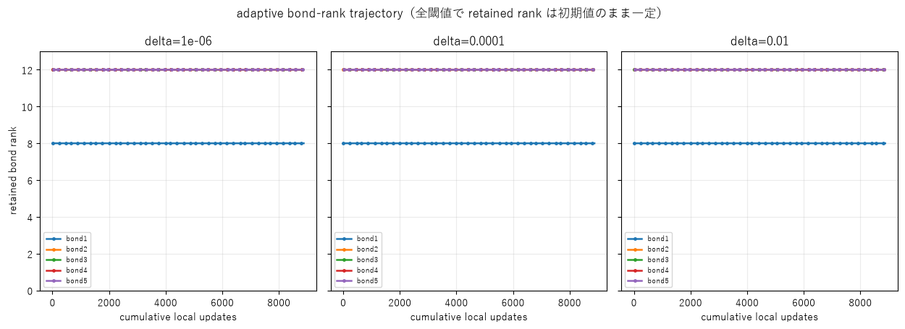
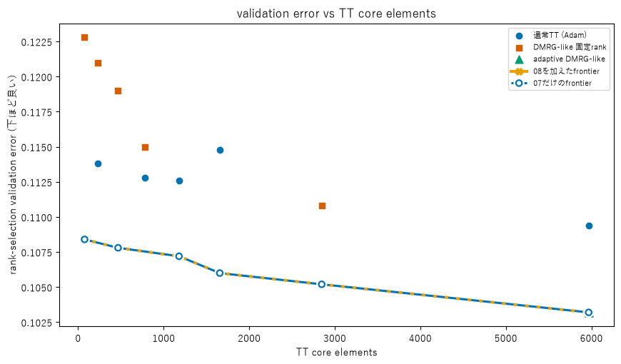
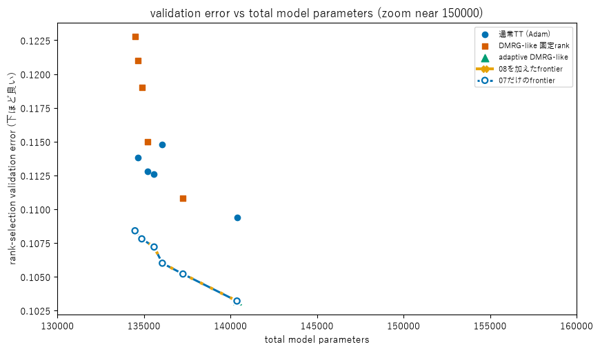
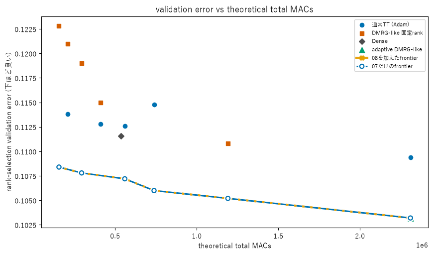
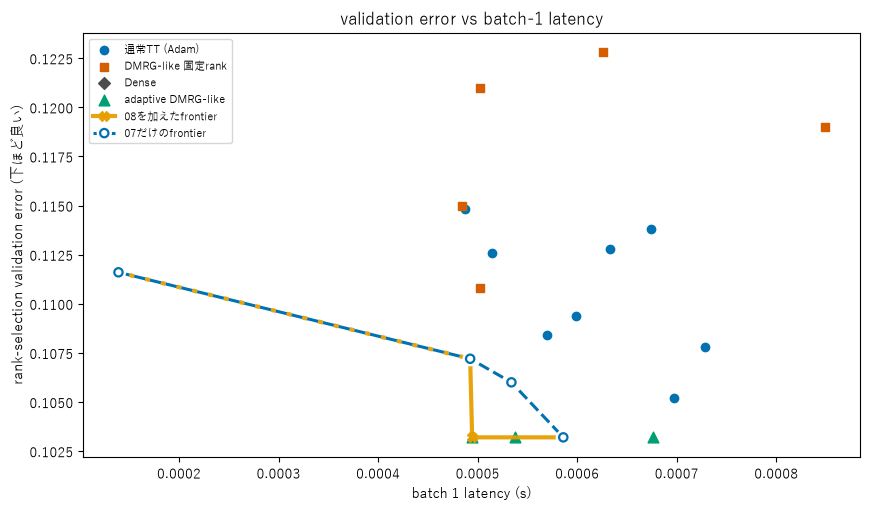
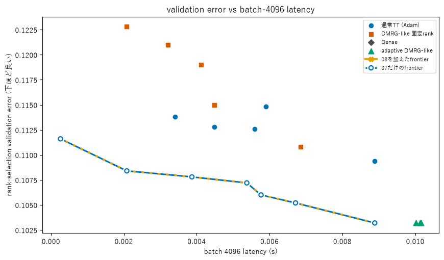
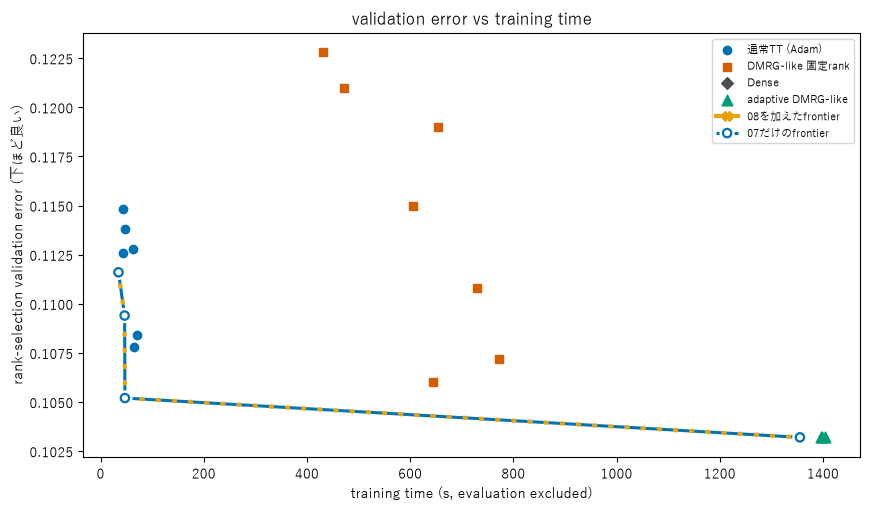

# adaptive bond rank DMRG-likeの閾値探索と追加圧縮の検証

## このノートの役割

本ノートは、Notebook 08でrank cap 12のStage Cからadaptive bond-rank DMRG-like学習を行い、局所SVDのdiscarded-weight閾値によってbond rankを追加削減できるかを検証した結果・考察ノートである。

- Notebook：`notebooks/40_dmrg/10_fashion_mnist_mlp/08_adaptive_bond_rank_dmrg_like_pareto.ipynb`
- 初期checkpoint：`models/40_dmrg/10_fashion_mnist_mlp/01_tt_initialization_scale_diagnostics/initial_stage_c.pt`
- 学習成果物：`models/40_dmrg/10_fashion_mnist_mlp/08_adaptive_bond_rank_dmrg_like_pareto/`
- best再評価：`results/40_dmrg/10_fashion_mnist_mlp/08_adaptive_bond_rank_dmrg_like_pareto/evaluations/`
- 固定rankの比較基準：[[40_TT_MPS_NN圧縮/10_FashionMNIST_MLP/17_固定rank_sweepとPareto比較]]

08の問いは、「adaptive rankが一般に有効か」ではない。07と同じseed、tensorization、Stage C、DMRG-like更新、early-stopping規則で、閾値`1e-6`、`1e-4`、`1e-2`が07の固定rank候補の費用対性能を改善したかを調べる実験である。

---

## 1. 実験設計

### 1.1 Stage CとDMRG-like学習の関係

Stage Cは、未学習Denseの`fc1`をTT-SVDでrank cap 12へ変換し、中心site 0の正準形にした初期TTモデルである。actual ranksは

$$
(1, 8, 12, 12, 12, 12, 1)
$$

である。このTTモデルに対して、隣接2-coreの結合・全学習データの勾配更新・SVD再分割を繰り返す。

TTはモデルの表現形式、DMRG-likeはそのTTコアを学習する更新方法である。rank 12で打ち切った後にDMRG-like学習することは、rank 12以下の表現集合で分類損失を最適化するという意味を持つ。08ではそこから、学習中に更にrankを下げられるかを調べた。

### 1.2 discarded weightによるrank選択

局所2-core結合テンソルを行列化したときの特異値を

$$
\sigma_1 \ge \sigma_2 \ge \cdots \ge \sigma_q \ge 0
$$

とする。rank $r$で切ったときの指標は、

$$
\mathrm{discarded\_weight}(r)
=
\frac{\sum_{j>r}\sigma_j^2}{\sum_{j=1}^{q}\sigma_j^2}
$$

である。指定閾値$\Delta$に対し、この値が$\Delta$以下になる最小rankを探し、最後にrank cap 12を適用する。

`threshold_required_rank`は閾値を満たすためにSVD上必要と判定されたrank、`retained_rank`はcap適用後に実際に保持したrankである。例えば必要rankが15でも、capが12なら実際に残すのは12であり、`threshold_satisfied=False`、`cap_limited=True`と記録する。

discarded weightは局所TT重みの相対Frobenius誤差の二乗に対応する指標であり、classification accuracyの保証ではない。

### 1.3 揃えた条件

- 3閾値はすべて同じStage Cから独立に開始した。
- 前の閾値の重みは引き継いでいない。
- rankの再増加を許可し、固定rankのwarm-upは入れていない。
- train 50,000件、early-stopping validation 5,000件、rank-selection validation 5,000件、seed 0である。
- test setは長さを確認後に破棄し、学習・閾値選択・checkpoint選択に使っていない。

---

## 2. 保存済み結果

### 2.1 3閾値の性能と費用

| 閾値 | best sweep | 停止sweep | 局所更新数 | rank-selection loss | rank-selection accuracy | 学習時間 |
|---:|---:|---:|---:|---:|---:|---:|
| `1e-2` | 106 | 111 | 8,880 | 0.286605 | 0.8968 | 1,398.10秒 |
| `1e-4` | 106 | 111 | 8,880 | 0.286605 | 0.8968 | 1,397.00秒 |
| `1e-6` | 106 | 111 | 8,880 | 0.286605 | 0.8968 | 1,403.39秒 |

3条件ともearly-stopping validationのstrict bestは`sweep 106`、8,480局所更新時点であった。そのときのlossは`0.290853`、accuracyは`0.8950`である。patienceの判定により`sweep 111`、8,880更新で停止した。

3閾値の探索に要した学習時間の合計は`4,198.49`秒である。これに既存Stage Cの作成時間とvalidation時間は含まれない。

### 2.2 rankは一度も変化しなかった

| 閾値 | 閾値未達 | 全8,880更新中の割合 | 最終actual ranks |
|---:|---:|---:|---|
| `1e-2` | 6 | 0.068% | `(1,8,12,12,12,12,1)` |
| `1e-4` | 1,283 | 14.45% | `(1,8,12,12,12,12,1)` |
| `1e-6` | 5,584 | 62.88% | `(1,8,12,12,12,12,1)` |

bond 1は構造上の最大8、bond 2〜5は設定上限12を、全8,880更新で保持した。図の水平線はデータが欠落しているのではなく、retained rankが一度も変わらなかっことを表す。

ここで閾値未達率は「rankを削減できなかった割合」ではない。最大rankまで残してもdiscarded weightが閾値以下にならなかった更新の割合である。`1e-2`の大部分はrank 12なら閾値を満たしたが、rank 11以下では満たせなかったため、削減は起きなかった。

### 2.3 bondごとの閾値未達

| 閾値 | bond 1 | bond 2 | bond 3 | bond 4 | bond 5 |
|---:|---:|---:|---:|---:|---:|
| `1e-2` | 0 | 0 | 0 | 6 | 0 |
| `1e-4` | 0 | 70 | 54 | 983 | 176 |
| `1e-6` | 0 | 704 | 1,363 | 1,741 | 1,776 |

各bondは1閾値あたり1,776回訪問された。`threshold_required_rank`の最大値は、`1e-2`でbond 4の20、`1e-4`でbond 4の44、`1e-6`でbond 4の48だった。`1e-6`のbond 5は全1,776回でcap limitedだったが、全閾値の未達数と必要rankの最大値を併せると、bond 4が特に厳しい。

ただしこれは、局所SVDのスペクトルと指定閾値から求めた必要rankである。「分類性能を維持するにはbond 4がrank 12必須」という因果は示さない。

### 2.4 3閾値と固定rank 12のモデルは一致した

08の3閾値のbest checkpointは、すべてSHA-256

`698cd7de461ed8d5020b7fcf739d064bf56d26938a539e32d304f5eb19e4b713`

で一致した。時間列を除く学習履歴と局所更新の数値経路も一致している。rankが同じだったため、閾値の違いは`threshold_required_rank`・`threshold_satisfied`・`cap_limited`といった診断値に現れたが、実際の保持特異値とコア更新には反映されなかった。

さらに、07がNotebook 06から再利用した固定DMRG-like rank 12のbest checkpointと08のbest checkpointをCPU上で読み、全11個のparameter tensorを比較した。key・shape・dtypeは一致し、tensorの最大絶対差は`0`だった。checkpointファイル全体のhashが異なるのは保存payloadが異なるためであり、モデルparameterは完全一致している。

したがって08は、「rank選択が常に上限を返す場合、adaptive経路が固定rank 12の学習を変えない」ことの実装上のcontrolにもなった。

---

## 3. 図から読む費用対性能

### 3.1 保存量・parameter数・理論MACs

08の3点は、固定DMRG-like rank 12と同じTT core要素数`5,968`、総parameter数`140,378`、理論総MACs`2,309,120`、validation error`0.1032`を持つ。そのため構造的費用のfrontierは07から変化せず、新しい圧縮候補は追加されなかった。

図では08を加えたfrontierと07だけのfrontierが重なる。これは、線が表示されていないのではなく、完全に同じ候補列であることを表す。

総parameter数の全体図はDenseの`535,818`を含むためTT候補が密集する。主な考察には、TT領域を拡大した`02b`を使う。全体図はDenseとTTの規模差を確認する補助図である。

### 3.2 latencyの小差は新しいモデルの優位ではない

batch 1の08記録値は`0.000495`〜`0.000677`秒、batch 4096は`0.010022`〜`0.010156`秒だった。一方、07の固定rank 12はそれぞれ`0.000586`秒、`0.008890`秒である。

batch 1図では08の一点が左に移動してfrontierが変わったように見える。しかし08と固定rank 12はparameter tensorが同一で、forward実装も同じである。この小差をadaptive学習による本質的な推論高速化とは解釈しない。別タイミングでの実測ぶれであり、モデル候補としてのfrontier改善には数えない。

batch 4096では08の方が遅い。理論MACsもparameterも同じなので、これも学習方式による構造的な差ではない。

### 3.3 学習時間

08の各閾値は約1,397〜1,403秒を要し、固定DMRG-like rank 12の記録値`1,355.38`秒より長かった。到達モデルとerrorが同じなので、学習時間対errorでも08は新しい候補を作っていない。

ただし、この時間差だけからadaptive rank判定の厳密な追加コストは求めない。別実行の記録値であり、計測ぶれも含むためである。

---

## 4. 実験結果からの考察

### 4.1 閾値は追加rank削減には厳しすぎた

`1e-2`では99.932%の更新が閾値を満たしたが、全bondでretained rankは最大値のままだった。これは、「rank 12ならほぼ常に`1e-2`を満たした」ことを意味するが、「rank 11以下でも満たした」ことを意味しない。

実際、`1e-2`の`threshold_required_rank`の最小値はbond 1で8、bond 2〜5で12だった。したがって今回の3閾値は、rank 11以下への追加削減にはすべて厳しすぎた。

`1e-4`や`1e-6`のように閾値を小さくすると、許容する切捨て量が減るため、より多くの特異値を保持する方向に働く。`1e-6`の62.88%で閾値未達だったことは、その局所SVDで`1e-6`を満たすにはrank 12より多く必要だっことを示す。分類にrank 13以上が必要だという意味ではない。

### 4.2 明示的なrank削減圧力がないことは、原因候補にとどめる

今回の目的関数は分類損失を下げるが、rank、核ノルム、小さい特異値への直接的なペナルティを持たない。そのため、rank削減を促す明示的な圧力がないことは、スペクトルが削減可能な形へ集中しなかった一因として考えられる。

ただし実測した事実は、「今回の学習では、指定した`1e-6`〜`1e-2`でrankを削減できるほどのスペクトル集中が確認されなかった」ことまでである。明示的圧力がないことが原因だとは、この3条件だけから断定できない。

### 4.3 全bondに最大rankが選ばれたことは、分類上の必要rankの証明ではない

全bondに最大rankが選ばれたことから言えるのは、今回の学習経路の局所SVDで、指定した近似誤差閾値を満たす最小rankが上限だっことである。rank 11・10・8へ実際に切ったモデルのvalidation loss・accuracyは測定していない。

したがって、「分類性能の維持に全bondのrank 12が必須」とは結論できない。またbond別の`threshold_required_rank`は、分類上の最適な非一様rank配分を直接表すものではない。

### 4.4 adaptive rankの考え方は否定されていない

08のadaptive候補は07のPareto frontierを改善しなかった。ただし、これはadaptive rank全般が無効だという結果ではない。

今回確認したのは、

> rank 12のStage Cから開始し、分類損失でDMRG-like学習しながら、`1e-6`〜`1e-2`のdiscarded-weight閾値でrankを下げる方式

では追加削減が起きなかっことである。異なる閾値、異なる初期化、一度だけのrounding、低rankからの増加、rank削減を促す目的関数は未検証である。

---

## 5. 次に行う診断

再学習より先に、保存済みbestモデルを使い、各bondの特異値スペクトルを診断するのが自然である。現在のlogは、選ばれたrankと閾値を満たす必要rankは保存するが、rank 11・10・8に固定したときのdiscarded weightを直接保存していない。

次の診断では、次を求める。

1. 学習後rank 12 bestのbond別特異値の減衰。
2. rank 11・10・8へ下げるときのdiscarded weight。
3. 一度だけTT-roundingした場合の重み誤差とvalidation性能。
4. 学習中の毎更新で切る場合と、学習後に一度切る場合の違い。
5. 低rankから開始し、必要なbondだけrankを増やす方式。

直接TT初期化や低rankからの増加は、08が間違っていたことを意味しない。08は07と同じStage Cを使って追加削減を試すcontrolled experimentとして成立している。それらは、別のadaptive設計を試す次段階である。

---

## 6. この実験から言えること・言えないこと

### 言えること

- `1e-6`、`1e-4`、`1e-2`のすべてで、bond rankは全学習中を通じて初期値から変わなかった。
- 3閾値は同じ学習経路とbest modelに到達した。
- best modelは07の固定DMRG-like rank 12とparameter tensorまで完全一致した。
- 構造費用・分類性能のどちらも新しい点にならず、07のPareto frontierは改善しなかった。
- 閾値を厳しくするほどcap limitedの更新が増えた。

### 言えないこと

- adaptive rankが一般に無効であること。
- 分類性能の維持に全bondの現在rankが必須であること。
- bond 4が分類上最重要であること。
- rank削減ペナルティがないことが、rank不変の原因だと断定すること。
- latency図の小差がadaptive学習による推論高速化であること。

## 結論

08のadaptive rank実験は、今回の目的関数・初期状態・閾値・切捨て規則の組合せではrank自動削減が働かなかっことを示した。単に「意味がなかった」のではない。

- `1e-2`でもrank 11以下を選べなかっこと。
- より厳しい閾値では、rank cap 12でも局所SVDの誤差基準を満たせない更新が増えたこと。
- bondごとに特異値スペクトルの厳しさが異なること。
- rankが変わない場合、adaptive実装が固定rank学習と同じモデルを再現しこと。

を実測できた。次は保存済みbestのスペクトル診断により、rank 11・10・8を選ぶために必要な閾値を数値で求める。

## 関連ノート

- [[40_TT_MPS_NN圧縮/10_FashionMNIST_MLP/17_固定rank_sweepとPareto比較]]
- [[40_TT_MPS_NN圧縮/10_FashionMNIST_MLP/16_Dense_通常TT_DMRG-like比較]]
- [[50_DMRG/06_TT-MLPのDMRG-like_2-core局所更新]]
- [[50_DMRG/07_TT-MLPのfull-batch共同更新と更新予算]]
