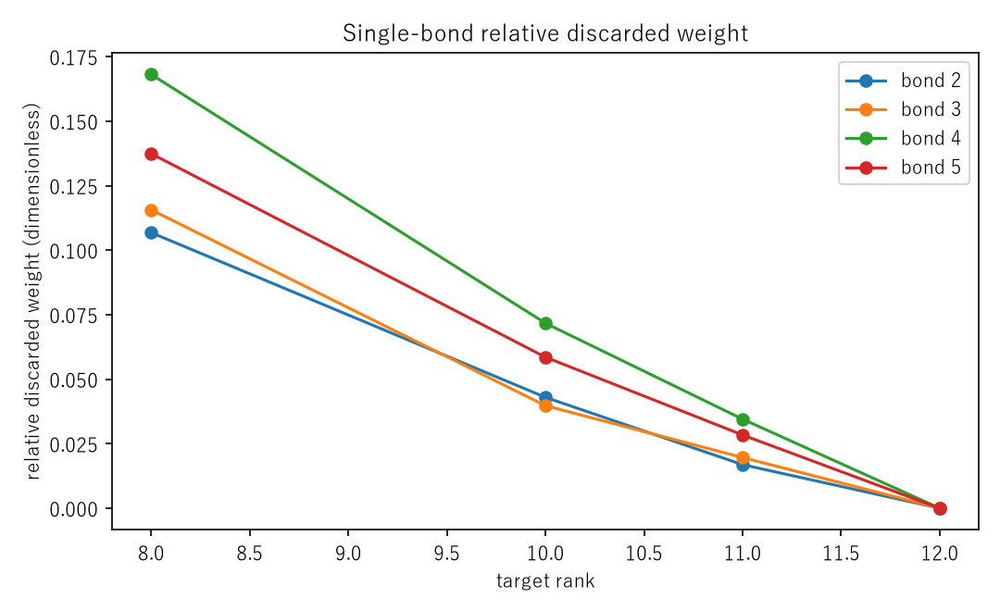
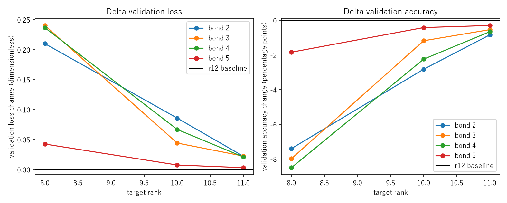
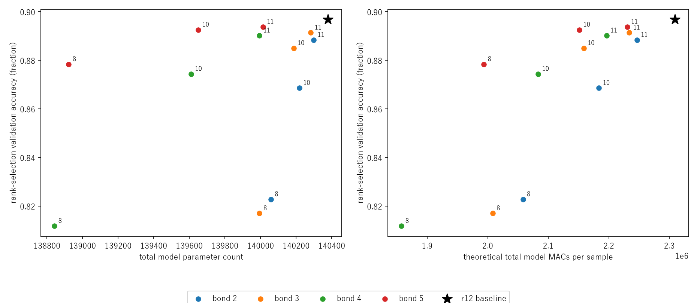
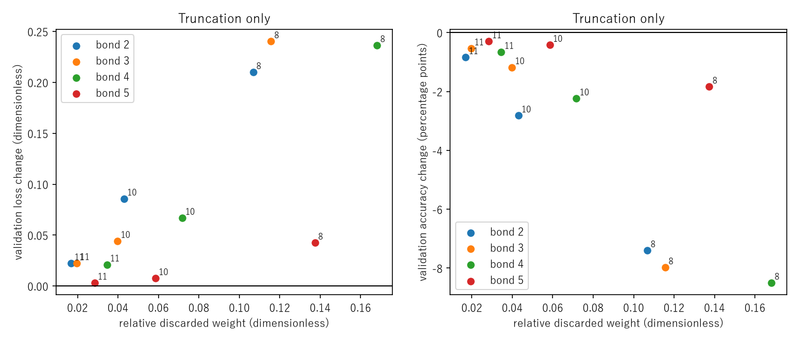
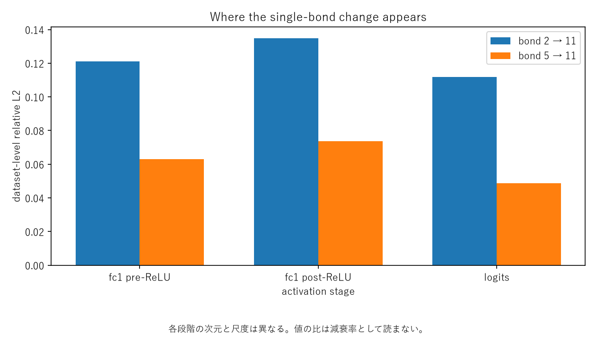
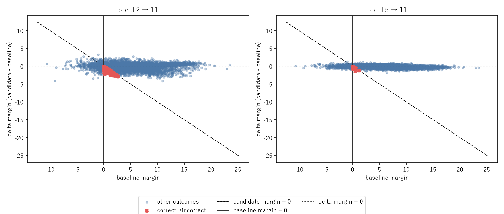

# 学習済みTT-MLPの単一bond事後切り詰めと分類感度診断

## このノートの役割

本ノートは、Notebook 09で学習済みDMRG-like rank 12モデルの内部bondを一つだけ事後的に切り詰め、重み近似誤差、実入力に対する出力変化、validation性能、sample別classification marginを調べた結果・考察ノートである。

- Notebook：`notebooks/40_dmrg/10_fashion_mnist_mlp/09_posthoc_single_bond_truncation_diagnostic.ipynb`
- 元checkpoint：Notebook 08の3閾値で共通だったbest model
- 結果：`results/40_dmrg/10_fashion_mnist_mlp/09_posthoc_single_bond_truncation_diagnostic/`
- 追加診断：同ディレクトリの`propagation_diagnostic/`
- 前段：[[40_TT_MPS_NN圧縮/10_FashionMNIST_MLP/18_adaptive_bond_rank_DMRG-likeと閾値探索]]

09の問いは、低rankモデルを学習し直したときの限界性能ではない。学習済みrank 12モデルを固定し、再学習せず単一bondだけ削ったとき、どのbondがどの程度の分類感度を持つか、重みの再構成誤差と分類性能への影響が一致するかを調べる。

---

## 1. 08から09へ進んだ理由

08では、discarded-weight閾値`1e-6`、`1e-4`、`1e-2`を使って学習中にrankを選んだが、bond 2〜5は全更新でrank 12のままだった。これは、指定した重み近似誤差の基準を満たす最小rankが12だったことを示す。一方で、rank 11以下へ強制的に下げた場合の分類性能は測っていなかった。

08と09の問いは次のように異なる。

| Notebook | 操作 | 問い |
|---|---|---|
| 06 | Dense・通常TT・DMRG-likeを学習 | 学習方式ごとの到達性能はどう違うか |
| 07 | 各固定rankで独立に学習 | 低rank構造で学習した場合の費用対性能はどうか |
| 08 | 学習中にdiscarded weightでrank選択 | 重み誤差の閾値を守りながらrankを自動削減できるか |
| 09 | 学習済みrank 12の単一bondを事後切り詰め | 重み誤差を許容すると分類性能はどう変わるか |

したがって09は、08でrankが下がらなかったことを「分類上も一切削れない」と解釈せず、保存済みモデルを使って直接確かめる診断である。rank 64学習、複数bond同時削減、追加学習、tensorization変更は含めない。

---

## 2. 実験設計

### 2.1 共通baseline

元モデルのactual ranksは、

$$
(1, 8, 12, 12, 12, 12, 1)
$$

である。rank-selection validation 5,000件でのbaselineは次のとおりだった。

| 指標 | 値 |
|---|---:|
| validation loss | 0.286605 |
| validation accuracy | 0.8968 |
| TT core要素数 | 5,968 |
| `fc1` parameter数 | 6,480 |
| モデル総parameter数 | 140,378 |
| 理論`fc1` MACs | 2,175,488 |
| 理論総MACs | 2,309,120 |

### 2.2 単一bondだけを独立に切る

対象は内部rankが12のbond 2〜5である。各bondについて、target rankを11、10、8に固定した。

- 各候補は毎回、同じ元checkpointのコピーから開始する。
- 一度に変更するbondは一つだけである。
- 他のbondは元のrankと重みを維持する。
- 候補間で切り詰めを累積しない。
- 切り詰め後のfine-tuningは行わない。
- test setは使わず、rank-selection validationだけで評価する。

bond 1は元からrank 8であり、今回の`12 → 11・10・8`比較に対応しないため候補から除外した。したがって本結果はbond 2〜5の比較であり、全bondの感度順位ではない。

### 2.3 正準化と単一bond SVD

対象bondがSchmidt cutになるよう正準化し、隣接2-coreを結合してSVDする。特異値を

$$
\sigma_1 \ge \sigma_2 \ge \cdots \ge \sigma_q \ge 0
$$

とすると、target rank $r$のrelative discarded weightは、

$$
d_r
=
\frac{\sum_{j>r}\sigma_j^2}
     {\sum_{j=1}^{q}\sigma_j^2}
$$

である。この正準条件では、重みのFrobenius相対誤差は理論上、

$$
\frac{\lVert W-\widetilde W_r\rVert_F}{\lVert W\rVert_F}
=
\sqrt{d_r}
$$

に対応する。relative discarded weightは相対二乗誤差、`sqrt_relative_discarded_weight`は重みの相対誤差なので、両者を混同しない。

### 2.4 rank 12→12 control

各bondでrank 12へ再分割するcontrolを先に実行した。4件すべてで、

- loss・accuracy
- effective `fc1` weight
- 固定入力logits
- actual ranks
- 正準性
- parameterの有限性
- 元checkpointと原本モデルの不変性

が許容差内だった。accuracy差は全件`0`、loss差は約`10^{-8}`、重み相対誤差は約`9 \times 10^{-7}`、固定入力logits相対誤差は約`6 \times 10^{-7}`だった。

このcontrolにより、以降の性能変化を「正準中心の移動や再分割だけで生じた差」ではなく、rank 11以下で特異成分を捨てた結果として扱える。

---

## 3. 単一bond切り詰めの保存済み結果

### 3.1 全12候補

| bond | target rank | relative discarded weight | 重み相対誤差 | loss | accuracy | accuracy差 |
|---:|---:|---:|---:|---:|---:|---:|
| 2 | 11 | 0.01689 | 13.00% | 0.308791 | 0.8884 | -0.84pt |
| 2 | 10 | 0.04297 | 20.73% | 0.372347 | 0.8686 | -2.82pt |
| 2 | 8 | 0.10680 | 32.68% | 0.496553 | 0.8228 | -7.40pt |
| 3 | 11 | 0.01966 | 14.02% | 0.309047 | 0.8914 | -0.54pt |
| 3 | 10 | 0.03975 | 19.94% | 0.330763 | 0.8850 | -1.18pt |
| 3 | 8 | 0.11566 | 34.01% | 0.526842 | 0.8170 | -7.98pt |
| 4 | 11 | 0.03452 | 18.58% | 0.307581 | 0.8902 | -0.66pt |
| 4 | 10 | 0.07170 | 26.78% | 0.353467 | 0.8744 | -2.24pt |
| 4 | 8 | 0.16809 | 41.00% | 0.523060 | 0.8118 | -8.50pt |
| 5 | 11 | 0.02840 | 16.85% | 0.289738 | 0.8938 | -0.30pt |
| 5 | 10 | 0.05854 | 24.19% | 0.294168 | 0.8926 | -0.42pt |
| 5 | 8 | 0.13739 | 37.07% | 0.329092 | 0.8784 | -1.84pt |

全12候補でbaselineよりlossが増加し、accuracyが低下した。今回試した範囲では、再学習なしで検証性能を完全に維持する単一bond削減は見つからなかった。

ただし、これはrank 12が分類上の最適rankであることや、rank 11以下では同じ性能を実現できないことを示さない。09は切り詰め直後を測っており、低rankでの再学習・fine-tuning後の性能は未検証である。

### 3.2 bond別のdiscarded weight

同一bond内ではtarget rankを11、10、8と下げるほどdiscarded weightが増加した。08の最大閾値`1e-2`に対して、rank 11の最小値でもbond 2の`0.01689`だった。したがって08でrank 11が選ばれなかったことと整合する。

bond 4はrank 11・10・8の全てでdiscarded weightが最大だった。一方、分類性能の低下順位はdiscarded weightだけでは決まらなかった。

### 3.3 validation性能の変化

同一bond内では強く削るほどloss・accuracyが悪化した。特にrank 8ではbond 2〜4が`7.40`〜`8.50`ポイント低下したのに対し、bond 5は`1.84`ポイントにとどまった。

したがって、必要なのは全bondを同じrankに揃えることではなく、どのbondへどのrankを割り当てるかを区別することである。ただし09は単一bond感度を調べたものであり、非一様rank配分を同時に適用したモデルの優位性までは示していない。

### 3.4 保存量・理論MACsとの交換関係

同じtarget rankでも、隣接コアのmode sizeが異なるためparameter数と理論MACsの削減量はbondごとに異なる。最も性能を保ったbond 5では次の交換関係だった。

| bond 5の変更 | accuracy | accuracy低下 | 総parameter削減 | 理論総MACs削減 |
|---|---:|---:|---:|---:|
| 削減なし | 89.68% | — | — | — |
| 12→11 | 89.38% | 0.30pt | 364個、0.26% | 3.41% |
| 12→10 | 89.26% | 0.42pt | 728個、0.52% | 6.83% |
| 12→8 | 87.84% | 1.84pt | 1,456個、1.04% | 13.66% |

モデル全体の保存parameter削減は小さい一方、現在の直接縮約定義による理論MACsはそれより大きく減った。保存容量を優先する場合と演算量を優先する場合で評価は異なる。理論MACsの削減率は実測latencyの短縮率ではない。

---

## 4. 重み誤差だけで分類性能を判断できるか

### 4.1 bond 2とbond 5で順位が逆転した

rank 12→11の中心的な比較は次のとおりである。

| 指標 | bond 2 | bond 5 |
|---|---:|---:|
| 重みのFrobenius相対誤差 | 13.00% | 16.85% |
| 実画像に対する`fc1` ReLU前出力相対誤差 | 12.10% | 6.32% |
| logits相対誤差 | 11.17% | 4.88% |
| accuracy低下 | 0.84pt | 0.30pt |

bond 2は重み誤差が小さいのに、実入力に対する出力差とaccuracy低下が大きかった。したがって、異なるbond間で「重み再構成誤差が小さい候補ほど分類性能も維持される」と順位付けすることはできなかった。

### 4.2 なぜ逆転し得るか

重み差を$\Delta W$、入力を$x$とすると、線形出力差は、

$$
\Delta y = \Delta W x
$$

である。Frobeniusノルムは、

$$
\lVert \Delta W x \rVert_2
\le
\lVert \Delta W \rVert_F \lVert x \rVert_2
$$

という上界を与えるが、実データ上の出力差との等式ではない。入力共分散を$\Sigma_x$とすると、平均二乗出力差は、

$$
\mathbb{E}_x
\left[
\lVert \Delta W x \rVert_2^2
\right]
=
\operatorname{tr}
\left(
\Delta W \Sigma_x \Delta W^{\mathsf T}
\right)
$$

に依存する。重み空間で大きい変化でも、実画像があまり持たない入力方向に作用するなら出力差は小さくなり得る。反対に、小さい重み変化でもデータが強く励起する方向や分類に重要な方向へ作用すれば影響が大きくなる。

この説明は今回の逆転と整合するが、「bond 5が具体的にどの入力方向を捨てたか」を同定したものではない。

### 4.3 discarded weightは無意味ではない

異なるbondを横断した性能順位はdiscarded weightだけでは決まらなかった。一方、各bondの内部ではrankを強く削るほどdiscarded weight、loss、accuracyが一貫して悪化した。

したがって結論は「特異値誤差は役に立たない」ではなく、次のとおりである。

> discarded weightは重み近似誤差を管理する指標として有効だが、異なるbondの分類感度を単独で順位付けする指標にはならなかった。

---

## 5. 実画像に対する誤差伝播診断

### 5.1 診断対象

順位が逆転したbond 2→11とbond 5→11を対象に、同じrank-selection validation 5,000件で次を保存した。

- `fc1` ReLU前出力
- `fc1` ReLU後出力
- 最終logits
- sample別の各段階のL2差
- baselineと候補の予測クラス・正誤
- 正解クラスmarginとその変化

再学習は行っていない。個票CSVは`5,000件 × 2候補 = 10,000行`で、重複なし、同じsample順、有限値である。個票から再計算したaccuracyと正誤遷移は集計CSVに一致し、再評価lossも元の候補結果と差`0`だった。

### 5.2 dataset全体の相対L2

各段階のdataset relative L2は、全sample・全成分をまとめて、

$$
\mathrm{relative\ L2}
=
\frac{
\sqrt{\sum_i \lVert z_i^{\mathrm{candidate}}-z_i^{\mathrm{baseline}}\rVert_2^2}
}{
\sqrt{\sum_i \lVert z_i^{\mathrm{baseline}}\rVert_2^2}
}
$$

と計算した。

| 段階 | bond 2→11 | bond 5→11 |
|---|---:|---:|
| `fc1` ReLU前 | 12.10% | 6.32% |
| `fc1` ReLU後 | 13.48% | 7.37% |
| logits | 11.17% | 4.88% |

bond 5の方が全段階で元モデルに近かった。違いは最終層だけで発生したのではなく、実画像を`fc1`へ入力した段階から現れている。

ただし各段階は次元も基準ノルムも異なる。`12.10% → 13.48% → 11.17%`を、ReLUが何%増幅し、後段が何%吸収したという減衰率としては読まない。この図だけで分類の正誤も判断しない。

### 5.3 sample別L2とp95

各画像$i$については、

$$
e_i
=
\left\lVert
z_i^{\mathrm{candidate}}
-
z_i^{\mathrm{baseline}}
\right\rVert_2
$$

を計算した。5,000枚に対して5,000個の値が得られ、その平均・中央値・p90・p95・最大値を保存した。p95は、小さい方から並べたとき95%のsampleがその値以下となる境界であり、上位5%の大きな変化の入口を表す。

dataset relative L2は全体をまとめた無次元の相対誤差である。一方、sample別L2の平均・中央値・p95は各出力ベクトルの絶対L2差であり、百分率ではない。この二種類を直接同じ尺度として比較しない。

logits差では次の結果だった。

| logits差 | bond 2→11 | bond 5→11 |
|---|---:|---:|
| sample別平均L2 | 1.912 | 0.834 |
| 中央値 | 1.833 | 0.811 |
| p95 | 3.169 | 1.379 |
| 最大値 | 4.629 | 2.386 |

平均だけでなく中央値・p95・最大値でもbond 5が小さく、一部の外れsampleだけが平均を作った結果ではなかった。

---

## 6. accuracy低下を正誤遷移から読む

元モデルは5,000件中4,484件正解だった。候補の正誤遷移は次のとおりである。

| 正誤の変化 | bond 2→11 | bond 5→11 |
|---|---:|---:|
| 正解のまま | 4,371 | 4,442 |
| 正解→不正解 | 113 | 42 |
| 不正解→正解 | 71 | 27 |
| 不正解のまま | 445 | 489 |
| 予測クラス変更 | 214 | 84 |

accuracy低下は「正解→不正解」の件数だけではなく、「不正解→正解」との差である。

$$
113-71=42
$$

よりbond 2のaccuracy低下は$42/5000=0.0084$、

$$
42-27=15
$$

よりbond 5は$15/5000=0.0030$である。

bond 2は悪化だけでなく改善も多く、切り詰めによって予測を大きく動かした。bond 5の性能保持は、多数の悪化を多数の改善で相殺した結果というより、予測クラスを変えた件数自体が少なく、正解を崩した件数も少なかったことに対応する。

不正解→正解が生じるのは、切り詰めが各画像を一方向に悪化させる操作ではないためである。元モデルも全画像に正解しておらず、logitsの順位変化によって、元は2位だった正解クラスが1位になるsampleもある。これは不要成分や過学習を除去した証拠ではなく、一部の画像で順位変化が正しい側へ働いたという事実である。

予測クラス変更数には、不正解クラスから別の不正解クラスへの変化も含む。したがってaccuracy差だけでは、モデル出力がどれほど動いたかを全て表せない。

---

## 7. classification marginの診断

### 7.1 marginの定義

正解ラベル$y$に対するmarginを、

$$
m
=
z_y
-
\max_{k\ne y}z_k
$$

とした。$m>0$なら正解クラスが単独1位、$m<0$なら他クラスが上である。候補による変化は、

$$
\Delta m
=
m_{\mathrm{candidate}}
-
m_{\mathrm{baseline}}
$$

である。

### 7.2 margin散布図

- 横軸：baseline margin。
- 縦軸：$\Delta m$。
- 縦線$x=0$：元モデルの正誤境界。
- 横線$y=0$：margin変化なし。
- 斜線$y=-x$：候補モデルのmarginが0となる境界。
- 赤い×：正解→不正解。
- 青い点：それ以外。正解のまま、不正解のまま、不正解→正解を全て含む。

候補marginは$x+y$なので、斜線より上では候補marginが正、下では負となる。下側にある点が全て不正解になったsampleではなく、元のmarginとの合計が判定を決める。

左右パネルの軸範囲は独立しているため、点群の広がりを見た目だけで比べず、目盛りと集計値を併用する。

### 7.3 margin悪化件数だけでは判定崩壊を説明できない

| 指標 | bond 2→11 | bond 5→11 |
|---|---:|---:|
| marginが低下した件数 | 2,545 | 2,964 |
| $\Delta m$平均 | -0.123 | -0.091 |
| $\Delta m$ 10パーセンタイル | -1.305 | -0.552 |
| 正解→不正解 | 113 | 42 |
| 正解→不正解sampleの元margin中央値 | 0.502 | 0.166 |

bond 5はmarginが低下した画像数が多いのに、正解を崩した件数は少なかった。重要なのは、marginが下がったかだけでなく、下がった量、元の余裕、変化後に0を越えたかである。

例えばmarginが`5 → 4`なら余裕は減るが正解を維持する。`0.2 → -0.1`なら小さい変化でも判定を失う。bond 5で崩れたsampleの元margin中央値は`0.166`で、元から境界に近い例が中心だった。一方、bond 2では10パーセンタイルの悪化量が大きく、より余裕のあったsampleも崩した。

したがって、margin悪化件数とaccuracy悪化は同じ指標ではない。「広いsampleで小さくmarginを下げること」と「判定境界を越えるほど大きく下げること」を分けて読む必要がある。

---

## 8. 09固有の考察

### 8.1 学習後にそのまま削れる余地

性能を完全に保つ候補はなかったが、bondごとの感度差は大きかった。したがって、学習済みモデルの全bondへ一様rankを課すより、非一様rankを検討する根拠は得られた。ただし非一様rankモデルそのものは未実行である。

### 8.2 同じrankでもbondごとに意味が違う

同じrank 11でも、各bondは異なる行列化の異なる特異方向を保持する。rankの数だけでは捨てる情報の内容を表せず、bond位置と学習済み表現を併せて評価する必要がある。

### 8.3 重み誤差と分類性能は役割が違う

重み誤差はモデルparameter空間の近似度、accuracyは有限なデータ集合上のargmax正誤を測る。両者に全く関係がないとは言えないが、単調な一対一関係でもない。今回のbond 2とbond 5は、その順位が逆転する実例になった。

### 8.4 bond 5の低感度はどこに現れたか

bond 5は重み誤差が大きい一方、実画像に対する`fc1`出力差が小さく、logits差と予測変更数も小さかった。影響の違いは`fc1`応答の段階から現れていた。

ただし、なぜ学習によってこの成分配置が生じたか、別seedやtensorizationでもbond 5が低感度か、後ろのbondが一般に削りやすいかは説明していない。

### 8.5 accuracyだけでは変化の内訳が消える

accuracyは正解→不正解と不正解→正解の純差だけを表す。sample別遷移とmarginを確認することで、bond 5は相殺が大きかったのではなく、予測変更自体が少なかったことを確認できた。

### 8.6 削減利益は目的によって異なる

bond 5→10はaccuracy`0.42`ポイント低下に対し、総parameter数`0.52%`、理論MACs`6.83%`の削減だった。保存量の追加削減としては小さいが、理論演算量では一定の削減がある。許容性能低下、保存量、演算量、実測速度のどれを優先するかによって候補評価は変わる。

---

## 9. この実験から言えること・言えないこと

### 言えること

- 今回の12候補では、再学習なしでbaseline性能を完全に保つ単一bond切り詰めはなかった。
- 同じtarget rankでもbondごとにloss・accuracyへの影響が異なった。
- bond 5は、全target rankで他のbondよりaccuracyを保った。
- 重み相対誤差の順位と分類性能低下の順位は、bond 2とbond 5で逆転した。
- bond 5の低感度は、実入力に対する`fc1`出力の段階から確認された。
- margin悪化件数だけでは、正解→不正解の件数を説明できなかった。
- 08でrankが下がらなかったことは、分類性能基準でも全bondが一切削れないことを意味しない。

### 言えないこと

- rank 12が分類性能上の最適rankであること。
- rank 11以下のモデルがfine-tuning後にも性能を回復できないこと。
- bond 5が一般に最も不要、または後ろのbondが一般に削りやすいこと。
- discarded weightとaccuracyが無関係であること。
- 非一様rank配分が一様rankより優れること。
- 複数bondを同時に削った場合も、単一bondの影響を加算できること。
- 理論MACs削減と同じ比率で実測latencyが短縮すること。
- test setや別seedでも同じ差が再現すること。

## 結論

学習済みTTモデルの単一bond事後切り詰めでは、削減感度がbondごとに異なった。重み再構成誤差の大小は分類性能悪化の大小と必ずしも一致せず、bond 2とbond 5の比較では、その違いが実入力に対する`fc1`応答の段階から現れていた。

bond 5→11は重み相対誤差`16.85%`を持つ一方、`fc1` ReLU前出力差`6.32%`、logits差`4.88%`、accuracy低下`0.30`ポイントにとどまった。bond 2→11は重み誤差`13.00%`と小さかったが、対応する値は`12.10%`、`11.17%`、`0.84`ポイントだった。

したがって、rank削減候補を重み誤差だけで判断せず、実入力に対する内部出力、logits、正誤遷移、margin、分類性能を併せて評価する意義がある。ただし、09は単一bond・再学習なしの感度診断であり、非一様rank配分、複数bond同時削減、fine-tuning後の性能は次段階の検証事項である。

## 関連ノート

- [[40_TT_MPS_NN圧縮/10_FashionMNIST_MLP/18_adaptive_bond_rank_DMRG-likeと閾値探索]]
- [[40_TT_MPS_NN圧縮/10_FashionMNIST_MLP/17_固定rank_sweepとPareto比較]]
- [[08_TT_MPS基礎実装検証/06_単一ボンドSVD打ち切りのPyTorch確認]]
- [[08_TT_MPS基礎実装検証/13_TT-rank打ち切りとLinear出力誤差上界のPyTorch確認]]
- [[08_TT_MPS基礎実装検証/15_ReLU_hidden_activation誤差伝播のPyTorch確認]]
- [[08_TT_MPS基礎実装検証/16_第2Linearのlogits誤差伝播と合成上界のPyTorch確認]]
- [[08_TT_MPS基礎実装検証/17_ClassificationMarginとArgmax安定性のPyTorch確認]]
