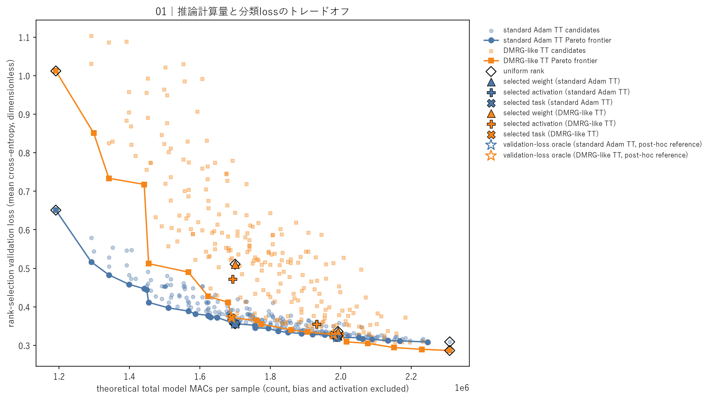
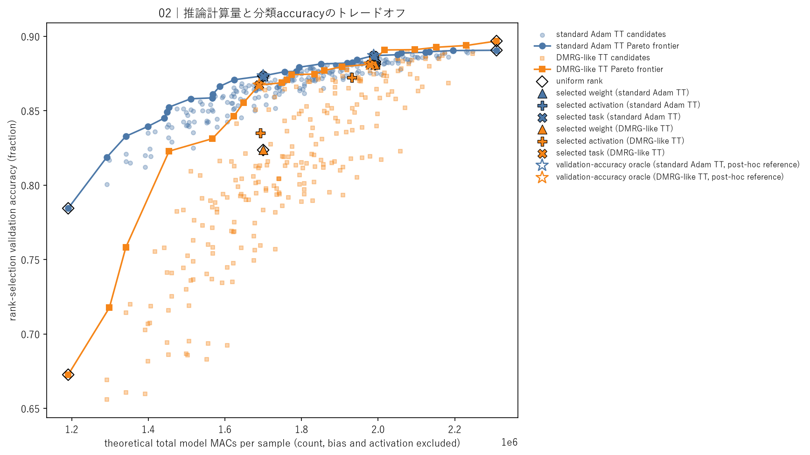
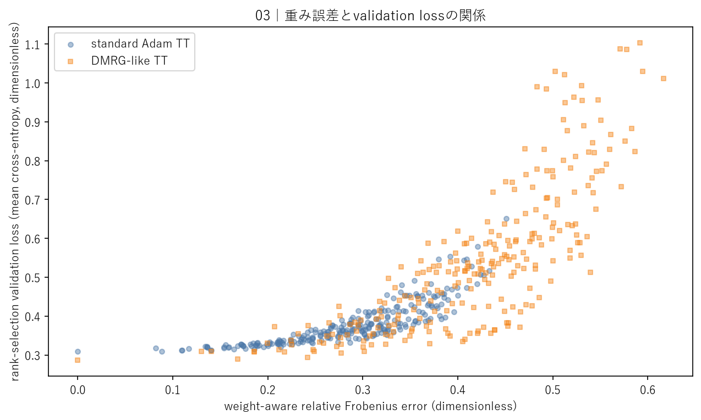
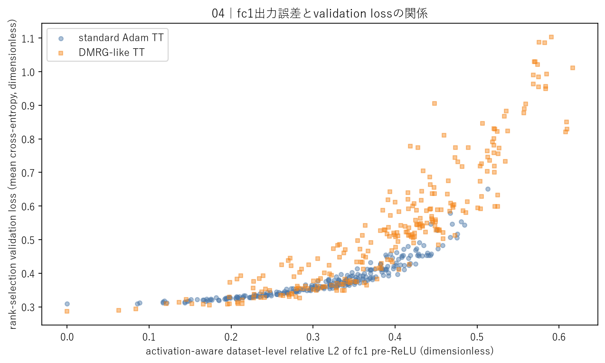
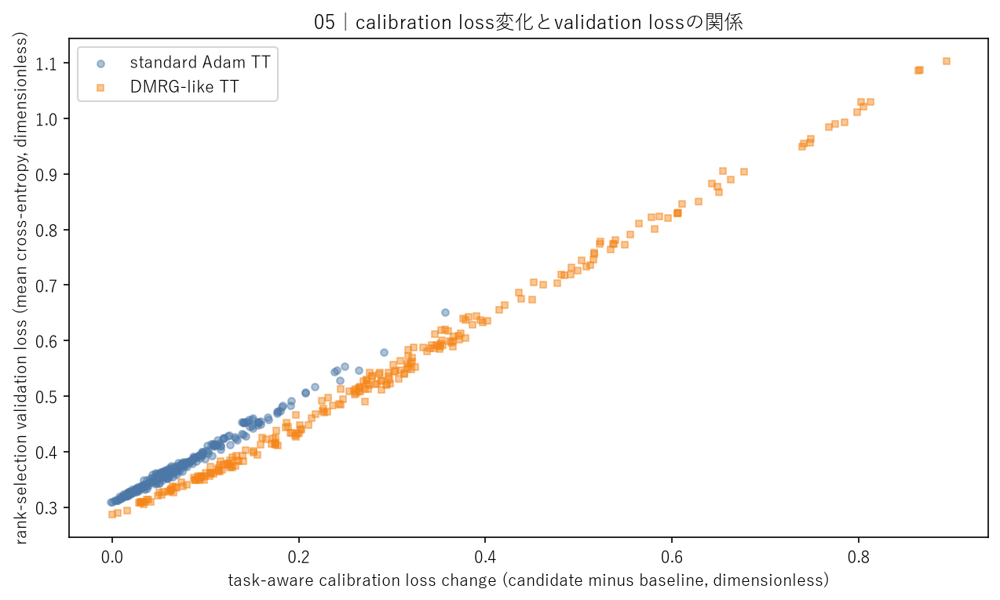
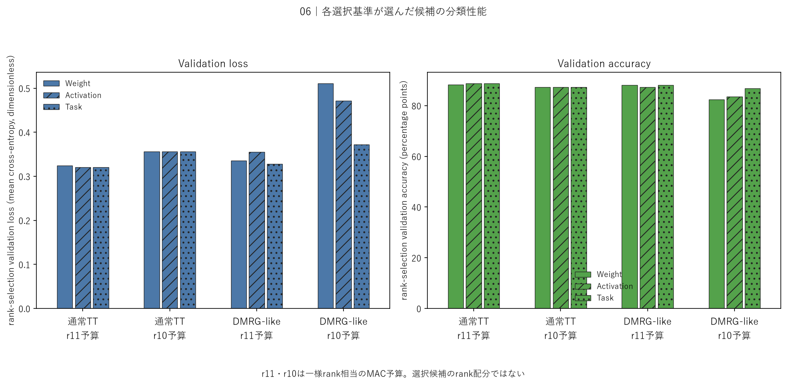
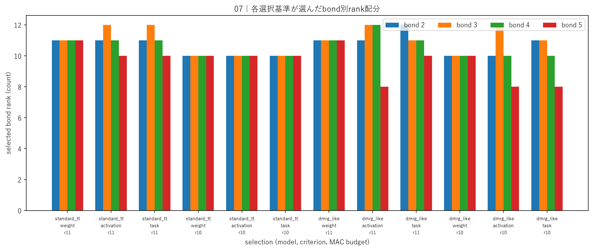
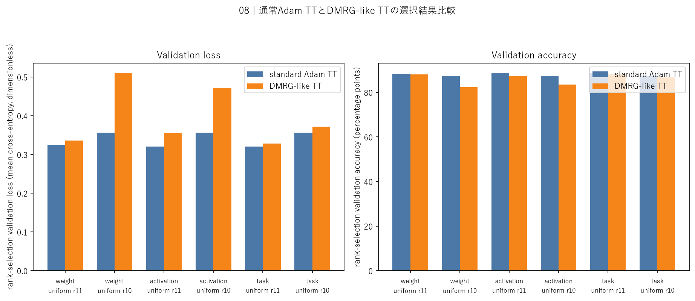
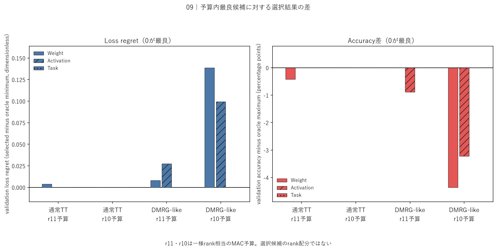
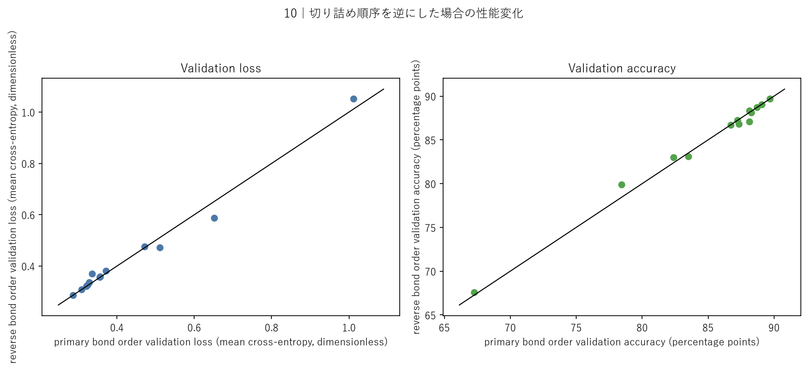

# 学習済みTT-MLPの非一様bond rank配分と選択基準比較

## このノートの役割

本ノートは、Notebook 10で通常Adam TTとDMRG-like TTの学習済みrank 12モデルを固定し、複数bondを再学習なしで事後切り詰めた結果・考察ノートである。

- Notebook：`notebooks/40_dmrg/10_fashion_mnist_mlp/10_nonuniform_bond_rank_allocation_criteria.ipynb`
- 結果：`results/40_dmrg/10_fashion_mnist_mlp/10_nonuniform_bond_rank_allocation_criteria/`
- 前段：[[40_TT_MPS_NN圧縮/10_FashionMNIST_MLP/18_adaptive_bond_rank_DMRG-likeと閾値探索]]
- 直接の前段：[[40_TT_MPS_NN圧縮/10_FashionMNIST_MLP/19_単一bond事後切り詰めと分類感度診断]]

Notebook 10の中心的な問いは、次である。

> 複数bondのrank配分候補について、同じ推論MAC予算以下という条件を課したとき、重みの近さ、実入力に対する`fc1`出力の近さ、分類lossの近さのどれを使えば、validation性能を保つ候補を選べるか。

これは新しいモデルの学習実験ではない。既存checkpointを固定し、候補生成、calibrationによる選択、validationによる事後評価を行う実験である。

---

## 1. Notebook 10の設計をどう決めたか

### 1.1 最初のfine-tuning案を採用しなかった理由

当初は、Notebook 09で単一bondを切り詰めた後、DMRG-likeでfine-tuningし、失った性能が回復するかを調べる案が出た。しかし、この案が答えるのは「削減後の低rank構造が追加学習へ適応できるか」であり、Notebook 09の中心だった「bondごとの切り詰め感度がなぜ異なるか」への直接回答ではない。

09は再学習なしの感度診断として、すでに次を確認していた。

- 全12候補で、切り詰め直後のlossは増加しaccuracyは低下した。
- 同じtarget rankでも、分類性能への影響はbondごとに異なった。
- 重みのFrobenius誤差だけでは、分類性能への影響を順位付けできなかった。
- bond 2とbond 5の差は、実画像に対する`fc1`出力の段階から現れていた。

したがってfine-tuningは、09を完結させるための必須実験ではなく、別の研究軸として切り分けた。

### 1.2 09の観察をrank配分へ利用する

09から自然に残った問いは、次だった。

> bondごとに感度が異なるなら、全bondを一様に削るより、敏感なbondへrankを多く残し、低感度なbondを強く削る非一様配分の方が、同じ費用以下で分類性能を保てるのではないか。

ただし、09の単一bond感度を足し合わせるだけでは、複数bond同時削減後の性能は決まらない。あるbondを切ると、後で処理するbondのテンソルと特異値も変わり得る。そこで10では、非一様rank候補を手作業で少数選ぶのではなく、指定した離散候補を全列挙し、実際に評価する設計にした。

### 1.3 10で含めなかったもの

Notebook 10には次を含めていない。

- 新規学習、追加学習、fine-tuning。
- adaptive rankでの再学習。
- 複数seed。
- test評価。
- tensorization比較。
- CNN・CIFAR-10。
- 通常TTとDMRG-like以外の学習方式。
- 統計的な一般化の主張。

目的は、Fashion-MNIST MLPの保存済みcheckpointに対する「事後rank配分の探索的比較」を完結させることである。

---

## 2. 08・09・10の接続

| Notebook | 操作 | 確認した問い |
|---|---|---|
| 08 | 学習中にdiscarded-weight閾値でrankを選ぶ | 重み誤差の閾値を守りながらrankを自動削減できるか |
| 09 | 学習済みrank 12モデルの単一bondだけを削る | 重み誤差と分類感度はbond間で対応するか |
| 10 | 複数bondのrank候補を全列挙し、別データで選択を評価する | 費用制約下で分類性能を保つrank配分を何で選ぶべきか |

08では、discarded-weight閾値`1e-6`、`1e-4`、`1e-2`の全条件でrank列が、

$$
(1,8,12,12,12,12,1)
$$

のままだった。09では、このrank 12モデルのbond 2〜5を一つずつrank 11、10、8へ強制的に削り、重み誤差が小さい候補ほど分類性能を保つとは限らないことを確認した。

10は08を否定する実験ではない。08は「指定した重み誤差基準を満たす最小rank」、10は「一定の分類性能低下を許容し、費用制約下で配分を選ぶ方法」を扱っている。評価基準が異なる。

---

## 3. 実験設計

### 3.1 対象モデル

同じ6-core tensorizationと同じactual rank列を持つ、二つの学習済みモデルを使用した。

| モデル | 学習方法 | validation loss | validation accuracy | rank列 |
|---|---|---:|---:|---|
| 通常TT | Adam | 0.309005 | 0.8906 | $(1,8,12,12,12,12,1)$ |
| DMRG-like | 2-core局所更新 | 0.286605 | 0.8968 | $(1,8,12,12,12,12,1)$ |

calibration 5,000件に対するbaselineは、通常TTがloss`0.194195`・accuracy`0.9270`、DMRG-likeがloss`0.188140`・accuracy`0.9328`だった。Task scoreは各モデルのこのbaselineからのloss変化であり、二モデル共通の絶対基準ではない。

どちらも`fc1`だけがTT層であり、候補生成時に`fc1.bias`、`fc2`、`fc3`は変更しない。

削減前はDMRG-likeの方がvalidation loss・accuracyとも良好だった。ただし、このbaseline順位が事後圧縮後にも保たれるとは限らない。

### 3.2 rank候補

bond 1は元からrank 8なので固定した。bond 2〜5について、それぞれ、

$$
r_k \in \{8,10,11,12\}
$$

から選んだ。rank列は、

$$
(1,8,r_2,r_3,r_4,r_5,1)
$$

である。1モデル当たりの候補数は、

$$
4^4=256
$$

で、2モデル合計512候補となる。

一様rank 12、11、10、8も、この候補集合に含まれる。非一様候補だけを優遇せず、一様候補も同じ選択対象に残した。

### 3.3 候補の生成方法

各候補は、必ず同じ元checkpointの独立コピーから生成した。候補Aの切り詰め結果を候補Bへ引き継ぐことはない。

一つの候補内では、主順序、

$$
2 \rightarrow 3 \rightarrow 4 \rightarrow 5
$$

で対象bondを処理した。各bondで正準化、2-core結合、SVD、指定rankでの再分割を行った。

このため、候補はrank列だけで完全には定まらず、次の組で定まる。

> 元checkpoint、rank列、bond処理順序、SVD再分割手順。

複数bondを順に切ると、先に行った切り詰めが後続bondのテンソルへ影響する。そのため同じrank列でも、処理順序を変えると異なるモデルになり得る。

### 3.4 三つの選択基準

#### Weight-aware

元モデルの`fc1`実効重みを$W$、候補を$\widetilde W$として、

$$
s_{\mathrm{weight}}
=
\frac{
\left\lVert W-\widetilde W\right\rVert_F
}{
\left\lVert W\right\rVert_F
}
$$

を使う。単一bondのdiscarded weightを加算するのではなく、全ての切り詰めを終えた候補の実効重み全体を比較する。

実画像と正解ラベルは使わない。parameter空間で元の重みを最もよく近似する候補を選ぶ基準である。

#### Activation-aware

calibration入力$x_i$に対する`fc1`のReLU前出力を比較し、

$$
s_{\mathrm{activation}}
=
\frac{
\sqrt{
\sum_i
\left\lVert
(W-\widetilde W)x_i
\right\rVert_2^2
}
}{
\sqrt{
\sum_i
\left\lVert
Wx_i
\right\rVert_2^2
}
}
$$

を使う。実画像は使うが、候補選択スコアには正解ラベルを使わない。

入力共分散を$\Sigma_x$とすると、分子の二乗は概念的に、

$$
\operatorname{tr}
\left(
\Delta W
\Sigma_x
\Delta W^{\mathsf T}
\right),
\qquad
\Delta W=W-\widetilde W
$$

と対応する。重み変化の大きさだけでなく、実データがその方向をどの程度励起するかを反映する。

#### Task-aware

calibrationデータ上のcross-entropy増加、

$$
s_{\mathrm{task}}
=
\mathcal L_{\mathrm{cal}}(\widetilde W)
-
\mathcal L_{\mathrm{cal}}(W)
$$

を使う。実画像と正解ラベルを使い、分類目的そのものに最も近い基準である。

三基準は異なる学習方式ではない。同じ候補集合へ異なる点数を付け、どの候補を選ぶかを比較している。

### 3.5 calibrationとvalidationを分ける

候補選択と答え合わせに同じデータを使わないよう、役割を分けた。

| データ | 件数 | 役割 |
|---|---:|---|
| calibration | 学習用50,000件から固定抽出した5,000件 | Activation・Taskスコアと候補選択 |
| rank-selection validation | 5,000件 | 選択確定後のloss・accuracy評価 |
| early-stopping validation | 使用しない | — |
| test | 使用しない | — |

選択CSVでは`validation_used=False`であり、validation結果を見て候補を差し替えていない。

ただしcalibrationは元モデルの学習に使用済みのtraining splitから抽出しており、完全な未使用データではない。rank-selection validationも過去のNotebookで参照済みである。したがって、10は独立testによる最終評価ではなく、探索的な選択基準比較である。

### 3.6 MAC予算

主な費用軸は、現在の直接縮約実装に基づくモデル総理論MACsとした。

| 予算 | 上限MACs | 予算内候補数／モデル |
|---|---:|---:|
| 一様rank 11相当 | 1,991,936 | 212 |
| 一様rank 10相当 | 1,699,840 | 99 |

各基準は、指定予算以下の候補の中から、自分のスコアが最小の候補を一つ選ぶ。候補同士のMACsを完全一致させた比較ではない。

一様rank 8予算では実質的に選択肢が一つになるため、選択基準比較の主予算には使わず、端点・補助候補として扱った。

### 3.7 oracleの役割

全512候補をvalidationで評価した後、各モデル・予算について、

- validation loss最小候補。
- validation accuracy最大候補。

を事後的に求めた。これをoracleと呼ぶ。

oracleはvalidationを使うため、実際の候補選択方法ではない。calibrationだけで選んだ候補が、予算内の事後的最良候補をどれだけ選び損ねたかを測る参照点である。

---

## 4. 保存結果の完全性確認

保存済み成果物に対して、次を確認した。

- calibration候補512件、validation候補512件。
- 各候補IDは一意で、calibrationとvalidationの候補集合は完全一致。
- 通常TT 256件、DMRG-like 256件。
- 選択結果は、2モデル×2予算×3基準の12枠。
- 12枠すべてで`validation_used=False`。
- 保存済みスコア、予算、同点処理から12件の選択結果を再計算し、全件一致。
- 全CSV・JSONの`run_id`が一致。
- rank 12を再分割するcontrolは両モデルで許容差内。
- Pareto frontierは、各候補のMACsとvalidation loss／errorから非支配判定を再計算し、全グループ・全目的で保存CSVと一致。
- 実験は`training=false`で、候補生成と評価だけを行っている。
- 512候補のcalibration、validation、13候補の逆順controlを完了し、停止理由は`completed`。
- 総実行時間は約710.1秒。

したがって、以降の考察は未完了条件を混ぜた集計ではない。

### 4.1 保存成果物の役割

| 成果物 | 内容 |
|---|---|
| `config.json` | データ、rank候補、bond順序、予算、元checkpoint情報 |
| `control_verification.json` | rank 12 no-cut controlの一致確認 |
| `calibration_metrics.csv` | 512候補の三スコア、calibration性能、費用 |
| `validation_metrics.csv` | 512候補のvalidation性能とbaseline差 |
| `selection.csv` | calibrationだけで確定した12枠の選択結果 |
| `selected_comparison.csv` | 重複候補をまとめた選択候補の詳細 |
| `uniform_comparison.csv` | 一様rank 12・11・10・8の対照 |
| `oracle_regret.csv` | 各選択候補と予算内validation oracleとの差 |
| `spearman.csv` | 三スコアとvalidation指標の記述的順位相関 |
| `pareto_frontier.csv` | loss／errorと理論MACsに基づく非支配候補 |
| `reverse_order_control.csv` | 選択・一様・oracle候補を逆順生成した13件 |
| `main_summary.json` | 候補数、各処理時間、完了状態 |

Spearman相関は、候補を独立標本とみなす統計的推論ではなく、今回の離散候補集合内の記述的な順位対応である。そのため$p$値は報告していない。

---

## 5. 全候補の費用対性能

### 5.1 理論MACsとvalidation loss



横軸はモデル総理論MACs、縦軸はvalidation lossである。左下ほど、計算量が小さくlossも低い。

同程度のMACsでもvalidation lossには幅があり、総rank量や最大rankだけでは性能が決まらなかった。どのbondへrankを配分したかが結果へ影響している。

一方、点群全体としてはMACsを削るほどlossが増えやすい。非一様配分によって圧縮と性能の交換関係そのものが消えたわけではない。

### 5.2 理論MACsとvalidation accuracy



横軸は理論MACs、縦軸はvalidation accuracyである。左上ほど、計算量が小さくaccuracyが高い。

loss図と同様、同程度のMACsでもaccuracyが異なった。したがって「MACsを同じ程度まで減らせば性能もほぼ同じ」ではなく、rank配分を選ぶ余地がある。

ただしaccuracyはargmaxの正誤だけを見るため、候補間のlogits変化や確信度差を全て表さない。候補選択ではlossも併せて見る。

### 5.3 散布点とrank配分の対応

図1〜5の点には、512候補すべてのrank列を直接表示していない。各点は、`model_type`と`candidate_id`の組で一意に特定する。`candidate_id`は、たとえば

```text
standard_tt__1_8_11_12_11_10_1
dmrg_like__1_8_11_11_10_8_1
```

のように、学習方式と実際のrank列$(1,8,r_2,r_3,r_4,r_5,1)$を含む。

図1・2の横軸と縦軸、および図3〜5のスコアとvalidation lossを点単位で確認する場合は、次の保存表を対応付ける。

| 保存表 | 点を特定するキー | 図で使う主な列 |
|---|---|---|
| `calibration_metrics.csv` | `model_type`, `candidate_id` | rank列、理論MACs、Weight／Activation／Task score |
| `validation_metrics.csv` | `model_type`, `candidate_id` | validation loss、accuracy、baseline差 |
| `selection.csv` | model、予算、基準 | 各基準が選んだ`candidate_id`とrank列 |
| `pareto_frontier.csv` | `model_type`, `candidate_id` | 非支配候補のrank列、理論MACs、loss／error |

全512行を本文へ複製すると図より点の対応が読みにくくなるため、本文には考察で参照する選択候補を7.1の表、一様対照を7.3、oracleとの差を9章に掲載する。したがって、図の灰色点すべてを本文だけで逆引きする構成ではないが、考察に使う強調点はrank列まで本文で特定でき、その他の点も上記CSVのキーから一意に追跡できる。

---

## 6. 三つのスコアとvalidation性能

### 6.1 Weight-aware



重み誤差とvalidation lossには、候補全体として正の順位対応があった。

| モデル | 全256候補でのSpearman相関 |
|---|---:|
| 通常TT | 0.919 |
| DMRG-like | 0.847 |

したがって、重み誤差は無意味ではない。強く重みを変える候補ほどlossが悪化しやすいという大域的傾向を捉えている。

一方、予算内で最良候補を選ぶ用途では不十分な場合があった。特にDMRG-like・r10予算では、Weightが選んだ一様rank 10はaccuracy`82.36%`で、Task候補の`86.72%`より`4.36`ポイント低かった。

### 6.2 Activation-aware



実画像に対する`fc1`出力誤差を使うと、validation lossとの順位対応はWeightより強くなった。

| モデル | Weight | Activation |
|---|---:|---:|
| 通常TT | 0.919 | 0.981 |
| DMRG-like | 0.847 | 0.929 |

これは09で観察した「重み誤差の大きさと、実入力に対する作用の大きさは一致しない」という結果と整合する。入力分布を考慮することで、候補全体の分類性能順位をよりよく捉えた。

ただし、高い順位相関と予算内の最良一点を選べることは別である。DMRG-like・r11予算では、Activation候補のlossは`0.355334`で、Weightの`0.335931`より悪かった。DMRG-like・r10予算でも、Task候補には届かなかった。

### 6.3 Task-aware



calibration loss増加とvalidation lossの順位相関は、三基準の中で最も強かった。

| モデル | 全256候補 | r11予算内 | r10予算内 |
|---|---:|---:|---:|
| 通常TT | 0.992 | 0.988 | 0.985 |
| DMRG-like | 0.998 | 0.997 | 0.997 |

Taskはvalidation lossと同じcross-entropyという分類目的を使うため、WeightやActivationより直接的である。ただし、同じ損失形式を使ったから自動的に成功したわけではない。候補選択はtraining由来のcalibration 5,000件で行い、結果は別のrank-selection validation 5,000件で測っている。今回確認できたのは、calibration上の順位がvalidationへ強く移ったことである。

この結果から「どのモデル・データでもTaskが最良」と一般化はできない。calibration件数、subset、seed、データ分布が変わった場合の頑健性は未検証である。

### 6.4 スコアはモデル内で比較する

通常TTとDMRG-likeでは、元の重み、activation、calibration lossが異なる。各スコアはそれぞれの元モデルからの変化量なので、WeightやTaskの生の値をモデル間で直接比較し、「どちらの学習方式が圧縮しやすい」と判断しない。

モデル間で比較するのは、選択後のvalidation loss・accuracy、元モデルからの変化量、MACsである。

### 6.5 Spearman相関の全結果

`delta accuracy`は候補accuracyからbaseline accuracyを引いた値なので、誤差スコアが大きいほど悪化し、相関は負になる。

| モデル | 候補範囲 | 基準 | validation lossとの相関 | delta accuracyとの相関 |
|---|---|---|---:|---:|
| 通常TT | 全256 | Weight | 0.919 | -0.933 |
| 通常TT | 全256 | Activation | 0.981 | -0.970 |
| 通常TT | 全256 | Task | 0.992 | -0.989 |
| 通常TT | r11予算内212 | Weight | 0.869 | -0.891 |
| 通常TT | r11予算内212 | Activation | 0.969 | -0.952 |
| 通常TT | r11予算内212 | Task | 0.988 | -0.983 |
| 通常TT | r10予算内99 | Weight | 0.685 | -0.727 |
| 通常TT | r10予算内99 | Activation | 0.915 | -0.882 |
| 通常TT | r10予算内99 | Task | 0.985 | -0.963 |
| DMRG-like | 全256 | Weight | 0.847 | -0.853 |
| DMRG-like | 全256 | Activation | 0.929 | -0.938 |
| DMRG-like | 全256 | Task | 0.998 | -0.996 |
| DMRG-like | r11予算内212 | Weight | 0.783 | -0.790 |
| DMRG-like | r11予算内212 | Activation | 0.902 | -0.916 |
| DMRG-like | r11予算内212 | Task | 0.997 | -0.994 |
| DMRG-like | r10予算内99 | Weight | 0.594 | -0.633 |
| DMRG-like | r10予算内99 | Activation | 0.808 | -0.849 |
| DMRG-like | r10予算内99 | Task | 0.997 | -0.988 |

費用制約を強くしたr10予算内では、Weightの順位相関が特に低下した。一方、Taskは全候補・両予算で高い相関を維持した。

---

## 7. 各選択基準が選んだ候補

### 7.1 validation性能



| モデル・予算 | 基準 | rank列 | MACs | validation loss | validation accuracy |
|---|---|---|---:|---:|---:|
| 通常TT・r11 | Weight | $(1,8,11,11,11,11,1)$ | 1,991,936 | 0.324772 | 0.8828 |
| 通常TT・r11 | Activation | $(1,8,11,12,11,10,1)$ | 1,988,352 | 0.320834 | 0.8870 |
| 通常TT・r11 | Task | $(1,8,11,12,11,10,1)$ | 1,988,352 | 0.320834 | 0.8870 |
| 通常TT・r10 | Weight | $(1,8,10,10,10,10,1)$ | 1,699,840 | 0.356105 | 0.8734 |
| 通常TT・r10 | Activation | 同上 | 1,699,840 | 0.356105 | 0.8734 |
| 通常TT・r10 | Task | 同上 | 1,699,840 | 0.356105 | 0.8734 |
| DMRG-like・r11 | Weight | $(1,8,11,11,11,11,1)$ | 1,991,936 | 0.335931 | 0.8812 |
| DMRG-like・r11 | Activation | $(1,8,11,12,12,8,1)$ | 1,931,008 | 0.355334 | 0.8724 |
| DMRG-like・r11 | Task | $(1,8,12,11,11,10,1)$ | 1,978,944 | 0.327949 | 0.8812 |
| DMRG-like・r10 | Weight | $(1,8,10,10,10,10,1)$ | 1,699,840 | 0.510625 | 0.8236 |
| DMRG-like・r10 | Activation | $(1,8,10,12,10,8,1)$ | 1,692,672 | 0.471420 | 0.8350 |
| DMRG-like・r10 | Task | $(1,8,11,11,10,8,1)$ | 1,689,536 | 0.371894 | 0.8672 |

通常TT・r11ではActivationとTaskが同じ非一様配分を選び、Weightよりlossが低く、accuracyが`0.42`ポイント高かった。通常TT・r10では三基準が同じ一様rank 10を選んだ。

DMRG-likeでは基準差が大きかった。特にr10予算では、TaskはWeightより少ないMACsでlossを`0.138731`下げ、accuracyを`4.36`ポイント高く保った。

DMRG-like・r11ではWeightとTaskのaccuracyは同じ`0.8812`である。Taskの優位はaccuracyではなく、lossが`0.335931`から`0.327949`へ低下した点にある。「Taskだけが一意にaccuracy最良だった」とは表現しない。

### 7.2 選ばれたbond別rank



この図の棒の高さは性能ではなく、bond 2〜5に残したrankを表す。

DMRG-like・r10予算では、

```text
Weight      : 10, 10, 10, 10
Activation  : 10, 12, 10,  8
Task        : 11, 11, 10,  8
```

となった。Taskはbond 5を8まで削り、その分bond 2・3へrank 11を残した。この候補は一様rank 10よりMACsが少なく、分類性能も高かった。

ただし、選ばれたrank列を各bondの独立した重要度と同一視しない。候補生成は逐次的で、bond間の相互作用と処理順序を含む。`bond 5 = 8`が「bond 5は一般に不要」を意味するわけではない。

### 7.3 一様と非一様の比較

Taskが選んだ候補を見ると、4条件中3条件で非一様配分が選ばれた。

- 通常TT・r11：非一様。
- 通常TT・r10：一様rank 10。
- DMRG-like・r11：非一様。
- DMRG-like・r10：非一様。

非一様配分を選んだ3条件では、一様対照よりMACsが少なく、validation lossも低かった。一方、通常TT・r10では一様rank 10が選ばれた。

さらに、非一様なら何でもよいわけではない。DMRG-like・r11でActivationが選んだ非一様配分は、一様rank 11よりaccuracyが低かった。

したがって結論は、

> 非一様rankそのものが性能を保証するのではなく、一様・非一様を含む候補集合から、分類目的に合う配分を選べる条件があった。

である。

---

## 8. 通常TTとDMRG-likeの比較



削減前のaccuracyは、通常TT`89.06%`、DMRG-like`89.68%`で、DMRG-likeが高かった。

しかしTask・r10予算の選択後は、通常TT`87.34%`、DMRG-like`86.72%`となり、順位が逆転した。削減前に高性能なモデルが、同じ事後圧縮予算でも必ず性能を保つとは限らない。

DMRG-like・r10では配分選択による改善幅も大きかった。

- 一様rank 10／Weight：`82.36%`。
- Activation：`83.50%`。
- Task：`86.72%`。

したがって、DMRG-like checkpointは今回の切り詰め方への感度が大きい一方、適切な非一様配分で低下をかなり軽減できた。

ただし、各学習方式につき一つのcheckpointしか使っていない。これは通常AdamとDMRG-likeの一般的な因果差を証明する実験ではない。言えるのは、今回の二つの学習済みモデルでは、削減前性能と事後圧縮性が異なる順位になったことである。

---

## 9. oracleとの差から選択基準を評価する



loss regretは、

$$
\text{選択候補のvalidation loss}
-
\text{予算内最小validation loss}
$$

である。accuracy差は、

$$
\text{選択候補のvalidation accuracy}
-
\text{予算内最大validation accuracy}
$$

である。どちらも0が最良である。

| モデル・予算 | 基準 | loss regret | accuracy差 |
|---|---|---:|---:|
| 通常TT・r11 | Weight | 0.003938 | -0.0042 |
| 通常TT・r11 | Activation | 0 | 0 |
| 通常TT・r11 | Task | 0 | 0 |
| 通常TT・r10 | Weight | 0 | 0 |
| 通常TT・r10 | Activation | 0 | 0 |
| 通常TT・r10 | Task | 0 | 0 |
| DMRG-like・r11 | Weight | 0.007982 | 0 |
| DMRG-like・r11 | Activation | 0.027386 | -0.0088 |
| DMRG-like・r11 | Task | 0 | 0 |
| DMRG-like・r10 | Weight | 0.138731 | -0.0436 |
| DMRG-like・r10 | Activation | 0.099526 | -0.0322 |
| DMRG-like・r10 | Task | 0 | 0 |

Taskは4条件すべてでloss oracleと一致し、accuracyも各条件の最大値に達した。ただしaccuracy最大には同率を含む。特にDMRG-like・r11ではWeightとTaskのaccuracyが同じである。

DMRG-like・r10でWeightとActivationが大きくoracleを外したことから、この条件では「良い候補が候補集合になかった」のではない。良い候補は存在したが、Weight・Activationの基準では選べなかった。

oracleはvalidationを使った答え合わせであり、実運用可能な選択方法ではない。Taskがoracleと一致したことは、今回の候補集合・calibration subset・予算・主順序に限定した結果である。

---

## 10. 切り詰め順序への依存

### 10.1 reverse-order control



主順序、

$$
2 \rightarrow 3 \rightarrow 4 \rightarrow 5
$$

で選ばれた候補、一様候補、oracle候補を重複除去し、13候補について逆順、

$$
5 \rightarrow 4 \rightarrow 3 \rightarrow 2
$$

で同じrank列を再生成した。

rank 12を維持するno-cut controlでは、実効重み・logits・accuracyがほぼ一致した。一方、切り詰めを含む候補では順序差が現れた。

- DMRG-like一様rank 11：accuracy`88.12% → 87.10%`。
- 通常TT一様rank 10：`87.34% → 86.82%`。
- 通常TT一様rank 8：`78.44% → 79.88%`。
- 13候補内の最大accuracy差は`1.44`ポイント。
- 13候補内の最大loss差は約`0.0631`。
- 実効重みの順序間相対差は最大約`0.343`。
- 固定入力logitsの順序間相対差は最大約`0.256`。

これはfloat32の丸め誤差だけでは説明できない。逐次切り詰めでは、最初の切り詰めが後続bondのテンソル・特異空間を変えるため、SVD打ち切りは一般に可換ではない。

逆順controlの全13件は次のとおりである。

| モデル | rank列 | loss：主→逆 | accuracy：主→逆 |
|---|---|---:|---:|
| 通常TT | $(1,8,12,12,12,12,1)$ | 0.309005 → 0.309005 | 0.8906 → 0.8906 |
| 通常TT | $(1,8,11,12,11,10,1)$ | 0.320834 → 0.320925 | 0.8870 → 0.8874 |
| 通常TT | $(1,8,11,11,11,11,1)$ | 0.324772 → 0.326626 | 0.8828 → 0.8812 |
| 通常TT | $(1,8,10,10,10,10,1)$ | 0.356105 → 0.358629 | 0.8734 → 0.8682 |
| 通常TT | $(1,8,8,8,8,8,1)$ | 0.650876 → 0.587794 | 0.7844 → 0.7988 |
| DMRG-like | $(1,8,12,12,12,12,1)$ | 0.286605 → 0.286605 | 0.8968 → 0.8968 |
| DMRG-like | $(1,8,12,11,11,10,1)$ | 0.327949 → 0.336421 | 0.8812 → 0.8832 |
| DMRG-like | $(1,8,11,12,12,8,1)$ | 0.355334 → 0.356271 | 0.8724 → 0.8726 |
| DMRG-like | $(1,8,11,11,11,11,1)$ | 0.335931 → 0.370707 | 0.8812 → 0.8710 |
| DMRG-like | $(1,8,11,11,10,8,1)$ | 0.371894 → 0.381966 | 0.8672 → 0.8672 |
| DMRG-like | $(1,8,10,12,10,8,1)$ | 0.471420 → 0.476204 | 0.8350 → 0.8312 |
| DMRG-like | $(1,8,10,10,10,10,1)$ | 0.510625 → 0.472700 | 0.8236 → 0.8298 |
| DMRG-like | $(1,8,8,8,8,8,1)$ | 1.012079 → 1.051321 | 0.6726 → 0.6756 |

### 10.2 順序を変えても維持されたこと

確認した13候補の中では、Task候補は逆順でも各予算で他基準の候補より低いlossを保った。

- 通常TT・r11ではActivationとTaskが同じ候補で、Weightより良好な関係を維持した。
- 通常TT・r10では三基準が同じ一様候補なので、基準差は生じない。
- DMRG-likeでは、確認したTask候補が両予算で最も低いlossだった。

### 10.3 順序を変えると変わったこと

WeightとActivationの順位や、一様候補の性能は順序で変わった。したがって「rank列だけで性能が決まる」「主順序で得た細かな順位が普遍」とは言えない。

また、逆順では全256候補を再列挙・再選択していない。確認したのは主順序で選択済みの候補などの頑健性である。

したがって、

- Task候補が、確認した候補間で逆順でも優位だった。
- 逆順でTask基準が同じrank列を再選択する。
- 逆順の全候補oracleとも一致する。

は別の主張である。後二つは未検証である。

---

## 11. 三つの選択基準をどう評価するか

### 11.1 Weight-aware

重み誤差は候補全体の悪化傾向を捉え、実画像・ラベルを必要としない。そのため、データを使えない場面や、重みの忠実な近似自体が目的の場合には意味がある。

一方、重みの各方向を等しく扱い、実データがどの方向を使うか、分類境界へどう作用するかを見ない。09と10の結果では、この不足により予算内の最良候補を外す条件があった。

### 11.2 Activation-aware

ActivationはWeightよりvalidation lossとの順位相関が高く、入力分布を使う価値を示した。ラベルを必要とせず、task-specificな正解ラベルが使えない場合にも適用できる。

ただし、`fc1`出力の近さは分類目的そのものではない。後段層が強く使う方向とそうでない方向を区別せず、分類境界への影響を直接測らない。そのため候補全体の順位をよく捉えても、最良一点を外すことがあった。

### 11.3 Task-aware

Taskは今回、全4条件でloss oracleと一致し、候補全体でも最も高い順位相関を示した。分類lossを直接使うことで、実入力、正解ラベル、後段層、分類境界への影響を一つのスカラーへ反映した結果と解釈できる。

ただし、ラベル付きcalibrationデータと候補ごとのforward評価が必要である。Weightより選択計算は重くなる。本Notebookは候補評価全体の時間を記録したが、三基準を独立運用した場合の選択コストを分離比較していない。

したがって、選択精度だけでなく、次も方式選択の条件になる。

- ラベル付きcalibrationデータを使えるか。
- 候補ごとのforward費用を許容できるか。
- 重みの再構成忠実度と分類性能のどちらを優先するか。

---

## 12. 小さいaccuracy差の扱い

rank-selection validationは5,000件である。通常TT・r11の`0.42`ポイント差は正解数約21件分、DMRG-like・r11ではWeightとTaskのaccuracyが同率である。

現在の保存CSVは候補ごとの集計loss・accuracyを持つが、512候補すべてのsample別予測は保存していない。そのため、候補間のMcNemar検定や、対応のある正誤遷移までは確認していない。

したがって、小差については、

> 今回の5,000件で観測された差

として扱い、統計的に有意な一般差とは表現しない。

一方、DMRG-like・r10でTaskがWeightを`4.36`ポイント、Activationを`3.22`ポイント上回った差は、通常TT・r11の小差より大きい。ただし、これも別seed・独立testでの再現を確認した結果ではない。

---

## 13. 08〜10から得られた知見

### 13.1 08で分かったこと

分類lossを最小化するDMRG-like学習へdiscarded-weight閾値を導入しただけでは、今回の閾値範囲でrankは下がらなかった。重み近似誤差を厳しく守る規則では、rank 12から削減できなかった。

### 13.2 09で分かったこと

rank 12未満へ強制的に削ると分類性能は変化したが、その影響はbondごとに異なった。重み誤差の小さいbondが、分類性能も最も保つとは限らなかった。実入力に対する`fc1`応答を調べる必要があった。

### 13.3 10で分かったこと

複数bondの配分候補を費用制約下で比較すると、一様rankより少ないMACsで分類lossを低く保つ非一様候補が存在した。候補選択では、重み誤差より実入力上のactivation誤差、さらに分類lossを使うTaskの方が、今回のvalidation性能と強く対応した。

特にDMRG-like・r10予算では、一様rank 10のaccuracy`82.36%`に対し、Taskが選んだ$(11,11,10,8)$配分は`86.72%`だった。

### 13.4 ここまでで区切れること

08〜10から、次の流れを実測で示した。

1. 重み誤差の閾値を守るだけではrankが下がらなかった。
2. 重み誤差と分類感度はbond間で一致しない場合があった。
3. 非一様配分により、一様rankより性能を保てる条件があった。
4. 分類目的を使うTask基準が、今回の候補集合では最も一貫して良い候補を選んだ。
5. 複数bondの逐次切り詰めには順序依存性がある。

これにより、Fashion-MNIST MLPの事後rank配分診断は、探索的研究として一度区切れる。

---

## 14. この実験から言えること・言えないこと

### 言えること

- 同程度のMACsでも、bond別rank配分によってvalidation性能が異なった。
- WeightよりActivation、ActivationよりTaskの方が、今回の候補全体ではvalidation lossとの順位対応が強かった。
- Taskは主順序の4条件すべてでloss oracleと一致した。
- Task候補はaccuracyも各条件の最大値に達した。ただし同率を含む。
- 非一様配分が一様rankより少ないMACsと低いlossを両立した条件があった。
- 非一様配分が常に最良ではなく、通常TT・r10では一様rank 10が選ばれた。
- 削減前の性能順位と、事後圧縮後の性能順位は一致しなかった。
- 同じrank列でも、切り詰め順序によって実効重みと分類性能が変わり得た。
- 逆順で確認した候補間でも、Task候補のloss上の優位は維持された。

### 言えないこと

- Task-awareが別seed、別モデル、別データでも最良であること。
- 非一様rankが一様rankより一般に優れること。
- 選ばれたrank列が各bondの独立した重要度を表すこと。
- bond 5を一般に強く削ってよいこと。
- DMRG-likeが通常TTより一般に事後圧縮しにくいこと。
- 主順序での細かな候補順位が、別の切り詰め順序でも不変であること。
- 逆順でTask基準が同じ候補を選び、逆順oracleとも一致すること。
- 小さいaccuracy差が統計的に有意であること。
- 理論MACsの削減率と同じ比率で実測latencyが短縮すること。
- test setで同じ候補が最良になること。
- fine-tuning後にも同じrank配分の優位が残ること。

---

## 15. 結論

Notebook 10では、通常TTとDMRG-likeのrank 12モデルについて、bond 2〜5のrankを$\{8,10,11,12\}$から選ぶ512候補を全列挙した。候補選択には、実効重みの相対Frobenius誤差、実入力に対する`fc1` ReLU前出力誤差、calibration cross-entropy増加の三基準を使った。

今回の候補集合では、分類目的を直接使うTask基準が、2モデル×2予算の全4条件でvalidation loss最小候補と一致した。WeightよりActivationの順位対応が強く、Taskはさらに強かったことから、事後rank配分では重み近似誤差だけでなく、実データと分類目的を考慮する意義が示された。

非一様配分自体が常に有効だったわけではない。通常TT・r10では一様rank 10が選ばれ、DMRG-like・r11ではActivationが選んだ非一様候補が一様対照より悪かった。一方、DMRG-like・r10ではTaskが$(11,11,10,8)$を選び、一様rank 10より少ないMACsでaccuracyを`82.36%`から`86.72%`へ保った。

また、複数bondのSVD切り詰めは順序依存であり、rank列だけでは候補モデルを一意に表せなかった。逆順controlでは、確認したTask候補のloss上の優位は維持されたが、逆順で全候補を再選択したわけではない。

したがって、本実験の結論は次である。

> 今回の学習済みTT-MLPでは、一様・非一様を含むrank配分候補から、分類目的に基づいて配分を選ぶことで、重み誤差だけを使う場合より性能を保てる条件があった。ただし、その有効性は今回のcheckpoint、calibration subset、候補集合、MAC予算、切り詰め順序に限定される。

## 関連ノート

- [[40_TT_MPS_NN圧縮/10_FashionMNIST_MLP/19_単一bond事後切り詰めと分類感度診断]]
- [[40_TT_MPS_NN圧縮/10_FashionMNIST_MLP/18_adaptive_bond_rank_DMRG-likeと閾値探索]]
- [[40_TT_MPS_NN圧縮/10_FashionMNIST_MLP/17_固定rank_sweepとPareto比較]]
- [[08_TT_MPS基礎実装検証/06_単一ボンドSVD打ち切りのPyTorch確認]]
- [[08_TT_MPS基礎実装検証/13_TT-rank打ち切りとLinear出力誤差上界のPyTorch確認]]
- [[08_TT_MPS基礎実装検証/15_ReLU_hidden_activation誤差伝播のPyTorch確認]]
