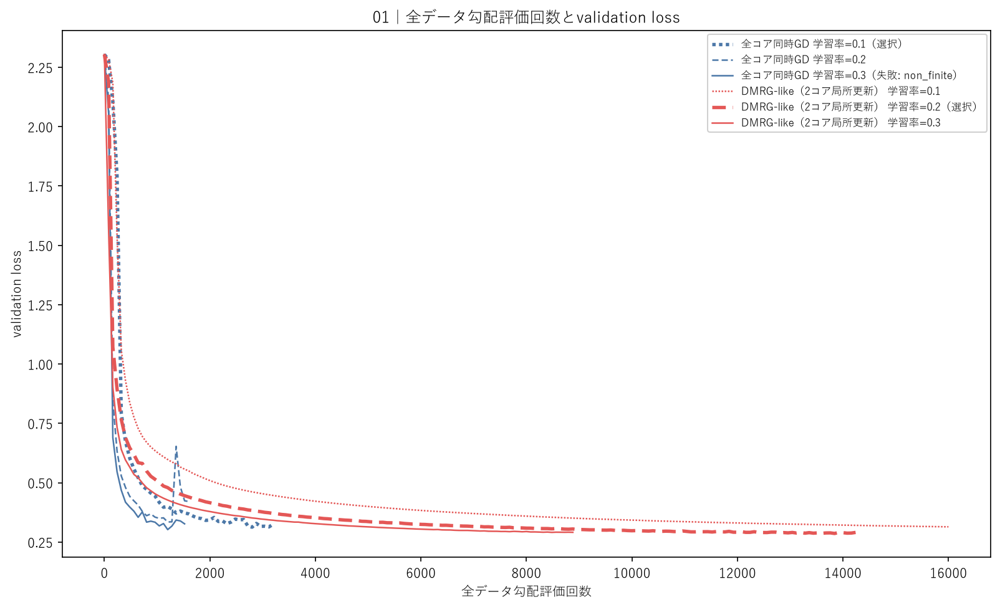
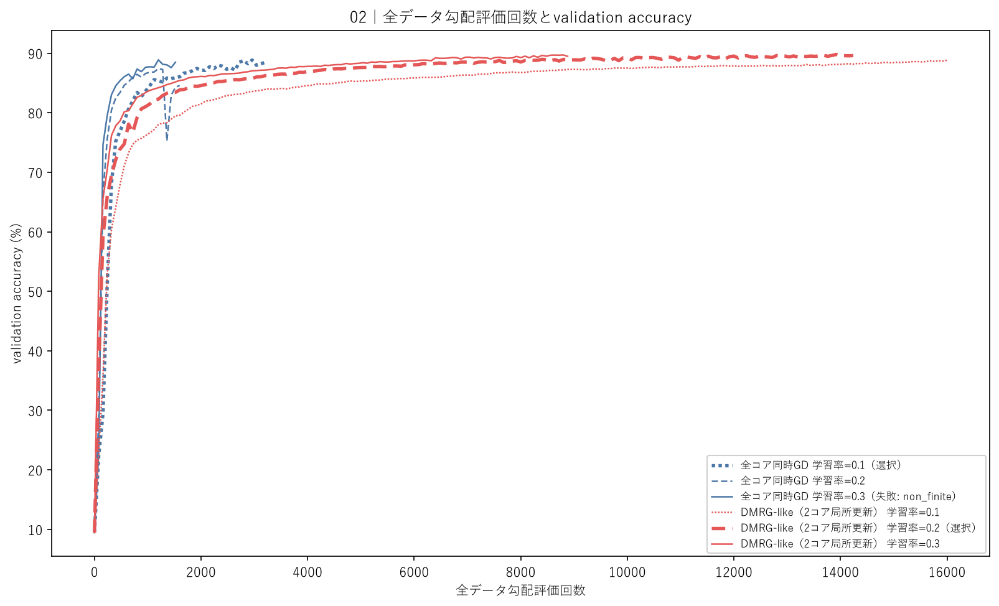
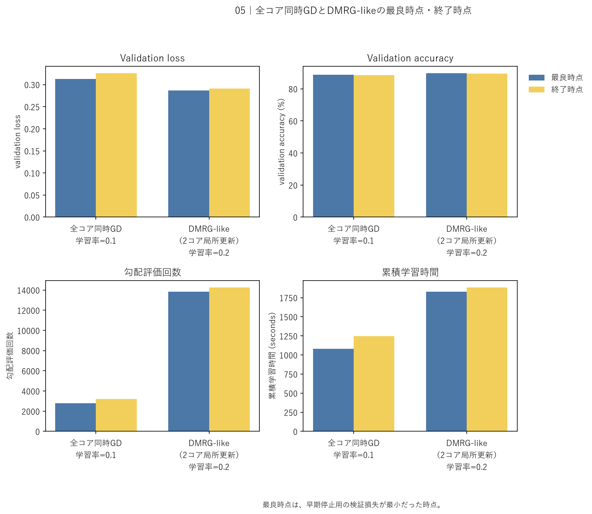
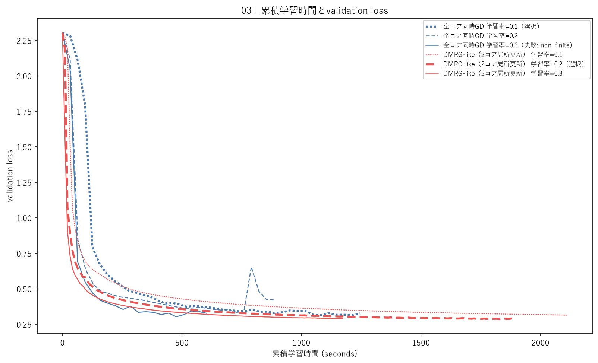
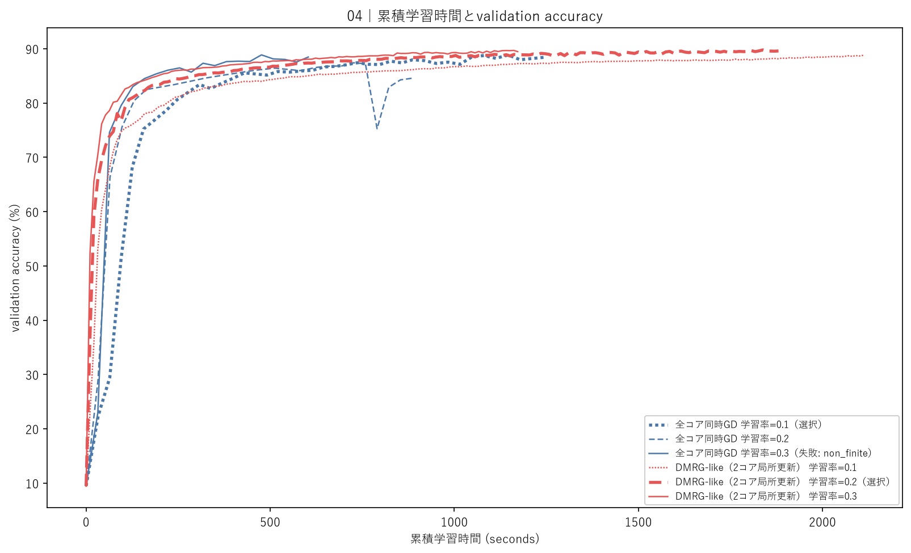
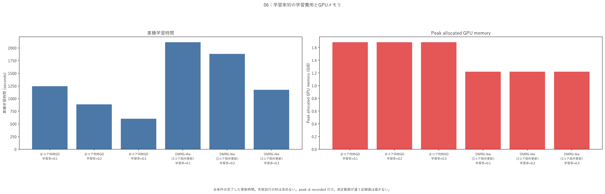

# 全コア同時GDとDMRG-like局所スイープの比較

## このノートの役割

本ノートは、Notebook 11で同じStage C初期TT-MLPから、全TTコアを同時に更新するfull-batch GDと、隣接2コアを順番に更新するDMRG-like局所スイープを比較した保存結果と考察をまとめる。

- Notebook：`notebooks/40_dmrg/10_fashion_mnist_mlp/11_full_batch_global_vs_local_update_control.ipynb`
- 結果：`results/40_dmrg/10_fashion_mnist_mlp/11_full_batch_global_vs_local_update_control/`
- checkpoint・履歴：`models/40_dmrg/10_fashion_mnist_mlp/11_full_batch_global_vs_local_update_control/`
- 前段：[[40_TT_MPS_NN圧縮/10_FashionMNIST_MLP/16_Dense_通常TT_DMRG-like比較]]

Notebook 11の中心的な問いは、次である。

> 同じ初期TTモデル、全学習データの平均勾配、素朴なGD、共通の学習率候補と停止規則を用いた場合でも、DMRG-like局所スイープは全コア同時GDと異なる到達性能・安定性・計算費用を示すか。

これは「2コア更新だけ」の因果効果を測る実験ではない。DMRG-like側には、結合テンソルへの更新、方向付きSVD、正準中心の移動、rank制約、左右巡回が一体として含まれる。また、通常parameterの更新回数も方式間で異なる。したがって、二つの**学習方式全体**の比較として読む。

---

## 1. なぜNotebook 11が必要だったか

Notebook 06までの通常TTとDMRG-likeの比較では、次の違いが同時に存在した。

| 観点 | 以前の通常TT | DMRG-like |
|---|---|---|
| optimizer | Adam | 素朴なGD |
| 勾配に使うデータ | minibatch | 全学習データ |
| TT更新 | 全コア同時 | 2コア局所更新＋SVD＋巡回 |

この比較だけでは、性能差がTTの更新方法によるのか、AdamとGDの違いによるのか、minibatchとfull-batchの違いによるのかを区別できない。

11では、両方式を次の条件へそろえた。

- 同じStage C初期モデル。
- 同じtraining・early-stopping validation・rank-selection validation分割。
- 全50,000件の平均cross-entropy勾配。
- momentumなしのGD。
- 学習率候補`0.1`、`0.2`、`0.3`。
- 80 full-dataset gradient evaluationsごとの評価。
- `min_delta=1e-4`、`patience=5`、最大16,000 evaluations。
- TTと通常parameterを両方更新するjoint条件。
- best checkpointはearly-stopping validation lossのstrict best。
- 学習率選択後に、別のrank-selection validationで評価。
- testは使用しない。

したがって11で減らせた曖昧さは、optimizerと勾配データ量の違いである。一方、局所変数、SVD、正準化、巡回、各parameterの更新頻度はそろっていない。

---

## 2. 二つの更新方式

### 2.1 全コア同時GD

現在の全TTコアと通常parameterについて、同じ更新前モデルから全データ平均勾配を求め、一斉に更新する。

$$
G_k
\leftarrow
G_k
-
\eta
\frac{\partial \mathcal L}{\partial G_k}
$$

1回のgradient evaluationで、6個のTTコア、`fc1.bias`、`fc2`、`fc3`をすべて更新する。SVDによる再分割や正準中心の移動は行わない。

### 2.2 DMRG-like局所スイープ

隣接2コアを結合したテンソルを更新し、方向付きSVDでrank cap 12へ再分割する。更新後の状態を次のpairへ引き継ぎ、左右に巡回する。

1 pair当たり8 local stepsで、6-core TTの5 pairを往復するため、1往復は80 local updatesである。各local updateでは、現在のTT pairに加えて通常parameterも更新する。

同じ「1 full-dataset gradient evaluation」でも、Globalは全コア、Localは現在の2コアを更新するため、計算内容とparameterごとの更新頻度は同じではない。

---

## 3. 保存結果の確認範囲

保存済み成果物では、次を確認した。

- 6条件すべてに履歴、best・final checkpoint、run state、manifestがある。
- `history.csv`は574行で、6条件すべてを含む。
- 6条件は同じStage C初期checkpointと同じデータ分割を使う。
- 各条件の停止理由、完了評価数、strict bestが`condition_summary.csv`と有効世代で対応する。
- 学習率選択結果は`selected_comparison.csv`と一致する。
- 選択checkpointのrank-selection validation結果は`rank_selection.csv`に保存されている。
- test forwardは行っていない。

Notebook末尾は保存済み結果から図を再生成したもので、本確認では再学習・validation再評価を行っていない。保存結果内部の対応は確認できるが、現在のNotebookソースで本学習を再現した確認ではない。

---

## 4. 6条件の結果

| 方式 | 学習率 | 停止理由 | best validation loss | best時点accuracy | best評価数 | 終了評価数 |
|---|---:|---|---:|---:|---:|---:|
| 全コア同時GD | 0.1 | early stopping | 0.312724 | 0.8876 | 2,800 | 3,200 |
| 全コア同時GD | 0.2 | early stopping | 0.334540 | 0.8742 | 1,200 | 1,600 |
| 全コア同時GD | 0.3 | non-finite | 0.302444 | 0.8888 | 1,200 | 1,520 |
| DMRG-like | 0.1 | 最大予算到達 | 0.314306 | 0.8882 | 16,000 | 16,000 |
| DMRG-like | 0.2 | early stopping | 0.286268 | 0.8962 | 13,840 | 14,240 |
| DMRG-like | 0.3 | early stopping | 0.290853 | 0.8950 | 8,480 | 8,880 |

Global・`0.3`は、非有限値発生前には6条件中で低いlossを記録したが、事前規則により選択対象外である。正常終了した候補の中から、全コア同時GDは`0.1`、DMRG-likeは`0.2`が選ばれた。

---

## 5. 選択されたモデルの到達性能

| 評価データ | 指標 | 全コア同時GD・0.1 | DMRG-like・0.2 |
|---|---|---:|---:|
| early-stopping validation | loss | 0.312724 | 0.286268 |
| early-stopping validation | accuracy | 0.8876 | 0.8962 |
| rank-selection validation | loss | 0.310293 | 0.287969 |
| rank-selection validation | accuracy | 0.8886 | 0.8960 |

rank-selection validationでのaccuracy差は、

$$
0.8960-0.8886=0.0074
$$

すなわち`0.74 percentage points`である。lossもDMRG-likeの方が`0.022324`低い。学習率選択に使ったvalidationだけでなく、選択後の別validationでもlossとaccuracyの方向が一致した。

ただし、この差は単一seed、3個の学習率候補、開発用validationでの結果である。統計的有意性、別seedでの再現性、未使用testへの一般化を示していない。

---

## 6. 初期の改善速度と最終到達性能は異なる

全データ勾配評価800回時点のvalidation lossは次だった。

| 学習率 | 全コア同時GD | DMRG-like |
|---:|---:|---:|
| 0.1 | 0.472254 | 0.670064 |
| 0.2 | 0.361102 | 0.548888 |
| 0.3 | 0.333897 | 0.479112 |

同じ学習率と同じ評価回数で見ると、初期は全コア同時GDが先行した。一方、今回の停止規則の下で長く学習すると、DMRG-like・`0.2`がより低いlossへ到達した。

したがって、次を分ける必要がある。

- 少ないgradient evaluationsでの初期改善。
- 各方式のbestまでの評価回数。
- 同じ目標性能への到達時間。
- 最大予算と停止規則の下で得た到達性能。

Globalを学習率schedule付きで続けた場合や、より細かく学習率を探索した場合に差が縮むかは未確認である。Local・`0.1`は最大16,000 evaluationsへ達したため、その停止を収束確認とは扱わない。

---

## 7. 学習率への敏感さと数値的不安定性

全コア同時GD・`0.2`では、1,280から1,360 evaluationsの間に、学習損失`0.284860→0.632375`、validation loss`0.335253→0.653266`、区間平均TTコア勾配norm`0.298→1.733`と同時に増加した。validationだけが悪化したのではないため、単純な過学習だけでは説明できない。更新が大きくなり、良い領域から外れた挙動と整合するが、80更新ごとの記録だけでは最初の原因を確定できない。

全コア同時GD・`0.3`は、途中でbest loss`0.302444`を得た後、非有限値を検出して停止した。保存されたfinal値は、失敗後に戻した最後の整合した評価時点である。

DMRG-likeは今回の3学習率で非有限値停止しなかったが、`0.1`は最大予算到達、`0.2`が最良、`0.3`はそれより少し悪かった。したがって「DMRG-likeなら学習率に鈍感」「一般に安定」とは言えない。また、同じ数値の学習率でも更新変数が異なるため、同じ実効更新量を意味しない。

事前に定めた「非有限値またはOOMで停止した条件を選択対象外にする」規則に従い、Global・`0.3`ではなく正常終了したGlobal・`0.1`を選んだ。この除外は結果を見た後の恣意的な変更ではないが、主比較の選択結果に影響しているため明記する。

---

## 8. 学習時間・評価回数・GPUメモリ

| 指標 | 全コア同時GD・0.1 | DMRG-like・0.2 |
|---|---:|---:|
| bestまでのgradient evaluations | 2,800 | 13,840 |
| bestまでの更新処理時間 | 1,080.4秒 | 1,827.9秒 |
| 終了までの更新処理時間 | 1,245.3秒 | 1,880.6秒 |
| 終了までの評価時間 | 65.8秒 | 598.9秒 |
| peak GPU memory | 約1.68 GiB | 約1.22 GiB |

DMRG-likeはbestまでに約`4.94倍`のgradient evaluationsを使ったが、更新処理時間は約`1.69倍`だった。これは1 evaluationの費用が方式間で同じではないことを示す。局所更新では勾配対象となるTTコアが現在のpairに限られる一方、SVD再分割などの追加処理がある。

peak GPU memoryはDMRG-likeが約`27.5%`少なかった。これは保存parameter数の差ではなく、条件実行中に記録されたGPU最大割当量である。

6条件の探索全体では、更新処理が約132分、評価処理が約30分、別記録の失敗試行が約4.37秒だった。保存などを除いても約2時間41分であり、選択された2条件のbest時間だけでは実験全体の探索費用を表さない。

---

## 9. 同じ目標性能への到達時間

各方式の異なるbestを比較するだけでは、「同じ性能を得るまでどちらが速いか」は分からない。既存履歴を使い、Global・`0.1`のbestを目標にすると次になる。

### 9.1 Globalのbest lossを目標にする

Globalのbest validation lossは`0.312724`で、2,800 evaluations・更新処理`1,080.4秒`で到達した。

Local・`0.2`が初めてこれを下回ったのは7,520 evaluationsで、loss`0.311937`、更新処理`992.7秒`だった。更新処理時間だけなら、Localはより多くのevaluationsを使いながら、Globalのbest lossへ約87.7秒早く到達した。

一方、そこまでの累積評価時間を加えると、

| 条件 | 更新処理 | 評価処理 | 合計 |
|---|---:|---:|---:|
| Global・best | 1,080.4秒 | 57.1秒 | 1,137.5秒 |
| Local・Global best loss初回到達 | 992.7秒 | 317.1秒 | 1,309.8秒 |

となり、評価を含む合計ではGlobalが早い。

### 9.2 Globalのbest時点accuracyを目標にする

Globalのbest-loss checkpointのaccuracy`0.8876`を、Localは7,600 evaluations・更新処理`1,003.3秒`で初めて超え、accuracy`0.8878`を得た。ここでも更新処理だけならLocalが早いが、累積評価時間を含めるとGlobalが早い。

したがってNotebook 11では、次の表現が正確である。

> DMRG-likeは、Globalのbest性能へ更新処理時間だけなら少し早く到達した。一方、より多い評価回数に伴うvalidation費用を含めると、同じ目標性能への総時間はGlobalの方が短かった。結論は、どの時間範囲を費用へ含めるかで変わる。

この比較も80 evaluationsごとの離散的な観測点に基づく。閾値を越えた正確な更新時点までは分からない。

---

## 10. parameterごとの更新回数は公平化されていない

DMRG-likeは局所更新のたびに、現在のTT pairだけでなく、`fc1.bias`、`fc2`、`fc3`も更新する。そのため、bestまでの通常parameter更新回数は次になる。

| 対象 | 全コア同時GD best | DMRG-like best |
|---|---:|---:|
| 通常parameter | 2,800 | 13,840 |
| 各TTコア | 全コア2,800回 | core位置により2,768回または5,536回 |

Local・bestの13,840 updatesは、1往復80 updatesなので173往復に相当する。各bondを往復で2回、各pairで8回更新するため、端のTTコアは1往復16回、内部コアは32回更新される。

$$
173\times16=2,768,
\qquad
173\times32=5,536
$$

この結果は興味深い。

- Localの端コア更新回数は、Globalの全コア2,800回とほぼ同じ。
- Localの内部コアは、Globalの約1.98倍更新される。
- Localの通常parameterは、Globalの約4.94倍更新される。

したがって、Localの高い到達性能を、TTの局所更新・SVD・正準化だけへ帰属できない。通常parameterへ多くの更新機会を与えた影響も含む。これは実験設計の誤りではなく、学習方式全体を比較するという11の範囲である。ただし、個々の機構の因果効果を主張する場合は、通常parameterの更新頻度をそろえる別実験が必要になる。

---

## 11. trainとvalidationの差から見た解釈

best-loss時点のtrain・validation lossは次だった。

| 条件 | train loss | validation loss | validation−train |
|---|---:|---:|---:|
| 全コア同時GD・0.1 | 0.242080 | 0.312724 | 0.070644 |
| DMRG-like・0.2 | 0.180648 | 0.286268 | 0.105620 |

DMRG-likeはtrain lossもvalidation lossも低いが、両者の差はGlobalより大きい。この結果は、「SVDやrank制約が正則化として働き、汎化gapを縮めたためvalidation性能が向上した」という説明を支持しない。

今回観測されたのは、DMRG-likeがtrainingデータへより強く適合しながら、validation性能も改善したことである。ただし、学習時間と更新回数が異なるため、この差だけからDMRG-likeの過学習傾向や一般的な汎化特性を断定しない。

---

## 12. loss基準のbestと最高accuracyを区別する

checkpointはvalidation accuracy最大ではなく、validation loss最小で選んでいる。そのため、選択checkpointのaccuracyと履歴中の最高accuracyは一致しない。

| 条件 | loss基準bestのaccuracy | 履歴中の最高accuracy | 最高accuracy時点 |
|---|---:|---:|---:|
| 全コア同時GD・0.1 | 0.8876 | 0.8886 | 2,960 evaluations |
| DMRG-like・0.2 | 0.8962 | 0.8980 | 13,920 evaluations |

これは選択処理の誤りではない。cross-entropyは正解クラスの確率や誤答の確信度も反映する一方、accuracyはargmaxだけを見る。ノートでは、`best accuracy`ではなく「best-loss checkpointのaccuracy」と記述する。

rank-selection validationの`0.8886`と`0.8960`も、選択済みcheckpointを別データで評価したaccuracyであり、履歴中の最大accuracyではない。

---

## 13. なぜDMRG-likeが良かった可能性があるか

### 13.1 結合テンソルを直接更新する変数空間

2コアを簡略化して$T=AB$と書くと、Globalは$A$と$B$を別々の変数として同時更新する。一方、DMRG-likeは結合した$T$を更新した後、SVDで新しい$A$と$B$へ分ける。同じ損失とGDでも、勾配を引く変数空間が異なるため、実効重みの更新方向は同じにならない。

### 13.2 正準化とgauge freedomの整理

TTには、

$$
AB=(cA)(B/c),
\qquad c\neq0
$$

のように、実効重みを変えずコアのscaleを変えられるgauge freedomがある。方向付きSVDと正準中心の移動が、この表現の自由度を整理し、局所更新を扱いやすくした可能性がある。ただし、Global側のscale偏りを測り、それが性能差の原因だと確認したわけではない。

### 13.3 SVD・rank制約・逐次巡回

Localは更新した結合テンソルをrank cap 12のSVDで再分割し、その結果を次のpairへ渡す。逐次的に更新済み状態を使うことが有利だった可能性がある。

一方、SVDが最小化するのは局所行列のFrobenius再構成誤差であり、分類lossではない。「SVDが悪い更新だけを除去した」とは言えない。今回rankは固定されていても、SVDによる再parameter化と正準中心移動は残る。

### 13.4 原因を断定できない理由

性能差には、次が同時に含まれる。

- 結合テンソルを更新すること。
- SVD再分割と正準化。
- 左右の逐次巡回。
- 方式ごとに選ばれた学習率の違い。
- bestまでの学習長の違い。
- TTコアと通常parameterの更新頻度の違い。

したがって、「2コア局所更新が`0.74`ポイント改善した」「正準化が主因だった」といった要因別の因果説明はできない。11の結論は、これらを含むDMRG-like方式全体の結果である。

---

## 14. 言えること・言えないこと

### 14.1 今回の結果から言えること

- Adamとminibatchという差をなくしても、今回の条件では方式間の性能差が残った。
- 選択されたDMRG-likeは、early-stopping validationとrank-selection validationの両方で低loss・高accuracyだった。
- 全コア同時GDは初期改善が速く、DMRG-likeは長く学習して良い到達性能を得た。
- 全コア同時GD・`0.2`と`0.3`では不安定な挙動が観測された。
- DMRG-likeはbestまでの更新処理時間が長い一方、peak GPU memoryは小さかった。
- 同じ目標性能への到達効率は、更新時間だけを見るか、validation評価時間も含めるかで結論が変わった。

### 14.2 今回の結果からは言えないこと

- DMRG-likeが一般に全コア同時GDより優れること。
- `0.74`ポイント差が統計的に有意であること。
- 2コア局所更新、SVD、正準化、巡回のどれが主因か。
- 同じparameter更新機会を与えた場合も差が残ること。
- early stoppingが数学的収束を意味すること。
- Local・`0.1`が限界性能へ到達したこと。
- testや別データでも優位性が保たれること。
- 学習費用の差から推論速度を判断すること。

追加実験は11の完成条件ではない。複数seedは差の再現性、通常parameter更新頻度をそろえる実験は局所TT更新の寄与、独立testは最終一般化性能というように、次に主張したい内容に応じて行う。

---

## 15. 結論

同じStage C初期TTモデル、全学習データの平均勾配、素朴なGD、共通の学習率候補と停止規則を用いても、今回の単一seedではDMRG-like局所スイープが全コア同時GDより良いvalidation性能へ到達した。rank-selection validationではlossが`0.310293→0.287969`、accuracyが`0.8886→0.8960`となった。

一方、DMRG-likeはbestまでに約4.94倍のfull-dataset gradient evaluationsと約1.69倍の更新処理時間を使い、通常parameterも約4.94倍多く更新した。peak GPU memoryは約27.5%少なかった。Globalのbest性能へ達する更新処理時間だけならLocalが少し短かったが、validation評価まで含む総時間ではGlobalが短かった。

したがって11の結論は、次のようにまとめる。

> 今回の固定条件では、DMRG-like方式は全コア同時GDより良い到達性能を示した。ただし、その差は局所2コア更新だけではなく、SVD、正準化、逐次巡回、学習率、学習長、通常parameterの更新頻度を含む方式全体の差である。到達性能、更新処理時間、評価費用、GPUメモリを分けて評価する必要があり、一般的な優越性や個々の機構の因果効果は未確定である。
