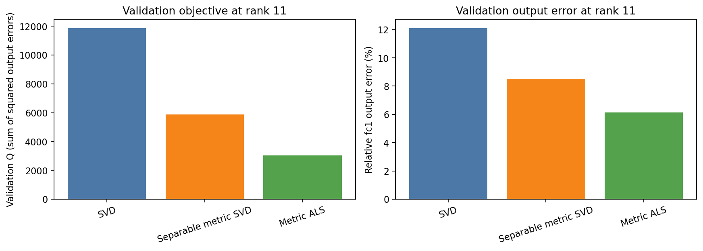
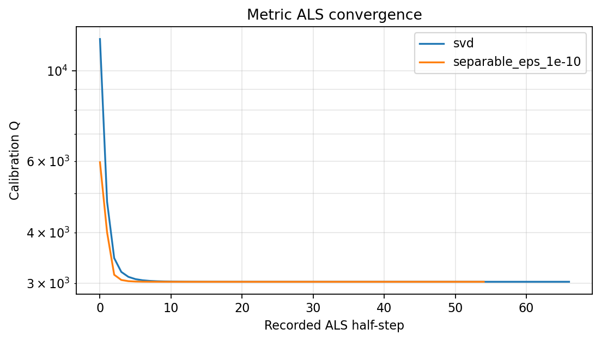
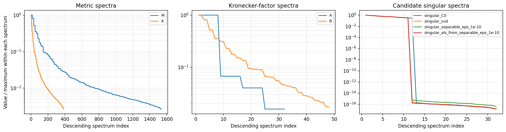

# 計量を考慮したbond切り詰め診断

## このノートの役割

本ノートは、Notebook 12で学習済みTT-MLPの一つのbondをrank 12から11へ切るとき、次の3方式を比較した結果と考察をまとめる。

1. 通常SVD
2. 分離計量SVD
3. 固定rank ALS

- Notebook：`notebooks/40_dmrg/10_fashion_mnist_mlp/12_metric_aware_bond_truncation_diagnostic.ipynb`
- 結果：`results/40_dmrg/10_fashion_mnist_mlp/12_metric_aware_bond_truncation_diagnostic/`
- source：`models/40_dmrg/10_fashion_mnist_mlp/06_dense_tt_dmrg_like_convergence_comparison/dmrg_like/best_model.pt`
- 前段の単一bond診断：[[40_TT_MPS_NN圧縮/10_FashionMNIST_MLP/19_単一bond事後切り詰めと分類感度診断]]
- 一般理論：[[00_基礎理論/03_モデル圧縮理論/30_TTLinear圧縮/79_データ計量付きTT_bond切り詰めとALS]]

中心的な問いは次である。

> 通常SVDが最小化する重みのFrobenius誤差ではなく、実データに対する`fc1`出力誤差を目的にすると、同じrank 11でも切り詰め誤差をどこまで減らせるか。

---

## 1. 実行状態

Notebookの主診断コードセルは実行済みで、保存出力に例外はない。`checks_passed=true`である。その後、保存済みCSVだけを読む表示用セルを追加し、診断本体を再実行せずに3枚の図を保存した。NotebookのRun Allは行っていない。

保存成果物は次の7ファイルである。

| ファイル | 内容 |
|---|---|
| `summary.csv` | 各方式の$Q$、出力相対誤差、rank、処理時間 |
| `als_history.csv` | 二つの初期値からのALS履歴 |
| `metric_spectrum.csv` | $M$、$K$、$A$、$B$、候補行列のスペクトル |
| `settings.json` | 固定条件、検算、下界、固有値、solver診断 |
| `method_comparison.png` | 3方式のvalidation $Q$と出力相対誤差 |
| `als_convergence.png` | 2初期値のALS収束履歴 |
| `metric_spectra.png` | 計量、クロネッカー係数、候補解のspectrum |

本Notebookは分類accuracy、cross-entropy、logits、test setを評価していない。

---

## 2. 固定条件

| 項目 | 設定 |
|---|---|
| source rank | $(1,8,12,12,12,12,1)$ |
| 対象bond | bond 2 |
| 対象pair | core 1とcore 2 |
| source rank | 12 |
| target rank | 11 |
| 2-core行列$C_0$ | $32\times48$ |
| 2-core tensor | $(8,2,2,2,2,12)$、1,536要素 |
| calibration | training split由来の5,000件 |
| validation | 別の5,000件 |
| calibrationとvalidation | 重複なし |
| dtype・device | float64・CPU |
| ALS初期値 | 通常SVD、分離計量SVD |

sourceはNotebook 06のDMRG-like best modelである。Notebook 12は、学習済み固定モデルを正準化し、対象2コアを結合して事後的に切り詰めた診断である。2-core局所更新の直後に切った実験ではない。

---

## 3. 目的関数

結合2-coreを$C$、切り詰め前を$C_0$とする。5,000件の入力に対するReLU前`fc1`出力を$z_s(C)$とすると、calibration目的関数は、

$$
Q_{\mathrm{cal}}(C)
=
\sum_{s=1}^{5000}
\left\|z_s(C)-z_s(C_0)\right\|_2^2
$$

である。$Q$は平均ではなく5,000件についての総和なので、絶対値はsample数に依存する。

$C$から出力までの写像は、他のTT coresを固定すれば線形である。したがって、

$$
Q(C)
=
\operatorname{vec}(C-C_0)^\top
M
\operatorname{vec}(C-C_0)
$$

と書ける。$M$は入力データと固定coreが決める局所計量である。

validation出力相対誤差は、

$$
\frac{
\left\|z_{\mathrm{val}}(C)-z_{\mathrm{val}}(C_0)\right\|_2
}{
\left\|z_{\mathrm{val}}(C_0)\right\|_2
}
$$

である。

---

## 4. 比較した3方式

### 4.1 ① 通常SVD

$C_0$を行列化し、通常SVDでrank 11へ切る。

$$
\min_{\operatorname{rank}(C)\le11}
\left\|C-C_0\right\|_F^2
$$

には厳密最適だが、$M\ne I$なら$Q(C)$の最適解とは限らない。

### 4.2 ② 分離計量SVD

本来の$M$を、Frobeniusノルムで最も近いクロネッカー積、

$$
M\approx A\otimes B
$$

へ近似する。その近似計量に対して、

$$
\widetilde C_0=A^{1/2}C_0B^{1/2}
$$

と白色化し、$\widetilde C_0$をrank 11へSVD切り詰めした後、

$$
C=A^{-1/2}\widetilde C B^{-1/2}
$$

で戻す。

$M=A\otimes B$が厳密に成立し、$A$と$B$が可逆なら、この方法は本来の$Q$についてもrank制約付き大域最適解になる。今回は$M$を近似しているため、本来の$Q$については近似解である。

### 4.3 ③ 固定rank ALS

$C$を、

$$
C=UV^\top,
\qquad
U\in\mathbb{R}^{32\times11},
\quad
V\in\mathbb{R}^{48\times11}
$$

と表し、本来の$M$を使って$U$と$V$を交互に最小二乗更新する。途中を含め、

$$
\operatorname{rank}(C)\le11
$$

が保たれる。

各片側更新は最小二乗問題として解けるが、$U$と$V$の同時問題は非凸である。したがって、ALSの到達点は大域最適とは限らない。

---

## 5. 保存結果

| 方法 | $Q_{\mathrm{cal}}$ | $Q_{\mathrm{val}}$ | validation出力相対誤差 | actual rank |
|---|---:|---:|---:|---:|
| 切り詰め前$C_0$ | 0 | $7.69\times10^{-25}$ | $9.74\times10^{-16}$ | 12 |
| ① 通常SVD | 11,976.91 | 11,859.70 | 12.10% | 11 |
| ② 分離計量SVD、$\varepsilon=10^{-10}$ | 5,959.61 | 5,876.04 | 8.52% | 11 |
| ② 分離計量SVD、$\varepsilon=10^{-6}$ | 5,959.61 | 5,876.04 | 8.52% | 11 |
| ③ ALS、①開始 | 3,028.08 | 3,038.72 | 6.13% | 11 |
| ③ ALS、②開始 | 3,028.08 | 3,038.72 | 6.13% | 11 |

すべて同じrank 11である。②と③の改善は、rankを戻した結果ではない。

この図はNotebook 12の保存済み`summary.csv`から表示した。左はvalidationの出力二乗誤差総和$Q_{\mathrm{val}}$、右はvalidation出力の相対$L_2$誤差である。どちらも通常SVD、分離計量SVD、計量ALSの順に小さくなった。

---

## 6. 検算

### 6.1 正準化と結合2-core

正準化・2-core結合後の$C_0$は、元のTTLinear forwardと相対誤差$9.77\times10^{-16}$で一致した。正準化は表現する線形写像を変えていない。

### 6.2 計量とforward

- 環境写像による予測とforward差分：相対誤差$3.98\times10^{-11}$
- 256 sampleで基底ごとに直接構築した$M$と、$K\otimes I$から構築した$M$：相対誤差$2.60\times10^{-15}$
- ランダムな3個の$\Delta C$について、二次形式とforwardによる$Q$：相対誤差$10^{-15}$以下

したがって、Notebook内で使った$M$は、固定coreと入力に対するReLU前出力誤差を数値的に再現している。

### 6.3 Notebook 09との接続

①通常SVDのvalidation出力相対誤差は`0.1210185113`で、Notebook 09の保存値`0.1210185975`との差は$8.62\times10^{-8}$だった。

Notebook 12の①は、Notebook 09のbond 2、rank 12→11を再現している。

---

## 7. 考察1：通常SVDがデータ上では損をした

①通常SVDに対して、②は$Q$を約半分、③は約4分の1へ減らした。

| 比較 | calibrationでの削減率 | validationでの削減率 |
|---|---:|---:|
| ② 対 ① | 50.24% | 50.45% |
| ③ 対 ① | 74.72% | 74.38% |

通常SVDは重み行列のFrobenius誤差を最小化するが、入力データがよく使う方向とほとんど使わない方向を区別しない。今回の結果は、①が捨てた方向がデータ上の出力誤差では比較的高価だったことを示す。

rank 12→11では、通常SVDが捨てる成分は1個である。その成分に対する計量のRayleigh商は、

$$
\frac{Q_{\mathrm{SVD}}}{\left\|C_{\mathrm{SVD}}-C_0\right\|_F^2}
=3592.20
$$

で、$M$の固有値分布の約80.2パーセンタイルに位置した。したがって「典型的な方向より重い」とは言えるが、特定の上位固有ベクトルそのものを捨てたとまでは言わない。

---

## 8. 考察2：下界と「取り戻した割合」

$M$の最小固有値を$\lambda_{\min}$、$C_0$の特異値を$\sigma_j$とすると、任意のrank 11以下の$C$について、

$$
Q(C)
\ge
\lambda_{\min}
\left\|C-C_0\right\|_F^2
\ge
\lambda_{\min}
\sum_{j>11}\sigma_j^2
$$

である。今回の値は、

$$
\lambda_{\min}=238.80,
\qquad
\sum_{j>11}\sigma_j^2=3.3341
$$

で、下界は、

$$
Q_{\mathrm{lower}}=796.19
$$

だった。

①の$Q$から下界まで到達できると仮定した理論上の最大削減率は、

$$
1-\frac{796.19}{11976.91}
=93.35\%
$$

である。一方、③が実際に達成した削減率は74.72%である。

したがって、結果は次のように区別する。

- **実測**：③は①の$Q$を約75%削減した。
- **単純下界**：最大約93%削減できる余地を否定しない。
- **未確認**：下界が達成可能か、③より良いrank 11解が存在するか。

③の$Q$は下界の約3.80倍である。下界は大域最適値そのものではなく、比較用の緩い下限である。

---

## 9. 考察3：分離計量SVDが半分まで改善した理由

### 9.1 計量の構造

実装では座標順序をそろえると、

$$
M=K\otimes I_{\mathrm{output}}
$$

となることを直接構築した$M$と照合した。出力modeにかかる単位行列自体は、行側と列側へ分離できる。

したがって、分離計量SVDが本来の$Q$に対して厳密になるかどうかは、$K$が2-core行列の行側と列側へクロネッカー分離できるかに依存する。

### 9.2 クロネッカー近似誤差

今回の最近接$A\otimes B$近似の相対Frobenius誤差は、

$$
\frac{\left\|M-A\otimes B\right\|_F}{\left\|M\right\|_F}
=0.24619
$$

だった。

これは残差ノルムが全体ノルムの24.6%という意味である。二乗エネルギー比なら、

$$
0.24619^2\approx0.0606
$$

である。「計量情報を24.6%失った」と直接読み替えたり、この値だけから$Q$の悪化率を予測したりはできない。

②は近似した$A\otimes B$に対しては最適だが、本来の$M$に対して残る相互作用を扱えない。②が①の$Q$を約半分まで減らしながら③に届かなかったことは、この非分離成分が影響した可能性と整合する。

ただし、クロネッカー近似誤差`0.246`が、②と③の差の主因だという因果は1条件だけでは確定しない。bondごとに近似誤差と$Q$差が連動するかを測っていないためである。

### 9.3 画像に対する解釈

このtensorizationでは、2-core行列の行側と列側へ異なる入力modeが割り当てられる。画像中の離れたmode間に相関があれば、左側の変化の重要度が右側の変化に依存し、$K$は単純な積へ分かれにくい。

「画像の帯」と「帯内位置」の相互作用が非分離性を生んだという説明は構造から得た仮説であり、画像統計を直接分解して確認した結果ではない。

---

## 10. 考察4：ALSの収束と初期値

①開始のALSは33反復、②開始は27反復で停止した。両履歴で$Q$は単調非増加だった。

二つの最終結果は、

- $Q_{\mathrm{cal}}$の差：約$4.9\times10^{-10}$
- $Q_{\mathrm{val}}$の差：約$1.5\times10^{-6}$
- 特異値列の相対差：約$1.8\times10^{-9}$

であり、数値的に同等の目的値と特異値スペクトルへ到達した。

ただし、最終$C$自体は保存されていないため、同一行列へ収束したとは確認できない。また、二つの初期値で同等の値になっても、大域最適性の証明にはならない。

縦軸は対数目盛である。この図は保存済み`als_history.csv`から作成し、両初期値で$Q_{\mathrm{cal}}$が単調非増加に低下することと、分離計量SVD初期化のほうが少ない記録stepで同程度の目的値へ到達したことを示す。

---

## 11. 考察5：calibrationからvalidationへの再現

各方式で$Q_{\mathrm{cal}}$と$Q_{\mathrm{val}}$は近かった。

| 方法 | calibrationとvalidationの相対差 |
|---|---:|
| ① 通常SVD | 0.98% |
| ② 分離計量SVD | 1.40% |
| ③ ALS | 0.35% |

少なくとも今回の固定splitでは、calibration上の改善がvalidationで消えていない。

ただし、このvalidationは独立seedやtest setではない。一つの5,000件splitでの再現であり、モデルやデータ分布をまたぐ一般化ではない。

---

## 12. 考察6：数値安定性

$M$の固有値は、

$$
238.80\le\lambda(M)\le90086.64
$$

で、条件数は約377.25、負固有値は0、最大固有値の$10^{-8}$以下の固有値も0だった。今回の$M$は正定値で、数値的な零空間を持っていない。

分離計量の$A$と$B$の条件数は約63.48、56.78である。$\varepsilon=10^{-10}$と$10^{-6}$のどちらでも持ち上げられた固有値は0だったため、結果が一致した。

したがって今回確認できたのは、

> 固有値floorが作動しない良条件の範囲では、二つの$\varepsilon$で結果が変わらなかった。

ことである。小固有値が存在する不安定な条件での感度を確認した実験ではない。

この図は`metric_spectrum.csv`に保存された各spectrumを降順に並べ、それぞれの最大値で1へ正規化した表示である。異なる行列の絶対スケールではなく、spectrumの形を比較するための図である。

---

## 13. 圧縮としての実益

bond 2を12から11へ下げると、対象2コアの要素数は、

| core | rank 12 | rank 11 | 削減 |
|---|---:|---:|---:|
| core 1 | 384 | 352 | 32 |
| core 2 | 576 | 528 | 48 |
| 合計 | 960 | 880 | 80 |

となる。

- TT core全体：5,968 → 5,888、約1.34%削減
- `fc1.bias`を含む`fc1`全体：6,480 → 6,400、約1.23%削減
- モデル総parameter：140,378 → 140,298、約0.057%削減

今回の設定は、1 rankだけ削ったときの切り詰め損を調べる診断である。モデル圧縮率を大きく改善する候補ではない。

また、`summary.csv`の`seconds`は候補行列のSVD・白色化・ALS部分の時間であり、計量構築、データ準備、forward評価を含むend-to-end時間ではない。①の約0.6 msと③の約1.3〜1.5 sだけから、実運用全体の速度比を評価しない。

---

## 14. 分類性能との関係

Notebook 12の$Q$は`fc1`のReLU前出力誤差である。分類はその後にReLU、`fc2`、`fc3`を通るため、$Q$が小さいほどaccuracy低下も単調に小さくなるとは限らない。

Notebook 09では、同じbond 2の①通常SVDで、

- validation出力相対誤差：12.10%
- accuracy：89.68% → 88.84%、0.84ポイント低下
- 予測変更：214 / 5,000件

だった。

一方、Notebook 12の③は出力相対誤差を6.13%へ減らしたが、accuracy、loss、prediction変更数を測っていない。別bondの6.3%誤差でaccuracy低下が0.30ポイントだった結果から、③も0.30ポイント程度になるとは予測できない。bondと誤差方向が異なるからである。

したがってNotebook 12が示したのは、同rankでReLU前出力誤差を減らせる仕組みであり、分類性能の改善ではない。

---

## 15. DMRG-like学習との関係

2-core DMRG-like更新では、隣接2コアを結合して目的関数を下げ、その後rank制約付きで再分割する。通常SVDは結合テンソルのユークリッド近似には最適だが、データ目的やlossに対して最適とは限らない。

Notebook 12は、この「更新目的と切り詰め目的の不一致」を単純化して診断した。ただし、入力は学習済み固定モデルの$C_0$であり、2-core局所更新によって得た直後のsupercoreではない。

したがって、

> DMRG-like学習中も同じ割合の切り詰め損が発生している。

とはまだ言えない。

---

## 16. 言えること・言えないこと

### 言えること

- 今回のbond 2、rank 12→11では、通常SVDはデータ上の`fc1`出力誤差に対して最適ではなかった。
- 同じrank 11で、分離計量SVDは①の$Q$を約50%、ALSは約75%削減した。
- 改善は独立なvalidation 5,000件でもほぼ同じ割合で再現した。
- 最近接クロネッカー近似の相対誤差は0.246で、計量は完全には分離しなかった。
- 二つのALS初期値は、数値的に同等の目的値と特異値スペクトルへ到達した。
- 今回の$M$、$A$、$B$は固有値floorを必要としない範囲だった。

### 言えないこと

- ALSが大域最適解である。
- 理論下界796.19へ到達できる。
- 二つのALSが同一行列へ収束した。
- 他のbond、rank、checkpoint、seed、モデルでも同じ改善率になる。
- クロネッカー近似誤差0.246が②と③の差の原因だと確定した。
- accuracy、cross-entropy、logitsも改善した。
- 2-core更新直後の切り詰めでも同じ結果になる。
- 実用的な圧縮率やend-to-end時間で既存方式より優れる。

---

## 17. 結論

Notebook 12では、通常SVDが重みのFrobenius近似としては最適でも、実データ上の`fc1`出力誤差には最適でないことを、一つのbond・rank条件で確認した。

同じrank 11のまま、分離計量SVDで通常SVDの出力二乗誤差を約半分、ALSで約4分の1まで削減した。これは、通常SVDが無視する入力データと固定coreの計量を使えば、切り詰めで失う方向を選び直せることを示す。

一方、実際に達成した削減率は約75%であり、93%は下界から計算した理論上の余地である。ALSの大域最適性、分類性能、他条件への一般化、2-core更新直後での再現は未確認である。

したがって、本実験の到達点は、

> DMRG-like 2-core再分割で起こり得る「更新目的と通常SVD切り詰め目的の不一致」を、データ計量付き低rank近似として定量化する基準を得た。
ことである。
