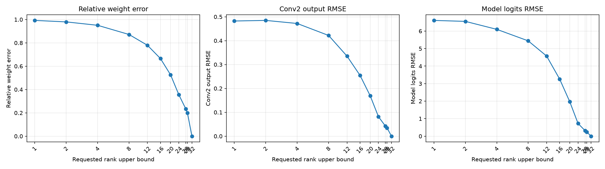
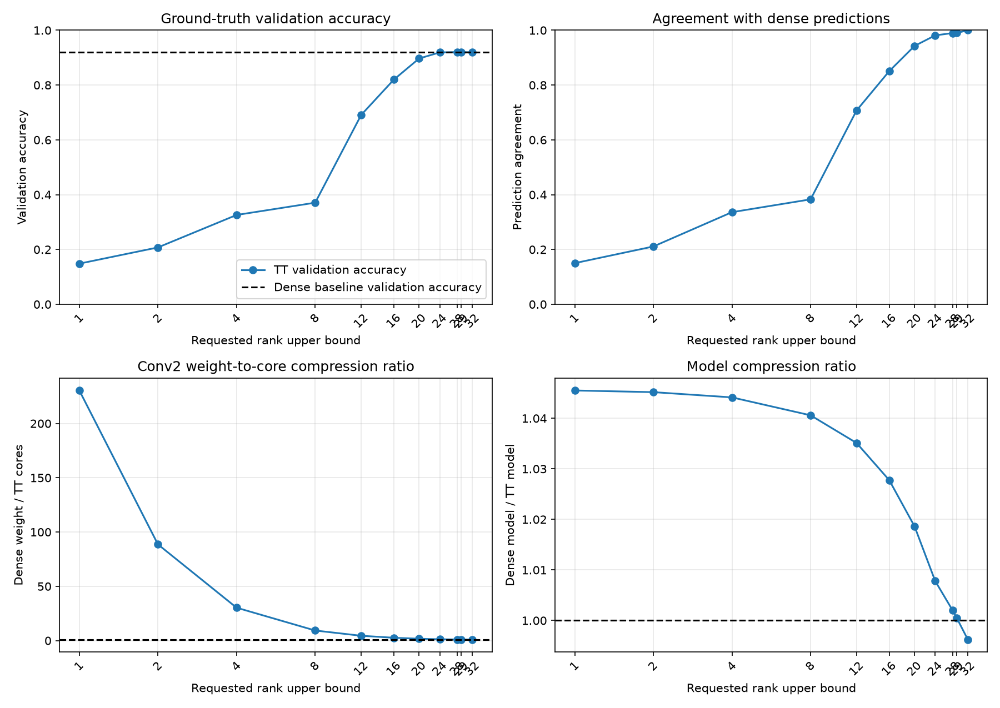
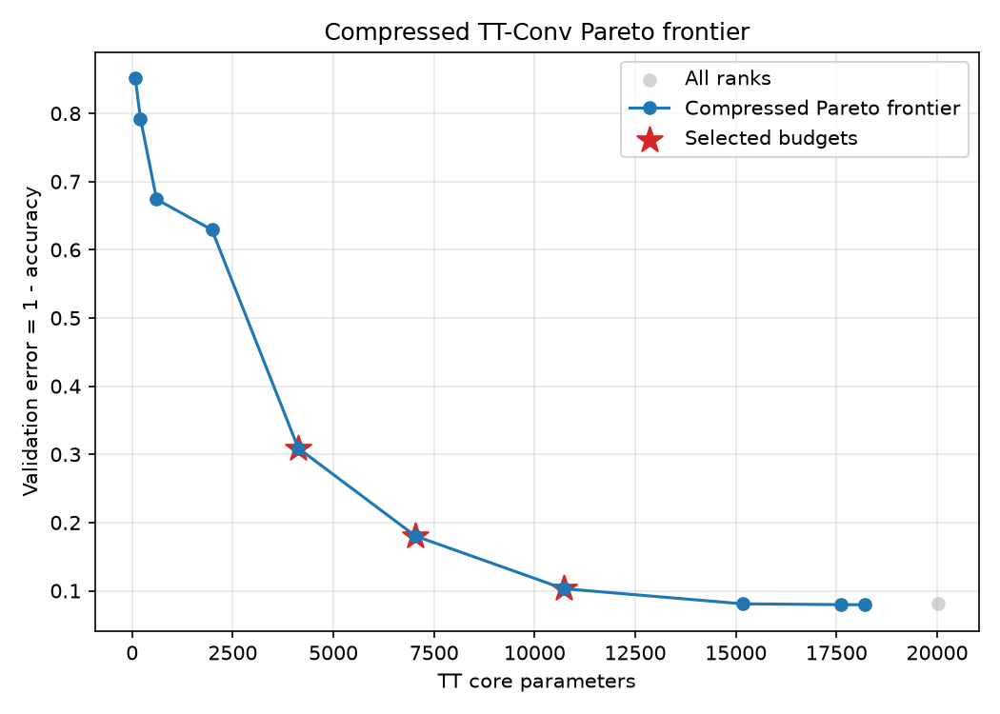

# 学習済みCNNのconv2 TT-rank sweep

## このノートの位置づけ

このノートは、Notebook 03の保存済み実装・結果と、その結果についてChatGPTおよびPerplexityとの対話で行った考察を統合する。

- [03_pretrained_cnn_conv2_tt_rank_sweep.ipynb](../../../notebooks/30_tt_mps/20_fashion_mnist_cnn/03_pretrained_cnn_conv2_tt_rank_sweep.ipynb)

Notebook 02では、学習済みCNNの`conv2`をrank打ち切りなしのexact `TTConv2d`へ置換し、推論を維持できることを確認した。Notebook 03ではtensorizationを固定し、2つの内部rankへ与える共通上限だけを変え、fine-tuning前のparameter削減と推論性能の交換関係を調べた。

```text
Notebook 02：exact TT置換の接続確認
    ↓
Notebook 03：rank制限直後の誤差・予測・accuracyを比較
    ↓
Notebook 04：rank 12・16・20・24をTT cores-onlyでfine-tuning
```

当初は03で選んだparameter予算を次のtensorization比較へ渡す予定だったが、CNN系列では先にTT-Convの学習可能性を確認する方針へ変更した。tensorization比較は後回しとし、Notebook 04では固定tensorizationのままfine-tuningした。

一般化できるrank sweep、評価指標、Pareto・kneeの読み方は、次の技術ノートへ分ける。

- [[00_基礎理論/03_モデル圧縮理論/31_TTConv圧縮/79_Conv2dのTT-matrix表現と直接forward]]

## 1. 証拠レベル

Notebookの保存済みコード・出力と、次の保存物を照合した。

- [rank_sweep_results.csv](../../../results/30_tt_mps/20_fashion_mnist_cnn/03_pretrained_cnn_conv2_tt_rank_sweep/rank_sweep_results.csv)
- [pareto_frontier.csv](../../../results/30_tt_mps/20_fashion_mnist_cnn/03_pretrained_cnn_conv2_tt_rank_sweep/pareto_frontier.csv)
- [selected_rank_budget_candidates.csv](../../../results/30_tt_mps/20_fashion_mnist_cnn/03_pretrained_cnn_conv2_tt_rank_sweep/selected_rank_budget_candidates.csv)
- [experiment_config.json](../../../results/30_tt_mps/20_fashion_mnist_cnn/03_pretrained_cnn_conv2_tt_rank_sweep/experiment_config.json)

保存済みNotebookは24セルで、11個のコードセルはすべて実行済みであり、保存されたerror出力はない。次の表示も保存されている。

```text
completed evaluation helpers: OK
TODO 1 and exact-control checks: OK
```

ただし、このノート作成時にFresh Restart KernelからRun Allを新たに実行したわけではない。以下は保存済み出力・CSV・設定ファイルの確認結果と、それに基づく考察である。

## 2. 実験設定

### 2.1 目的と固定条件

中心となる問いは、次である。

> 学習済みCNNの`conv2`について、TT-rank上限を下げると、どこまでparameter数を削減でき、どのrank帯でaccuracyやdenseモデルの予測が回復するか。

| 項目 | 設定 |
| :-- | :-- |
| モデル | 学習済み`FashionMNISTCNN` |
| checkpoint | `fashion_mnist_cnn_baseline.pt`、best epoch 10 |
| 圧縮対象 | `conv2`のみ |
| `conv2.weight` | shape $(64,32,3,3)$、18,432 parameters |
| 行列化後 | shape $(64,288)$ |
| out / in modes | $(4,4,4)$ / $(6,6,8)$ |
| device / dtype / seed | CPU / `torch.float32` / 0 |
| rank-selection validation | 5,000件、batch size 256 |
| dense accuracy | `0.9194`、4,597 / 5,000件正解 |
| dense model parameters | 421,642 |
| fine-tuning / test評価 | 実施しない / 実施しない |
| latency・MACs・peak memory | 測定しない |

60,000件のtraining dataは、50,000件、fine-tuning監視用5,000件、rank選択用5,000件へ分けた。rank選択用5,000件はNotebook 02のvalidation分割手順を再現したindexと一致し、3分割に重複がないことも確認した。

ただし、監視用5,000件は元baselineの55,000件の学習に含まれている。rank選択用5,000件もbaseline checkpointの選択に使用済みである。どちらもbaseline学習から完全に独立した最終評価用データではない。

### 2.2 rank sweepと検証

rank上限候補は、

```text
[1, 2, 4, 8, 12, 16, 20, 24, 28, 29, 32]
```

である。各候補は、前のrankの近似結果ではなく、毎回同じ元のdense weightからTT-SVDした。元モデルを`deepcopy`し、copy側の`conv2`だけを今回のcoresで作った`TTConv2d`へ置換した。

評価前には、モデルが独立していること、`conv2`以外のstate、biasとConv設定、診断用coresとモデル内coresの対応、denseな`weight`を保持していないこと、parameter数の帳尻を確認した。

各rankについて先頭2画像を使い、同じrank制限coresによる、

```text
TT direct forward
       ↕
coresから再構成したkernelによるF.conv2d
```

が許容誤差内で一致することも確認した。これは元dense weightへの近さではなく、同じ近似weightをdirect経路が正しく計算できているかの検査である。

内部rankを$r_1,r_2$とすると、core parameter数は、

$$
P_{\mathrm{cores}}=24r_1+24r_1r_2+32r_2
$$

であり、モデル全体は、

$$
P_{\mathrm{model}}=421{,}642-18{,}432+P_{\mathrm{cores}}
$$

となる。

## 3. 保存結果

accuracy dropは`dense accuracy - TT accuracy`であり、負値はTT側のaccuracyが高かったことを表す。

| rank上限 | actual ranks | core数 | model数 | conv2圧縮率 | weight相対誤差 | conv2 RMSE | logits RMSE | agreement | accuracy | drop |
| --: | :-- | --: | --: | --: | --: | --: | --: | --: | --: | --: |
| 1 | `(1,1,1,1)` | 80 | 403,290 | 230.40倍 | 0.9925 | 0.4824 | 6.6096 | 0.1502 | 0.1484 | 0.7710 |
| 2 | `(1,2,2,1)` | 208 | 403,418 | 88.62倍 | 0.9798 | 0.4848 | 6.5541 | 0.2110 | 0.2076 | 0.7118 |
| 4 | `(1,4,4,1)` | 608 | 403,818 | 30.32倍 | 0.9506 | 0.4720 | 6.0994 | 0.3362 | 0.3260 | 0.5934 |
| 8 | `(1,8,8,1)` | 1,984 | 405,194 | 9.29倍 | 0.8717 | 0.4218 | 5.4419 | 0.3830 | 0.3708 | 0.5486 |
| 12 | `(1,12,12,1)` | 4,128 | 407,338 | 4.47倍 | 0.7793 | 0.3352 | 4.5752 | 0.7074 | 0.6910 | 0.2284 |
| 16 | `(1,16,16,1)` | 7,040 | 410,250 | 2.62倍 | 0.6655 | 0.2545 | 3.2599 | 0.8508 | 0.8198 | 0.0996 |
| 20 | `(1,20,20,1)` | 10,720 | 413,930 | 1.72倍 | 0.5256 | 0.1693 | 1.9656 | 0.9428 | 0.8970 | 0.0224 |
| 24 | `(1,24,24,1)` | 15,168 | 418,378 | 1.22倍 | 0.3547 | 0.0817 | 0.7257 | 0.9814 | 0.9192 | 0.0002 |
| 28 | `(1,24,28,1)` | 17,600 | 420,810 | 1.05倍 | 0.2330 | 0.0422 | 0.3199 | 0.9898 | 0.9204 | -0.0010 |
| 29 | `(1,24,29,1)` | 18,208 | 421,418 | 1.01倍 | 0.1991 | 0.0348 | 0.2441 | 0.9902 | 0.9206 | -0.0012 |
| 32 | `(1,24,32,1)` | 20,032 | 423,242 | 0.92倍 | $1.33\times10^{-6}$ | $5.58\times10^{-7}$ | $3.27\times10^{-6}$ | 1.0000 | 0.9194 | 0.0000 |

rank 32はNotebook 02を再現するexact controlであり、parameter数がdense weightを上回るため圧縮候補ではない。

最大logits絶対差はrank 1で`23.8002`、rank 29で`1.2016`、exact controlで$1.24\times10^{-5}$だった。direct経路と同じcoresの再構成経路の最大絶対差は、全候補で$2.09\times10^{-7}$から$2.86\times10^{-6}$の範囲に収まり、各候補の`assert_close`を通過した。





### 3.1 Pareto frontierと予算候補

圧縮になっているrank 1から29までの10候補について、TT core parameter数と`validation_error = 1 - validation_accuracy`をともに小さくするPareto frontierを求めた。agreement、logits RMSE、weight誤差は診断値であり、Pareto判定には使っていない。

10候補はすべてfrontierに残り、正規化したfrontierの両端を結ぶ直線からの距離によりrank 16が一意な内部kneeとなった。

| role | rank上限 | core予算 | model数 | accuracy |
| :-- | --: | --: | --: | --: |
| aggressive | 12 | 4,128 | 407,338 | 0.6910 |
| balanced | 16 | 7,040 | 410,250 | 0.8198 |
| conservative | 20 | 10,720 | 413,930 | 0.8970 |



この3点は、当初は次のtensorization比較へ渡すparameter予算候補として抽出したものであり、最終採用モデルではない。実際のNotebook 04では、tensorization比較よりfine-tuningを優先し、この3候補にaccuracy回復の基準となるrank 24を加えて比較した。

## 4. 実験結果からの考察

### 4.1 accuracy維持の確認済み境界はrank 24付近

accuracyはrank 8で`0.3708`、12で`0.6910`、16で`0.8198`、20で`0.8970`、24で`0.9192`となった。denseは`0.9194`である。評価済み候補の中では、rank 24で差が`0.0002`、5,000件中1件まで縮まった。

従って今回の固定条件では、rank 24を「validation accuracyをほぼ維持した最小の確認済み候補」とする。ただしrank 21から23は未評価なので、必要rankの厳密な境界が24だとは言えない。

accuracy増加量は8→12で32.02 points、12→16で12.88 points、16→20で7.72 points、20→24で2.22 pointsだった。denseとの差は20→24でほぼ消えるが、増加量自体は8→12が最大である。rank増加とともに改善幅が小さくなり、24付近でdense水準へ達したと読む。

### 4.2 weight誤差とaccuracy低下は比例しない

rank 24ではweight相対Frobenius誤差が`0.3547`残る一方、accuracyは`0.9192`だった。元weightの数値誤差が35.5%ならaccuracyも同程度下がる、という関係は成り立たない。

Frobenius誤差はweight全要素の差を測るが、分類への影響は、その差が実入力へどう作用し、class順位を変えたかで決まる。今回言えるのは、weight誤差とaccuracyが「無関係」ではなく、一対一または比例関係になく、weight誤差だけではrankを選べないことである。

rank 1から24では、weight相対誤差が`0.9925 → 0.3547`、conv2 RMSEが`0.4824 → 0.0817`、logits RMSEが`6.6096 → 0.7257`となった。ただし指標ごとにshapeとscaleが異なるため、この比だけから後段が誤差を一定割合で減衰させるとは結論しない。

### 4.3 accuracy維持とdenseモデルの再現は別

rank 24のaccuracyはdenseとほぼ同じだが、agreementは`0.9814`であり、93件では異なるclassを予測した。予測変化には、`dense正解→TT不正解`、`dense不正解→TT正解`、`両方不正解だがclass変更`がある。accuracy差は最初の2種類の差し引きで、3種類目はagreementだけを下げる。

従って、正解数がdenseより1件少ないことから、93件の変更のほぼすべてが悪化だったとは言えない。改善・悪化の個別件数は、今回の集計値だけでは分からない。

rank 29もaccuracy `0.9206`、agreement `0.9902`、logits RMSE `0.2441`である。49件で予測classが異なり、logitsも一致していないため、denseを完全再現したモデルではなく、同程度のaccuracyを得た別の近似モデルである。

### 4.4 rank 28・29のaccuracy上昇を汎化性能の改善とはみなさない

正解数はdenseが4,597件、rank 28が4,602件、rank 29が4,603件だった。予測classはrank 28で51件、rank 29で49件変わり、その差し引きとして正解数が5件・6件増えた。

denseモデルも誤分類するため、denseの予測から離れることは必ずしも悪化ではない。一方、このvalidationはbaseline checkpointとrank候補の選択に使った開発用データであり、test評価はしていない。観測事実は「このvalidationでaccuracyがわずかに高かった」であり、「TT圧縮が汎化性能を改善した」ではない。削った成分がノイズだったという説明も仮説にとどまる。

### 4.5 conv2の大きな圧縮がモデル全体の大きな圧縮にはならない

`conv2.weight`の18,432 parametersは、モデル全体421,642の約4.37%である。rank 12では対象weightを18,432から4,128へ減らして4.47倍に圧縮したが、モデル全体の削減は14,304、約3.39%である。

$$
\frac{18{,}432}{421{,}642}
\left(1-\frac{4{,}128}{18{,}432}\right)
\approx 3.39\%
$$

rank 24ではaccuracyをほぼ維持したが、モデル全体の削減は3,264、約0.77%だった。この実験はモデル全体の大幅圧縮ではなく、`conv2`のTT近似が推論へ与える影響を調べた実験として読む。

### 4.6 accuracy維持とparameter削減を重視する暫定候補はrank 24

| 候補 | accuracy | denseとの正解数差 | model数 | 削減数 |
| :-- | --: | --: | --: | --: |
| rank 24 | 0.9192 | -1件 | 418,378 | 3,264 |
| rank 28 | 0.9204 | +5件 | 420,810 | 832 |
| rank 29 | 0.9206 | +6件 | 421,418 | 224 |

rank 28・29の小幅なaccuracy上昇を汎化性能の改善とはみなさず、denseとの差`0.0002`を許容するなら、rank 24が3候補中で最も大きくparameterを削減する。この目的ではrank 24を暫定候補とする。ただし、モデル全体の削減率は約0.77%であり、最終採用候補ではない。

### 4.7 kneeのrank 16は最終採用rankではない

rank 16は幾何学的なkneeだが、accuracyは`0.8198`で、denseより9.96 points低い。knee計算には許容accuracy低下が入っていないため、`balanced`という名前からaccuracy維持や妥当な折り合いを判断しない。

rank 12・16・20は幾何学的な規則から抽出した低・中・高の予算候補であり、rank 24は今回のvalidationでaccuracyをほぼ維持した候補である。両者の基準は異なる。Notebook 04では4候補をfine-tuningし、学習後に候補評価が実際に変化した。

### 4.8 `validation_error`はvalidation lossではない

Pareto判定の`validation_error = 1 - validation_accuracy`は誤分類率であり、cross-entropy lossではない。rank 24の`0.0808`は$1-0.9192$である。logits RMSEもdenseとのlogits差であり、正解labelに対するlossではない。

Notebook 03はrank別validation lossを保存していないため、「rank 24ではaccuracyとlossの両方がdense付近まで回復した」とは言えない。

### 4.9 探索刻みと共通rank上限が結論を限定する

rank 28以降は第1内部rankが24で飽和し、actual ranksは$(1,24,28,1)$、$(1,24,29,1)$、$(1,24,32,1)$となった。requested rankだけで表現規模を判断せず、actual ranksとcore数を見る必要がある。

また、探索は2つの内部rankへ同じ上限を与える系列だけであり、任意の$(r_1,r_2)$を探索していない。rank 21から23も未評価である。従って、今回の候補内での比較であって、必要accuracyを満たすparameter最小構成の特定ではない。

rank 29のcore数18,208はdense weightの18,432より224少ない。rank 30なら式上18,816となるため、rank 29はこの共通上限系列で圧縮側に残る最大付近の候補である。rank 32はparameter数が増える代わりに、agreement 1.0、accuracy `0.9194`となり、exact controlの役割を果たした。

## 5. 確認できた範囲と未確認事項

確認できたのは、固定tensorization、共通rank上限、`conv2`だけ、1 checkpoint、1 validation split、fine-tuning前という条件でのrank sweepである。各rankのdirect経路、圧縮直後の診断指標、Pareto frontier、次へ渡す3予算までを確認した。

次は未確認である。

- rank 21から23、または非対称rankを含むparameter最小構成
- fine-tuning後のrank別回復
- 別tensorizationで同じparameter予算を使った比較
- rank別validation loss
- sampleごとの改善・悪化の内訳
- 候補固定後の未使用test setでの性能
- latency、MACs、peak memory
- 別checkpoint、別seed、別split、別層での再現性

最終候補はvalidationで固定した後、未使用test setでdenseと比較する。test結果を見て候補を選び直すと、そのtest setも選択用データになる。

## 6. 結論

Notebook 03では、固定tensorizationで`conv2`の共通rank上限を1から32まで変え、fine-tuning前の圧縮と推論性能を比較した。評価済み候補ではrank 24がaccuracy `0.9192`となり、denseの`0.9194`との差を5,000件中1件まで縮めた。一方、agreementは`0.9814`で、denseの予測を完全再現したわけではない。

rank 24のweight相対誤差は`0.3547`残っており、weight誤差とaccuracy低下が比例しないことも確認できた。ただし`conv2.weight`はモデル全体の約4.37%であり、rank 24のモデル全体parameter削減率は約0.77%にとどまった。

Pareto kneeのrank 16は予算候補であり、最終採用rankではない。fine-tuning前にaccuracy維持とparameter削減を重視した暫定候補はrank 24だった。その後のNotebook 04ではrank 12・16・20・24をfine-tuningし、全候補がdense baseline以上の開発用accuracyへ到達した。詳細は[[40_TT_MPS_NN圧縮/20_FashionMNIST_CNN/04_conv2_TT-cores-only_fine-tuning]]に分ける。
