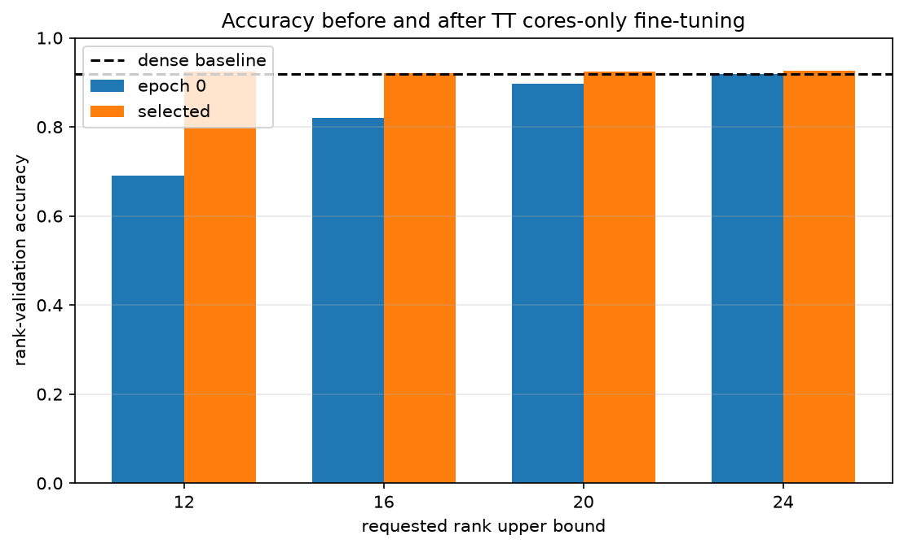
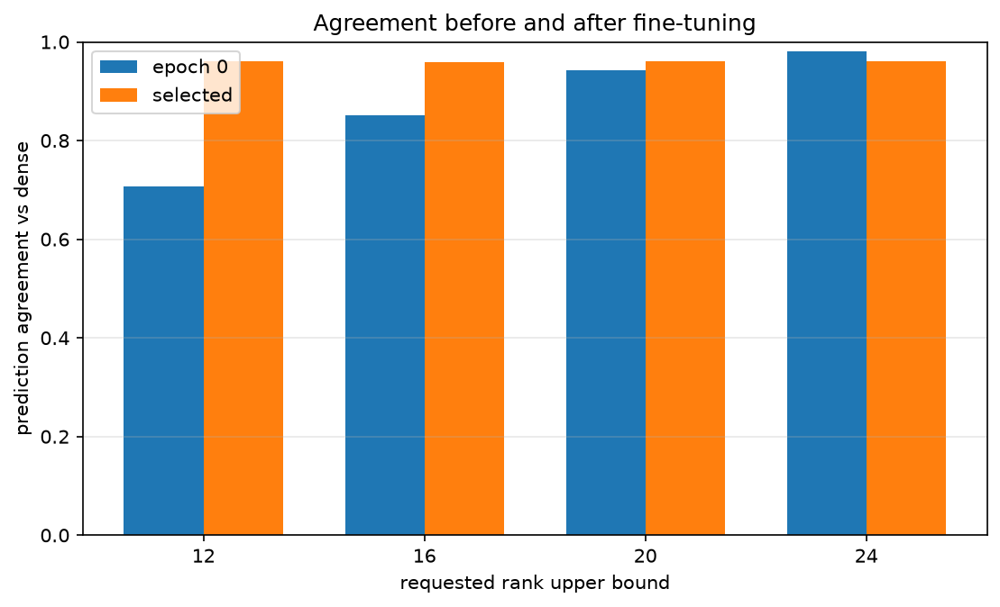
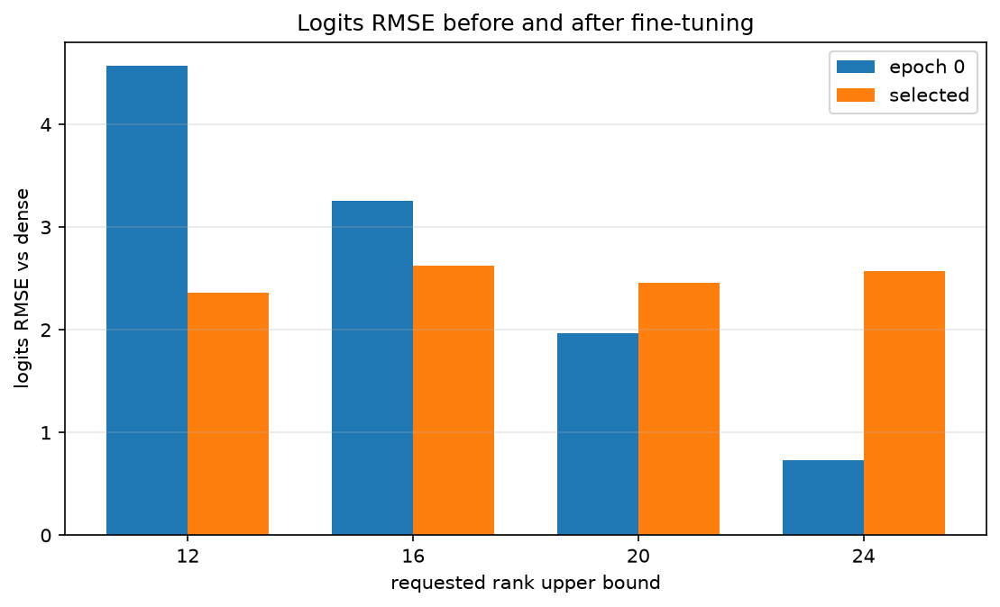
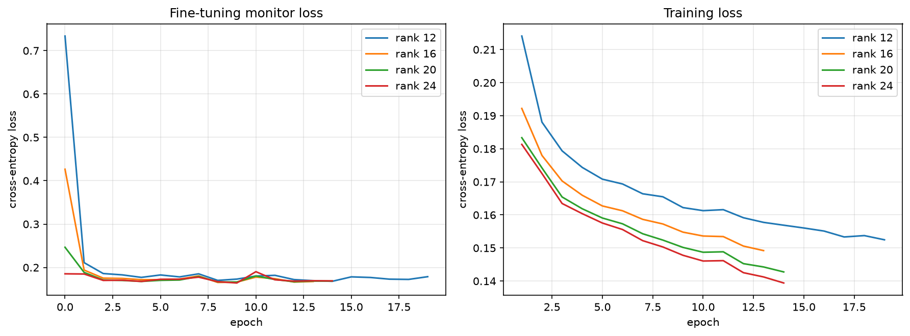

# conv2 TT cores-only fine-tuning

## このノートの位置づけ

このノートは、Notebook 04の保存済み実装・結果と、その結果についてChatGPTおよびPerplexityとの対話で行った考察を統合する。

- [04_pretrained_cnn_conv2_tt_cores_only_finetuning.ipynb](../../../notebooks/30_tt_mps/20_fashion_mnist_cnn/04_pretrained_cnn_conv2_tt_cores_only_finetuning.ipynb)

Notebook 03では、固定tensorizationのままTT-rankを制限し、fine-tuning前の誤差・accuracy・parameter数を比較した。Notebook 04では、そこから選んだrank 12・16・20と、fine-tuning前にdenseとほぼ同じaccuracyだったrank 24を、同じ条件でTT cores-only fine-tuningした。

```text
Notebook 03：圧縮直後のrank sweep
    ↓
Notebook 04：同じrankをTT coresだけ更新して性能回復を比較
```

当初はNotebook 04でtensorization比較を行う案もあった。しかしMLP系列ですでに同種の比較を経験しており、CNN系列ではまずdirect TT-Convが実際に学習できるかを確かめるため、固定tensorizationでのfine-tuningを優先した。tensorization比較を不要と判断したわけではなく、04の必須範囲から外した。

fine-tuning、目的関数、checkpoint選択、評価指標に関する一般論は、次の技術ノートへ分ける。

- [[00_基礎理論/03_モデル圧縮理論/31_TTConv圧縮/79_Conv2dのTT-matrix表現と直接forward]]

## 1. 証拠レベル

Notebookの保存済みコード・出力と、次の保存物を照合した。

- [finetuning_comparison.csv](../../../results/30_tt_mps/20_fashion_mnist_cnn/04_pretrained_cnn_conv2_tt_cores_only_finetuning/finetuning_comparison.csv)
- [finetuning_history.csv](../../../results/30_tt_mps/20_fashion_mnist_cnn/04_pretrained_cnn_conv2_tt_cores_only_finetuning/finetuning_history.csv)
- [parameter_verification.csv](../../../results/30_tt_mps/20_fashion_mnist_cnn/04_pretrained_cnn_conv2_tt_cores_only_finetuning/parameter_verification.csv)
- [experiment_config.json](../../../results/30_tt_mps/20_fashion_mnist_cnn/04_pretrained_cnn_conv2_tt_cores_only_finetuning/experiment_config.json)

保存済みNotebookは20セルで、9個のコードセルはすべて実行済みであり、保存されたerror出力はない。次の表示も保存されている。

```text
fine-tuning verification: OK
```

ただし、このノート作成時にFresh Restart KernelからRun Allを新たに実行したわけではない。以下は保存済み出力・CSV・設定ファイルの確認結果と、それに基づく考察である。

## 2. 実験設定

### 2.1 目的と固定条件

中心となる問いは、次である。

> 圧縮直後にaccuracyが低下したrank制限TT-Convは、他層を変更せずTT coresだけを更新することで、どこまで分類性能を回復できるか。

| 項目 | 設定 |
| :-- | :-- |
| モデル | 学習済み`FashionMNISTCNN` |
| 圧縮対象 | `conv2.weight`のみ |
| dense `conv2.weight` | shape $(64,32,3,3)$、18,432 parameters |
| tensorization | out modes $(4,4,4)$、in modes $(6,6,8)$ |
| rank上限 | 12、16、20、24 |
| actual ranks | 各候補とも$(1,r,r,1)$ |
| 初期値 | 同じdense checkpointの`conv2`をrank別にTT-SVD |
| 更新対象 | `conv2.cores.0`、`.1`、`.2`のみ |
| 固定対象 | `conv1`、`conv2.bias`、`fc1`、`fc2` |
| optimizer | Adam、学習率$10^{-3}$ |
| batch size | 学習64、評価256 |
| 最大epoch | 50 |
| early stopping | `min_delta=1e-4`、`patience=5` |
| checkpoint選択 | fine-tuning監視用loss、epoch 0も候補 |
| device / dtype / seed | CUDA / `torch.float32` / 0。各trialでseedをリセットし、同じseedの学習Loaderを作成 |
| test | 10,000件の件数だけ確認し、評価しない |

Notebook 03はCPU、Notebook 04はCUDAで実行された。このためepoch 0のlogits RMSEには微小差があるが、Notebookで定めた許容誤差内であり、accuracyとagreementは一致した。

### 2.2 データの役割

Fashion-MNISTのtraining data 60,000件を次の3つへ分けた。

| データ | 件数 | 役割 |
| :-- | --: | :-- |
| 更新用 | 50,000 | TT coresのgradient更新 |
| fine-tuning監視用 | 5,000 | early stoppingとcheckpoint選択 |
| rank-validation | 5,000 | epoch 0と選択済みcheckpointの診断 |

checkpointはrank-validation accuracyではなく、監視用cross-entropy lossで選んだ。`min_delta`があるため、全epoch中のlossを事後的に単純比較して最小値を選ぶ処理とは異なる。rank-validationのaccuracy・agreement・logits RMSEはepoch 0と選択済みcheckpointだけで測り、epoch選択には使っていない。

ただし、両方の5,000件は研究全体から独立した最終評価用データではない。監視用5,000件は元dense baselineの学習55,000件に含まれ、rank-validation 5,000件もbaseline checkpoint選択とNotebook 03のrank比較に使われている。未使用test setだけが最終評価用として残っている。

### 2.3 更新範囲の検証

`parameter_verification.csv`では、全rankについて3個のTT coreがすべて変化し、`conv1`、`conv2.bias`、`fc1`、`fc2`は初期値と完全一致していた。

従って、今回の性能変化は「他層の適応による補償を許した結果」ではなく、TT coresだけの更新で得られた。ただし、これは全parameter更新との優劣を比較した結果ではない。

## 3. 保存結果

### 3.1 学習前後の比較

accuracy、agreement、logits RMSEは同じrank-validation 5,000件で測定した。monitor lossとmonitor accuracyは別の監視用5,000件の値である。

| rank | core数 | model数 | epoch 0 acc. | 選択後acc. | acc.変化 | agreement前→後 | logits RMSE前→後 | 選択／実行epoch |
| --: | --: | --: | --: | --: | --: | :-- | :-- | :-- |
| 12 | 4,128 | 407,338 | 0.6910 | 0.9238 | +0.2328 | 0.7074 → 0.9604 | 4.5753 → 2.3637 | 14 / 19 |
| 16 | 7,040 | 410,250 | 0.8198 | 0.9202 | +0.1004 | 0.8508 → 0.9596 | 3.2600 → 2.6207 | 8 / 13 |
| 20 | 10,720 | 413,930 | 0.8970 | 0.9246 | +0.0276 | 0.9428 → 0.9600 | 1.9656 → 2.4568 | 9 / 14 |
| 24 | 15,168 | 418,378 | 0.9192 | 0.9256 | +0.0064 | 0.9814 → 0.9614 | 0.7258 → 2.5721 | 9 / 14 |

dense baselineのrank-validation accuracyは`0.9194`である。選択済みcheckpointは4候補すべてで、この値を数値上は上回った。







### 3.2 checkpoint選択と学習時間

| rank | monitor loss前→選択後 | 選択後monitor acc. | 累積学習時間 | 平均時間 / epoch |
| --: | :-- | --: | --: | --: |
| 12 | 0.7337 → 0.1681 | 0.9380 | 128.85秒 | 6.78秒 |
| 16 | 0.4265 → 0.1655 | 0.9362 | 94.99秒 | 7.31秒 |
| 20 | 0.2466 → 0.1664 | 0.9356 | 123.06秒 | 8.79秒 |
| 24 | 0.1854 → 0.1642 | 0.9374 | 115.72秒 | 8.27秒 |

累積学習時間は`train_one_epoch`部分の合計であり、monitor評価時間を含まない。一方、選択epoch後のpatience待機中に実行したepochは含む。従って、選択checkpointへ到達するまでの時間でも、推論時間でもない。



## 4. 実験結果からの考察

### 4.1 fine-tuning後にはrank間のaccuracy差が大幅に縮まった

学習前のrank 12と24のaccuracy差は、

$$
0.9192-0.6910=0.2282
$$

で、22.82 percentage pointsだった。学習後は最低のrank 16が`0.9202`、最高のrank 24が`0.9256`で、4候補全体の差は、

$$
0.9256-0.9202=0.0054
$$

まで縮まった。同じrank 12と24の組で比べても、差は22.82 pointsから0.18 pointsへ縮小した。

従って、圧縮直後に観測した大きなrank差は、fine-tuning後の分類性能へそのまま残らなかった。また学習後はrank 12がrank 16を上回り、rankが高いほどaccuracyも高いという単調な順序も崩れた。

ただし、4候補の真の性能が同等だと検証したわけではない。単一seedの開発用validationで、選択済みcheckpointの点推定差が小さくなったという結果である。

### 4.2 parameter数とaccuracyだけならrank 16はrank 12に支配される

rank 12は407,338 parametersでaccuracy `0.9238`、rank 16は410,250 parametersで`0.9202`だった。rank 12の方が2,912 parameters少なく、accuracyは0.36 percentage points高い。

従って、モデルparameter数を小さく、accuracyを高くする2目的だけなら、rank 16はrank 12に支配され、候補から外れる。今回の4候補でfrontierに残るのはrank 12・20・24である。

これは04の1回の実測値に対する整理であり、rank 16が一般に不要という意味ではない。またNotebook 03の`balanced`という候補名は、この採用判断の根拠にならない。

### 4.3 rank 12の低いepoch 0 accuracyは表現能力の限界ではなかった

rank 12はparameter数を増やさず、4,128個のTT core parametersだけを更新して、accuracyを`0.6910`から`0.9238`へ回復した。

TT-SVD初期値はdense weightのFrobenius近似を作るが、正解labelに対するcross-entropy lossを直接最適化した値ではない。従って、圧縮直後の性能と、そのrankの中で学習後に到達できる性能は区別する。

今回示されたのは、固定された他層と組み合わせたrank 12の構成内に、このvalidationでaccuracy `0.9238`を実現するparameter設定が存在したことである。rankによる表現制約が一切ない、または低accuracyの原因がすべて初期化だった、とまでは断定しない。

### 4.4 fine-tuningの目的はdense再現ではなく正解labelへの適合だった

rank 24では、accuracyが`0.9192 → 0.9256`へ上がった一方、agreementは`0.9814 → 0.9614`へ下がり、logits RMSEは`0.7258 → 2.5721`へ増えた。

今回最小化したのは、正解classを$y$、TTモデルの予測確率を$p_{\mathrm{TT}}(y\mid x)$としたcross-entropy、

$$
\mathcal L_{\mathrm{CE}}
=-log p_{\mathrm{TT}}(y\mid x)
$$

である。denseとのagreementやlogits RMSEを保つ項は目的関数にない。denseモデルも誤分類するため、denseの出力から離れながら正解数が増えても矛盾しない。

rank-validationでは、rank 24の正解数は差し引き32件増えた一方、denseとの不一致は93件から193件へ増えた。どのsampleが改善・悪化したか、logits RMSEが増えた具体的機構は、集計値だけでは分からない。

なお、monitor lossの`0.1854 → 0.1642`とaccuracyの改善は別々の5,000件で測った値である。同じデータ上でlossとaccuracyの両方が改善した、と書かない。

### 4.5 agreementとlogits RMSEは逆方向へ動き得る

rank 20ではagreementが`0.9428 → 0.9600`へ改善した一方、logits RMSEは`1.9656 → 2.4568`へ悪化した。

agreementは各sampleについて最大logitのclassだけを比較する。

$$
\frac{1}{N}\sum_{i=1}^{N}
\mathbf 1\!\left[
\arg\max_c z_{i,c}^{\mathrm{dense}}
=
\arg\max_c z_{i,c}^{\mathrm{TT}}
\right]
$$

logits RMSEは全sample・全classの数値差を集計する。最大classが同じでも、最大値の大きさや他classのlogitが変わればRMSEは増える。従って、agreementの改善は「denseと同じclassを選ぶ割合が増えた」ことを意味するが、denseの出力ベクトル全体へ近づいたことは意味しない。

accuracy `0.8970 → 0.9246`は、さらに別の正解labelとの一致を測っている。

### 4.6 rank 24のfine-tuningにもaccuracy目的では意味があった

rank 24は学習前からdenseとほぼ同じaccuracyだったが、fine-tuning後は`0.9192 → 0.9256`となり、5,000件中の正解数が差し引き32件増えた。parameter数を増やさずに得た改善なので、accuracyを優先する今回の目的ではfine-tuningに意味があった。

一方、dense出力の再現を優先するなら、agreementとlogits RMSEの悪化は不利である。fine-tuningの価値は目的に依存する。

この結果は、rank 24を最終採用すべき、学習費用に見合う、testでも改善する、圧縮そのものが性能を高めた、という証拠ではない。同条件で追加学習したdense対照もない。

### 4.7 cores-onlyで回復できたことと、全parameter更新が不要なことは別

全4候補で、他層と`conv2.bias`を固定したまま、dense baselineの`0.9194`以上のrank-validation accuracyへ到達した。

従って、目標を「今回の開発用validationでdense baseline以上へ回復すること」と置けば、今回の条件では他parameterを変更する必要はなかった。一方、全parameter更新は比較していないため、次は未確認である。

- 全parameter更新ならさらに高いaccuracyへ到達できるか。
- より低いrankで、他層の適応を許す効果があるか。
- cores-onlyと全parameter更新のどちらがtest性能や学習コストで有利か。

### 4.8 rank 24が未知データでも最良とは言えない

rank 24の`0.9256`は4候補中の最高値で、dense baselineより0.62 percentage points高い。しかしrank 24とrank 20の差は0.10 points、5,000件中の正解数で差し引き5件、rank 12との差も0.18 points、9件である。

単一seedの開発用validationにおける小さい点推定差だけでは、順位の再現性や統計的な優位性は判断できない。また比較相手は元dense checkpointであり、同条件で追加学習したdenseではない。

従って、「今回の開発用rank-validationではrank 24が最高だった」までが実測事実である。未知データで最良、denseより高性能、圧縮により改善した、とは結論しない。

### 4.9 fine-tuning後の評価を含めると必要parameter予算の見え方が変わる

Notebook 03では、圧縮直後にdense相当のaccuracyを示した最小の確認済み候補はrank 24、15,168 coresだった。Notebook 04ではrank 12、4,128 coresでも学習後に`0.9238`へ到達した。

| 比較対象 | TT core parameters | rank-validation accuracy |
| :-- | --: | --: |
| rank 24・学習前 | 15,168 | 0.9192 |
| rank 12・学習後 | 4,128 | 0.9238 |
| dense baseline | conv2 weight 18,432 | 0.9194 |

rank 24学習前とrank 12学習後ではTT core数が約73%少ない。比較には追加学習の効果が含まれるが、最終的にfine-tuningする前提なら、圧縮直後のaccuracyだけで小さいrankを除外すると、学習後には有力になる候補を見落とす可能性がある。

ただし、rank 12未満はfine-tuningしていないため、rank 12が必要最小とは言えない。またrank 12でもモデル全体は421,642から407,338への約3.39%削減にとどまる。

### 4.10 学習後のagreementは約96%へ揃ったが、同じ予測に揃ったとは限らない

学習前のagreementは`0.7074`から`0.9814`まで大きく異なったが、学習後は`0.9596`から`0.9614`の狭い範囲へ集まった。rank 12・16・20ではagreementが上がり、rank 24では下がったため、fine-tuningが全rankを一律にdense再現方向へ動かしたわけではない。

各rankがdenseと異なるclassを選んだ件数は、rank 12・16・20・24でそれぞれ198・202・200・193件である。ただし、その約200件が同じsampleであるとは限らない。

確認できたのは、各rankがdenseと異なるclassを選ぶ割合がほぼ揃ったことまでである。4モデルが同じ分類の仕方へ到達したかは未確認であり、調べるにはsample単位の予測比較が必要である。

### 4.11 学習時間を目的へ加えるとrank 16への支配関係は変わる

parameter数とaccuracyだけならrank 12がrank 16を支配する。一方、今回のtrial全体の累積学習時間はrank 12が128.85秒、rank 16が94.99秒で、rank 16の方が約34秒短かった。

rank 12は1 epoch当たり6.78秒でrank 16の7.31秒より速いが、選択epochは14対8、実行epochは19対13だった。従って、小さいrankは1 epochを短くできても、選択checkpointを得るまでの学習期間まで短いとは限らない。

ただし、これは同じaccuracyへ達する時間の比較ではない。停止時点も到達accuracyも異なり、単一trialの時間には実行環境の揺らぎも含まれる。rank 16が一般に学習効率で優れるとも、推論が速いとも言えない。

### 4.12 rank 12の選択結果にはpatienceの設定も影響した

rank 12のmonitor lossは、epoch 8の`0.170245`を更新した後、epoch 9から12まで4回連続で改善条件を満たさなかった。その後、epoch 13で`0.169579`、epoch 14で`0.168096`へ再びbestを更新した。

| epoch | monitor loss | best更新 | 未改善回数 |
| --: | --: | :-- | --: |
| 8 | 0.170245 | あり | 0 |
| 9 | 0.173152 | なし | 1 |
| 10 | 0.180271 | なし | 2 |
| 11 | 0.181866 | なし | 3 |
| 12 | 0.172055 | なし | 4 |
| 13 | 0.169579 | あり | 0 |
| 14 | 0.168096 | あり | 0 |

今回の`patience=5`は一時的な停滞を通過し、より低いmonitor lossのcheckpointを得る余地を残した。同じ履歴へ`patience=4`を適用すればepoch 12で停止し、epoch 8のcheckpointが選ばれる。

ただし、rank-validationは各epochで測っていない。従って`patience=4`ならrank-validation accuracy `0.9238`へ届かなかった、とは断定できない。また`patience=5`が最適だと示したわけでもない。今回のrank 12の結果は、rank・学習率だけでなく停止条件も含めて得られた結果である。

### 4.13 rank 12・16では最初の1 epochで回復の大部分が起きた

epochごとの記録があるmonitor accuracyは次のように変化した。これはrank-validation accuracyとは別の、監視用5,000件の値である。

| rank | epoch 0 | epoch 1 | 選択checkpoint |
| --: | --: | --: | --: |
| 12 | 0.6938 | 0.9186 | 0.9380 |
| 16 | 0.8240 | 0.9266 | 0.9362 |
| 20 | 0.9060 | 0.9286 | 0.9356 |
| 24 | 0.9272 | 0.9288 | 0.9374 |

rank 12は最初の1 epochで22.48 percentage points改善し、その後、選択checkpointまでにさらに1.94 points改善した。rank 16も最初の1 epochで10.26 points改善した。従って、rank 12・16の回復を、長期間学習した末に初めて生じたものとは説明しない。

一方、1 epochは更新用50,000件をmini-batchで処理する期間であり、1回のparameter更新ではない。またrank-validationは各epochで測っていないため、そちらでも同じ回復曲線だったとは確認していない。急速な回復を生んだcoreや特徴量の具体的変化も未調査である。

## 5. 確認できた範囲と未確認事項

今回確認できたのは、固定tensorization、4つのrank、TT-SVD初期化、cores-only、学習率$10^{-3}$、seed 0という条件での性能回復である。

次は未確認である。

- rank 12未満をfine-tuningした場合の回復限界
- rank 12・20・24の順位が別seedでも維持されるか
- 全parameter更新とのaccuracy・test性能・学習コスト比較
- 別tensorization、非対称rank、別学習率、別停止条件での結果
- 同条件でdenseモデルを追加学習した対照
- fine-tuning前後のweight誤差と`conv2`出力誤差
- rank-validation 5,000件に対するcross-entropy lossの前後比較
- sample単位の改善・悪化と、各rankの予測不一致集合
- 候補固定後の未使用test setでの性能
- 推論latency、学習時peak memory、MACs

別tensorizationの比較は、より小さいparameter予算での回復を狙う場合、現在の表現で性能が頭打ちになった場合、kernel空間軸の配置自体を研究対象にする場合に有用である。全parameter更新比較は、cores-onlyで未達の目標を追う場合や、他層の適応による上積みを調べる場合の課題である。

## 6. 結論

Notebook 04では、rank 12・16・20・24のTT-Convについて、TT coresだけをfine-tuningした。全候補でdense baseline `0.9194`以上の開発用rank-validation accuracyへ到達し、学習後のaccuracy差は最大0.54 percentage pointsへ縮まった。

特にrank 12は4,128 coresのまま`0.6910 → 0.9238`へ回復した。従って、圧縮直後の低accuracyは学習後に到達可能な性能の限界ではなく、圧縮直後だけで候補を除外すると有力な小規模モデルを見落とし得る。parameter数とaccuracyだけならrank 16はrank 12に支配される。

一方、fine-tuningはdenseの出力再現を目的にしていないため、accuracyが改善してもagreementやlogits RMSEは悪化し得る。rank 24はその例である。cores-onlyで今回の回復目標を達成できたことは確認したが、全parameter更新が不要または劣るとは結論していない。

これらは単一seedの開発用データにおける結果である。最終的なrank選択、denseに対する未知データ上の優位性、rank 12が必要最小であることは、未使用test評価や追加条件の比較なしには確定しない。
