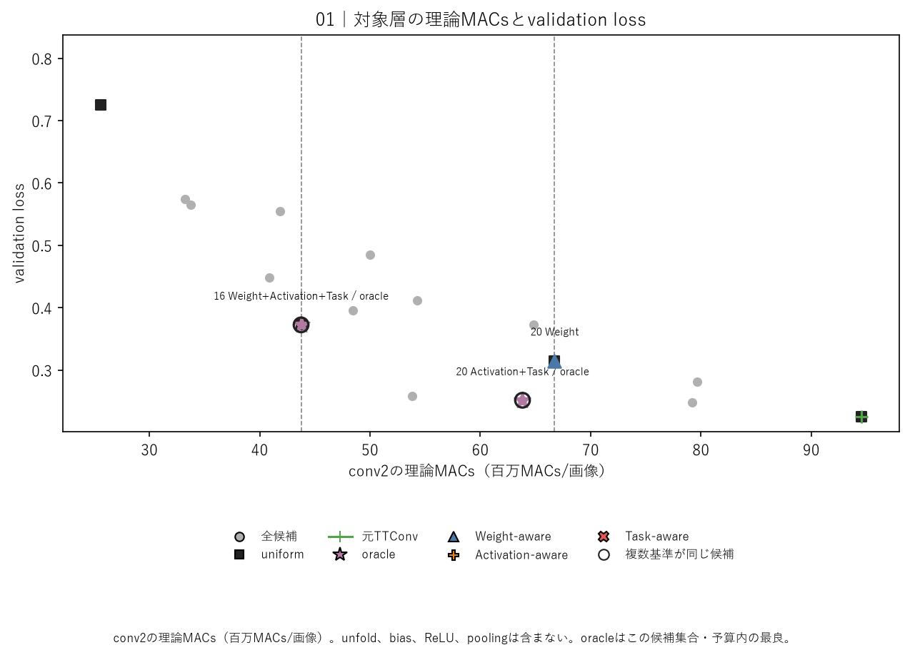
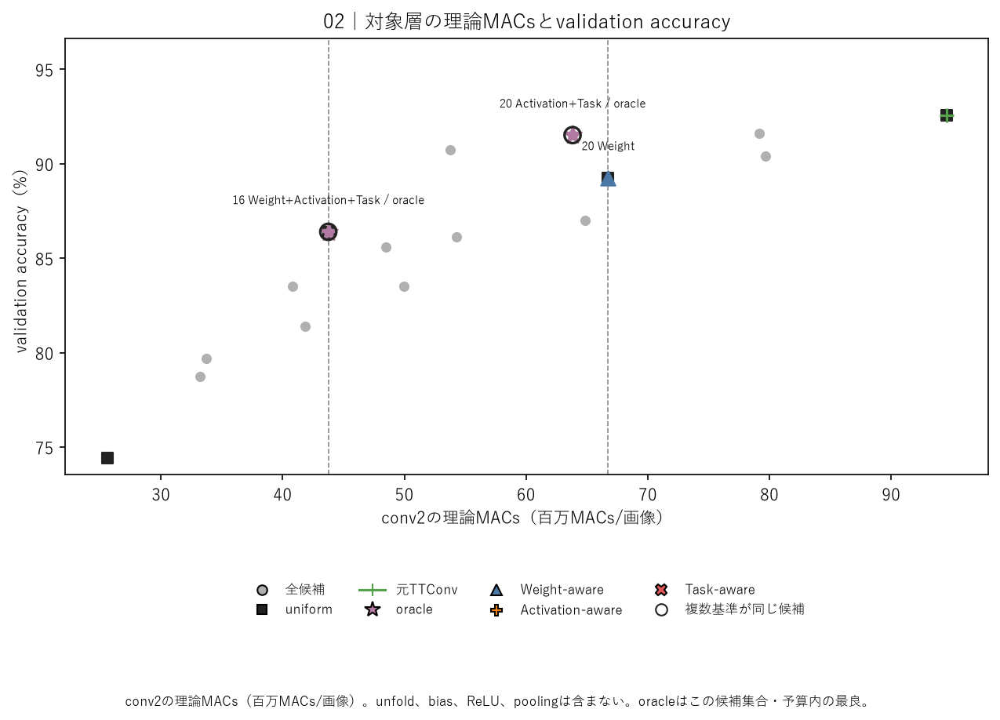
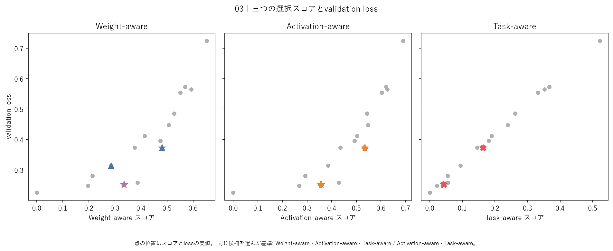
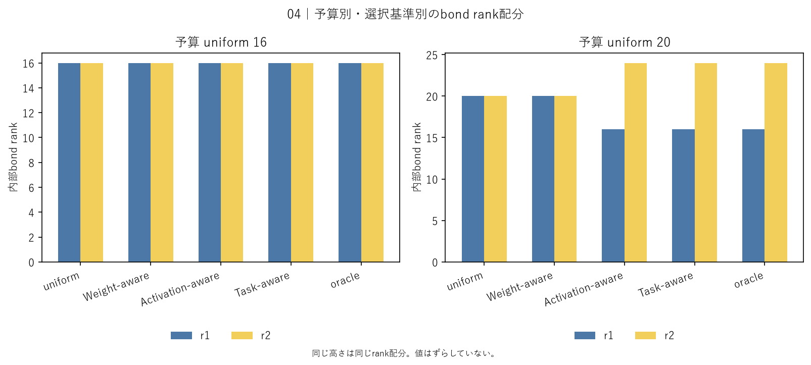

# 学習済みTTConvの事後非一様rank配分と選択基準比較

## このノートの役割

本ノートは、CNN DMRG系列Notebook 00で、学習済みFashion-MNIST CNNの`conv2`を追加学習なしで事後rank削減し、三つの基準でrank配分を選んだ結果と考察をまとめる。

- Notebook：`notebooks/40_dmrg/20_fashion_mnist_cnn/00_posthoc_nonuniform_ttconv_rank_allocation_criteria.ipynb`
- 結果：`results/40_dmrg/20_fashion_mnist_cnn/00_posthoc_nonuniform_ttconv_rank_allocation_criteria/`
- source checkpoint：`models/30_tt_mps/20_fashion_mnist_cnn/04_pretrained_cnn_conv2_tt_cores_only_finetuning/rank_24_selected.pt`
- 前段：[[40_TT_MPS_NN圧縮/20_FashionMNIST_CNN/04_conv2_TT-cores-only_fine-tuning]]
- MLP側の対応実験：[[40_TT_MPS_NN圧縮/10_FashionMNIST_MLP/20_非一様bond_rank配分と選択基準比較]]

中心的な問いは次である。

> 学習済みTTConvを同じ理論MACs予算以下へ削減するとき、重み、実入力に対する層出力、分類lossのどれを使えば、分類性能を保ちやすいbond rank配分を選べるか。

これはCNNやTTConvを新規学習する実験でも、CNNをDMRG-likeに学習する実験でもない。学習済みsourceから候補を作り、削減直後の性能を診断する実験である。

---

## 1. sourceモデルとfine-tuningの位置づけ

sourceはCNN系列Notebook 04でTT cores-only fine-tuningしたrank 24モデルである。

```text
core 1 -- rank 24 -- core 2 -- rank 24 -- core 3
```

sourceのactual ranksは$(1,24,24,1)$、選択epochは9である。`conv2.bias`、`conv1`、全結合層は候補生成時に変更しない。

「Notebook 00ではfine-tuningなし」という記述は、次の二段階を区別して読む。

1. sourceを作る段階では、Notebook 04でfine-tuning済み。
2. sourceから$(20,20)$や$(16,24)$へ削減した後は、fine-tuningしていない。

したがって、本実験は「fine-tuning済みrank 24 TTConvを出発点として、削減後の追加学習なしで選択基準を比較した事後圧縮」である。候補のaccuracyは、削減後に再学習して回復した値ではない。

---

## 2. 実験設計

### 2.1 候補集合

二つの内部bond rankを、それぞれ

$$
r_1,r_2\in\{12,16,20,24\}
$$

から選ぶ。候補数は、

$$
4^2=16
$$

である。外側rank 1を含む完全なrank列は$(1,r_1,r_2,1)$である。

### 2.2 費用予算

候補選択には、uniform rank 16とuniform rank 20の`conv2`理論MACsを上限として使う。

| 予算 | `conv2`理論MACs上限 | 実行可能候補数 |
|---|---:|---:|
| uniform rank 16相当 | 43,753,472 | 6 |
| uniform rank 20相当 | 66,734,080 | 13 |

rankの和ではなく、direct TTConv縮約に基づく理論MACsで制約する。各bond rankは異なる縮約項へ入るため、同じrankの組でも配置によって費用は同じとは限らない。

### 2.3 三つの選択基準

| 基準 | 候補について測るもの | 使用情報 |
|---|---|---|
| Weight-aware | sourceと候補の実効`conv2`重みの相対Frobenius誤差 | 重み |
| Activation-aware | 同じcalibration入力に対する`conv2` ReLU前出力の相対L2誤差 | 入力、層出力 |
| Task-aware | sourceからのcalibration cross-entropy増加 | 入力、正解ラベル、CNN全体 |

候補選択にはtraining split由来のcalibration 5,000件を使い、選択後の答え合わせには別のrank-selection validation 5,000件を使う。oracleは、各予算内・今回の候補集合内でvalidation lossが最小の候補であり、実運用時に使う選択基準ではない。

### 2.4 候補生成順序

主解析ではbond 1からbond 2の順に逐次切り詰める。各切り詰め結果を次の処理へ引き継ぐため、最終rank列だけで候補が一意に決まるとは限らない。選択候補については逆順controlも行った。

---

## 3. 保存結果の確認範囲

`summary.json`と保存CSVでは次を確認した。

| 項目 | 結果 |
|---|---|
| 実行mode | `main` |
| 完了状態 | `complete` |
| 候補数 | 16 |
| 記録実行時間 | 約36.69秒 |
| 候補削減後fine-tuning | なし |
| test評価 | なし |

主な保存成果物の役割は次である。

| 成果物 | 内容 |
|---|---|
| `calibration_metrics.csv` | 16候補のrank、三スコア、費用 |
| `validation_metrics.csv` | 16候補のvalidation loss・accuracy |
| `selection.csv` | 予算・基準ごとに選んだ候補 |
| `comparison.csv` | source、uniform、選択候補、oracleの比較 |
| `oracle_regret.csv` | 選択候補と候補集合内oracleとの差 |
| `spearman.csv` | 各スコアとvalidation lossの順位相関 |
| `reverse_order_control.csv` | 選択候補を逆順で生成したcontrol |
| `control_verification.json` | no-cut controlの数値一致 |
| `summary.json` | 完了状態、候補数、実行時間 |

---

## 4. 図の全候補対応表

図1〜3では全点へrankを直接表示していないため、次の表を点の索引とする。値は`calibration_metrics.csv`と`validation_metrics.csv`を`candidate_id`で対応付けたものである。各行が図中の1点に対応する。

| rank列 | `conv2` MACs | Weight | Activation | Task | validation loss | accuracy |
|---|---:|---:|---:|---:|---:|---:|
| $(1,12,12,1)$ | 25,589,760 | 0.650 | 0.690 | 0.520 | 0.720 | 74.44% |
| $(1,12,16,1)$ | 33,216,512 | 0.570 | 0.620 | 0.370 | 0.570 | 78.76% |
| $(1,16,12,1)$ | 33,718,272 | 0.590 | 0.630 | 0.350 | 0.570 | 79.68% |
| $(1,12,20,1)$ | 40,843,264 | 0.510 | 0.550 | 0.240 | 0.450 | 83.50% |
| $(1,20,12,1)$ | 41,846,784 | 0.550 | 0.600 | 0.330 | 0.550 | 81.38% |
| $(1,16,16,1)$ | 43,753,472 | 0.481 | 0.534 | 0.163 | 0.372429 | 86.40% |
| $(1,12,24,1)$ | 48,470,016 | 0.470 | 0.490 | 0.180 | 0.400 | 85.60% |
| $(1,24,12,1)$ | 49,975,296 | 0.530 | 0.540 | 0.260 | 0.490 | 83.52% |
| $(1,16,20,1)$ | 53,788,672 | 0.390 | 0.430 | 0.060 | 0.260 | 90.76% |
| $(1,20,16,1)$ | 54,290,432 | 0.410 | 0.500 | 0.190 | 0.410 | 86.12% |
| $(1,16,24,1)$ | 63,823,872 | 0.334 | 0.357 | 0.042 | 0.251563 | 91.52% |
| $(1,24,16,1)$ | 64,827,392 | 0.380 | 0.440 | 0.150 | 0.37326 | 87.00% |
| $(1,20,20,1)$ | 66,734,080 | 0.285 | 0.385 | 0.094 | 0.314927 | 89.26% |
| $(1,20,24,1)$ | 79,177,728 | 0.200 | 0.270 | 0.020 | 0.250 | 91.62% |
| $(1,24,20,1)$ | 79,679,488 | 0.210 | 0.290 | 0.050 | 0.280 | 90.40% |
| $(1,24,24,1)$ | 94,531,584 | 0 | 0 | 0 | 0.225673 | 92.56% |

一部のスコアとlossは読みやすさのため丸めている。厳密値や点の逆引きには、`candidate_id`をキーとして元CSVを使う。

---

## 5. 四つの図と結果

### 5.1 `conv2`理論MACsとvalidation loss



横軸は対象層`conv2`の理論MACs、縦軸はvalidation lossで、左下ほど費用とlossの両方が小さい。点を結んだ学習曲線ではなく、各点が異なるrank配分である。

予算16では三基準とも$(16,16)$を選んだ。予算20ではWeightが$(20,20)$、ActivationとTaskが$(16,24)$を選び、後者はより左下に位置した。

### 5.2 `conv2`理論MACsとvalidation accuracy



左上ほど費用が小さくaccuracyが高い。予算20では$(16,24)$が$(20,20)$よりMACsが少なく、accuracyも高かった。一方、sourceの92.56%は完全には維持していない。

### 5.3 三スコアとvalidation loss



三パネルは同じ16候補を異なる横軸で並べている。validation lossは共通で、横位置だけがWeight、Activation、Taskによって変わる。

全16候補におけるSpearman相関は次だった。

| スコア | validation lossとの相関 |
|---|---:|
| Weight | 0.941 |
| Activation | 0.962 |
| Task | 0.994 |

三基準とも候補全体の傾向は捉えているが、予算内最良候補の選択結果は同じではなかった。

### 5.4 選択されたbond rank配分



予算16では三基準とも$(16,16)$である。予算20では、Weightは均等な$(20,20)$、ActivationとTaskは非一様な$(16,24)$を選んだ。棒の高さは性能ではなく、各bondに残したrankを表す。

---

## 6. 選択結果とoracle

| 予算 | 基準 | 選択rank | validation loss | accuracy | oracle regret | 予算内順位 |
|---|---|---|---:|---:|---:|---:|
| rank 16相当 | Weight | $(16,16)$ | 0.372429 | 86.40% | 0 | 1 |
| 同上 | Activation | $(16,16)$ | 0.372429 | 86.40% | 0 | 1 |
| 同上 | Task | $(16,16)$ | 0.372429 | 86.40% | 0 | 1 |
| rank 20相当 | Weight | $(20,20)$ | 0.314927 | 89.26% | 0.063364 | 3 |
| 同上 | Activation | $(16,24)$ | 0.251563 | 91.52% | 0 | 1 |
| 同上 | Task | $(16,24)$ | 0.251563 | 91.52% | 0 | 1 |

予算16では、非一様配分4個を含む6候補から三基準とも同じoracleを選んだ。uniformしか候補になかったため一致したのではない。

予算20では、13候補の中からWeightは3位の$(20,20)$を選び、ActivationとTaskはoracleの$(16,24)$を選んだ。良い候補が候補集合に存在しなかったのではなく、選択基準によって取り逃した結果である。

---

## 7. 実験結果からの考察

### 7.1 重みの再現と分類性能の維持は別

| 指標 | Weight：$(20,20)$ | Activation・Task：$(16,24)$ |
|---|---:|---:|
| 重み相対誤差 | 0.28472 | 0.33432 |
| Activation相対誤差 | 0.38482 | 0.35679 |
| calibration loss増加 | 0.09369 | 0.04229 |
| validation loss | 0.31493 | 0.25156 |
| validation accuracy | 89.26% | 91.52% |

$(16,24)$は重みの数値としてはsourceから遠いが、実入力に対する層出力と分類lossをよく保った。したがってWeightの計算が誤っていたのではなく、重み近似誤差を分類性能の完全な代理指標にできなかった。

### 7.2 高い全体相関と、予算内の最良一点の選択は別

Weightとvalidation lossのSpearman相関も0.941と高い。重み誤差は無意味ではなく、強く重みを変える候補ほどlossが悪化しやすいという大域的傾向を捉えている。

それでも予算20の境界付近では、$(20,20)$と$(16,24)$の順位を取り違えた。候補全体で高い順位相関を持つことと、費用制約内で最良の一点を選べることは別である。選択基準は相関だけでなく、予算内oracle regretでも評価する必要がある。

### 7.3 予算により、選択基準の追加利得が変わった

予算16では三基準が一致し、入力やラベルを追加しても選択結果は改善しなかった。予算20では、評価が逆転する$(16,24)$が実行可能となり、ActivationとTaskだけが選べた。

したがって「Activation・Taskが常に優れる」でも、「低予算では均等配分が一般に最適」でもない。今回の離散候補集合では、選択基準の追加利得が費用予算と実行可能候補に依存した。

### 7.4 ActivationとTaskの一致

ActivationとTaskは両予算で同じ候補を選び、oracle regretも0だった。今回の設定では、ラベルを使わず実入力に対する`conv2`出力を測るだけで、ラベル付き分類lossを使うTaskと同じ選択結果を得た。

したがって、今回確認した改善を「ラベル情報を使った効果」とは説明できない。中心は、重みだけでなく入力分布に対する層の働きを見たことである。ただし、最小候補の一致は全16候補の順位一致や、両基準の一般的同等性を意味しない。

### 7.5 非一様配分とbond位置

予算20では、均等な$(20,20)$より非一様な$(16,24)$の方が少ないMACsで良い性能だった。また、rankを逆に配置した$(24,16)$は、

| 配分 | Activation誤差 | calibration loss増加 | validation loss |
|---|---:|---:|---:|
| $(16,24)$ | 0.35679 | 0.04229 | 0.25156 |
| $(24,16)$ | 0.43517 | 0.14551 | 0.37326 |

となった。rankの組合せだけでなく、どのbondへ残すかが結果に関係した。

ただし、「2本目のbondが一般に重要」「低次・高次特徴に対応する」とは言えない。固定したsource、tensorization、候補生成手順での削減感度の違いである。予算16では一様な$(16,16)$がoracleなので、非一様配分自体が性能を保証するわけでもない。

### 7.6 $(16,24)$は$(20,20)$を測定指標上で支配した

| 指標 | $(20,20)$ | $(16,24)$ |
|---|---:|---:|
| validation loss | 0.314927 | 0.251563 |
| validation accuracy | 89.26% | 91.52% |
| `conv2`理論MACs | 66.73M | 63.82M |
| TTコア要素数 | 10,720 | 10,368 |
| モデル総parameter数 | 413,930 | 413,578 |

$(16,24)$は、性能を得る代わりに費用を増やした候補ではない。今回測定したloss、accuracy、理論MACs、parameter数のすべてで$(20,20)$を上回った。Weightは、より重く性能も低い候補を選んだことになる。

これは実測latencyの優位を意味しない。理論MACsと実行時間は分ける。

### 7.7 sourceから見た圧縮量

| 指標 | source $(24,24)$ | $(16,24)$ | 変化 |
|---|---:|---:|---:|
| validation accuracy | 92.56% | 91.52% | -1.04 points |
| `conv2` parameter数 | 15,232 | 10,432 | 約31.5%減 |
| モデル総parameter数 | 418,378 | 413,578 | 約1.15%減 |
| `conv2`理論MACs | 94.53M | 63.82M | 約32.5%減 |
| モデル総理論MACs | 95.16M | 64.45M | 約32.3%減 |

対象層のparameterは約31.5%減るが、モデル全体のparameter削減は約1.15%にとどまる。一方、`conv2`が理論計算量の大部分を占めるため、モデル総理論MACsも約32.3%減る。

したがって本結果は、モデル保存容量の大幅削減より、accuracyを1.04ポイント失う代わりに理論推論MACsを約32%減らした候補として評価するのが適切である。

### 7.8 切り詰め順序への依存

| 配分 | 主順loss | 逆順loss | 主順accuracy | 逆順accuracy |
|---|---:|---:|---:|---:|
| $(16,16)$ | 0.37243 | 0.39948 | 86.40% | 85.46% |
| $(20,20)$ | 0.31493 | 0.31809 | 89.26% | 89.08% |
| $(16,24)$ | 0.25156 | 0.25156 | 91.52% | 91.52% |

均等配分では順序により重みと性能が変化した。一方、$(16,24)$は実質的に一つのbondだけを削るため、今回の逆順controlではほぼ不変だった。

ただし逆順で全16候補を再採点・再選択したわけではない。逆順でも同じ候補がoracleになることや、三基準が同じ候補を選ぶことは未確認である。

### 7.9 MLPとの接続と比較条件の違い

MLP Notebook 10でも、学習済みTTモデルを追加学習なしで事後削減し、Weight、Activation、Taskを比較した。両実験に共通するのは、「学習済みTT表現からrank配分候補を作り、同じ予算内で選択基準を比較した」ことである。

一方、sourceの来歴は同じではない。

| 実験 | source |
|---|---|
| MLP・通常TT | Adamで学習済みのrank 12モデル |
| MLP・DMRG-like | 局所スイープで学習済みのrank 12モデル |
| CNN 00 | TT cores-only fine-tuning済みrank 24モデル |

さらに、モデル構造、tensorization、コア数、候補rank、予算も異なる。CNN内で三基準を公平に比べるためにMLPとsource学習方法をそろえる必要はないが、MLPとCNNの結果差をarchitectureの因果効果へ帰属することはできない。

現時点では、異なる二つの設定で「重み誤差だけでは分類性能を保つ配分を取り逃す条件があった」という事例の補強として扱う。

---

## 8. 実装controlと結果の限界

### 8.1 no-cut control

元rank維持controlでは、実効weight相対誤差が約$1.36\times10^{-6}$、`conv2`出力最大絶対差が約$8.11\times10^{-6}$、logits最大絶対差が約$7.63\times10^{-6}$で、`passed: true`だった。validation accuracyもsourceと同じ92.56%だった。

### 8.2 今回の範囲

- 3コア・内部bond 2本・16候補の小規模な全列挙である。
- oracleは今回の16候補のうち、各予算内に入った候補に限定される。
- source checkpoint、tensorization、calibration subsetは各1条件である。
- rank-selection validationは今回の選択に使っていないが、研究系列では参照済みの開発用データである。
- 独立testは評価していない。
- 削減後fine-tuningは行っていない。
- 実測latencyとpeak memoryは評価していない。
- 多bondでの探索効率や、候補を全列挙できない場合の探索方法は扱っていない。

小規模だからこそ、選択結果を候補集合内oracleと厳密に照合できた。一方、「大規模な自動rank探索を実現した」「CNN全般でActivationが優れる」とは主張しない。

---

## 9. 言えること・言えないこと

### 9.1 言えること

- 予算16では三基準が同じ均等配分を選び、oracleと一致した。
- 予算20ではActivationとTaskが非一様配分$(16,24)$を選び、Weightの$(20,20)$より良い性能と小さい理論費用を得た。
- Weightも全候補ではvalidation lossと高い順位相関を持ったが、予算内最良候補を取り逃した。
- 今回はラベルなしのActivationでTaskと同じ候補を選べた。
- rankの値だけでなく、bondへの配置と候補生成順序が結果に関係した。
- $(16,24)$はsourceよりaccuracyが1.04ポイント低い一方、モデル総理論MACsを約32.3%削減した。

### 9.2 言えないこと

- ActivationとTaskが一般に同等であること。
- 非一様rank配分が常に一様配分より優れること。
- 2本目のbondがCNN一般で重要であること。
- MLPとCNNの差がarchitectureだけで生じたこと。
- 候補集合外を含む大域的最適rank配分であること。
- 別checkpoint、calibration subset、tensorizationでも選択が再現すること。
- 削減後fine-tuningでも候補間の順位が保たれること。
- 理論MACs削減率と同じ割合で実測推論時間が短くなること。
- 未使用testでも性能差が保たれること。

---

## 10. 結論

fine-tuning済みrank 24 TTConvを出発点として、16個の非一様rank候補を追加学習なしで生成し、Weight-aware、Activation-aware、Task-awareを共通の理論MACs予算内で比較した。

uniform rank 16相当の予算では、三基準とも$(16,16)$を選び、候補集合内oracleと一致した。一方、uniform rank 20相当の予算では、Weightが$(20,20)$、ActivationとTaskが$(16,24)$を選んだ。$(16,24)$は$(20,20)$より重み誤差が大きいにもかかわらず、層出力誤差、calibration loss増加、validation lossが小さく、accuracyも高かった。さらに理論MACsとparameter数も小さく、今回測定した指標では$(20,20)$を支配した。

したがって、今回のTTConvでは、重み再構成誤差だけでは捉えきれないrank配分の差を、実入力に対する層出力の評価によって捉えられた。TaskはActivationと同じ候補を選び、ラベル情報による追加利得は確認されなかった。

選択した$(16,24)$はsourceに対してaccuracyを1.04ポイント失う一方、モデル総理論MACsを約32.3%削減した。ただし、モデル総parameter数の削減は約1.15%である。結果は単一のfine-tuning済みcheckpoint、3コア、固定tensorization、16候補、固定calibration、主切り詰め順序に限定される。MLPでも同種の現象は観測されたが、source学習方法と構造が異なるため、現時点では異なる二事例による補強として扱う。

> 今回の設定では、学習済みTTConvのrank配分を選ぶ際、重みそのものの近さより、実入力に対する層出力の近さを見ることで、同じ費用予算内のより良い候補を選べた。ただし、この選択結果の再現性、削減後fine-tuning、独立test、実測速度、多bondへの拡張は未検証である。
