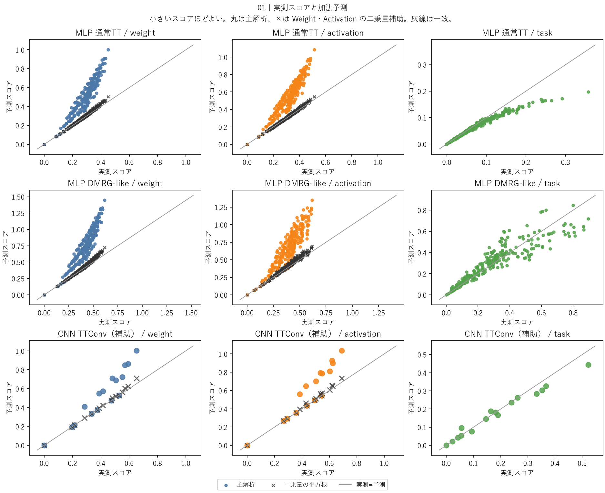
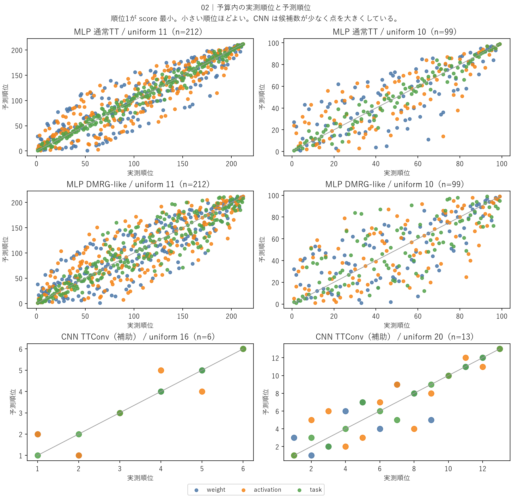
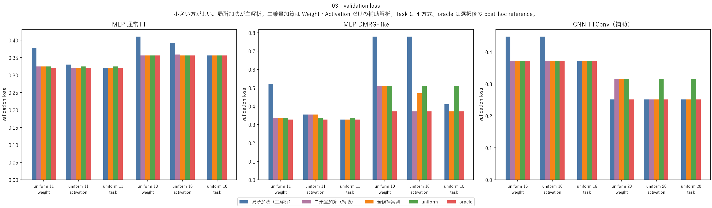
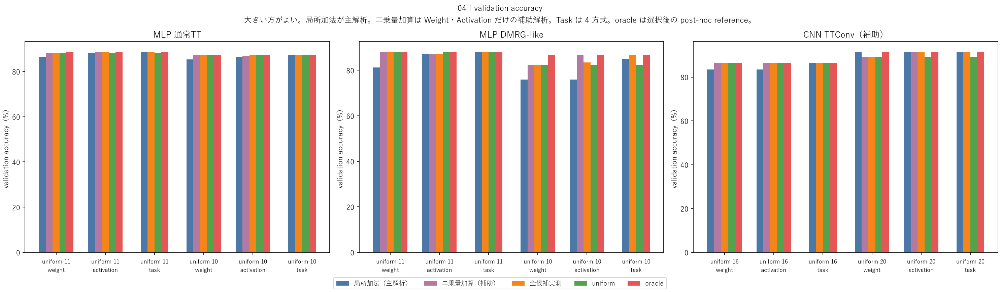
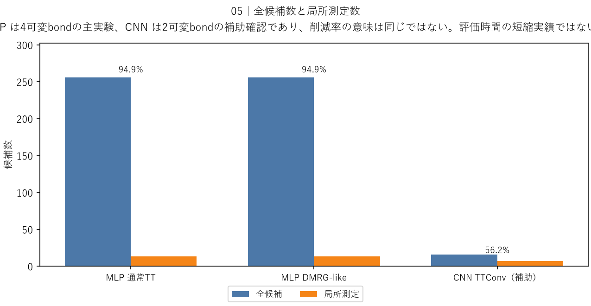

# 単一bond局所感度による複数bond rank配分予測

## このノートの役割

本ノートは、CNN DMRG系列Notebook 01で、元モデルと単一bond削減候補だけを材料に、複数bondを同時に削減したrank配分のスコアを予測した結果と考察をまとめる。

- Notebook：`notebooks/40_dmrg/20_fashion_mnist_cnn/01_local_sensitivity_rank_allocation_diagnostic.ipynb`
- 結果：`results/40_dmrg/20_fashion_mnist_cnn/01_local_sensitivity_rank_allocation_diagnostic/`
- CNN側の前段：[[40_TT_MPS_NN圧縮/20_FashionMNIST_CNN/05_事後非一様TTConv_rank配分と選択基準比較]]
- MLP側の入力実験：[[40_TT_MPS_NN圧縮/10_FashionMNIST_MLP/20_非一様bond_rank配分と選択基準比較]]

中心的な問いは次である。

> 全rank配分を実測しなくても、元モデルと1本ずつbondを削減したときの局所感度から、計算費用制約下で有力な複数bond rank配分を選べるか。

Notebook 00と01の関係は次のとおりである。

| Notebook | 役割 |
|---|---|
| CNN DMRG 00 | 複数bond rankの全16候補を実際に評価し、Weight・Activation・Taskで選ぶ |
| CNN DMRG 01 | 元モデルと単一bond削減候補だけを材料に、複数bond削減候補のスコアを予測し、保存済み全候補結果と照合する |

したがって01は、「1本だけ削って終わる実験」ではない。単一bond削減の測定値を、複数bond配分を選ぶための局所モデルとして利用できるかを診断した実験である。

---

## 1. 実行範囲

01は保存済み結果を読み込んで予測、選択、集計、描画を行った。次の処理は実行していない。

- 新規学習
- 新規forward評価
- calibrationの再計算
- fine-tuning
- test評価
- checkpointの選び直し

`analysis_summary.json`では、`status=complete`、`tables_complete=true`、`figures_complete=true`であり、上記の新規計算フラグはいずれも`false`である。

Notebookの保存値は、`RUN_SMOKE=False`、`RUN_MAIN_EXPERIMENT=False`、`REGENERATE_DISPLAY_ARTIFACTS=False`である。

横軸に使う「実測値」も01で新しくforwardして得た値ではない。MLP Notebook 10およびCNN Notebook 00に保存されていた全候補結果である。01が新しく計算したのは、主に単一bond測定から得る予測値と、それに基づく候補選択である。

---

## 2. 入力sourceと候補数

### 2.1 三つのsource

| source | 役割 | 可変bond数 | 全候補 | 局所測定 |
|---|---|---:|---:|---:|
| MLP 通常TT | 主解析 | 4 | 256 | 13 |
| MLP DMRG-like | 主解析 | 4 | 256 | 13 |
| CNN TTConv | 補助解析 | 2 | 16 | 7 |

MLPでは内部bond 2〜5を、それぞれ`{8, 10, 11, 12}`から選ぶため、全候補は、

$$
4^4=256
$$

である。元rank以外の選択肢は各bondに3個あるので、局所予測に使う測定は、

$$
1+4\times3=13
$$

条件である。

CNNでは二つの内部bondを`{12, 16, 20, 24}`から選ぶ。全候補は、

$$
4^2=16
$$

局所測定は、

$$
1+2\times3=7
$$

条件である。

### 2.2 CNNの具体例

sourceを$(24,24)$とすると、局所測定に使うのは次の7条件である。

```text
source：       (24, 24)
bond 1だけ：  (12, 24), (16, 24), (20, 24)
bond 2だけ：  (24, 12), (24, 16), (24, 20)
```

ここから、例えば$(16,20)$のように両方のbondを削減した候補を予測する。

---

## 3. 予測方法

### 3.1 直接加算

sourceのrank配分を$\mathbf{r}_0$、評価基準を$s$、bond $b$だけを候補rankへ変更した配分を$\mathbf{r}^{(b)}$とする。直接加算の予測値は、

$$
\widehat{s}_{\mathrm{add}}(\mathbf{r})
=
s(\mathbf{r}_0)
+
\sum_b
\left[
s\!\left(\mathbf{r}^{(b)}\right)-s(\mathbf{r}_0)
\right]
$$

である。

CNNの$(24,24)$から$(16,20)$を予測する場合は、

$$
\widehat{s}(16,20)
=
s(24,24)
+\left[s(16,24)-s(24,24)\right]
+\left[s(24,20)-s(24,24)\right]
$$

となる。

これは恒等式ではなく、単独変更の影響が他bondのrankに依存しないと仮定した加法近似である。実測値との差を相互作用残差$I$とすれば、

$$
s(16,20)=\widehat{s}(16,20)+I
$$

$$
I=s(16,20)-s(16,24)-s(24,20)+s(24,24)
$$

と書ける。$I=0$は保証されない。

### 3.2 二乗量加算

WeightとActivationは非負の誤差量なので、補助解析として二乗量も加算した。

$$
\widehat{s}_{\mathrm{sq}}(\mathbf{r})
=
\sqrt{
s(\mathbf{r}_0)^2
+
\sum_b
\left[
s\!\left(\mathbf{r}^{(b)}\right)^2-s(\mathbf{r}_0)^2
\right]
}
$$

Task scoreは符号を持つloss差であり、二乗すると改善と悪化の符号を失う。そのためTaskには二乗量版を作っていない。

### 3.3 三つの評価基準

| 基準 | 意味 | 小さいほどよい |
|---|---|---|
| Weight | sourceと候補の実効重み差 | はい |
| Activation | calibration入力に対する層出力差 | はい |
| Task | calibration cross-entropyのsourceからの変化 | はい |

予測したスコアは、uniform rank相当の理論MACs予算を満たす候補内で最小化する。validationは予測方式による選択には使わず、選択後の答え合わせに使う。

---

## 4. 図01：実測スコアと予測スコア



### 4.1 図の読み方

- 横軸：上流実験で保存された全候補の実測スコア
- 縦軸：単一bond削減から計算した予測スコア
- 灰色線：予測と実測が一致する位置
- 色付き丸：直接加算
- 黒い`×`：二乗量加算。WeightとActivationだけ
- 上段：MLP 通常TT
- 中段：MLP DMRG-like
- 下段：CNN TTConv

MLPでは各パネル256候補、CNNでは16候補を描いている。ただしsourceと単一bond削減は予測式の材料そのものである。真に外挿している複数bond削減候補は、MLP各sourceで243候補、CNNで9候補である。

### 4.2 WeightとActivation

三つのsourceで、直接加算は複数bond削減の影響を系統的に過大評価した。MLP通常TTのWeightでは、全候補MAEが、

| 方式 | MAE | RMSE | Spearman相関 |
|---|---:|---:|---:|
| 直接加算 | 0.21297 | 0.24150 | 0.9300 |
| 二乗量加算 | 0.00841 | 0.01205 | 0.9967 |

となり、二乗量加算で大きく改善した。CNNでもWeightのMAEは`0.12047`から`0.01424`へ、Activationは`0.13913`から`0.01563`へ改善した。

したがって、単独削減情報そのものが無効だったのではなく、非負の誤差量をそのまま足す方法が今回の複数削減に合わなかったと読める。

ただし、二乗量加算の改善を誤差ベクトルの直交性の証明とは扱わない。01では誤差同士の内積を測っておらず、二乗量加算は今回の候補集合に対する経験的な補正である。

### 4.3 Task

Task直接加算の全候補Spearman相関は、通常TT MLPで約`0.995`、DMRG-like MLPで約`0.950`、CNNで約`0.985`だった。

通常TTでは候補順位をよく再現した。一方、DMRG-likeでは大まかな傾向は捉えるものの散らばりが増えた。CNNも比較的よく並ぶが、2 bond・16候補の補助確認であり、多bond CNNへの一般化根拠にはならない。

---

## 5. 図02：計算予算内の順位



図01の全体相関が高くても、予算内の上位候補の順序を外せば選択は変わる。図02は、予算内で実測スコア順位と予測スコア順位が一致したかを示す。

DMRG-like MLPのTask直接加算では、

| 予算 | 予算内Spearman相関 | 全候補実測方式との選択 |
|---|---:|---|
| uniform rank 11相当 | 約0.918 | 一致 |
| uniform rank 10相当 | 約0.753 | 不一致 |

となった。同じsourceと方式でも、費用予算によって成立範囲が変わった。

ただし通常TTでは両予算でTask選択が一致しているため、「予算を厳しくすると必ず失敗する」「DMRG-likeだから失敗した」とは言えない。

---

## 6. 選択一致の集計

### 6.1 全6条件

MLP 2 sourceとCNN、各2予算の6条件をまとめると次のとおりである。

| 方式 | 基準 | 全候補実測方式との一致 | 平均score regret | 最大score regret |
|---|---|---:|---:|---:|
| 直接加算 | Weight | 0/6 | 0.05483 | 0.10892 |
| 直接加算 | Activation | 2/6 | 0.02585 | 0.06105 |
| 直接加算 | Task | 5/6 | 0.00813 | 0.04878 |
| 二乗量加算 | Weight | 6/6 | 0.00000 | 0.00000 |
| 二乗量加算 | Activation | 4/6 | 0.00177 | 0.00556 |

`score regret`は、予測方式が選んだ候補の実測代理スコアと、同じ予算内で全候補を実測した場合の最小代理スコアとの差である。0なら、その代理基準について全候補実測方式と同等の最小値を選んでいる。

この6条件は独立seedによる6回の再現実験ではない。異なるsourceと予算に対する記述的集計であり、成功確率とは解釈しない。

### 6.2 主解析のMLP 4条件

| 基準 | 直接加算 | 二乗量加算 |
|---|---:|---:|
| Weight | 0/4 | 4/4 |
| Activation | 1/4 | 2/4 |
| Task | 3/4 | 対象外 |

Task直接加算が一致した3条件では、選んだ候補がvalidation-loss oracleにも一致した。したがって、単一bond削減の13条件だけから、256候補の全実測を選択材料にしなくても有力候補を選べた場合があった。

---

## 7. 図03・04：選択後のvalidation性能





### 7.1 スコア選択の再現とvalidation性能は別

評価すべき問いは二つある。

1. 少数測定から、各基準の全候補実測選択を再現できたか。
2. その候補のvalidation性能はUniformやoracleに対して良かったか。

全候補実測方式もWeight・Activation・Taskという代理指標で選ぶ方式であり、validation性能の正解ではない。そのため、全候補実測方式を再現してもvalidation oracleになるとは限らず、逆に再現を外してもvalidationでは良い候補を選ぶことがある。

### 7.2 Weight二乗量

MLPではWeight二乗量が4条件すべてで全候補実測Weight選択を再現した。しかし、4条件すべてで選択はUniformだった。

これは「13条件で256候補を実測したWeight方式を再現した」という結果であり、「非一様配分でUniformより良くなった」という結果ではない。

### 7.3 Activation二乗量

DMRG-like MLP・uniform rank 10予算では、Activation二乗量は全候補実測Activationとは異なる候補を選んだ。

| 選択方法 | validation loss | validation accuracy |
|---|---:|---:|
| Activation二乗量 | 0.37189 | 0.8672 |
| Activation全候補実測 | 0.47142 | 0.8416 |
| Uniform rank 10 | 0.51063 | 0.8236 |

Activation二乗量が選んだ$(11,11,10,8)$はvalidation oracleに一致した。代理指標の再現を外しても、validation性能では良い場合があることを示す。

### 7.4 CNN uniform rank 20相当予算

CNNでも同じ区別が必要である。

| 方法 | 選択rank | validation loss | validation accuracy | oracle一致 |
|---|---|---:|---:|---|
| Weight直接加算 | $(16,24)$ | 0.25156 | 0.9152 | はい |
| Weight二乗量 | $(20,20)$ | 0.31493 | 0.8926 | いいえ |
| Weight全候補実測 | $(20,20)$ | 0.31493 | 0.8926 | いいえ |
| validation oracle | $(16,24)$ | 0.25156 | 0.9152 | - |

Weight二乗量はWeight基準の選択を正しく再現したが、Weight基準自体がvalidation oracleを選んでいない。直接加算はWeight基準の再現には失敗したが、結果的にvalidation oracleを選んだ。

したがって、「予測方式として正確」と「分類性能のよい候補を選ぶ」は同義ではない。

### 7.5 accuracy図のoracle

図04のoracleはaccuracy最大候補ではなく、図03でvalidation lossが最小だった候補のaccuracyである。loss最小候補とaccuracy最大候補を混同しない。

---

## 8. 図05：評価候補数



| source | 全候補実測 | 局所測定 | 候補数削減率 |
|---|---:|---:|---:|
| MLP 通常TT | 256 | 13 | 94.92% |
| MLP DMRG-like | 256 | 13 | 94.92% |
| CNN TTConv | 16 | 7 | 56.25% |

直接加算と二乗量加算は同じ局所測定を利用するため、必要な測定候補数は同じである。

ただし、これは「今回の実験全体で256回の評価を13回へ削減した」という実績ではない。今回は保存済みの全候補結果を答え合わせに使用している。また、上流CSVの`seconds`は候補記録までの経過時間であり、局所方式のオンライン実行時間ではない。

したがって言えるのは、

> 局所予測が機能する条件では、配分選択に入力するモデル評価数を減らせる可能性がある。

までである。実時間短縮率、候補列挙・集計の費用、多bondでのスケーラビリティは未検証である。

---

## 9. 結果からの考察

### 9.1 単一bond情報は配分選択に利用できる場合がある

主解析のMLPでは、Task直接加算が4条件中3条件で全候補実測Task選択と一致し、その3条件ではvalidation oracleにも一致した。

したがって、全候補を実測しなくても、単一bond削減の情報から有力なrank配分を選べる場合があった。

ただし、4条件は独立seedによる反復ではないため、「成功率75%」とは一般化しない。

### 9.2 組み合わせ方が重要だった

Weight・Activationの直接加算は、三つのsourceに共通して過大予測した。二乗量加算で予測誤差と選択一致が改善したため、局所情報の有無だけでなく、その集約方法が重要だった。

一方、二乗量加算が改善した原因は未特定である。誤差の直交性、相関、重複、相殺のどれが支配的だったかは01では分からない。

### 9.3 代理指標の再現とタスク性能を分ける

Weight二乗量のように全候補実測方式を正確に再現しても、Uniformを超えない場合がある。逆に、DMRG-likeのActivation二乗量やCNNのWeight直接加算のように、代理指標の選択を外してもvalidation oracleを選ぶ場合がある。

したがって、候補選択法は少なくとも次の二軸で評価する。

- 代理スコアの予測・選択再現性
- 選択候補のvalidation性能

### 9.4 sourceと費用予算に依存する

通常TT、DMRG-like、CNNで予測誤差と選択一致は異なった。同一sourceでも費用予算を変えると候補集合が変わり、DMRG-likeのTask直接加算のように選択成否も変わった。

この結果から、「DMRG-likeだから相互作用が強い」「厳しい圧縮なら必ず失敗する」と原因を断定することはできない。

### 9.5 評価数削減と高速化は別

候補数の式だけを見れば、可変bond数$B$、各bondのrank候補数$K$に対して、

$$
K^B
$$

の全候補実測を、局所測定では、

$$
1+B(K-1)
$$

へ置き換える構成である。$B$が増えるほど候補数上の利点は大きい。

しかし、実測時間、データ転送、候補生成、集計、再利用可能性を測っていないため、候補数削減率をそのまま高速化率として扱わない。

---

## 10. 追加考察

### 10.1 二乗量加算は探索的な補正仮説

二乗量加算は、直接加算の系統的過大予測を確認した候補集合に対して比較した補助解析である。今回の保存済み候補では有効だったが、独立した新しいモデルや候補集合で、方式を事前固定して検証した結果ではない。

したがって、

> 二乗量加算は一般に正しい。

とは言えない。今回の候補集合で有効だった探索的な補正方法であり、Phase Bや別モデルで使うなら、予測式、基準、予算、同点処理を結果を見る前に固定する必要がある。

### 10.2 候補選択の安定性は上位候補間のmarginに依存する

MAEやSpearman相関が良くても、予算内の1位と2位が僅差なら、小さな予測誤差で選択候補が入れ替わる。一方、上位差が予測誤差より十分大きければ、数値予測が完全でなくても選択は安定する。

したがって、選択法としての頑健性を見るには、次を合わせて評価する必要がある。

1. 予測誤差
2. 実測スコアの1位と2位の差
3. 予測スコアの1位と2位の差
4. その差に対する順位反転の可能性

01ではcandidate matchとoracle regretは保存しているが、全条件についてselection marginを主結果として整理していない。これは新しい学習やforwardをせず、既存候補CSVだけで追加できる診断である。

### 10.3 局所モデルの外挿距離

単一bond測定はsource近傍の軸方向の情報である。変更bond数が多い候補、各bondの削減量が大きい候補、より厳しい費用予算の候補ほどsourceから遠くなり、高次のbond間相互作用を無視する影響が増える可能性がある。

実際、DMRG-like MLPのTask直接加算では、MAEが全候補の`0.05639`から、uniform rank 10予算内では`0.09759`へ増えた。ただし、この1例だけから誤差が距離に対して単調増加するとは言えない。

したがって01の局所予測は、

> source周辺で測った単一bond感度を、複数bond削減候補へ外挿する近似。

と位置づける。今後、既存CSVを使って`changed_bond_count`、総rank削減量、費用削減量ごとに残差を層別化すれば、適用範囲をさらに明確にできる。

### 10.4 Task直接加算の成功も一般保証ではない

Task scoreは符号付きloss差なので、各bondの改善と悪化を代数的に相殺できる。この点では非負のWeight・Activation誤差を直接足すより加算と相性がよい可能性がある。

ただしcross-entropyと後段ネットワークは非線形であり、bond間相互作用は残る。DMRG-likeのuniform rank 10で選択を外したことからも、Task scoreなら常に加法的とは言えない。

### 10.5 三つのsourceを一つの母集団として扱わない

MLPとCNNでは、bond数、候補数、rank候補、費用軸が異なる。

- MLP：`theoretical_total_macs`、4 bond、256候補
- CNN：`conv2_theoretical_macs`、2 bond、16候補

また、CNNは補助解析であり、多bond CNNの確認ではない。したがって全6条件の一致数は比較用の記述であり、モデル横断の成功率や統計的な一般化性能ではない。

---

## 11. 来歴と確認限界

### 11.1 確認できたこと

- 三つのsourceで候補数、rank列の重複なし、bond順、費用、スコア、validation値の有限性を確認した。
- CNNでは保存された`ranks`と`actual_ranks`が一致した。
- 選択にvalidationを使っていない。
- testを使っていない。

### 11.2 MLP側に残る未確認事項

MLP上流結果について、01は次を再検証していない。

- validation indexの整数列と実データの再照合
- Weight・Activation・Taskの定義文字列と実装の再照合
- 各候補のrequested rankとactual rankの一致
- checkpointを開き直した再評価

したがって、01は保存済み候補表に対する整合的な診断であり、上流実験の完全な来歴監査ではない。この制約はMLPとCNNを横断して一般化するときに明記する。

---

## 12. 言えること・言えないこと

### 言えること

- 単一bond削減の少数測定から、有力な複数bond rank配分を選べる条件があった。
- Weight・Activationの直接加算には系統的な過大予測があり、二乗量加算で改善した。
- Task直接加算は主解析MLPの4条件中3条件で、全候補実測選択とvalidation oracleに一致した。
- 予測方式の再現性と、選択候補のvalidation性能は別である。
- 有効性はsource、評価基準、集約方式、費用予算に依存した。
- 必要な入力測定候補数を減らせる可能性がある。

### 言えないこと

- 二乗量加算が一般に正しい。
- 誤差成分が直交している。
- Task直接加算が未知モデルでも高確率で成功する。
- CNNでも多bond化したときに同じ精度で予測できる。
- 候補数削減率と同じ割合で実時間が短縮する。
- 代理スコアを正確に再現すれば、必ずvalidation最良候補を選べる。
- 今回の6条件から統計的成功率を推定できる。

---

## 13. 結論

今回の結果では、単一bond削減の局所感度から、計算費用制約下の複数bond rank配分を選択できる条件が確認された。特にTask直接加算は、主解析MLPの4条件中3条件で全候補実測選択とvalidation oracleに一致した。

一方、Weight・Activationでは単純加算が複数削減の影響を過大評価し、二乗量加算で予測誤差と選択一致が改善した。ただし二乗量加算は今回の候補を見た後に比較した探索的補正であり、一般的な正当性は未検証である。

さらに、代理スコアの予測・選択を再現することと、validation性能のよい候補を選ぶことは別だった。有効性はsourceと費用予算に依存し、上位候補のselection marginやsourceからの外挿距離も選択の安定性に関係する可能性がある。

したがってNotebook 01の到達点は、

> 全候補実測を局所測定へ置き換えられる可能性と、その成立条件・失敗条件を、保存済み候補集合上で診断した。

ことである。Phase Bへ進む場合は、方式を事前に固定し、独立した対象で候補選択精度と実時間削減を検証する必要がある。

---

## 14. Phase Bへ進む場合の未決事項

01はPhase Bへ持ち込む方式を自動選択していない。保存結果上も`phase_b_method_automatically_selected=false`である。

現時点の候補は次の二系統である。

1. **Task直接加算**
   - 全6条件中5条件、主解析MLPでは4条件中3条件で全候補実測Task選択と一致した。
   - ラベルとモデル全体のloss計算が必要である。
   - DMRG-likeの厳しい予算では選択を外した。
2. **Weight・Activation二乗量加算**
   - 直接加算より予測誤差と選択一致が改善した。
   - Taskには二乗量版がないため、同じ定義でTaskと優劣比較した結果ではない。
   - Weight選択を再現してもvalidation改善につながらない条件があった。

Phase Bでは、何を示したいかに応じて、基準、予測式、費用予算、同点処理を事前に固定する。01の結果を見ながら都合のよい方式へ切り替えると、独立検証にならない。

---

## 15. 保存成果物

| ファイル | 内容 |
|---|---|
| `analysis_summary.json` | 完了状態、実行範囲、選択一致集計、来歴確認状態 |
| `analysis_config.json` | source、候補、予算、予測式の設定 |
| `source_compatibility_audit.csv` | sourceごとの候補集合・来歴監査 |
| `local_sensitivity.csv` | sourceと単一bond削減の局所感度 |
| `additive_predictions.csv` | 全候補の実測・直接加算・二乗量予測 |
| `prediction_diagnostics.csv` | MAE、RMSE、Spearman相関、最大残差 |
| `predicted_selection.csv` | 予測方式ごとの選択候補 |
| `selection_comparison.csv` | 全候補実測、Uniform、oracleとの比較 |
| `evaluation_cost_summary.csv` | 全候補数、局所測定数、候補数削減率 |
