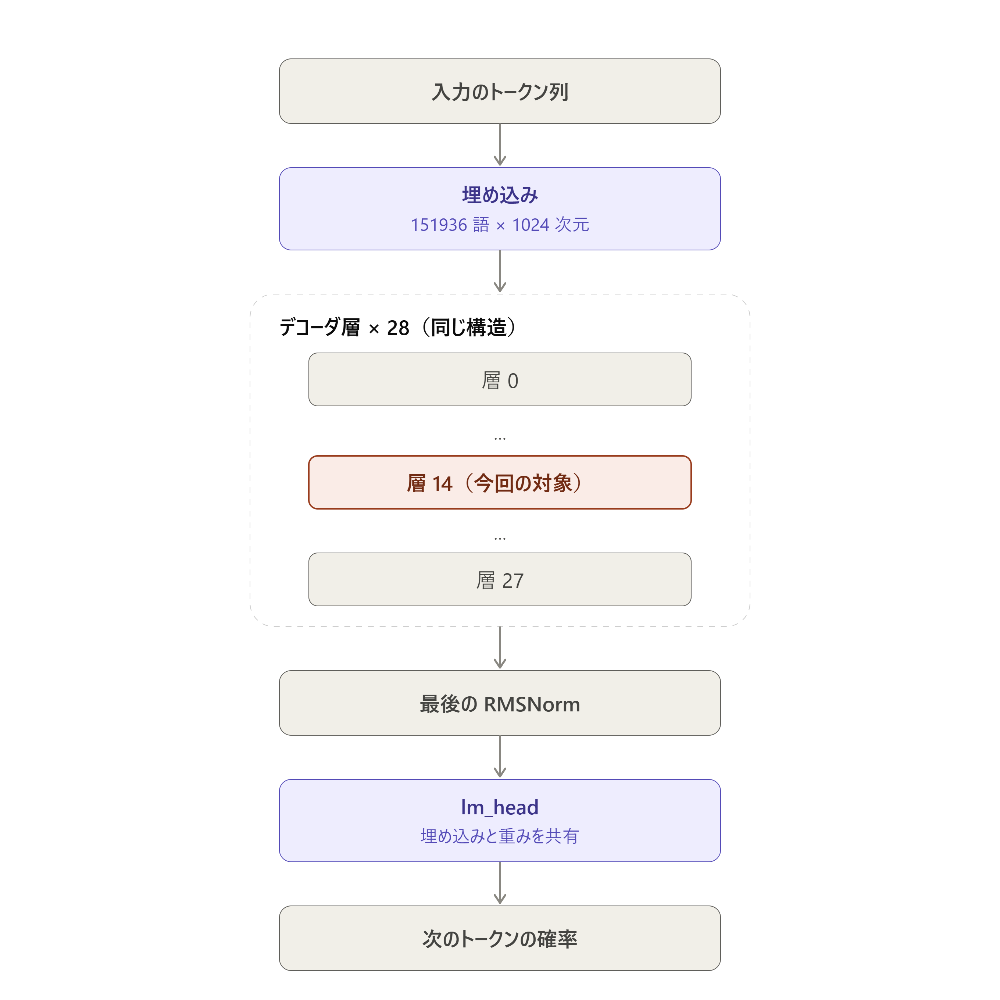
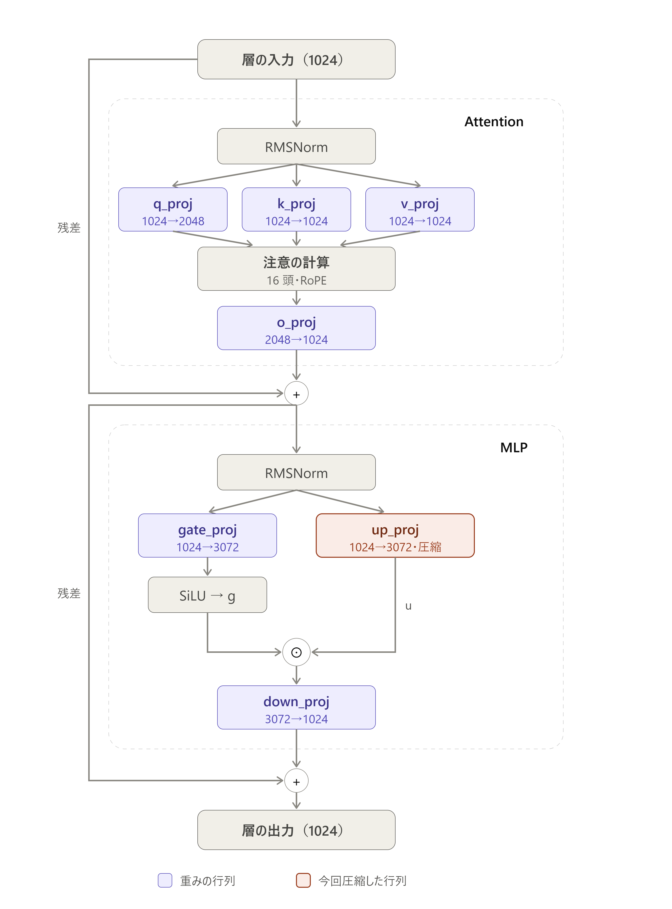
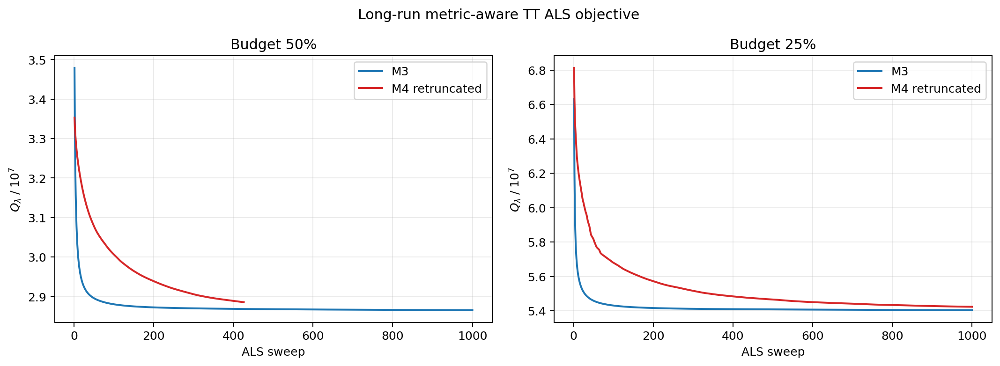
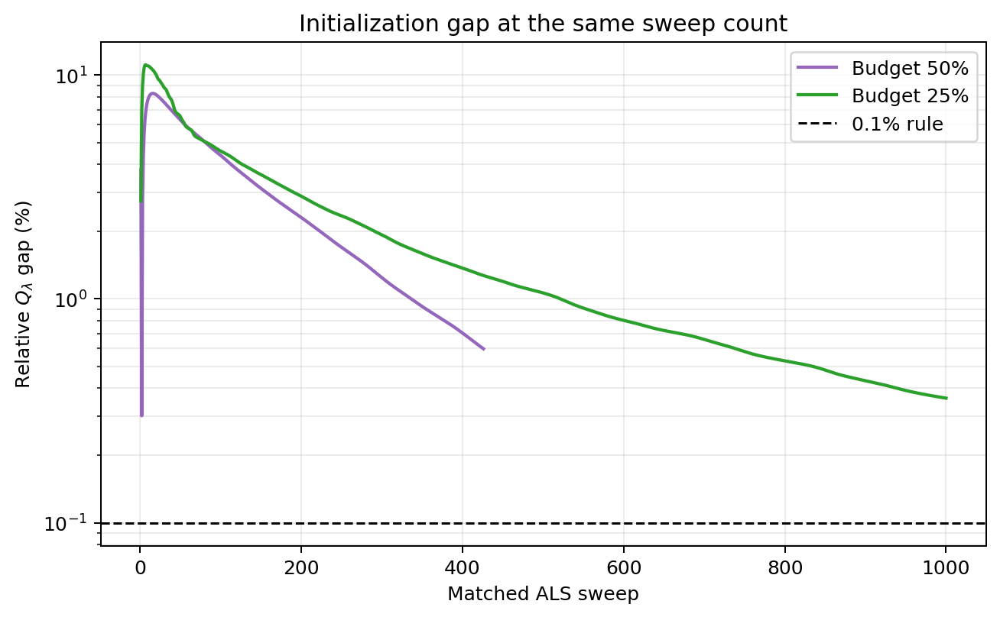
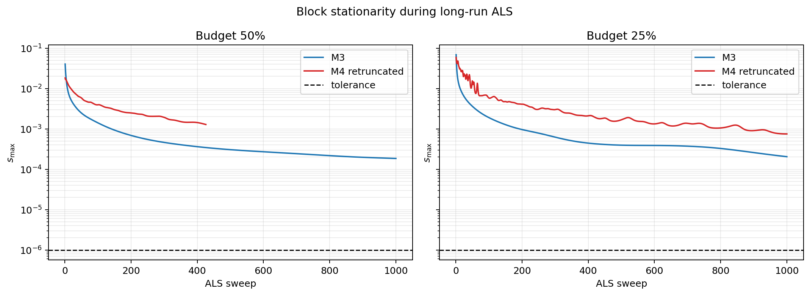
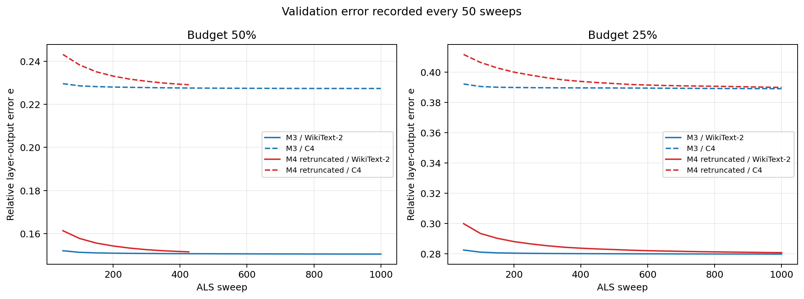

# 長いALSの収束確認と初期値依存

## このノートの役割

本ノートは、Notebook 03でQwen3-0.6B-Baseの1層を対象に、計量付きTT-ALSを最大1,000 sweepまで実行した結果と考察をまとめる。

中心的な問いは次の3点である。

1. Notebook 01の50 sweepでは未収束だったALSが、何sweepで停止条件を満たすか。
2. M3初期値とM4再切り詰め初期値の間にあった約6%の $Q_{\lambda}$ 差が、長く回すと消えるか。
3. 後続実験のsweep上限と停止規則を、実測に基づいて決められるか。

参照先は次である。

- Notebook：`notebooks/50_llm_tt_vs_matrix/10_qwen3_0p6b_base/03_long_als_convergence.ipynb`
- 結果：`results/50_llm_tt_vs_matrix/10_qwen3_0p6b_base/03_long_als_convergence/`
- 設計：`plan/50_llm_tt_vs_matrix/10_qwen3_0p6b_base/03_long_als_convergence/design.md`
- 一般理論：[[00_基礎理論/03_モデル圧縮理論/30_TTLinear圧縮/81_計量付きTT_ALSの局所方程式と停留性]]

---

## 1. 実行状態と検算

Notebookの本実行は完了している。21セルのうちcode cellは実行済みで、保存出力に例外はない。4条件を実行し、次の成果物を保存した。

| 成果物 | 内容 |
|---|---|
| `history.csv` | 4条件のsweep別履歴、合計3,426行 |
| `diagnostics.csv` | 50 sweepごとの較正・検証診断、69行 |
| `comparison.csv` | 初期値間の目的値差、解間距離、50 sweep再現 |
| `rho.csv` | 50 sweep時点と最終時点の$e$、$E_{\mathrm{gated}}$、$\rho$ |
| `decision.json` | 事前固定した規則による予算別判定 |
| `failures.json` | 50%・M4再切り詰めの局所solver失敗1件 |
| `checks.json` | 本実行の単調性と最終目的値再計算 |
| `checks_smoke.json` | 初期値、既存trajectory、再開の検算 |

試運転と本実行では、次を確認した。

- 4条件の初期 $Q_{\lambda}$ はNotebook 01の保存値と相対差 $1.9\times10^{-15}$ 以下で一致した。
- 5 sweepのsolver trajectoryはNotebook 02のGPU版基準とビット単位で一致した。
- 2 sweepで中断して再開した結果は、中断なしの5 sweepと時間以外が一致した。
- 全完了sweepで $Q_{\lambda}$ は単調非増加だった。
- 最終coreからCPU float64で再計算した $Q_{\lambda}$ は、記録値と相対差 $1.4\times10^{-16}$ 以下で一致した。

したがって、以下は未完了runや壊れたcheckpointを混ぜた比較ではない。

### 1.1 Notebook 01の50 sweep結果の再現

長期runの50 sweep時点とNotebook 01の保存値との差は次だった。

| 予算・初期値 | $Q_{\lambda}$の相対差 |
|---|---:|
| 50%・M3 | $1.76\times10^{-8}$ |
| 50%・M4再切り詰め | $9.32\times10^{-5}$ |
| 25%・M3 | $2.52\times10^{-11}$ |
| 25%・M4再切り詰め | $4.00\times10^{-9}$ |

50%・M4再切り詰めだけ差が他より大きいが、約0.0093%である。他の3条件はほぼ同じtrajectoryを再現した。

---

## 2. 対象と固定条件

### 2.1 対象層

- model：Qwen3-0.6B-Base
- layer：`model.layers[14].mlp.up_proj`
- dense weight shape：$3072\times1024$
- tensorization T2
  - output modes：$(2,16,96)$
  - input modes：$(64,8,2)$
  - TT cores：3個

Qwen3-0.6B-Base全体における対象層の位置を次に示す。28個のdecoder層のうち、Notebook 03ではzero-based index 14の層を対象とした。

対象decoder層の内部では、MLPの`up_proj`だけを圧縮した。Attentionの4行列、`gate_proj`、`down_proj`およびその他の層の重みは変更していない。

本Notebookは単層の重み近似実験である。Qwen3全体のperplexityやdownstream taskは評価していない。

### 2.2 予算

50%と25%は、dense weightのparameter数 $3072\times1024=3,145,728$ に対する保存parameter上限である。

| 予算 | 意味 | parameter上限 | T2 ranks | TT core要素数 |
|---|---|---:|---|---:|
| 50% | 2倍圧縮 | 1,572,864 | $(1,109,109,1)$ | 1,555,648 |
| 25% | 4倍圧縮 | 786,432 | $(1,77,77,1)$ | 783,552 |

同じparameter数を厳密に使い切る条件ではなく、同じ上限予算内で選んだrankである。

### 2.3 データと計量

- calibration：WikiText-103 train、128系列、各1,024 token
- same-domain validation：WikiText-2 validation
- other-domain validation：C4
- 計量：入力Gram行列に小さい正則化を加えた $G_{\lambda}$
- 正則化係数：$\lambda=10^{-6}$

目的関数は、

$$
Q_{\lambda}
=
\operatorname{tr}\left[
(W-\widehat W)
G_{\lambda}
(W-\widehat W)^{\mathsf T}
\right]
$$

である。

### 2.4 比較した初期値

- M3：dense weightをT2へTT-SVDした初期値
- M4_retruncated：対角近似を経由したM4を、M3と同じTT ranksへ再切り詰めした初期値

「初期値依存」は任意の乱数初期値一般ではなく、この2種類の構造的な初期値の比較を意味する。

---

## 3. 事前固定したsolverと停止規則

| 項目 | 設定 |
|---|---|
| device | GPU |
| solver | float32で解き、float64で反復改良 |
| preconditioner | Jacobi |
| 局所CG相対残差 | $10^{-8}$ |
| CG上限 | 500 iteration |
| 通常の反復改良上限 | 5 |
| 解き直し時の反復改良上限 | 10 |
| ALS上限 | 1,000 sweep |
| 目的値の相対減少 | $10^{-7}$未満 |
| 連続回数 | 5 sweep |
| block stationarity | $s_{\max}\le10^{-6}$ |
| checkpoint | 50 sweepごと |

`converged`には、目的値の相対減少と $s_{\max}$ の両方を要求した。

局所問題が解き直し後も $10^{-8}$ を満たさない場合は、その候補だけでなく失敗したsweep全体を破棄し、最後に完了したsweepを正式な最終状態とした。

---

## 4. 主結果

| 条件 | 停止理由 | 完了sweep | 最終$Q_{\lambda}$ | 最後の相対減少 | 最後の$s_{\max}$ | 記録sweep時間 |
|---|---|---:|---:|---:|---:|---:|
| 50%・M3 | `max_sweeps` | 1,000 | 28,651,953.43 | $9.19\times10^{-7}$ | $1.85\times10^{-4}$ | 3,749秒 |
| 50%・M4再切り詰め | `local_solver_unresolved` | 426 | 28,853,042.74 | $3.97\times10^{-5}$ | $1.28\times10^{-3}$ | 956秒 |
| 25%・M3 | `max_sweeps` | 1,000 | 54,043,342.21 | $5.50\times10^{-7}$ | $2.04\times10^{-4}$ | 1,248秒 |
| 25%・M4再切り詰め | `max_sweeps` | 1,000 | 54,238,016.38 | $5.38\times10^{-6}$ | $7.50\times10^{-4}$ | 1,701秒 |

記録sweep時間は `history.csv` のsweep処理時間の和である。Notebook全体のwall-clockではなく、50 sweepごとの検証、保存、準備をすべて含む値でもない。また、実行前半には別プロセスとのGPU競合が観測されたため、この表を方式間の速度比較には使わない。

4条件とも $Q_{\lambda}$ は下がり続けた。M3は早い段階で平坦に近づいた一方、M4再切り詰め、特に25%条件は1,000 sweep時点でもM3より速く改善していた。

---

## 5. 初期値差は大幅に縮んだが、消えたとは言えない

同じsweep数で比較した差を、

$$
\delta_Q(t)
=
\frac{
\left|Q_{\mathrm{M3}}(t)-Q_{\mathrm{M4r}}(t)\right|
}{
\min\left(Q_{\mathrm{M3}}(t),Q_{\mathrm{M4r}}(t)\right)
}
$$

とする。

| 予算 | 50 sweep | 同一sweepで確認できる最終差 | 保存final同士の差 |
|---|---:|---:|---:|
| 50% | 約6.3% | 426 sweepで約0.60% | 0.7018% |
| 25% | 約6.5% | 1,000 sweepで0.3602% | 0.3602% |

50%の保存final同士は、M3が1,000 sweep、M4再切り詰めが426 sweepであり、計算量をそろえた比較ではない。事前の機械判定では保存finalを使うため0.7018%になったが、収束速度を見る考察では同じ426 sweep同士の約0.60%を使う。

50 sweep時点の約6%差の大部分は、M4再切り詰め側の収束が遅かったことによって説明できる。ただし、両初期値が収束した条件はない。したがって、

- 最終的に同じ解へ収束する
- 異なる局所解へ収束する
- 目的値は同じでも異なる重みへ収束する

のどれであるかは決められない。

---

## 6. 停留性の基準は満たされなかった

各sweep終了時に、同じTT状態で全coreの局所方程式残差を測り、

$$
s_k
=
\frac{\|b_k-H_kc_k\|_2}{\|b_k\|_2},
\qquad
s_{\max}=\max_k s_k
$$

を記録した。

終了時の $s_{\max}$ は $1.85\times10^{-4}$ から $1.28\times10^{-3}$ であり、停止基準 $10^{-6}$ の約185倍から1,280倍だった。

50%・M3では、

- 100 sweep：$1.4\times10^{-3}$
- 200 sweep：$6.9\times10^{-4}$
- 400 sweep：$3.6\times10^{-4}$
- 800 sweep：$2.2\times10^{-4}$
- 1,000 sweep：$1.9\times10^{-4}$

と、ゆっくり減少した。

3-coreの更新順序は、

$$
0\rightarrow1\rightarrow2\rightarrow1\rightarrow0
$$

である。sweep終了時にはcore 0を解いた直後なので $s_0$ は小さい。core 2は、その後にcore 1と0が更新されて環境が変わるため、4条件とも主に $s_2$ が $s_{\max}$ を決めた。

これは、各局所問題を高精度で解いても、他のcoreの更新によって先に解いたcoreが再び局所最適点からずれることを示す。

### 6.1 $10^5$ sweepという外挿について

$s_{\max}$が概ねsweep数に反比例している区間だけを使えば、$10^{-6}$へ届くまで非常に多くのsweepが必要と推定できる。ただし、減衰則が将来も保たれる保証はない。したがって、$10^5$ sweepという値は参考外挿であり、実測事実として扱わない。

---

## 7. 50%・M4再切り詰めの局所solver停止

50%・M4再切り詰めは、427 sweep目のsite 1で停止した。

| 項目 | 値 |
|---|---:|
| 最初の局所相対残差 | $1.07\times10^{-7}$ |
| 解き直し後の局所相対残差 | $1.19\times10^{-8}$ |
| 基準 | $1.00\times10^{-8}$ |
| 合計CG iteration | 7,500 |
| 合計反復改良 | 15 |
| 直前の正式$Q_{\lambda}$ | 28,853,042.74 |
| 未採用候補の$Q_{\lambda}$ | 28,853,011.93 |

候補は目的値を約 $1.1\times10^{-6}$ 相対的に下げたが、局所残差基準を満たさなかったため採用しなかった。失敗したsweep内で先に行われた更新も含めてrollbackし、正式なfinalは426 sweep終了時点である。

この停止は、外側ALSが収束したことも、収束しなかったことも意味しない。悪条件な局所問題をfloat32とfloat64反復改良で $10^{-8}$ まで解く際の精度限界と整合するが、単一failureだけから原因を確定はできない。

---

## 8. 実用的にほぼ平坦になった時点

後から得た各runの最終 $Q_{\lambda}$ の0.1%以内へ、初めて入ったsweepは次だった。

| 条件 | 最終値の0.1%以内へ入ったsweep |
|---|---:|
| 50%・M3 | 435 |
| 50%・M4再切り詰め | 403 |
| 25%・M3 | 410 |
| 25%・M4再切り詰め | 876 |

M3の2条件だけを今後の初期値として採用するなら、400〜500 sweepは実用的な上限候補になる。一方、全初期値に共通する上限として400〜500を採用する根拠はない。25%・M4再切り詰めは876 sweep必要だった。

また、この値は最終結果を知った後の診断であり、そのままonline停止規則にはできない。「収束した」ではなく、「今回のrunの最終値に対してほぼ平坦になった」と表現する。

---

## 9. 検証誤差とgap closure

50 sweepごとに、較正データ、同一ドメインのWikiText-2、別ドメインのC4を診断した。

最終診断値は次である。

| 予算・初期値 | 較正$e$ | 較正$\rho$ | WT-2 $e$ | WT-2 $\rho$ | WT-2 $E_{\mathrm{gated}}$ | C4 $e$ | C4 $\rho$ | C4 $E_{\mathrm{gated}}$ |
|---|---:|---:|---:|---:|---:|---:|---:|---:|
| 50%・M3 | 0.1447 | 0.8889 | 0.1505 | 0.8850 | 0.2165 | 0.2274 | 0.8157 | 0.3285 |
| 50%・M4再切り詰め | 0.1457 | 0.8870 | 0.1515 | 0.8831 | 0.2176 | 0.2291 | 0.8120 | 0.3293 |
| 25%・M3 | 0.2730 | 0.8532 | 0.2799 | 0.8487 | 0.4064 | 0.3892 | 0.7738 | 0.5614 |
| 25%・M4再切り詰め | 0.2740 | 0.8517 | 0.2808 | 0.8472 | 0.4084 | 0.3900 | 0.7724 | 0.5624 |

$\rho$は、通常TT-SVDの誤差と、同じ予算での計量付き行列低rank近似の誤差との差のうち、計量付きTTが埋めた割合である。

$$
\rho
=
\frac{e_{\mathrm{M3}}-e_{\mathrm{M5}}}
{e_{\mathrm{M3}}-e_{\mathrm{M2}}}
$$

50 sweepから最終までの $\rho$ の変化は、全条件・全ドメインで0.02以下だった。例えば50%・M3の較正値は、

$$
0.8860\rightarrow0.8889
$$

である。

M3初期値では、50 sweepから最終までの $e$ 改善は約1%だった。M4再切り詰め初期値では6〜7%改善したが、これは50 sweep時点でまだM3へ追いついていなかったためである。

したがって、長期化は初期値間の差を大幅に縮めたが、Notebook 01の「本実験へ進む」というgap closure判定を実質的には変えなかった。

---

## 10. 解の距離

M3から得た重みとM4再切り詰めから得た重みの相対距離は次だった。

| 予算 | Frobenius | $G_{\lambda}$ | $G$ | WT-2 | C4 |
|---|---:|---:|---:|---:|---:|
| 50% | 1.527 | 0.252 | 0.252 | 0.258 | 0.314 |
| 25% | 1.222 | 0.327 | 0.327 | 0.331 | 0.390 |

50%はM3の1,000 sweepと、M4再切り詰めの426 sweepを比べているため、同一sweep比較ではない。

目的値の差が1%未満まで縮んでも、Frobenius距離は元の重みノルムの1.2〜1.5倍に達した。一方、データ計量で測る距離は0.25〜0.39だった。

較正Gram行列は条件数が約 $3\times10^{14}$ で、有効rankは約60だった。したがって、Gram行列の固有値が小さい入力方向では、大きな重み差があっても $Q_{\lambda}$ への寄与が小さい可能性がある。

ただし、

- まだ収束していないため解が離れている
- 目的値がほぼ同じ解が多数存在する
- 小固有値方向に差が集中している

を、このNotebookだけでは分離できない。

---

## 11. 機械判定

事前固定した優先順位は次である。

1. どちらかが `local_solver_unresolved`
2. それ以外で、どちらかが `max_sweeps`
3. 両方が `converged`なら $\delta_Q$ を0.1%と比較

結果は、

| 予算 | 判定 | 理由 |
|---|---|---|
| 50% | `local_solver_unresolved` | M4再切り詰めが局所問題を解けずに停止 |
| 25% | `max_sweeps_unresolved` | 両初期値とも1,000 sweep上限へ到達 |

となった。

どちらも `converged_initialization_dependent` ではないため、事前計画どおり1%摂動runは実行していない。

---

## 12. 実験結果からの考察

### 12.1 「ALSが収束しない」とは言えない

確認できたのは、1,000 sweep以内に事前固定した収束条件を満たさなかったことである。M3も最後まで目的値が相対 $5.5\times10^{-7}$ から $9.2\times10^{-7}$ 下がっていた。

したがって、

- ALSは一般に収束しない
- 目的値はもう下がらない
- rank制約下の限界値へ到達した

とは言えない。

### 12.2 約6%の差の大部分は収束速度差だった

同じsweep数で比べると、約6%の差は0.36〜0.60%まで縮んだ。M4再切り詰めの初期目的値が高く、初期の収束も遅かったことが大きい。

ただし残差が0.1%規則より大きく、両方が収束していないので、初期値依存が消えたとは判定しない。

### 12.3 目的値の改善と検証指標の改善は同じ大きさではない

長期ALSで $Q_{\lambda}$ は改善したが、M3から始めたrunの $e$ と $\rho$ の変化は小さかった。目的値を厳密に詰める計算費用が、研究上の結論を大きく変えるとは限らない。

### 12.4 局所問題を過剰に正確に解いている可能性がある

50%・M4再切り詰めでは、外側の $s_{\max}$ が約 $10^{-3}$ の段階で、内側の局所問題へ $10^{-8}$ を要求して停止した。外側がまだ大きく動く段階で、各局所問題を5桁以上厳しく解く必要があるかは再検討の余地がある。

これは許容誤差を緩めれば同じ解が得られることを示した結果ではない。変更する場合は、目的値trajectoryと最終診断が変わらないかを別に検証する必要がある。

### 12.5 1-site ALSの遅さはcore間の結合と整合する

coreを一つ最適化した後、他のcoreを更新すると環境が変わり、先のcoreが再び最適点からずれる。今回、更新順序の中で早く更新されたcore 2が継続的に最大残差を持ったことは、この機構と整合する。

ただし、細長い谷、小固有値方向、非一意解のどれが支配的かは未検証である。

### 12.6 計算時間はsolver固有の速度比較には使えない

試運転では4条件の完了時間を約6.5時間と見積もり、事前の相談基準5時間を超えたが、設定を変えずに本実行した。実際の記録sweep時間の合計は約2.1時間だった。

50%・M3では、別プロセスがGPUを使用していた区間の1 sweepが約13〜15秒、その使用がなくなった後は約2.2〜2.7秒だった。後半のGPU使用率は約60〜97%、平均70%前後だった。50 sweepごとの検証診断は1回約4〜5秒だった。

したがって、今回の時間差には、rankと局所CG反復数だけでなく、外部GPU競合と診断・同期の影響が混ざっている。03の時間は実行記録として残すが、budget間や初期値間のalgorithmic efficiencyを結論づける値にはしない。

---

## 13. 一般論と、この実験から言えないこと

### 一般論

- 1-site ALSはblock coordinate descentであり、各blockを正確に解いても全体の収束が速いとは限らない。
- 非凸なTT parameterizationでは、block stationarityは大域最適性を保証しない。
- 悪条件なGram行列では、Frobenius距離とデータ計量距離の順位が大きく異なり得る。
- 数学的収束条件と、有限計算予算での実用的な打ち切りは分ける必要がある。

### この実験から言えないこと

- Qwen3の他層でも同じsweep数になること
- T1や別tensorizationでも同じこと
- 別モデル、別calibration data、別正則化係数への一般化
- M3・M4再切り詰め以外の初期値への依存性
- end-to-end perplexityやdownstream task性能が維持されること
- 400〜500 sweepが全条件に十分であること
- float32精度だけが局所solver停止の原因であること

---

## 14. 後続実験へ引き継ぐ判断

03によって、1,000 sweepでも事前の停留条件には届かず、完全収束を待つ設計は現実的でないことが分かった。一方、M3初期値の検証指標は400〜500 sweep以降ほとんど変わらず、Notebook 01のgap closure判定も変わらなかった。

後続実験では、次を事前に固定する必要がある。

1. M3だけを使うのか、複数初期値を残すのか。
2. sweep上限で打ち切るのか、目的値の相対減少を使うのか。
3. 「収束」ではなく「打ち切り」と明記するか。
4. 局所CG許容誤差を外側の停留性に合わせるか。
5. 1-site ALS以外の方法を比較する必要があるか。

03だけから推奨設定を確定はしない。確定できたのは、以前の50 sweepでは短すぎたことと、1,000 sweepでも数学的収束には届かなかったことの両方である。

---

## 15. 結論

Notebook 03の結論は次である。

> M3とM4再切り詰めの間にあった約6%の目的値差は、長期ALSによって0.36〜0.60%まで縮んだ。このため、初期差の大部分は収束速度差によると考えられる。しかし、どのrunも事前固定した収束条件を満たさず、50%・M4再切り詰めは局所solver未解決で停止した。したがって、初期値依存が消えるか残るかは未解決である。一方、M3から始めたrunの検証誤差とgap closure指標の改善は小さく、Notebook 01の本実験移行判断は変わらなかった。

数学的収束、局所solverの成功、目的値の平坦化、検証指標の安定を、別々の事実として扱う必要がある。
