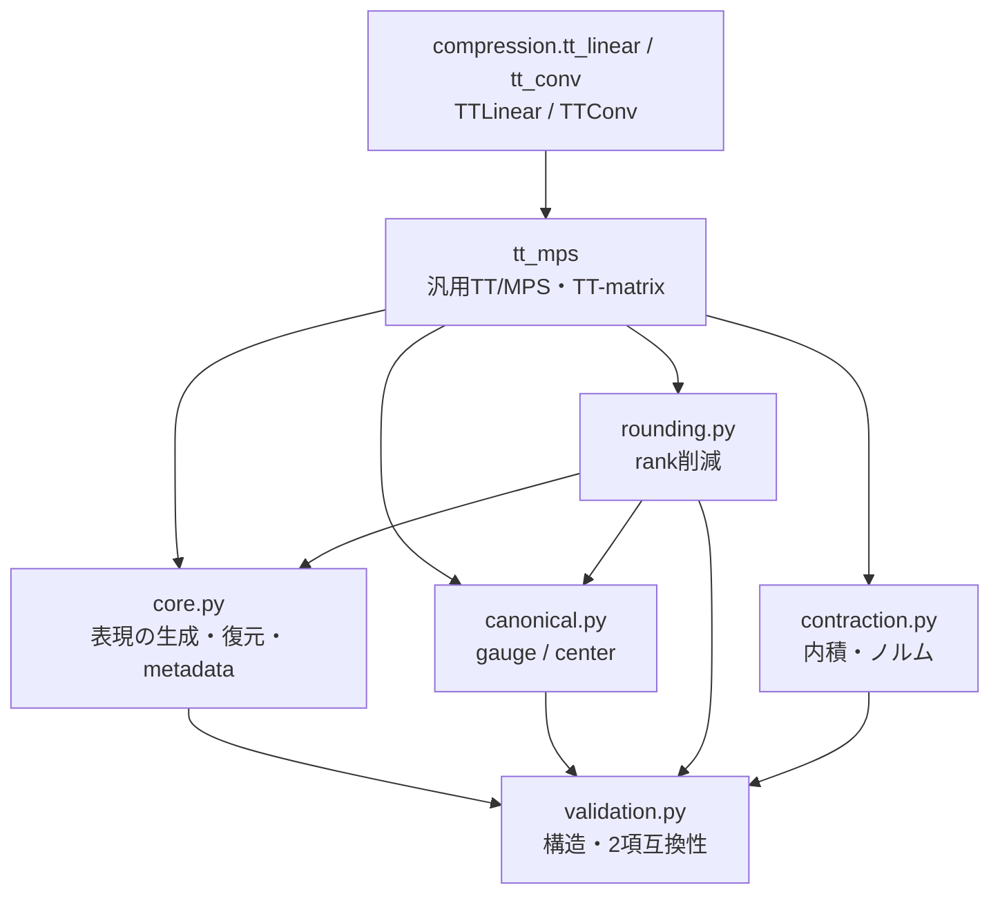

# モジュール設計

## 1. 目的

このファイルは `src/nn_compression/` の各sub-packageが、**何を担当し、何を担当しないか**を定義する。

関数単位のsignature・引数・戻り値は [[90_src設計/05_Core_API_v1]] に集約する。

---

## 2. パッケージ構成

```text
src/nn_compression/
├─ tensor/
├─ linalg/
├─ tt_mps/
├─ dmrg/
├─ compression/
├─ training/
├─ metrics/
├─ selection/
├─ datasets/
├─ models/
└─ utils/
```

---

## 3. `tensor`

### 責務

mode-nテンソル演算と、そのshape/mode contractを担当する。

### 主な入力

```text
torch.Tensor
mode index
matrix
shape
```

### 主な出力

```text
unfolded matrix
folded tensor
mode product result
```

### 依存

上位の圧縮方式には依存しない。

```text
tensor
  └─ torch
```

### 利用元

```text
Tucker / HOSVD / HOOI
将来のTensor Network utility
```

### 担当しないこと

- rank選択
- SVD
- NN Module構築
- accuracy評価

---

## 4. `compression`

### 責務

学習済みweightの低rank分解と、低rank表現をNN Moduleへ変換する処理を担当する。

### 内部分類

```text
svd.py
→ NN layer weight の retained energy と Compatibility API。SVD本体は linalg/svd.py

linear_svd.py / conv_svd.py
→ NN layerへのSVD適用

tucker.py
→ HOSVD / Tucker reconstruction / parameter metrics

hooi.py
→ HOOI iteration

conv_tucker.py
→ Conv2d Tucker-2 decomposition / Module build

named_layers.py
→ 複数named layer置換

rank_sweep.py
→ rank候補の実験支援

mlp_svd.py
→ 既存MLP向け組み立て

tt_linear.py / tt_linear_two_site.py
→ TTLinear と NN固有 forward

tt_conv.py
→ TTConv2d

tt_rank_sweep.py
→ NN weight の TT rank sweep
```

### 主な入力

```text
weight Tensor
nn.Linear / nn.Conv2d
nn.Module
rank / ranks
TT core list / center / bond
relative error tolerance
```

### 主な出力

```text
SVD factors
Tucker core / factors
factorized nn.Sequential
compressed model copy
rank sweep record
TT core list
TT rank / physical shape metadata
TT-SVD error bound / canonicality error / bond singular values
rounding diagnostics
TT scalar contraction
```

### 依存

```text
compression
├─→ linalg
├─→ tt_mps
├─→ tensor
├─→ utils
└─→ metrics
```

`compression.hooi` はrelative Frobenius error、`rank_sweep` はmodel comparison/MACsをmetricsから利用する。汎用TT/MPS・TT-matrixは `tt_mps`、DMRG Coreは `dmrg` が担当し、`compression` はNN層への適用を担当する。

### 汎用 TT/MPS の責務分担



DMRG Coreは `dmrg`、初期化とdense診断は `dmrg.support`、TFIMは `dmrg.models` に置く。距離APIは現時点のPublic APIへ含めない。

### 担当しないこと

- Dataset準備
- optimizer / epoch loop
- 最終rankの意思決定
- 実験結果CSV名の固定

---

## 5. `training`

### 責務

圧縮方式に依存しない学習・評価ループを担当する。

### 主な入力

```text
model
DataLoader
criterion
optimizer
device
```

### 主な出力

```text
loss
accuracy
training history
best-state model
```

### 設計上の特徴

- lossはsample-weighted average
- empty loaderを明示的に拒否
- `evaluate()` は全submoduleのtraining stateを復元
- Early Stopping後はbest validation stateへ復元

### 依存方針

学習・評価ループ本体は特定の分解方式を知らない。TTLinearのfull-batch sweepは `compression` の TTLinear を利用する。

`evaluate` の実装は `metrics.evaluation` にあり、`training.loops` が同じ関数を再公開する。training状態の保存は `utils.module_state` が担当し、`metrics` から `training` へは依存しない。

### 担当しないこと

- SVD/Tucker分解
- MACs式
- rank選択

---

## 6. `metrics`

### 責務

圧縮前後のmodel/Tensorを**測定する**。

### 分類

```text
model_comparison.py
→ parameters / accuracy drop / agreement / RMSE / latency

macs.py
→ layer-level MACs

mlp_macs.py / cnn_macs.py
→ 既存実験向け集計

tensor_approximation.py
→ relative Frobenius error
```

### 主な入力

```text
baseline model
compressed model
loader
weight Tensor
rank
output spatial size
```

### 主な出力

```text
parameter reduction
accuracy difference
agreement
RMSE
latency
MACs
relative error
```

### 依存

```text
metrics.evaluation
└─→ utils.module_state

metrics.model_comparison
└─→ metrics.evaluation

metrics.cnn_macs
└─→ utils.modules
```

### 依存方針

`compression.hooi → metrics` が既に存在するため、**metricsからcompressionへは依存しない**。

この制約により、rank/integer validation等のprivate helperが一部重複している。

### 担当しないこと

- 圧縮モデルの生成
- optimizer update
- candidateの最終選択

---

## 7. `selection`

### 責務

実験で生成した候補recordから、Pareto frontier・kneeを抽出する。

### 主な入力

```text
pandas.DataFrame
評価列名
```

### 主な出力

```text
Pareto candidate判定
Pareto DataFrame
knee point
```

### 設計上の位置付け

数学的圧縮アルゴリズムではなく、**実験結果から候補を選ぶ層**。

TT/MPSで複数bond rankを扱う場合も、既存2目的Paretoがそのまま使える部分だけ再利用する。

---

## 8. `datasets`

### 責務

Dataset取得、再現可能なsplit、DataLoader構築を担当する。

### 設計上のポイント

```text
train
→ shuffle=True

validation / test / rank-validation / train-eval
→ shuffle=False
```

学習順序を決めるGeneratorと評価用走査を分離し、候補比較が学習乱数状態へ影響しないようにする。

### 依存

seed用utilityを利用する。

```text
datasets
└─→ utils.seed
```

### 担当しないこと

- model定義
- 圧縮
- 学習loop

---

## 9. `models`

### 責務

既存実験で再利用するbaseline architectureを定義する。

```text
MNISTMLP
FashionMNISTCNN
CIFAR10CNN
```

### 安定化するもの

既存checkpoint・named compression・Notebookがlayer名へ依存するため、主要attribute名は安定APIとして扱う。

```text
MNISTMLP
→ fc1 / fc2 / fc3

FashionMNISTCNN
→ conv1 / conv2 / fc1 / fc2

CIFAR10CNN
→ conv1 / conv2 / conv3 / fc1 / fc2
```

新architectureは既存classを破壊的に変更せず、新classまたは明示optionとして追加する。

---

## 10. `utils`

### 責務

圧縮方式・Dataset・model種別に依存しない共通基盤。

```text
modules.py
→ named module get/set

paths.py
→ project root / experiment directories

seed.py
→ global seed / torch.Generator
```

### 設計原則

utilityへ高位パッケージ固有の知識を入れない。

例えば `set_named_module()` はConvやTuckerを知らず、任意の既存submodule pathを置換するだけにする。

---

## 11. 依存方向

矢印は **利用する側 → 依存先**。

```text
training ──→ compression ──→ metrics ──→ utils
    │              │
    ├─→ metrics    ├─→ linalg
    ├─→ tt_mps     ├─→ tensor
    └─→ utils      ├─→ tt_mps
                   └─→ utils

tt_mps ──→ linalg
tt_mps ──→ tensor
dmrg ──→ tt_mps
dmrg ──→ linalg
datasets ──→ utils

models / selection / linalg / tensor / utils
→ 他の nn_compression subpackage へ依存しない
```

特に重要：

```text
compression.hooi
→ metrics.tensor_approximation

training.loops
→ metrics.evaluation.evaluate

metrics
→ utils.module_state
```

### 禁止する方向

```text
metrics → training
metrics → compression
compression → training
```

は循環依存を作るため追加しない。

```text
tensor → compression
```

も、tensorを下位数学utilityとして保つため追加しない。

---

## 12. 新規機能の配置判断

新しい関数を追加するときは以下で判断する。

```text
Tensorのshape操作か？
→ tensor

モデル非依存のSVDか？
→ linalg

汎用TT/MPS・TT-matrixか？
→ tt_mps

DMRGの局所更新か？
→ dmrg

NN層への低rank分解・Module変換か？
→ compression

学習/評価loopか？
→ training

測定値を返すか？
→ metrics

候補選択か？
→ selection

実験データ準備か？
→ datasets

baseline architectureか？
→ models

どれにも依存しない小規模共通処理か？
→ utils
```

TT/MPS・DMRGでもこの責務分離を維持する。
