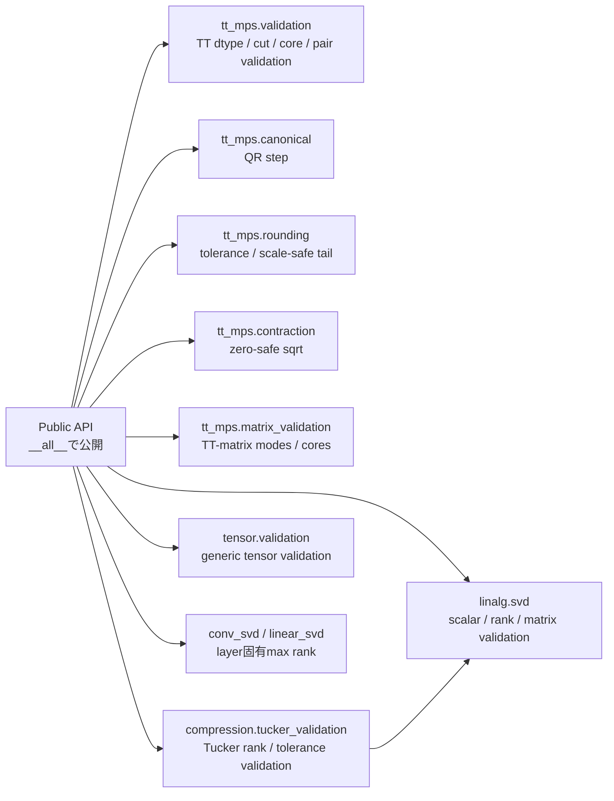

# Internal helper API境界

**Status:** Internal — Core API v1のPublic APIではない

## 目的

`src/nn_compression/`内で複数のPublic APIから利用する共通helperの責務と所有componentを示す。

これらのhelperはsubpackageの`__all__`へ含めない。したがって、Core API v1の安定したimport pathや後方互換性を保証する対象ではなく、新しいNotebookや外部コードから直接呼び出さない。

## Public APIとの境界

Public APIは必要なvalidationを内部helperへ委譲するが、利用者に内部helperの直接呼び出しを要求しない。入力不正はPublic API境界から同じ例外contractとして観測できるようにする。

## helper一覧

### `linalg.svd`

| helper | 責務 |
|---|---|
| `coerce_integer_scalar` | boolを除外し、Python / NumPy整数scalarを整数へ正規化する。 |
| `coerce_rank` | rankを整数化し、`1 <= rank <= max_rank`を検証する。 |
| `matrix_max_rank` | 2次元行列の最大rankを求める。 |
| `as_matrix` | Linear weightまたは2次元TensorをSVD対象行列として解釈する。 |

### `tt_mps.validation`

| helper | 責務 |
|---|---|
| `validate_tt_dtype` | TT-SVDが扱える実数浮動小数点dtypeを検証する。 |
| `validate_tt_cut_index` | TT cut位置が有効範囲内か検証する。 |
| `validate_tt_cores` | TT core列の次元、境界rank、隣接bond rank、dtype、deviceを検証する。 |
| `validate_tt_pair` | 2つの検証済みTTについて、order、siteごとの物理次元、dtype、deviceが2項演算に適合するか検証する。A/Bのbond rank一致は要求しない。 |

### `tt_mps.canonical`

| helper | 責務 |
|---|---|
| `_qr_step_left_to_right` | coreを左直交化し、QRの`R`を右隣coreへ吸収する。呼び出し側がclone済みのlistをin-place更新する。 |
| `_qr_step_right_to_left` | coreを右直交化し、転置QRの`R.mT`を左隣coreへ吸収する。呼び出し側がclone済みのlistをin-place更新する。 |
| `_scale_safe_frobenius_norm` | Gram差を最大絶対値で正規化してからFrobenius normを求め、微小なcanonicality誤差の二乗underflowを避ける。 |

### `tt_mps.core`

| helper | 責務 |
|---|---|
| `_tt_svd_sweep` | exact / 共通rank上限 / bond別rank上限で共有する逐次SVD本体。 |
| `_scale_safe_vector_norm` | 特異値tailを最大絶対値で正規化してから2-normを求め、極小・極大値の二乗underflow / overflowを避ける。 |

### `tt_mps.rounding`

| helper | 責務 |
|---|---|
| `_coerce_eps_rel` | `eps_rel`を有限・非負のPython floatへ正規化し、boolとbool Tensorを拒否する。 |
| `_is_exact_zero` | ノルム計算結果に依存せず、Tensorの全要素が厳密に0か判定する。 |
| `_scale_safe_norm` | 最大絶対値で正規化してから2-normを求め、素朴な二乗和のoverflow / underflowを避ける。 |
| `_tail_norm` | `math.hypot`により、特異値tailのnormをPython float上でscale-safeに更新する。 |
| `_choose_truncation_rank` | 非二乗の局所誤差予算とtail normから、最低rank 1を保って打ち切りrankを選ぶ。 |
| `_left_unfolding_svd` | 3階coreを左展開してreduced SVDし、元shapeと`U, S, Vh`を返す。bond spectrum取得と打ち切りで共有する。 |
| `_absorb_truncated_svd_right` | 保持した`U`を左coreへ戻し、`S @ Vh`を右隣coreへ吸収する。単一bond打ち切りとrounding sweepで共有する。 |

### `tt_mps.contraction`

| helper | 責務 |
|---|---|
| `_safe_sqrt` | 正値では通常の平方根、零点では有限な0勾配を返す。負値を`ValueError`とし、NaNを隠さず伝播する。 |

### `tt_mps.matrix`

| helper | 責務 |
|---|---|
| `_validate_tt_svd_max_rank` | 1-site TT-matrixでTT-SVDを迂回するときも、`max_rank`へ既存`tt_svd`と同じ型・下限contractを適用する。 |

### `tt_mps.matrix_validation`

| helper | 責務 |
|---|---|
| `validate_tt_matrix_modes` | 出力・入力mode列が同じ非零長で、各要素がboolではない正の整数か検証し、tupleへ正規化する。 |
| `validate_tt_matrix_cores` | 4階TT-matrix core列の境界rank、隣接bond、物理次元、dtype、deviceを検証する。 |
| `validate_dense_tt_matrix_weight` | dense weightが2階で、mode積とshapeが一致し、対応dtypeであることを検証する。 |

### `compression.tt_linear_validation`

| helper | 責務 |
|---|---|
| `validate_tt_linear_input` | `tt_linear_forward`の入力が2階で、入力feature数、dtype、deviceがcoreと一致することを検証する。 |
| `validate_tt_linear_bias` | biasの`None`分岐、shape、dtype、deviceを検証する。 |

### `tt_mps.modes`

| helper | 責務 |
|---|---|
| `_positive_int` | `ordered_factorizations`の整数引数についてbool・非整数・1未満を拒否し、Python整数へ正規化する。 |
| `_divisors_at_least` | 残りの積の約数を昇順に列挙し、指定した因子下限未満を除外する。 |

### `compression.tucker_validation`

| helper | 責務 |
|---|---|
| `validate_real_dtype` | Tucker / HOOIが扱う実数浮動小数点dtypeを検証する。 |
| `mode_unfold_max_rank` | mode-n unfoldingで取り得る最大rankを求める。 |
| `validate_positive_shape` | Tucker対象shapeが2次元以上かつ各次元が正の整数か検証する。 |
| `validate_mode_index` | Tuckerのmode番号を型・範囲の両面から検証する。 |
| `validate_tucker_ranks` | modeごとのrank辞書を検証し、正規化したcopyを返す。 |
| `validate_non_negative_tolerance` | HOOIの収束toleranceが有限かつ非負か検証する。 |
| `validate_max_iter` | HOOIの最大反復回数を非負整数へ正規化する。 |

### `tensor.validation`

| helper | 責務 |
|---|---|
| `validate_tensor_ndim_at_least_2` | 公開tensor演算の入力が2次元以上か検証する。 |
| `validate_tensor_shape` | Tensorが2次元以上で、各dimensionが正か検証する。 |
| `validate_mode_index` | generic tensor演算のmode番号を型・範囲の両面から検証する。 |
| `validate_positive_shape` | `fold()`等へ渡すshapeが2次元以上かつ正の整数列か検証する。 |

### layer固有helper

| 定義component | helper | 責務 |
|---|---|---|
| `compression.conv_svd` | `conv2d_max_rank` | Conv2d weightを行列化したときの最大SVD rankを求める。 |
| `compression.linear_svd` | `linear_max_rank` | Linear weightの最大SVD rankを求める。 |

### `metrics.evaluation`

| helper | 責務 |
|---|---|
| `evaluate` | loader全体のlossとaccuracyを計算する共有実装。`training.loops.evaluate` が同じ関数を再公開する。training状態の保存は `utils.module_state` へ委譲する。 |

### Qwen3 1層パイロット（`__all__` には未収載）

Core API v1 の `__all__` スナップショットは変えていない。Notebook はモジュールパスから呼ぶ。

| helper | 責務 |
|---|---|
| `gram_matrix` | トークン行の活性化から、平均を引かない Gram 行列を float64 で作る。 |
| `gram_matrices_from_documents` | 文書ごとの Gram と合計を返す。 |
| `regularize_gram` | `G_λ = G + λ tr(G) / n I` を作る。 |
| `regularization_shift` | 正則化で足す対角成分 `λ tr(G) / n` を返す。 |
| `effective_rank_from_eigenvalues` | 正の固有値のエントロピーから effective rank を返す。 |
| `channel_rms` | チャネルごとの RMS `sqrt(G_ii / N)` を返す。 |
| `gram_diagnostics` | `G` と `G_λ` の条件数、effective rank、RMS 分位点を返す。 |
| `squared_output_error_from_gram` | `tr(ΔW G ΔW^T)` を返す。 |
| `squared_output_errors_from_documents` | 文書ごとの `tr(ΔW G_d ΔW^T)` を返す。 |
| `squared_output_error_from_activations` | 活性化から `||ΔW X||_F^2` を直接返す。 |
| `max_matrix_rank_within_budget` | `r(m+n)` が予算以下の最大 rank を返す。 |
| `matrix_factor_parameter_count` | バイアスなし低ランク因子のパラメータ数 `r(m+n)` を返す。 |
| `truncated_svd_weight` | 通常の SVD で rank r に切った行列を返す。 |
| `WhitenedSvdResult` | 白色化 SVD の近似、捨てた特異値エネルギー、`Q_λ` を持つ。 |
| `gram_sqrt_and_inv_sqrt` | 正定値 Gram の平方根と逆平方根を固有値分解で返す。 |
| `whitened_truncated_svd` | `W G_λ^{1/2}` を SVD で切り、`G_λ^{-1/2}` で戻す。 |
| `gated_error_parts` | SwiGLU の gate を通した誤差の分子と分母を返す。 |
| `gated_error_parts_per_document` | 文書ごとの gate 付き誤差の分子と分母を返す。 |
| `output_error_ratios_from_gram` | `e = tr(ΔW G ΔW^T) / tr(W G W^T)` と `E_rel = sqrt(e)` を Gram から返す。 |
| `output_error_ratios_from_activations` | 同じ `e` と `E_rel` を、Gram を作らずに活性化から直接返す。 |
| `bootstrap_ratio_difference_intervals` | 文書再標本で、比の差の百分位区間を同じ抽選から返す。 |
| `RhoEvaluation` | 1 条件の ρ と、ρ を出さないときの補助量を持つ。 |
| `evaluate_rho` | `g = e(M3)-e(M2)` から ρ を計算し、情報がないときは計算しない。 |
| `classify_pilot_outcome` | 設計の 0.2 と 0.5 で、予備実験の進退を 4 区分に分ける。 |
| `select_balanced_tt_matrix_modes` | physical size の偏りが最小の mode 分解を、同点は辞書順で選ぶ。 |
| `structural_tt_matrix_ranks` | bond ごとの構造上の rank 上限を返す。 |
| `uniform_tt_matrix_ranks` | 一様な rank 上限を構造上の上限で頭打ちにする。 |
| `select_uniform_tt_rank` | 追加パラメータを含めて予算以下になる最大の一様 rank を返す。 |
| `expand_tt_matrix_bonds` | bond をゼロ埋めで広げ、密な重みは変えない。 |
| `tt_matrix_core_adjoint` | 密行列を、指定サイトのコア空間へ縮約して戻す。 |
| `metric_tt_hvp` | 局所ヘッセ行列とコア方向の積を、密行列経由で返す。 |
| `metric_tt_rhs` | 局所正規方程式の右辺を返す。 |
| `metric_tt_jacobi_diagonal` | 局所ヘッセ行列の対角を返す。 |
| `q_lambda_of_cores` | TT が表す行列の `Q_λ` を返す。 |
| `PCGResult` | 前処理つき共役勾配法の反復回数と残差を持つ。 |
| `preconditioned_conjugate_gradient` | Jacobi 前処理の共役勾配法。直前のコアから始める。 |
| `move_tt_matrix_center` | TT-matrix の正準中心を 1 サイトずつ移す。 |
| `SiteUpdate` | 1 サイト更新の受理、CG、時間を持つ。 |
| `update_tt_matrix_site` | 1 サイトを PCG で更新し、`Q_λ` が増えれば棄却する。 |
| `SweepRecord` | 1 掃引の `Q_λ`、CG、棄却数、時間を持つ。 |
| `run_metric_tt_als` | 正準形を保つ 1 サイト ALS。 |
| `diagonal_rms_scales` | 対角 RMS `sqrt(G_ii / N)` を返す。0 以下は拒否する。 |
| `scale_matrix_columns` | 重みの列に対角スケールを掛ける。 |
| `DiagonalMetricTT` | スケール済み TT と、入力対角の逆数、吸収後の TT を持つ。 |
| `fit_diagonal_metric_tt` | 対角 RMS で列をスケールしてから TT-SVD する。 |
| `prepare_m5_from_diagonal_tt` | 吸収済み TT の bond を M5 の rank まで広げて正準化する。 |
| `tt_parameter_count` | TT-matrix コアの要素数を返す。 |

### 計量つき TT の device ソルバ（`__all__` には未収載）

`tt_mps.metric_tt` は CPU・float64 の参照実装である。HVP、Jacobi、1 サイト ALS の定義はここが正とする。
`tt_mps.metric_tt_solver` は同じ局所問題を、device と精度と前処理と CG の許容誤差を引数で選んで解く。戻り値のコアは CPU の float64 に戻す。
`K ⊗ I` の形は前処理と検算に使う。2 サイト更新や、`G_λ` 自体の低ランク近似はしない。
前処理（Jacobi の対角、Kronecker の固有値分解）は中心以外のコアと `G` だけで決まるので、局所問題ごとに 1 回だけ作り、CG の反復と float32 の外側反復で使い回す。

| helper | 責務 |
|---|---|
| `MetricTTSolverConfig` | device、精度、前処理、CG と掃引の停止を持つ。計算中は TF32 を切る。`timing_sync` が偽のとき、区間時間は GPU と同期しない。 |
| `DeviceSweepRecord` | 1 掃引の `Q_λ`、局所勾配、実際に使った許容誤差、時間（HVP、前処理を作る時間と掛ける時間、QR、受理判定）、停止理由を持つ。 |
| `KroneckerMetricFactors` | `G` の Kronecker 因子と、相対誤差、固有値クリップの有無を持つ。 |
| `LocalSolveRecord` | 1 サイトの相対残差の履歴と、その時刻、前処理を作る時間と掛ける時間を持つ。 |
| `metric_tt_hvp_on_device` | 局所ヘッセ行列とコア方向の積。dtype と device は入力に合わせる。 |
| `metric_tt_rhs_on_device` | 使い回す `W @ G` から、局所正規方程式の右辺を返す。 |
| `metric_tt_jacobi_diagonal_on_device` | Jacobi 対角。出力 mode 方向には同じ値を繰り返す。 |
| `kronecker_metric_factors` | Van Loan–Pitsianis を 2 段階使い、対称な正定値因子に直す。 |
| `kronecker_preconditioner_matrix` | 小さい問題用に、前処理 `K_L ⊗ G_j ⊗ K_R` を明示的な行列で返す。 |
| `solve_metric_tt_site_on_device` | 正準中心が合っている 1 サイトだけを解く。掃引はしない。 |
| `run_metric_tt_als_on_device` | 正準形を保つ 1 サイト ALS。入力は変更せず、コアは CPU の float64 で返す。 |
| `ConvergenceStopRule` | 1 本の長い ALS をいつ止めるか（相対減少が続けて小さい掃引数、掃引の終わりの s_max、掃引の上限、局所残差と 1 度の解き直し、保存の間隔）。 |
| `ConvergenceSweepRecord` | 長い ALS の完了した 1 掃引の `Q_λ`、正則化なしの `Q`、全サイトの s_k、更新ごとの CG 回数・残差・解き直し・受理、時間（s_k と正則化なしの `Q` は別）、停止理由を持つ。 |
| `LocalSolverFailure` | 局所問題が解き直しても解けなかった掃引の診断（サイト、残差、反復数、採用しなかった候補の `Q_λ`、その掃引の更新の記録）。最終状態には反映しない。 |
| `ConvergenceRunResult` | 長い ALS の最終コア（最後に完了した掃引の終わり）、全履歴、停止理由、ALS 前の `Q_λ`、保存ごとの診断値と時間、失敗の診断を持つ。 |
| `metric_tt_stationarity_on_device` | 更新せずに正準中心を各サイトへ移し、同じ状態で s_k = ‖b_k − H_k c_k‖ / ‖b_k‖ を測る。 |
| `perturb_tt_matrix_site` | 1 サイトを中心にした正準形で、そのコアに正規化した雑音を足し、中心 0 に戻す。実現した相対摂動 δ_W も返す。 |
| `run_metric_tt_als_until_converged` | `ConvergenceStopRule` で止める 1 サイト ALS。局所の解き方と受理は `run_metric_tt_als_on_device` と同じ。解けなかった局所問題の候補は採用しない。保存と、設定・入力のハッシュを確かめてからの再開を持つ。 |
| `StudyResolutionStopRule` | 50 掃引窓の Δ を `d_ref` で割った値が続けて小さいとき、掃引上限、局所問題が解けなかったとき、のどれかで止める。s_max では止めない。`escalation_refinements` は外側反復の累計上限。 |
| `StudyStageRecord` | 局所問題の 1 段の残差、開始時の残差、CG の反復と状態、曲率 0 以下の回数、空回り、その段の外側反復と累計、時間。 |
| `StudyUpdateRecord` | 1 サイト更新の段、区分（`target_met` / `local_target_missed` / `local_solver_unresolved`）、受理、3 段目まで進んだときの確認値 a。 |
| `StudySweepRecord` | 完了した掃引の Q_λ、Δ、連続回数、警告数、2 段目・3 段目まで進んだ回数、HVP 回数。 |
| `StudyLocalFailure` | 解けなかった局所問題の段と、捨てた掃引の更新。最終コアには入れない。 |
| `StudyRunResult` | 研究用 ALS の最終コア、履歴、停止理由、正準化前の Q_λ、警告数。 |
| `study_resolution_delta` | (Q_λ(s−窓) − Q_λ(s)) / D_ref。 |
| `decide_study_stop` | Q_λ の列から停止理由、直近の Δ、連続回数を返す。分解能と上限が同時なら分解能を優先する。 |
| `run_metric_tt_als_study` | 3 段の解き直しと `StudyResolutionStopRule` で止める 1 サイト ALS。次の段は前の段の解から続ける。保存形式は `metric_tt_study_checkpoint/2`。窓の倍数と停止時に保存し、止まったファイルは計算し直さない。`breakdown` は記録だけで、それだけでは解けなかったことにしない。 |

### 入力 Gram の蓄積（`llm.activation_capture`、`__all__` に収載）

| helper | 責務 |
|---|---|
| `accumulate_input_grams` | 1 回の順伝播で、複数モジュールの入力二次モーメントを float64 で足す。活性化は保存しない。 |

### 長い ALS の事後判定（`metrics.als_convergence`、`__all__` には未収載）

1 本をいつ止めるかは上の `ConvergenceStopRule` が決める。こちらは止まった 2 本を比べる純粋関数で、等価とみなす幅は呼び出し側が渡す。

| helper | 責務 |
|---|---|
| `InitializationDependence` | 判定、`δ_Q`、使った等価幅を持つ。 |
| `relative_objective_difference` | `δ_Q = abs(Q_a − Q_b) / min(Q_a, Q_b)`。正の有限値以外は拒否する。 |
| `classify_als_initialization_dependence` | 2 本の停止理由と最終 `Q_λ` から、`local_solver_unresolved` → `max_sweeps_unresolved` → `δ_Q` による 2 分類の順で判定する。 |

## validation ownership

- Tensor一般の次元・shape・modeは`tensor.validation`が担当する。
- SVD共通のscalar・rank・行列解釈は`linalg.svd`が担当する。
- Tucker / HOOI固有のrank辞書・収束条件は`compression.tucker_validation`が担当する。
- TT固有のcut・core chain・dtype・2項演算の互換性は`tt_mps.validation`が担当する。
- canonicalizationの方向別QR stepは`tt_mps.canonical`が担当する。
- rounding固有の許容誤差、scale-safe norm、tail rank選択は`tt_mps.rounding`が担当する。
- contractionの平方根境界処理は`tt_mps.contraction`が担当する。
- TT-matrix固有のmode列、4階core、dense weightは`tt_mps.matrix_validation`が担当する。
- TTLinearの入力とbiasは`compression.tt_linear_validation`が担当する。
- 1-site TT-matrixでTT-SVDを迂回するときの`max_rank`整合は`tt_mps.matrix`のprivate helperが担当する。
- TT-matrixのtensorization候補列挙に固有の正整数正規化と約数列挙は`tt_mps.modes`が担当する。
- Conv2d / Linear固有の最大rankは各factorization componentが担当する。

## 現在の重複と変更時の注意

`validate_mode_index`と`validate_positive_shape`は、`tensor.validation`と`compression.tucker_validation`の両方に同等の処理が存在する。現行Public APIの挙動を変えずに記録するため、この文書では現在の定義先をそのまま示している。

将来統合する場合は、genericなshape / mode contractを`tensor.validation`等の1か所へ集約し、Tucker側はそれを利用する構成を候補とする。その際は例外型・例外message・bool拒否・境界値をcontract testで比較し、Public APIから観測される挙動を維持する。

## 文書化ルール

- internal helperを`__all__`へ追加した場合は、この文書から対応する個別Public API仕様へ移す。
- internalのまま引数や例外contractを変更した場合は、利用するPublic API仕様とcontract testを同時に確認する。
- 単純な内部helperごとに個別mdを増やさず、責務・所有関係・Public APIへの影響をこの文書へ集約する。

## 関連API

[[90_src設計/05_Core_API_v1/README]]、[[90_src設計/05_Core_API_v1/linalg/truncated_svd]]、[[90_src設計/05_Core_API_v1/compression/hosvd]]、[[90_src設計/05_Core_API_v1/tt_mps/tt_svd]]、[[90_src設計/05_Core_API_v1/tt_mps/tt_canonicalize]]、[[90_src設計/05_Core_API_v1/tt_mps/tt_round]]、[[90_src設計/05_Core_API_v1/tt_mps/tt_inner]]、[[90_src設計/05_Core_API_v1/compression/tt_linear_forward]]、[[90_src設計/05_Core_API_v1/compression/TTLinear]]、[[90_src設計/05_Core_API_v1/tt_mps/ordered_factorizations]]、[[90_src設計/05_Core_API_v1/tensor/unfold]]
