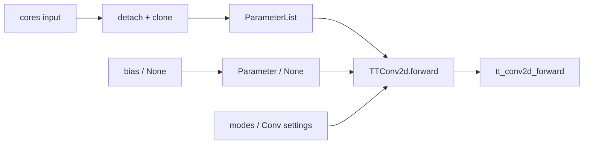

# `TTConv2d`

**Stability:** A
**定義:** `src/nn_compression/compression/tt_conv.py`

## 責務

Conv2d weightをTT-matrix coreの`nn.ParameterList`として所有し、functionalな`tt_conv2d_forward`へ計算を委譲する学習可能層を提供する。

## Signature
```python
TTConv2d(cores, out_modes, in_modes, in_channels, out_channels, kernel_size, stride=1, padding=0, dilation=1, groups=1, padding_mode="zeros", bias=None)
```

## 引数

- `cores`: TT-matrix core列。独立したleaf Parameterへコピーする。
- `out_modes`: 積が`out_channels`となるmode列。
- `in_modes`: 積が`in_channels*kH*kW`となるmode列。
- `in_channels`: 入力channel数。
- `out_channels`: 出力channel数。
- `kernel_size`: kernelの高さ・幅。
- `stride`: spatial stride。
- `padding`: zero padding量。
- `dilation`: kernel dilation。
- `groups`: 現行は`1`のみ。
- `padding_mode`: 現行は`"zeros"`のみ。
- `bias`: `None`またはshape `(out_channels,)`のTensor。

## 戻り値

coreを`cores.0`, `cores.1`, ...、biasを`bias`として`state_dict`へ登録する`nn.Module`。denseな`weight` Parameterは持たない。

## 使用場面

dense Conv2dをTT化してcoreをfine-tuningするとき、または通常のModuleとしてmodelへ組み込むとき。

## 処理概要



## 主なcontract / 注意事項

- constructorはcoreとbiasのstorage/autograd graphを共有しない。既定では学習可能。
- `groups!=1`、非zero `padding_mode`、文字列padding、float16は未対応。
- `.to`, `train`, `eval`, `parameters`, `state_dict`は標準Module規約に従う。
- forwardではdense kernelを復元しない。

## 関連API

`tt_conv2d_forward`, `build_tt_conv2d`, `factorize_named_tt_conv2d`
