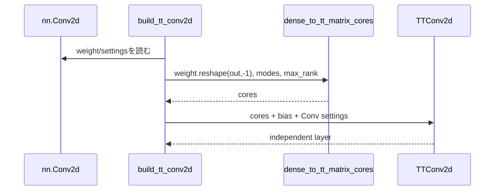

# `build_tt_conv2d`

**Stability:** A
**定義:** `src/nn_compression/compression/tt_conv.py`

## 責務

dense `nn.Conv2d`のweightを行列化・TT-SVDし、同じ畳み込み設定を持つ独立した`TTConv2d`を構築する。

## Signature
```python
build_tt_conv2d(conv, out_modes, in_modes, *, max_rank=None)
```

## 引数

- `conv`: 変換元`nn.Conv2d`。変更しない。
- `out_modes`: 積が`conv.out_channels`となる出力mode列。
- `in_modes`: 積が`conv.in_channels*kH*kW`となる入力mode列。
- `max_rank`: `None`ならexact TT-SVD、正整数なら全内部bondのrank上限。

## 戻り値

dtype/device、bias有無、stride/padding/dilation、training状態、weight/biasの`requires_grad`を引き継ぐ`TTConv2d`。元層とはParameter storageを共有しない。

## 使用場面

単一Conv2dのTT変換、またはnamed layer置換前のbuilderとして使用する。

## 処理概要



## 主なcontract / 注意事項

- NaN/inf weight、mode積不一致を拒否する。
- `groups=1`、`padding_mode="zeros"`、整数paddingのみ対応する。
- `d=1`でもcloneによりweight viewとのstorage共有を防ぐ。

## 関連API

`TTConv2d`, `dense_to_tt_matrix_cores`, `factorize_named_tt_conv2d`
