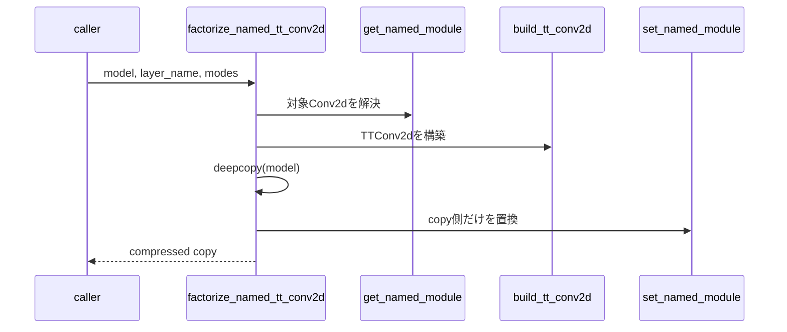

# `factorize_named_tt_conv2d`

**Stability:** A
**定義:** `src/nn_compression/compression/tt_conv.py`

## 責務

modelをdeepcopyし、名前で指定した1つの`nn.Conv2d`だけを`TTConv2d`へ置換する。

## Signature
```python
factorize_named_tt_conv2d(model, layer_name, out_modes, in_modes, *, max_rank=None)
```

## 引数

- `model`: 変換元model。変更しない。
- `layer_name`: `"conv2"`や`"features.3"`などの既存module path。
- `out_modes`: 対象Conv2dの出力mode列。
- `in_modes`: 対象Conv2dの入力patch mode列。
- `max_rank`: exact分解またはrank上限を指定する。

## 戻り値

対象層だけをTT化した独立model。対象外のParameter/bufferと各moduleのtraining状態はdeepcopyで保持する。

## 使用場面

baseline CNNを保持したまま圧縮候補modelを作り、rank sweepやfine-tuningを行うとき。

## 処理概要



## 主なcontract / 注意事項

- 空名、存在しないpath、Conv2d以外を明示的に拒否する。
- 元modelは変更せず、fine-tuningしても元Parameterへ影響しない。
- 複数層の一括置換や学習対象parameterの設定は責務外。

## 関連API

`build_tt_conv2d`, `factorize_named_tt_linear`, `set_trainable_parameter_prefixes`
