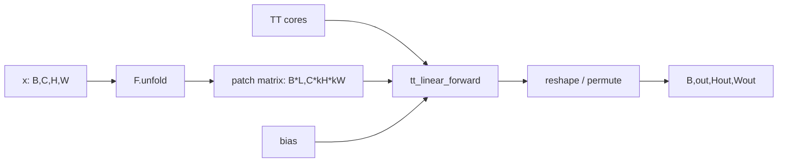

# `tt_conv2d_forward`

**Stability:** A
**定義:** `src/nn_compression/compression/tt_conv.py`

## 責務

Conv2d weightを表すTT-matrix coreを直接縮約し、dense kernelを構築せず2次元畳み込み相当の出力を計算する。

## Signature
```python
tt_conv2d_forward(x, cores, out_modes, in_modes, bias=None, *, kernel_size, stride=1, padding=0, dilation=1)
```

## 引数

- `x`: shape `(batch, in_channels, height, width)`の入力。
- `cores`: shape `(r[k-1], m[k], n[k], r[k])`のTT-matrix core列。
- `out_modes`: 積が`out_channels`となる出力mode列。
- `in_modes`: 積が`in_channels*kH*kW`となる入力mode列。
- `bias`: `None`またはshape `(out_channels,)`。coreとdtype/deviceを一致させる。
- `kernel_size`: 必須keyword。正整数または`(kH, kW)`。
- `stride`: 正整数または2要素列。
- `padding`: 非負整数または2要素列。zero padding量。
- `dilation`: 正整数または2要素列。

## 戻り値

shape `(batch, out_channels, H_out, W_out)`のTensor。dtype/device/autogradを入力、core、biasから維持する。

## 使用場面

TT-Convのfunctional primitive、またはdense復元経路とのforward・gradient等価性検証。

## 処理概要



## 主なcontract / 注意事項

- `F.unfold`の列順と`conv.weight.reshape(out, -1)`の列順を対応させる。
- float32/float64、`d>=1`を対応範囲とする。dtype不一致は`TypeError`、shape/device不一致は`ValueError`。
- 出力空間サイズが非正となる設定を拒否する。
- NaN/infはIEEE規則で伝播し、入力をin-place変更しない。

## 関連API

`TTConv2d`, `tt_linear_forward`, `tt_conv2d_to_dense_weight`
