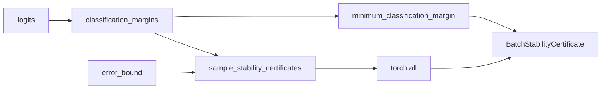

# `batch_stability_certificate`

**Stability:** A
**定義:** `src/nn_compression/metrics/prediction_stability.py`

## 責務

logitsと誤差上界からmargin計算、最小margin、sample別certificate、batch全体判定を一括して構成する。

## Signature
```python
batch_stability_certificate(logits, error_bound)
```

## 引数

- `logits`: 圧縮前modelのshape `(batch, num_classes)` logits。
- `error_bound`: 全sample共通またはsample別のlogits誤差上界。

## 戻り値

`BatchStabilityCertificate`。

## 使用場面

MLP/TT-Linearの理論上界からbatch-wideな予測安定性を診断するとき。

## 処理概要



## 主なcontract / 注意事項

- 個別validationと数値境界は下位3 APIへ委譲する。
- 十分条件であり、`all_certified=False`は予測変化の証明ではない。

## 関連API

`BatchStabilityCertificate`, `mlp_sample_logits_error_bounds`
