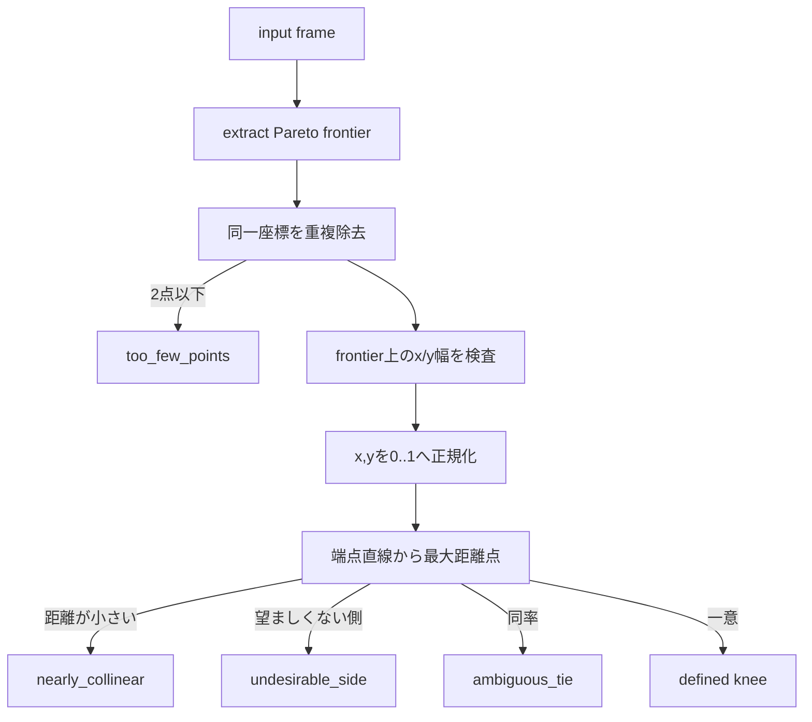

# `select_pareto_knee`

**Stability:** A
**定義:** `src/nn_compression/selection/pareto_knee.py`

## 責務

2目的とも小さいほど良い候補表からPareto frontierを抽出し、正規化した端点間の直線から一意で信頼できるkneeだけを返す。

## Signature
```python
select_pareto_knee(frame, *, x_column, y_column, tolerance=1e-9)
```

## 引数

- `frame`: 候補行を持つ非空`pandas.DataFrame`。変更しない。
- `x_column`: 第1の最小化目的を表す数値列名。
- `y_column`: 第2の最小化目的を表す数値列名。`x_column`と異なる必要がある。
- `tolerance`: 正規化座標での非負有限距離許容差。直線性と同率判定に使う。

## 戻り値

`ParetoKneeSelection`。定義できない場合も誤ったkneeを返さず、frontierと理由を返す。

## 使用場面

parameter数とvalidation errorなどのtrade-offから、rank候補の中心点を機械的に診断するとき。

## 処理概要



## 主なcontract / 注意事項

- 幅判定は入力全体ではなく、実際に正規化する重複除去後frontierに対して行う。
- 完全同一座標の複数行では入力中の先頭を代表とする。
- NaN/inf、空frame、列不足、不正toleranceは未定義結果ではなく例外。
- `aggressive/balanced/conservative`の命名、前後点採用、保存・plotは責務外。

## 関連API

`ParetoKneeSelection`, `extract_pareto_frontier`, `find_knee_point_numpy`
